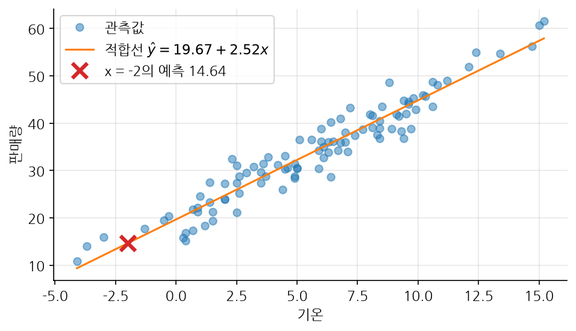
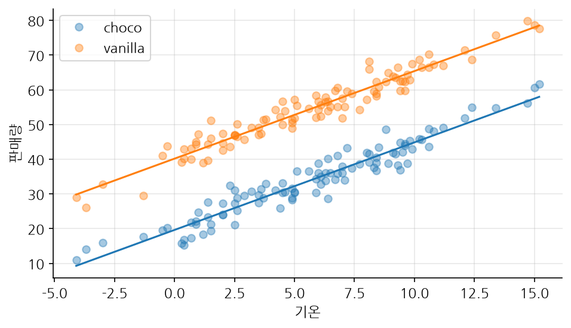
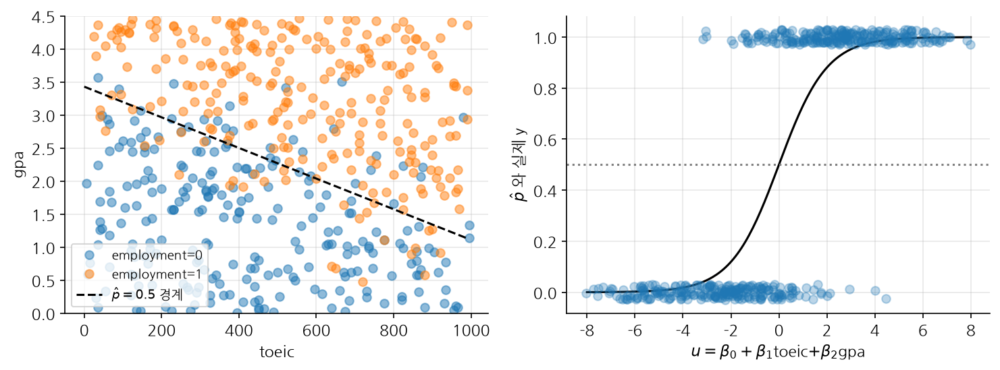

**선형회귀**(linear regression)는 $y \approx \beta_0 + \beta_1 x_1 + \cdots + \beta_p x_p$가 되도록 계수를 고르는 방법이고, **로지스틱 회귀**(logistic regression)는 같은 선형식을 시그모이드에 넣어 $y=1$일 확률을 만드는 방법이다. 반응변수가 연속형이면 앞의 것, 범주형이면 뒤의 것을 쓴다. 최소제곱과 최대가능도 추정의 이론은 [데이터 마이닝 - 선형회귀](/posts/dm-linear-regression)와 [데이터 마이닝 - 로지스틱 회귀](/posts/dm-logistic-regression)에 있고, 이 글은 [앞 글](/posts/ml-01-predictor)의 네 단계로 두 모형을 쓰고 결과를 읽는 데 집중한다.

## 선형회귀

### 추세선 찾기 게임

(강의 예제) 전주의 하루 평균기온 100개 $x_i$에 대해 아이스크림 판매량을

$$
y_i = 20 + 2.5\,x_i + \varepsilon_i, \qquad \varepsilon_i \sim N(0, 3^2)
$$

로 만든다. 기온이 $-2$도일 때 판매량을 묻는다면, 가장 가까운 관측치($x=-1.3$, $y=17.67$)를 답할 수도 있지만 관측치 하나에는 잡음이 섞여 있다. 자료 전체로 추세선을 긋고 그 위의 값을 답하는 편이 낫다. 원래 문제(임의의 $x$에 대해 $y$ 맞히기)가 숫자 두 개(20과 2.5)를 맞히는 문제로 바뀐다.

```python
X, y = df[['temp']], df['sales']
predictr = sklearn.linear_model.LinearRegression()
predictr.fit(X, y)
predictr.coef_, predictr.intercept_            # (array([2.5156]), 19.6671)
predictr.predict(pd.DataFrame({'temp': [-2.0]}))  # array([14.6359])
```



추정한 계수 2.516과 19.667은 참값 2.5와 20에 가깝다. 예측값은 $19.667 + 2.516 \times (-2) = 14.64$로, 가장 가까운 관측치 17.67보다 작다. 그 관측치는 잡음이 위로 튄 점이었다.

새 자료를 예측할 때도 `X`와 같은 열 이름을 가진 2차원 DataFrame을 넣는다. 수식으로 직접 계산한 값과 `predict`의 값은 같다.

### R²

회귀 모형의 `score`는 **결정계수** $R^2$다.

$$
R^2 = 1 - \frac{\sum_i (y_i - \hat y_i)^2}{\sum_i (y_i - \bar y)^2}
$$

분모는 모든 관측치를 평균 $\bar y$로 예측했을 때의 오차, 분자는 모형의 오차다. 1이면 완벽한 적합, 0이면 평균으로 찍은 것과 같다. 이 자료에서는 0.922다. 시험 자료에서 계산하면 평균보다 못한 모형은 **음수**도 나온다(4편).

## 범주형 설명변수

### 원핫 인코딩

같은 기온에서 바닐라가 초코보다 20만큼 더 팔리는 자료를 생각한다.

$$
\text{초코: } y = 20 + 2.5x + \varepsilon, \qquad \text{바닐라: } y = 40 + 2.5x + \varepsilon
$$

`type` 열의 값은 문자열이므로 그대로는 `fit`에 넣을 수 없다. 범주마다 0/1 열을 만드는 것이 **원핫 인코딩**(one-hot encoding)이고, `pd.get_dummies`가 해 준다.

| temp | type | → | temp | type_choco | type_vanilla |
|---|---|---|---|---|---|
| -4.1 | choco | | -4.1 | 1 | 0 |
| -4.1 | vanilla | | -4.1 | 0 | 1 |

### drop_first

모든 관측치에서 `type_choco + type_vanilla = 1`이고, 이것은 절편 열(모두 1)과 같다. 열 사이에 정확한 선형관계가 있으면 계수가 하나로 정해지지 않는다. 두 가지 처리 결과를 비교하면 다음과 같다.

| | 열 | 계수 | 절편 | $R^2$ |
|---|---|---|---|---|
| `get_dummies(X)` | temp, type_choco, type_vanilla | 2.522, −10.27, +10.27 | 29.90 | 0.9629 |
| `get_dummies(X, drop_first=True)` | temp, type_vanilla | 2.522, +20.54 | 19.63 | 0.9629 |

두 적합의 예측값과 $R^2$는 같다. 해석이 다를 뿐이다.

- `drop_first=True`: 초코가 기준이고 `type_vanilla`의 계수 20.54는 "같은 기온에서 바닐라가 초코보다 더 팔리는 양"이다. 참값 20을 바로 읽을 수 있다.
- 둘 다 남긴 경우: 계수가 하나로 정해지지 않는다. sklearn은 그중 계수 크기가 가장 작은 해(최소노름 해)를 돌려주므로 $-10.27$, $+10.27$로 나눠 갖는다. 차이 $10.27-(-10.27)=20.54$는 같다.

> **주의.** sklearn은 완전한 공선성이 있어도 오류 없이 답을 낸다. 예측에는 문제가 없지만 계수를 해석하려면 `drop_first=True`로 기준 범주를 정해야 한다. R의 `lm`은 이 경우 마지막 열의 계수를 `NA`로 둔다.



이 모형의 두 직선은 언제나 평행하다. 기울기도 범주마다 다르면 이 모형은 그것을 표현할 수 없고, 교호작용 항이 필요하다(6편).

### 계수의 해석: Medical Cost

미국 의료보험 청구액(`charges`, 1338명)을 나이, 성별, BMI, 자녀 수, 흡연 여부, 지역으로 설명한다.

```python
X = pd.get_dummies(df.drop(columns='charges'), drop_first=True)
y = df['charges']
predictr = sklearn.linear_model.LinearRegression().fit(X, y)
```

| 변수 | 계수 | 해석 (다른 변수가 같을 때) |
|---|---|---|
| age | 256.9 | 한 살 많으면 청구액 약 257달러 증가 |
| bmi | 339.2 | BMI 1 증가에 약 339달러 |
| children | 475.5 | 자녀 1명당 약 476달러 |
| sex_male | −131.3 | 남성이 여성보다 약 131달러 적음 |
| smoker_yes | 23848.5 | 흡연자가 비흡연자보다 약 2만 4천 달러 많음 |
| region_* | −353 ~ −1035 | 기준 지역(northeast)과의 차이 |

$R^2$는 0.751이다. 흡연 여부의 계수가 다른 변수들보다 두 자릿수 크다. 7편의 의사결정나무도 첫 분할로 흡연 여부를 고른다.

> **주의.** 계수의 크기로 변수의 중요도를 비교하면 안 된다. `age`는 한 살, `bmi`는 1 단위의 효과이므로 단위가 다르다. 중요도를 비교하려면 변수를 같은 척도로 맞춘 뒤(3편의 스케일링) 계수를 보거나, 특성 중요도(7편, 10편)를 쓴다.

## 로지스틱 회귀

### 시그모이드로 확률 만들기

(강의 예제) 토익과 학점으로 취업 여부(0/1)를 예측한다. 500명 중 51.2%가 취업했다. $y$가 범주형이면 predictor만 `LogisticRegression`으로 바꾼다.

```python
X, y = df[['toeic', 'gpa']], df['employment']
predictr = sklearn.linear_model.LogisticRegression().fit(X, y)
predictr.coef_, predictr.intercept_     # ([[0.005716, 2.4652]], [-8.4543])
predictr.score(X, y)                    # 0.882
```

예측값은 다음 두 단계로 나온다.

$$
u = -8.454 + 0.005716\,\text{toeic} + 2.465\,\text{gpa}, \qquad \hat p = \frac{1}{1 + e^{-u}}, \qquad \hat y = I(\hat p > 0.5)
$$

계수로 직접 계산한 $\hat p$는 `predict_proba(X)[:, 1]`과 기계 정밀도($4\times10^{-16}$)까지 같고, $I(\hat p > 0.5)$는 `predict(X)`와 500명 모두 일치한다. `predict_proba`는 범주별 확률을 열로 주므로 첫 열이 $P(y=0)$, 둘째 열이 $P(y=1)$이다.

| 메서드 | 돌려주는 것 | 처음 세 명 |
|---|---|---|
| `predict_proba(X)` | $(1-\hat p, \hat p)$ | (0.999, 0.001), (0.903, 0.097), (0.547, 0.453) |
| `predict(X)` | $I(\hat p > 0.5)$ | 0, 0, 0 |



$\hat p = 0.5$는 $u = 0$이므로 결정경계는 직선 $0.005716\,\text{toeic} + 2.465\,\text{gpa} = 8.454$다. 선형식은 경계를 정하고, 시그모이드는 경계에서 멀어질수록 확신이 커지게 만든다. 두 단계로 나누어 보면 로지스틱 회귀는 은닉층이 없는 신경망과 같다([딥러닝 - 출력층과 손실함수](/posts/dl-03-output-loss)).

계수는 로그 오즈로 읽는다. 토익이 100점 오르면 오즈가 $e^{100 \times 0.005716} = 1.77$배, 학점이 1 오르면 $e^{2.465} = 11.8$배가 된다. 토익과 학점 중 무엇이 중요한지는 이 숫자로 비교할 수 없다. 토익 100점과 학점 1점이 같은 노력이 아니기 때문이고, 이 질문이 3편 스케일링의 동기다.

정확도 0.882에서 더 올리려고 할 필요는 없다. 경계 근처에는 같은 점수인데 취업 여부가 다른 사람이 섞여 있고, 그 차이는 토익과 학점으로 설명되지 않는 운이다. 이것까지 맞히려는 것이 과적합(4편)이다.

### fit이 실패하는 이유: 타이타닉

타이타닉의 모든 열을 원핫 인코딩해 넣으면 다음 오류가 난다.

```python
X = pd.get_dummies(df.drop(columns=['PassengerId', 'Survived']))
sklearn.linear_model.LogisticRegression().fit(X, df['Survived'])
# ValueError: Input X contains NaN.
```

`df.isna().sum()`으로 보면 `Age` 177개, `Cabin` 687개, `Embarked` 2개가 비어 있다. 원인은 두 가지다.

| 문제 | 열 | 처리 |
|---|---|---|
| 결측치가 있다 | Age, Cabin, Embarked | 제외하거나 채운다 (3편) |
| 값이 거의 모두 다른 문자열이다 | Name (891종), Ticket (681종) | 원핫 인코딩하면 열이 1700개 넘게 생긴다. 제외한다 |

`Name`과 `Ticket`을 원핫 인코딩하면 891행에 1729열이 생긴다. 열마다 해당하는 사람이 한두 명뿐이라 생존과의 관계를 배울 수 없고, 이렇게 쓸모없는 열이 많으면 과적합된다(4편). 결측치가 없고 범주가 적은 `Pclass`, `Sex`, `SibSp`, `Parch`만 쓰면 학습 정확도 0.800으로 적합된다. 계수는 `Sex_female` +1.354, `Pclass` −0.923으로, 여성일수록 등급 숫자가 작을수록(1등급) 생존 확률이 높다.

## 비교

| | 선형회귀 | 로지스틱 회귀 |
|---|---|---|
| 반응변수 | 연속형 | 범주형 (이진) |
| sklearn | `LinearRegression` | `LogisticRegression` |
| 출력 | $\hat y = \mathbf x^\top\hat\beta$ | $\hat p = \sigma(\mathbf x^\top\hat\beta)$, $\hat y = I(\hat p > 0.5)$ |
| 계수 해석 | $x_j$ 1 증가 시 $y$의 변화 | $x_j$ 1 증가 시 로그 오즈의 변화 |
| `score` | $R^2$ | 정확도 |
| 추정 | 최소제곱 | 최대가능도 (기본으로 L2 벌점이 붙는다) |

마지막 행에 주의한다. sklearn의 `LogisticRegression`은 기본값이 `penalty='l2', C=1.0`인 **벌점 로지스틱 회귀**다. 그래서 계수가 R의 `glm(family=binomial)`과 조금 다르다. 순수한 최대가능도 추정을 원하면 `penalty=None`을 준다. 벌점의 의미는 5편에서 다룬다.

## 요약

| 개념 | 핵심 |
|---|---|
| 선형회귀 | `coef_`, `intercept_`로 추세선을 읽는다. `score`는 $R^2$ |
| 원핫 인코딩 | `pd.get_dummies`. 해석하려면 `drop_first=True` |
| 계수 해석 | 다른 변수가 같을 때의 효과. 단위가 다르면 크기를 비교하지 않는다 |
| 로지스틱 회귀 | 선형식 → 시그모이드 → 0.5 기준. `predict_proba`의 둘째 열이 $\hat p$ |
| fit 실패 | 결측치, 범주가 너무 많은 문자열 열 |

- 범주형 변수는 원핫 인코딩하면 선형모형에 들어간다. 다만 범주별로 절편만 달라지고 기울기는 같다.
- sklearn의 로지스틱 회귀는 기본으로 L2 벌점이 있다.

## 참고자료

- 최규빈, 「기계학습활용」 강의노트 (2023), <https://guebin.github.io/MP2023/>
- Kaggle, *Medical Cost Personal Datasets*, <https://www.kaggle.com/datasets/mirichoi0218/insurance>
- James, G., Witten, D., Hastie, T. and Tibshirani, R. (2021). *An Introduction to Statistical Learning* (2nd ed.), Sections 3.3.1, 4.3. Springer.
- scikit-learn User Guide, *1.1.1 Ordinary Least Squares*, *1.1.11 Logistic regression*.
