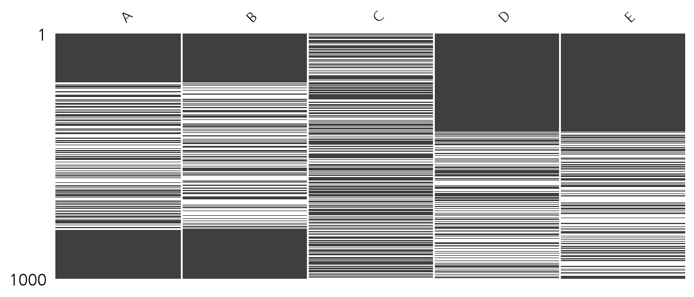
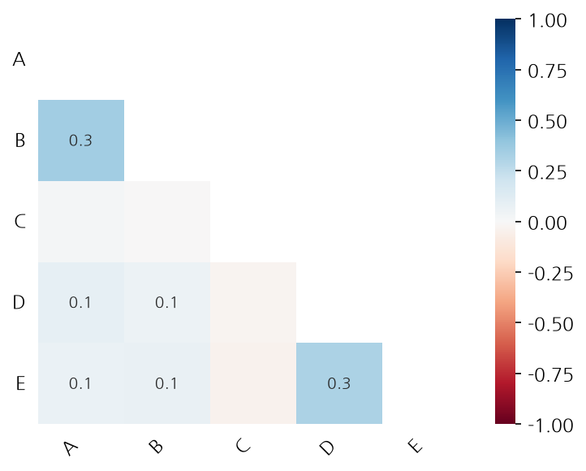

**결측치 대체**(imputation)는 비어 있는 값을 그럴듯한 값으로 채우는 일이고, **스케일링**(scaling)은 단위가 다른 변수들을 같은 범위로 맞추는 일이다. 둘 다 [앞 글](/posts/ml-02-linear-logistic)에서 본 "fit이 실패한다", "계수를 비교할 수 없다"는 문제에서 출발한다. 그리고 둘 다 sklearn에서 `fit`/`transform`을 가진 변환기(transformer)로 구현되어 있어서, 학습 자료와 시험 자료를 다루는 규칙이 같다.

## 결측치 파악

먼저 얼마나, 어떤 모양으로 비어 있는지 본다. `df.info()`나 `df.isna().sum()`이 열별 개수를 주고, `missingno` 패키지가 패턴을 그림으로 보여 준다.

| 함수 | 보여 주는 것 |
|---|---|
| `msno.bar(df)` | 열별 결측이 아닌 값의 수. `isna().sum()`의 막대그래프 |
| `msno.matrix(df)` | 행 × 열 격자에서 값이 있으면 검정, 없으면 흰색 |
| `msno.heatmap(df)` | 결측 여부(0/1) 사이의 상관계수 |
| `msno.dendrogram(df)` | 결측 패턴이 비슷한 열끼리 묶은 나무 |

(강의 예제) 1000행 5열의 모의 자료로 확인한다. 열마다 332~392개가 비어 있다.





A와 B는 같은 구간이 함께 비고(결측 상관 0.35), D와 E도 그렇다(0.32). C는 다른 열과 무관하게 흩어져 있다(상관 0.02 이하). 함께 비는 열들은 같은 원인(같은 설문 문항 묶음, 같은 장비)으로 빠졌을 가능성이 높다. 결측이 무작위인지 아닌지는 대체 방법의 타당성을 정한다. 무작위가 아니면(예: 소득이 높을수록 소득 문항을 비움) 평균 대체는 편향을 만든다.

> **주의.** 타이타닉처럼 결측이 몇 열에만 있는 자료에서는 bar, heatmap, dendrogram이 새로 알려 주는 것이 거의 없다. `isna().sum()` 한 줄이면 충분하다. 패턴 그림은 결측이 여러 열에 걸쳐 있을 때 쓴다.

## SimpleImputer

`sklearn.impute.SimpleImputer`는 열마다 하나의 값으로 결측을 채운다.

| `strategy` | 채우는 값 | 쓸 수 있는 자료 |
|---|---|---|
| `'mean'` (기본) | 열의 평균 | 수치형 |
| `'median'` | 열의 중앙값 | 수치형 |
| `'most_frequent'` | 최빈값 | 수치형, 범주형 |
| `'constant'` | `fill_value`로 준 값 (예: −999, `'missing'`) | 수치형, 범주형 |

열 `A = [2.1, 1.9, 2.2, NaN, 1.9]`의 빈칸은 전략에 따라 평균 2.025, 중앙값 2.0, 최빈값 1.9로 채워진다. 범주형에는 평균이 없으므로 최빈값이나 상수만 쓸 수 있다. 수치형과 범주형이 섞인 자료는 두 가지로 처리한다.

1. 모두 최빈값으로 채운다. 한 줄이면 되지만 연속형 변수의 최빈값은 의미가 약하다.
2. `select_dtypes`로 열을 나누어 수치형은 평균, 범주형은 최빈값으로 채운다.

```python
num = df.select_dtypes(include='number').columns
cat = df.select_dtypes(exclude='number').columns
df[num] = SimpleImputer(strategy='mean').fit_transform(df[num])
df[cat] = SimpleImputer(strategy='most_frequent').fit_transform(df[cat])
```

### fit과 transform

변환기는 predictor와 같은 구조를 가진다. `fit`은 채울 값(평균 등)을 계산해 `statistics_`에 저장하고, `transform`은 저장된 값으로 채운다. `fit_transform`은 둘을 한 번에 한다.

| | predictor | 변환기 (imputer, scaler) |
|---|---|---|
| 학습 | `fit(X, y)`: 계수를 추정 | `fit(X)`: 평균, 최솟값 등을 계산 |
| 적용 | `predict(XX)` | `transform(XX)` |
| 학습된 값 | `coef_` | `statistics_`, `data_min_`, `mean_` |

**시험 자료는 학습 자료에서 계산한 값으로 채운다.** 학습 자료의 평균 나이가 29.26세라면 시험 자료의 빈 나이도 29.26세로 채운다. 시험 자료에서 평균을 다시 구하면 학습 때와 다른 규칙으로 변환하는 것이 된다.

### 타이타닉에 적용

[앞 글](/posts/ml-02-linear-logistic)에서 결측 때문에 뺐던 `Age`, `Embarked`와 `Fare`를 채워서 넣는다. `Cabin`은 77%가 비어 있어 채우는 것이 무의미하므로 뺀다.

```python
num_imp = SimpleImputer(strategy='mean').fit(tr[['Age', 'Fare']])
cat_imp = SimpleImputer(strategy='most_frequent').fit(tr[['Embarked']])
# 학습 자료와 시험 자료에 같은 num_imp, cat_imp의 transform을 적용한 뒤 get_dummies
```

| 설명변수 | 학습 정확도 | 시험 정확도 |
|---|---|---|
| Pclass, Sex, SibSp, Parch | 0.796 | 0.810 |
| 위 + Age, Fare, Embarked (대체) | 0.799 | 0.810 |

7:3으로 나눈 이 분할에서는 변수를 셋 더해도 시험 정확도가 그대로다. 나이와 운임의 정보 상당 부분이 등급(`Pclass`)에 이미 들어 있기 때문으로 보인다. 결측이 있는 행을 지우는(`dropna`) 방법을 썼다면 학습 자료 623행 중 498행만 남았을 것이다. 대체는 행을 잃지 않는다는 데 의미가 있다.

## 스케일링

### 왜 맞추는가

[앞 글](/posts/ml-02-linear-logistic)의 취업 예측에서 계수는 토익 0.0057, 학점 2.47이었다. 토익의 범위는 0~990, 학점은 0~4.5라서 계수 크기로 무엇이 중요한지 말할 수 없다. 두 변수를 같은 범위로 맞추고 다시 적합하면 비교할 수 있다.

| 변환 | toeic 계수 | gpa 계수 | 정확도 |
|---|---|---|---|
| 원자료 | 0.0057 | 2.465 | 0.882 |
| MinMaxScaler | 3.14 | 6.76 | 0.880 |
| StandardScaler | 1.46 | 3.08 | 0.880 |

어느 척도로 맞춰도 학점의 계수가 토익의 2배쯤이다. 정확도가 0.882에서 0.880으로 조금 바뀐 것은 sklearn 로지스틱 회귀의 기본 L2 벌점 때문이다. 벌점은 계수 크기에 걸리므로 척도가 바뀌면 적합 결과도 바뀐다. **벌점이 있는 모형(릿지, 라쏘, 5편)과 거리 기반 모형(k-NN, SVM), 신경망은 스케일링이 결과를 바꾸고, 벌점 없는 선형회귀와 나무 모형은 바꾸지 않는다.**

### 두 가지 변환

$$
\text{MinMax: } z = \frac{x - \min(x)}{\max(x) - \min(x)}, \qquad \text{Standard: } z = \frac{x - \bar x}{s_x}
$$

`StandardScaler`의 $s_x$는 $n$으로 나눈 표준편차(`ddof=0`)다. pandas의 `std()` 기본값(`ddof=1`)과 다르므로 손으로 확인할 때 주의한다.

| | MinMaxScaler | StandardScaler |
|---|---|---|
| 결과 범위 | 학습 자료에서는 [0, 1] | 범위 제한 없음, 평균 0·분산 1 |
| 쓰는 통계량 | 최솟값, 최댓값 | 평균, 표준편차 |
| 어울리는 곳 | 입력 범위가 정해진 신경망, 이미지(0~255 → 0~1) | 벌점 회귀, PCA, 정규분포를 가정하는 방법 |
| 이상치 하나에 대한 반응 | 최댓값이 바뀌어 나머지가 0 근처로 눌림 | 평균과 표준편차가 함께 끌려가 역시 눌림 |

마지막 행을 확인해 보면, $x = (1, 2, 3, 4, 5, 100)$에서 MinMax는 앞의 다섯 값을 0~0.04로, Standard는 −0.50~−0.39로 누른다. 두 방법 모두 이상치에 민감하다. 이상치에 강한 변환이 필요하면 중앙값과 사분위범위를 쓰는 `RobustScaler`를 쓴다. 같은 자료에서 다섯 값이 −1.0~0.6으로 고르게 퍼진다. 둘 중 무엇을 고를지에 대한 이론적 기준은 대부분의 경우 없으며, 둘 다 해 보고 시험 점수로 정해도 된다.

### 학습 자료와 시험 자료의 스케일링

학습 자료 $X = (1, 2, 3, 4, 5)$, 시험 자료 $XX = (1.5, 2.5, 3.5)$로 세 가지 방법을 비교한다.

| 방법 | 코드 | $X$ 변환 | $XX$ 변환 | 판정 |
|---|---|---|---|---|
| 따로 fit | `minmax_scale(X)`, `minmax_scale(XX)` | 0, 0.25, …, 1 | 0, 0.5, 1 | 비효율 |
| 학습 자료로 fit | `s.fit(X)`, `s.transform(XX)` | 0, 0.25, …, 1 | 0.125, 0.375, 0.625 | 올바름 |
| 합쳐서 fit | `minmax_scale(concat([X, XX]))` | | | 정보누수 |

- **따로 fit**하면 시험 자료의 1.5가 0이 되어 학습 자료의 1과 같은 값이 된다. 같은 숫자가 두 자료에서 다른 뜻을 갖게 되므로 학습한 관계를 제대로 적용할 수 없다. 규칙 위반은 아니지만 예측을 망친다.
- **학습 자료로 fit**하면 시험 자료의 값은 [0, 1]을 벗어날 수 있다. $X = (1, 2, 3, 4, 3.5)$, $XX = (1.5, 2.5, 5)$이면 5는 1.33이 된다. 정상이다.
- **합쳐서 fit**하면 시험 자료의 최댓값 5가 학습 자료의 변환에 영향을 준다. 학습 단계에서 시험 자료의 정보를 본 것이고, 이것을 **정보누수**(data leakage)라고 한다. 대회에서는 실격 사유다.

> **주의.** 결측치 대체도 같다. 시험 자료를 포함한 전체 평균으로 채우면 정보누수다. 학습 자료에서 `fit`(또는 `fit_transform`), 시험 자료에는 `transform`만 쓴다. 이 규칙을 자동으로 지키게 해 주는 도구가 `sklearn.pipeline.Pipeline`이다. 교차검증 안에서 fold마다 변환기를 다시 fit해야 할 때 특히 필요하다([데이터 마이닝 - 리샘플링](/posts/dm-resampling)).

변환한 값을 원래 단위로 되돌릴 때는 `s.inverse_transform(Z)`를 쓴다. 객체(`MinMaxScaler`)는 학습된 최솟값·최댓값을 기억하므로 이것이 가능하지만, 함수(`minmax_scale`)는 기억하지 않는다. 함수형이 더 짧은데도 객체형을 쓰는 이유다.

## 요약

| 작업 | 도구 | 학습 자료 | 시험 자료 |
|---|---|---|---|
| 결측 파악 | `isna().sum()`, `msno.matrix` | | |
| 결측 대체 | `SimpleImputer(strategy=...)` | `fit_transform` | `transform` |
| 스케일링 | `MinMaxScaler`, `StandardScaler`, `RobustScaler` | `fit_transform` | `transform` |

- 수치형은 평균·중앙값, 범주형은 최빈값·상수로 채운다. 결측이 대부분인 열은 뺀다.
- 스케일링은 벌점 모형, 거리 기반 모형, 신경망에서 결과를 바꾼다. 나무 모형에는 필요 없다.
- MinMax와 Standard 모두 이상치에 민감하다. 이상치가 있으면 `RobustScaler`.
- 변환기는 학습 자료에서만 fit한다. 시험 자료로 fit하면 정보누수다.

## 참고자료

- 최규빈, 「기계학습활용」 강의노트 (2023), <https://guebin.github.io/MP2023/>
- Bilogur, A. (2018). Missingno: a missing data visualization suite. *Journal of Open Source Software*, 3(22), 547.
- scikit-learn User Guide, *6.3 Preprocessing data*, *6.4 Imputation of missing values*, *Common pitfalls: Data leakage*.
- Little, R. J. A. and Rubin, D. B. (2019). *Statistical Analysis with Missing Data* (3rd ed.), Chapter 1. Wiley.
