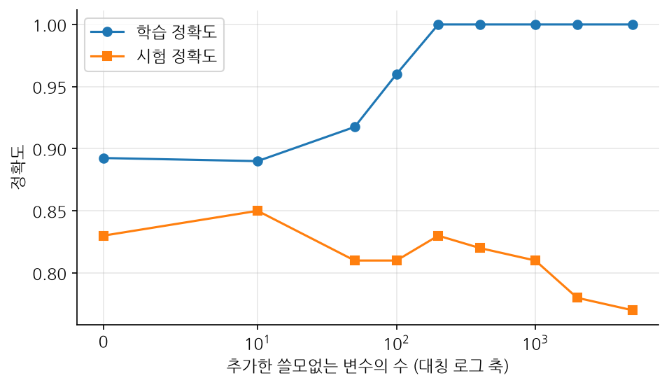
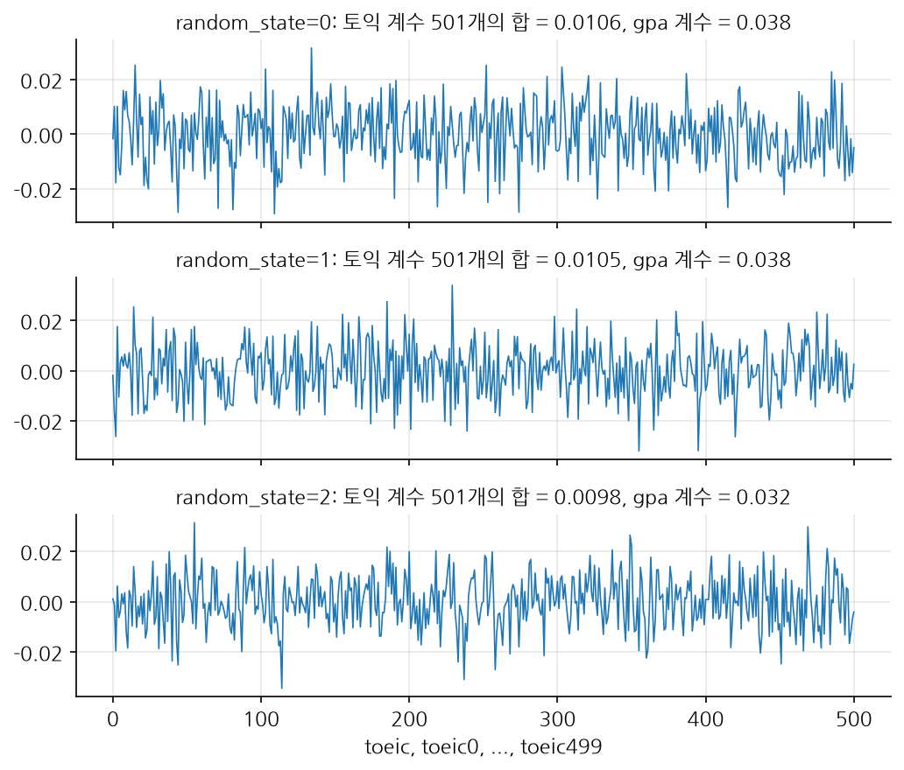
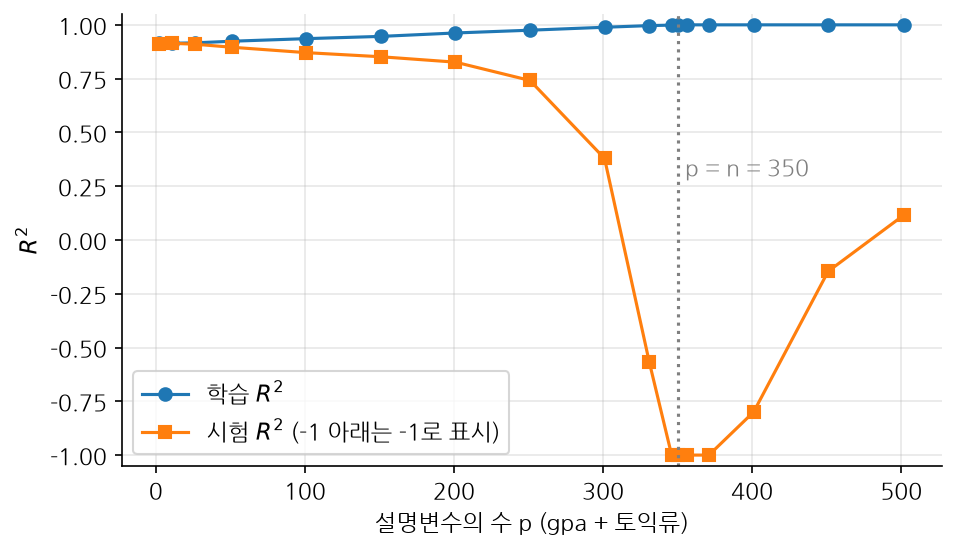

**과적합**(overfitting)은 모형이 학습 자료의 반응을 만든 규칙(underlying)이 아니라 그 자료에만 있는 오차까지 맞춰서, 학습 점수는 높은데 새 자료의 점수는 낮아지는 현상이다. **다중공선성**(multicollinearity)은 설명변수들이 서로 거의 선형관계에 있는 상황이고, 과적합을 일으키는 대표적인 원인이다. [앞 글들](/posts/ml-02-linear-logistic)에서 "변수가 많을수록 좋지 않을까"라고 물을 수 있는데, 이 글의 답은 "쓸모없는 변수는 학습을 방해한다"이다. 이론적 배경은 [데이터 마이닝 - 리샘플링](/posts/dm-resampling)의 편향-분산 절충과 같다.

## 과적합: 쓸모없는 변수가 많을 때

### 밸런스 게임 변수

(강의 예제) 취업 여부를 10명에 대해 알고, 각 사람에게 "부먹/찍먹", "민트초코 좋아함/싫어함" 같은 0/1 질문(밸런스 게임)을 50개 했다고 하자. 질문의 답은 취업과 아무 관계가 없다. 그런데 앞의 7명을 학습 자료로 보면, 50개 질문 중 2개는 7명의 취업 여부와 **정확히 일치**한다. 이 질문으로 나머지 3명을 예측하면 하나는 1/3, 다른 하나는 2/3를 맞힌다. 우연히 맞았던 규칙이 새 자료에서는 동전 던지기 수준이 된다.

질문 수가 늘면 우연히 맞는 규칙은 반드시 생긴다. 실제 취업 자료(500명, 토익·학점)에 이런 0/1 무작위 변수를 $k$개 붙여 400명으로 로지스틱 회귀를 학습하고 100명으로 시험했다.

| 추가한 변수 | 0 | 10 | 100 | 200 | 1000 | 5000 |
|---|---|---|---|---|---|---|
| 학습 정확도 | 0.893 | 0.890 | 0.960 | 1.000 | 1.000 | 1.000 |
| 시험 정확도 | 0.83 | 0.85 | 0.81 | 0.83 | 0.81 | 0.77 |

변수를 200개 넣으면 400명을 전부 맞힌다. 하지만 토익과 학점으로 설명되지 않는 부분은 원래 운(오차)이므로, 이것을 맞힌 규칙은 시험 자료에서 쓸모가 없다. 시험 정확도는 0.83에서 0.77로 내려간다. 시험 자료가 100명뿐이라 0.01은 한 명이고, 10~200개 구간의 등락은 우연의 범위다. 하지만 5000개에서의 하락은 분명하다.

> **주의.** 학습 점수가 시험 점수보다 높다는 것만으로 과적합이라고 할 수는 없다. 6편의 이상치 예처럼 학습 점수가 높은 다른 이유도 있다. 과적합의 핵심은 **오차를 적합하고 있는가**이고, 시험 점수의 하락은 그 결과다.

### 일상의 비유

- 시험 공부: 원리를 이해하지 않고 모의고사 답을 외웠다. 모의고사는 만점이지만 문제가 조금 바뀌면 틀린다.
- 운전 연습: 한 도로에서만 연습해서 그 도로의 구멍과 신호 위치까지 외웠다. 다른 도로에서는 서툴다.
- 시험 전날: 이미 충분히 공부했다면 더 공부해도 학습 오차만 줄어든다.

## 다중공선성: 거의 같은 변수가 많을 때

쓸모없는 변수에는 두 종류가 있다.

| | 경우 1: 정말 무관한 변수 | 경우 2: 대체 가능한 변수 |
|---|---|---|
| 예 | 부먹/찍먹 | 토익과 거의 같은 다른 영어 시험 점수 |
| $\text{corr}(y, X_j)$ | 0에 가깝다 | 높다 |
| $\text{corr}(X_j, X_k)$ | 낮다 | 매우 높다 |
| 이름 | (불필요한 변수) | 다중공선성 |

둘 다 과적합을 일으킨다. 경우 2는 각 변수가 혼자서는 쓸모 있어 보여서 상관계수만으로 걸러내기 어렵다.

### 유사 토익 500개

(강의 예제) 500명의 학점, 토익, 그리고 토익과 거의 같은 시험 점수 `toeic0`~`toeic499`가 있다. 각 유사 토익은 토익에 표준편차 9 정도의 작은 잡음을 더한 값으로, 토익과의 상관이 0.999다. 반응은 토익과 학점으로만 만든다.

$$
\text{score} = 1.0 \times \text{gpa} + 0.01 \times \text{toeic} + \varepsilon, \qquad \varepsilon \sim N(0, 1)
$$

참 계수는 gpa 1.0, toeic 0.01이고 유사 토익 500개는 모두 0이다. 7:3으로 나눠(학습 350명) 선형회귀로 적합한다.

| 설명변수 | 학습 $R^2$ | 시험 $R^2$ | 계수 |
|---|---|---|---|
| gpa, toeic (정답을 아는 경우) | 0.913 | 0.913 | gpa 0.972, toeic 0.0101 |
| gpa, toeic0 | 0.912 | 0.912 | gpa 0.981, toeic0 0.0101 |
| gpa만 | 0.132 | 0.154 | gpa 0.877 |
| 전부 (502개) | **1.000** | **0.117** | gpa 0.035, toeic 0.0027, … |

정답 변수 대신 `toeic0`을 써도 거의 똑같이 좋다. 그런데 전부 넣으면 학습 자료는 완벽하게 맞히고 시험 자료에서는 학점 하나만 쓴 모형보다도 못하다.

### 계수가 불안정하다

학습·시험 분할만 바꿔 세 번 적합하고 토익류 계수 501개를 그렸다.

- 개별 계수는 −0.03~0.03 사이에서 제멋대로이고, 분할마다 완전히 다르다. 음수 계수는 "이 시험 점수가 오르면 취업 점수가 내려간다"는 뜻이 되어 해석할 수 없다.
- 그러나 **계수의 합은 매번 0.01 근처**다(0.0106, 0.0105, 0.0098). 501개의 열이 거의 같은 값이므로 $\sum_j \beta_j \cdot \text{toeic}_j \approx (\sum_j \beta_j)\cdot\text{toeic}$이고, 합만 0.01이면 예측은 거의 같다. 합 0.01을 501개에 나누는 방법은 무수히 많고, 자료의 작은 잡음이 그중 하나를 고른다.

이것이 다중공선성의 특징이다. **예측에 쓰이는 조합(계수의 합)은 안정적이지만 개별 계수는 불안정하다.** 개별 계수의 분산이 크다는 것을 선형대수로 쓰면 $\mathbf X^\top\mathbf X$의 가장 작은 고윳값이 0에 가깝다는 것이고, 최소제곱 해의 분산 $\sigma^2(\mathbf X^\top\mathbf X)^{-1}$이 그 역수만큼 커진다([선형대수 - 특잇값 분해와 주성분분석](/posts/la-svd)).

### 변수 수가 표본 수에 다가갈 때

시험 $R^2$ 0.117이 어디서 나왔는지 보려고, gpa와 토익에 유사 토익을 하나씩 더하며 적합했다.

| $p$ | 2 | 51 | 201 | 301 | 346 | 350 | 401 | 502 |
|---|---|---|---|---|---|---|---|---|
| 학습 $R^2$ | 0.913 | 0.924 | 0.962 | 0.989 | 0.999 | 1.000 | 1.000 | 1.000 |
| 시험 $R^2$ | 0.913 | 0.896 | 0.827 | 0.379 | −2.34 | −82.2 | −0.80 | 0.117 |

- $p$가 커질수록 학습 $R^2$는 올라가고 시험 $R^2$는 내려간다. 과적합의 전형이다.
- 절편(`fit_intercept=True`)을 포함하면 미지수는 $p + 1$개이므로 $p + 1 = n$, 즉 $p = 349$($p \approx n = 350$ 부근)에서 방정식의 수와 미지수의 수가 같아져 해가 정확히 하나가 되고, 그 해는 잡음까지 그대로 통과하느라 계수가 폭발한다. 시험 $R^2 = -82.2$는 $1 - R^2 = 83.2$이므로 평균으로 찍는 것보다 약 83배 나쁘다는 뜻이다.
- $p > n$이면 학습 자료를 정확히 맞히는 해가 무수히 많고, sklearn은 그중 계수 크기가 가장 작은 해를 고른다. 이 선택이 일종의 규제 역할을 해서 시험 $R^2$가 다시 올라간다. 502개에서 학점 계수가 0.035로 작아진 것도 이 최소노름 해의 결과로, 학점의 효과까지 토익류 열들의 작은 차이로 나누어 표현되었다.

이 곡선은 이중 하강(double descent)이라고 불리는 현상과 같은 모양이다. 실용적인 결론은 단순하다. **학습 표본 수보다 변수가 많거나 비슷하면 보통의 선형회귀는 쓸 수 없다.**

## 대처

| 방법 | 내용 | 다루는 곳 |
|---|---|---|
| 변수 선택 | $\text{corr}(y, X)$로 무관한 변수를, $\text{corr}(X, X)$ 히트맵으로 중복 변수를 걸러낸다 | 6편 |
| 변수 합치기 | 중복 변수를 하나로 만든다. 예: `Fsize = SibSp + Parch + 1` 후 원래 둘은 뺀다 | |
| 차원 축소 | PCA로 공선성 있는 변수들을 소수의 성분으로 바꾼다 | [데이터 마이닝 - 주성분분석](/posts/dm-pca) |
| 벌점 회귀 | 계수가 제멋대로 커지지 못하게 벌점을 준다 (릿지, 라쏘) | 5편 |
| 나무 모형 | 한 번에 변수 하나로만 나누므로 덜 흔들린다 | 7편 |
| 자료 더 모으기 | $n$을 키운다. 가장 확실하지만 변수가 많으면 필요한 $n$이 급격히 커진다(차원의 저주) | |

## 비교

| | 과소적합 (underfitting) | 적절 | 과적합 (overfitting) |
|---|---|---|---|
| 모형이 맞히는 것 | 규칙의 일부 | 규칙 | 규칙 + 오차 |
| 학습 점수 | 낮음 | 높음 | 매우 높음 (종종 완벽) |
| 시험 점수 | 낮음 | 높음 | 낮음 |
| 예 | gpa만 사용 ($R^2$ 0.13) | gpa + toeic (0.91) | 502개 전부 (학습 1.0, 시험 0.12) |
| 대처 | 변수·교호작용 추가, 더 유연한 모형 | | 변수 정리, 벌점, 더 많은 자료 |

## 요약

- 과적합은 오차를 적합하는 것이다. 학습 점수와 시험 점수의 차이로 드러난다.
- 무관한 변수가 많으면 우연히 맞는 규칙이 생긴다. 변수 수가 표본 수에 다가가면 학습 자료는 반드시 완벽하게 맞는다.
- 다중공선성에서는 개별 계수가 불안정하고 해석할 수 없지만 계수의 합은 안정적이다.
- $p \approx n$ 근처에서 시험 성능이 가장 나쁘다. 보통의 선형회귀는 $p \ll n$일 때만 쓴다.

## 참고자료

- 최규빈, 「기계학습활용」 강의노트 (2023), <https://guebin.github.io/MP2023/>
- James, G., Witten, D., Hastie, T. and Tibshirani, R. (2021). *An Introduction to Statistical Learning* (2nd ed.), Sections 2.2, 3.3.3, 6.4, 10.8. Springer.
- Belkin, M., Hsu, D., Ma, S. and Mandal, S. (2019). Reconciling modern machine-learning practice and the classical bias–variance trade-off. *PNAS*, 116(32), 15849–15854.
