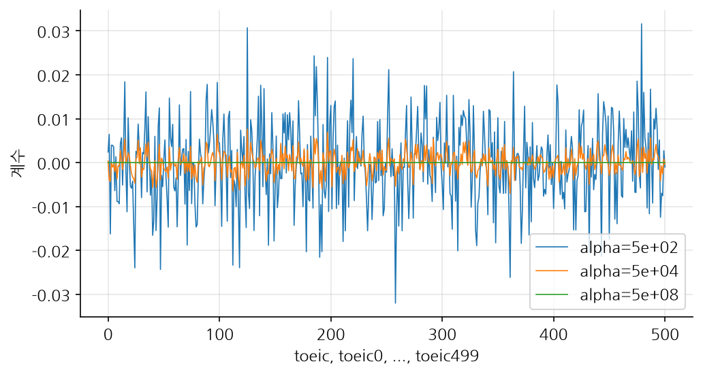
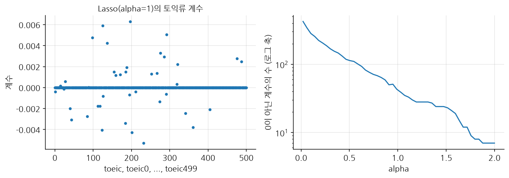
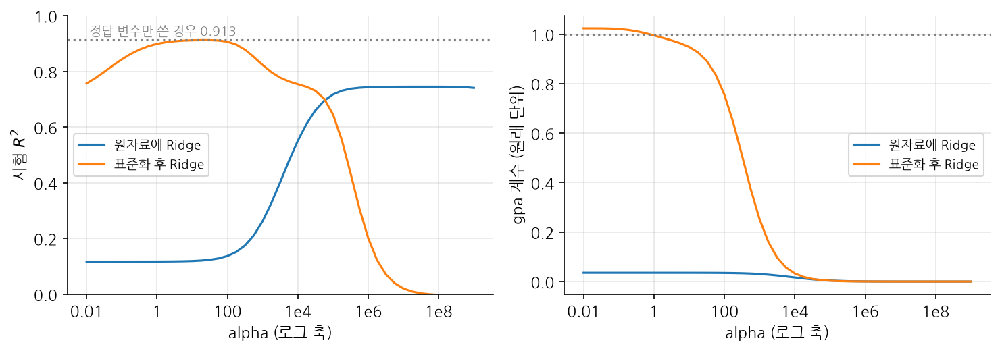

**릿지**(ridge)와 **라쏘**(lasso)는 최소제곱 목적함수에 계수 크기에 대한 벌점을 더한 회귀다. 릿지는 계수 제곱합(L2 노름), 라쏘는 계수 절댓값 합(L1 노름)에 벌점을 준다. [앞 글](/posts/ml-04-overfitting-collinearity)에서 유사 토익 500개가 있으면 "계수 합 0.01을 501개에 나누는 방법"이 무수히 많아 계수가 제멋대로가 되었다. 벌점은 그중 하나를 고르는 규칙이다. 추정량의 성질과 유도는 [데이터 마이닝 - 변수선택과 정규화: Ridge, Lasso, PCR](/posts/dm-regularization)에 있고, 이 글은 같은 자료에서 둘이 어떻게 다르게 행동하는지를 본다.

## 두 가지 규칙

$$
\text{Ridge: } \min_\beta \; \|\mathbf y - \mathbf X\beta\|_2^2 + \alpha\sum_j \beta_j^2, \qquad
\text{Lasso: } \min_\beta \; \frac{1}{2n}\|\mathbf y - \mathbf X\beta\|_2^2 + \alpha\sum_j |\beta_j|
$$

$\alpha \ge 0$는 벌점의 세기다. $\alpha = 0$이면 보통의 최소제곱이고, 클수록 계수가 0 쪽으로 줄어든다. 절편은 벌점을 받지 않는다. sklearn에서 릿지는 오차 제곱합을 그대로, 라쏘는 $1/(2n)$을 곱해서 쓰므로 **같은 $\alpha$라도 두 모형에서 뜻이 다르다.**

토익 계수 합 0.01을 501개 변수가 어떻게 나누는지로 두 규칙을 직관적으로 보면 다음과 같다.

| | 릿지 (L2) | 라쏘 (L1) |
|---|---|---|
| 벌점 | $\sum_j \beta_j^2$ | $\sum_j \lvert\beta_j\rvert$ |
| 합이 0.01로 같을 때 벌점이 가장 작은 배분 | 501개에 똑같이 $0.01/501$씩 | 어떻게 나눠도 같음 (부호가 같으면) |
| 결과 | 비슷한 변수들이 계수를 **나눠 갖는다** | 소수의 변수만 **남기고** 나머지는 정확히 0 |
| 변수 선택 | 안 한다 | 한다 |

$x_1 \approx x_2$이고 $\beta_1 + \beta_2 = c$로 정해져 있을 때 $\beta_1^2 + \beta_2^2$는 $\beta_1 = \beta_2 = c/2$에서 최소다. 그래서 릿지는 나눠 갖는다. 절댓값 합은 둘 사이의 배분에 무관하므로 라쏘는 오차를 조금이라도 더 줄이는 쪽으로 몰아주고, 벌점의 꼭짓점(좌표축 위)에서 해가 잡혀 나머지 계수가 정확히 0이 된다.

## 릿지

(강의 예제) [앞 글](/posts/ml-04-overfitting-collinearity)의 자료를 그대로 쓴다. 학습 350명, 설명변수 502개(gpa, toeic, toeic0~toeic499), 참 계수는 gpa 1.0, toeic 0.01.

```python
predictr = sklearn.linear_model.Ridge(alpha=5e8)
predictr.fit(X, y)
```

| $\alpha$ | 학습 $R^2$ | 시험 $R^2$ | 토익류 계수 합 | 토익류 계수 표준편차 |
|---|---|---|---|---|
| 0 (선형회귀) | 1.000 | 0.117 | | |
| 1 | 1.000 | 0.117 | 0.0103 | $1.0\times10^{-2}$ |
| $5\times10^{4}$ | 0.897 | 0.689 | 0.0099 | $2.5\times10^{-3}$ |
| $5\times10^{6}$ | 0.756 | 0.745 | 0.0099 | $5.2\times10^{-5}$ |
| $5\times10^{8}$ | 0.751 | 0.744 | 0.0095 | $5.3\times10^{-7}$ |
| $10^{12}$ | 0.019 | 0.014 | 0.0001 | |



- $\alpha$가 커질수록 토익류 계수의 퍼짐(표준편차)이 줄어든다. $\alpha = 5\times10^8$에서 501개 계수는 모두 약 $1.9\times10^{-5}$로, $0.01/501 = 2.0\times10^{-5}$과 거의 같다. 위 표의 "똑같이 나눠 갖기"다.
- 계수 합은 0.01 근처를 유지하다가 $\alpha$가 매우 커지면 줄어든다. 벌점이 합 자체를 0 쪽으로 끌어당기는 수축(shrinkage)이다. $\alpha = 10^{12}$에서는 합이 0.0001로 줄어 모형이 거의 상수가 된다. $\alpha$는 클수록 좋은 것이 아니다.
- 계수 제곱합은 $\sum_j \beta_j^2 = p(\text{Var}(\beta) + \bar\beta^2)$이다. 평균이 정해져 있으면 계수의 분산을 줄이는 것과 같아서, 릿지의 벌점을 "계수들이 서로 비슷해지라는 압력"으로 읽어도 된다.

시험 $R^2$는 0.117에서 0.745까지 오르지만, 정답 변수만 쓴 0.913에는 한참 못 미친다. 이유는 아래 표준화 절에서 본다.

## 라쏘

```python
predictr = sklearn.linear_model.Lasso(alpha=1)
predictr.fit(X, y)          # 학습 0.860, 시험 0.828, 0이 아닌 계수 41개
```



| $\alpha$ | 0이 아닌 계수 | 학습 $R^2$ | 시험 $R^2$ | 토익류 계수 합 | gpa 계수 |
|---|---|---|---|---|---|
| 0.01 | 474 | 1.000 | 0.618 | 0.0105 | 0.81 |
| 0.1 | 281 | 0.991 | 0.800 | 0.0102 | 0.75 |
| 0.5 | 113 | 0.935 | 0.855 | 0.0100 | 0.56 |
| 1 | 41 | 0.860 | 0.828 | 0.0099 | 0.30 |
| 2 | 7 | 0.756 | 0.743 | 0.0099 | 0 |

$\alpha$가 커질수록 남는 변수가 줄고, 남은 변수들의 계수 합은 여전히 0.01 근처다. "토익 하나면 충분한데 `toeic0`을 써도 괜찮다"는 것이 라쏘의 발상이다. 계수가 0이면 그 변수를 뺀 것과 같으므로 라쏘는 적합과 변수 선택을 동시에 한다. 같은 자료에서 라쏘의 최고 시험 $R^2$(0.855)가 릿지(0.745)보다 높다. 참 모형이 소수의 변수로 되어 있으면 라쏘가 유리하다.

그런데 표의 마지막 열이 이상하다. 참값이 1.0인 gpa 계수가 $\alpha$와 함께 줄어 $\alpha = 2$에서 아예 0이 된다. 릿지에서도 gpa 계수는 0.035에서 0.000으로 줄었다.

## 표준화하고 벌점을 준다

벌점 $\alpha\sum_j \beta_j^2$는 모든 계수를 같은 잣대로 잰다. 그런데 계수의 크기는 변수의 단위에 따라 정해진다. 이 자료에서 표준편차는 gpa 1.28, toeic 272다. gpa가 반응에 주는 효과(1.0 × 1.28)를 내려면 계수가 1.0이어야 하지만, 토익류는 계수 0.0047(≈ 1.28/272)만으로 같은 크기의 효과를 낸다. 같은 효과에 대해 gpa가 훨씬 큰 벌점을 받으니 벌점 모형은 gpa를 먼저 버린다. 릿지가 0.745에서 멈춘 이유는 학점의 정보를 잃었기 때문이다.

변수를 표준화([3편](/posts/ml-03-missing-scaling))한 뒤 벌점을 주면 모든 계수가 "표준편차 1 증가당 효과"로 같은 단위가 된다.

```python
predictr = sklearn.pipeline.make_pipeline(
    sklearn.preprocessing.StandardScaler(),
    sklearn.linear_model.Ridge(alpha=...))
```



| 방법 | 고른 $\alpha$ | 시험 $R^2$ | gpa 계수 | 남은 변수 |
|---|---|---|---|---|
| 정답 변수만 (선형회귀) | | 0.913 | 0.972 | 2 |
| 원자료 + RidgeCV | $5\times10^{7}$ | 0.745 | 0.000 | 502 |
| 원자료 + LassoCV | 0.731 (격자의 끝) | 0.846 | | 75 |
| 표준화 + RidgeCV | 13.7 | 0.912 | 0.937 | 502 |
| 표준화 + LassoCV | 0.0058 | 0.914 | 0.972 | 7 |

표준화하면 릿지도 라쏘도 정답 변수만 쓴 모형과 같은 시험 점수를 낸다. 라쏘는 502개 중 7개(gpa와 토익류 6개)만 남기고 gpa 계수 0.972를 정확히 찾는다. 원자료의 LassoCV는 $\alpha$ 후보 격자의 가장 작은 값을 골랐는데, 격자가 원자료의 단위에 맞지 않았다는 신호다.

> **주의.** 벌점 회귀에는 표준화가 사실상 필수다. sklearn의 `Ridge`, `Lasso`는 R의 `glmnet`과 달리 내부에서 표준화하지 않는다. 그리고 표준화는 [3편](/posts/ml-03-missing-scaling)의 규칙대로 학습 자료에서만 fit해야 하므로 `Pipeline`으로 묶는다.

## α 고르기: RidgeCV와 LassoCV

$\alpha$는 자료에서 추정되는 모수가 아니라 분석가가 정하는 **하이퍼파라미터**다. 시험 자료로 고르면 시험 자료를 학습에 쓴 것이 되므로, 학습 자료 안에서 교차검증으로 고른다([데이터 마이닝 - 리샘플링](/posts/dm-resampling)).

| | 후보 지정 | 기본 검증 방식 | 결과 |
|---|---|---|---|
| `RidgeCV(alphas=[...])` | 직접 준다 | 효율적인 LOOCV | `alpha_` |
| `LassoCV(cv=5)` | 자동 격자 (최대값의 $10^{-3}$배까지 100개) | 5겹 교차검증 | `alpha_`, `alphas_`, `mse_path_` |

CV 버전은 고른 $\alpha$로 전체 학습 자료에 다시 적합하므로, 이후에는 보통의 predictor처럼 `predict`와 `score`를 쓴다.

## 로지스틱 회귀에서의 L1

벌점은 로지스틱 회귀에도 붙는다. sklearn은 $\alpha$ 대신 그 역수 $C = 1/\alpha$를 쓰므로 **$C$가 작을수록 벌점이 세다.** [2편](/posts/ml-02-linear-logistic)에서 말했듯 기본값은 L2, $C=1$이다.

(강의 예제) 취업 자료에 무작위 변수 3개(`balance0~2`)를 붙인다. 반응과의 상관은 toeic 0.26, gpa 0.71, balance 셋은 −0.007~0.037이다.

```python
# 여기서는 설명을 간결하게 하기 위해 원자료 X를 그대로 사용했다 (실전에서는 make_pipeline(StandardScaler(), ...) 사용)
predictr = sklearn.linear_model.LogisticRegressionCV(
    Cs=[0.1, 1, 10, 100], penalty='l1', solver='liblinear', random_state=42)
predictr.fit(X, y)
predictr.C_, predictr.coef_     # [0.1], [[0.0026, 1.414, 0, 0, 0]]
```

교차검증이 가장 센 벌점($C = 0.1$)을 골랐고, 무관한 세 변수의 계수가 정확히 0이 되었다. L1 벌점은 `liblinear`나 `saga` solver에서만 쓸 수 있다. (위 예제는 `LogisticRegressionCV`의 동작에 집중하기 위해 표준화 단계를 생략한 원자료 `X` 기준 결과이며, 앞 절에서 확인했듯 `toeic`과 `gpa`처럼 단위가 다를 때는 실전에서 `make_pipeline(StandardScaler(), LogisticRegressionCV(...))`로 표준화해 적합해야 한다.)

## 비교

| | 선형회귀 | 릿지 | 라쏘 |
|---|---|---|---|
| sklearn | `LinearRegression` | `Ridge`, `RidgeCV` | `Lasso`, `LassoCV` |
| 벌점 | 없음 | $\alpha\lVert\beta\rVert_2^2$ | $\alpha\lVert\beta\rVert_1$ |
| 공선 변수들의 계수 | 불안정, 해석 불가 | 비슷하게 나눠 가짐 | 소수만 남김 |
| 변수 선택 | 안 함 | 안 함 | 함 (계수 = 0) |
| 해 | 닫힌 형태 | 닫힌 형태 $(\mathbf X^\top\mathbf X + \alpha I)^{-1}\mathbf X^\top\mathbf y$ | 반복 계산 (좌표 하강) |
| 유리한 상황 | $p \ll n$, 공선성 없음 | 많은 변수가 조금씩 기여 | 소수의 변수만 기여 |
| 표준화 | 결과에 영향 없음 | 필요 | 필요 |

릿지의 해에서 $\alpha I$를 더하면 $\mathbf X^\top\mathbf X$의 0에 가까운 고윳값이 $\alpha$만큼 커져 역행렬이 안정된다. [앞 글](/posts/ml-04-overfitting-collinearity)에서 본 계수 분산 폭발을 직접 막는 장치다. 둘을 섞은 엘라스틱넷(`ElasticNet`, 벌점 $\alpha(\rho\|\beta\|_1 + \tfrac{1-\rho}{2}\|\beta\|_2^2)$)은 공선 변수들을 무리로 남기면서 선택도 한다.

## 요약

| 개념 | 핵심 |
|---|---|
| 릿지 | L2 벌점. 공선 변수들이 계수를 나눠 가진다 |
| 라쏘 | L1 벌점. 소수만 남기고 나머지는 정확히 0 |
| $\alpha$ | 클수록 세다. 너무 크면 모든 계수가 0으로 줄어든다 |
| 표준화 | 하지 않으면 단위가 작은 변수(gpa)가 먼저 버려진다 |
| CV | `RidgeCV`, `LassoCV`, `LogisticRegressionCV`로 학습 자료 안에서 $\alpha$(또는 $C$)를 고른다 |

- 표준화 + 벌점 회귀로 유사 토익 자료의 시험 $R^2$가 0.117에서 0.91로 올랐다.
- 로지스틱 회귀의 `C`는 $1/\alpha$다.

## 참고자료

- 최규빈, 「기계학습활용」 강의노트 (2023), <https://guebin.github.io/MP2023/>
- Hoerl, A. E. and Kennard, R. W. (1970). Ridge regression: Biased estimation for nonorthogonal problems. *Technometrics*, 12(1), 55–67.
- Tibshirani, R. (1996). Regression shrinkage and selection via the lasso. *JRSS B*, 58(1), 267–288.
- James, G., Witten, D., Hastie, T. and Tibshirani, R. (2021). *An Introduction to Statistical Learning* (2nd ed.), Section 6.2. Springer.
- scikit-learn User Guide, *1.1.2 Ridge regression*, *1.1.3 Lasso*.
