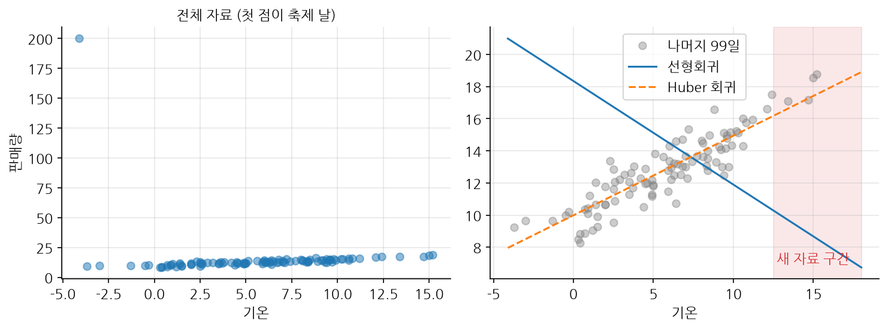
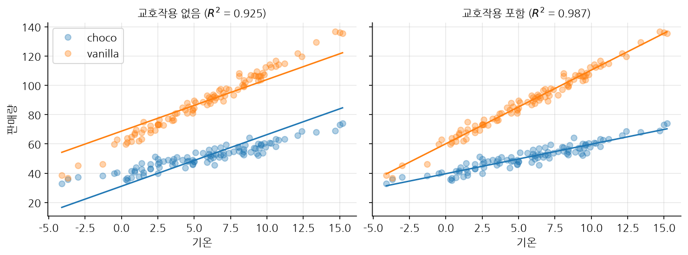

**이상치**(outlier)는 나머지 자료의 규칙에서 크게 벗어난 관측치이고, **교호작용**(interaction)은 한 변수의 효과가 다른 변수의 값에 따라 달라지는 것이다. 둘 다 선형모형 $y = \beta_0 + \sum_j \beta_j x_j$의 구조와 맞지 않는다. 이 글은 지금까지 본 것을 포함해 선형모형을 무너뜨리는 다섯 가지 상황을 표로 정리하고, 아직 다루지 않은 이상치와 교호작용을 자세히 본다. 다섯 상황은 [다음 글](/posts/ml-07-decision-tree)에서 의사결정나무와 비교하는 기준이 된다.

## 선형모형의 다섯 적

| 상황 | 증상 | 대처 | 다룬 곳 |
|---|---|---|---|
| 결측치 | `ValueError: Input X contains NaN` | 열·행 제거, `SimpleImputer` | [3편](/posts/ml-03-missing-scaling) |
| 다중공선성 | 계수가 불안정, 시험 점수 하락 | 상관 히트맵으로 제거, 변수 합치기, PCA, 릿지·라쏘 | [4편](/posts/ml-04-overfitting-collinearity), [5편](/posts/ml-05-ridge-lasso) |
| 무관한 변수 | 학습 점수만 오르고 시험 점수 하락 | $\text{corr}(y, X)$로 제거, 라쏘 | [4편](/posts/ml-04-overfitting-collinearity), [5편](/posts/ml-05-ridge-lasso) |
| 이상치 | 적합선 전체가 한 점에 끌려감 | 제거, 로버스트 회귀, 변환 | 이 글 |
| 교호작용 | 패턴이 남는 잔차, 과소적합 | 교호작용 항 추가, 나무 모형 | 이 글 |

## 이상치

### 축제 하루가 기울기를 뒤집는다

(강의 예제) 기온 $x$와 아이스크림 판매량을 $y = 10 + 0.5x + \varepsilon$, $\varepsilon \sim N(0,1)$로 100일치 만들고, 가장 추운 날($-4.1$도) 하나만 판매량을 200으로 바꾼다. 그날 썰매 축제가 열려 사람이 몰렸다고 상상한다.



| 방법 | 기울기 | 절편 | 15도 예측 | 30도 예측 |
|---|---|---|---|---|
| 참값 | 0.5 | 10 | 17.5 | 25.0 |
| 선형회귀 (전체) | **−0.645** | 18.35 | 8.67 | −1.00 |
| 선형회귀 (이상치 제거) | 0.509 | 9.86 | 17.49 | 25.12 |
| Huber 회귀 (전체) | 0.495 | 9.99 | 17.42 | 24.85 |

점 하나 때문에 기울기의 부호가 바뀌었다. "기온이 오르면 아이스크림이 덜 팔린다"는 결론이 되고, 30도에서는 판매량이 음수로 예측된다. 최소제곱은 잔차의 **제곱**을 줄이므로, 잔차 190짜리 점 하나가 잔차 1짜리 점 99개보다 훨씬 큰 영향을 준다.

이 모형의 학습 $R^2$는 0.019이고, 이상치를 뺀 99개에서 계산하면 −3.99다. 새 자료(12.5~18도)에서도 엉터리일 것이다. 학습 점수가 시험 점수보다 높겠지만, 이것은 오차를 외운 과적합이 아니다. 모형이 한 점에 끌려가 규칙 자체를 잘못 찾은 것이다. [4편](/posts/ml-04-overfitting-collinearity)에서 학습·시험 점수 차이만으로 과적합을 정의하지 않은 이유다.

### 대처

| 방법 | 내용 | sklearn |
|---|---|---|
| 제거 | 이상치를 찾아 빼고 적합한다. 찾는 기준(잔차, 레버리지, 쿡의 거리)이나 이상치 탐지 모형을 쓴다 | `IsolationForest` 등 |
| 로버스트 회귀 | 큰 잔차에 덜 민감한 손실을 쓴다 | `HuberRegressor`, `RANSACRegressor` |
| 변환 | 분포의 꼬리를 줄이는 변환(로그, Box-Cox, Yeo-Johnson) 후 적합 | `PowerTransformer` |
| 나무 모형 | 이상치는 자기 영역에만 영향을 준다 | 7편 |

Huber 손실은 잔차가 작을 때는 제곱, 클 때는 절댓값처럼 늘어난다.

$$
L_\delta(r) = \begin{cases} \tfrac12 r^2, & |r| \le \delta \\ \delta\left(|r| - \tfrac12\delta\right), & |r| > \delta \end{cases}
$$

큰 잔차의 기여가 제곱이 아니라 선형으로 늘어나므로 점 하나가 전체를 끌고 가지 못한다. 위 표에서 Huber 회귀는 이상치를 지우지 않고도 이상치를 제거한 결과와 거의 같다.

> **주의.** 이상치를 무조건 지우면 안 된다. 축제 날의 판매량은 측정 오류가 아니라 실제로 일어난 일이고, 다음 축제 날을 예측해야 한다면 오히려 가장 중요한 자료다. 지울지는 그 점이 **예측하려는 상황을 대표하는가**로 정한다. 이 판단은 자료가 아니라 분야의 지식에서 나온다.

## 교호작용

### 시너지: 운동과 보조제

(강의 예제) 1만 명이 운동 여부와 체중감량 보조제 복용 여부에 따라 감량한 체중(kg)이다. 네 집단의 평균은 다음과 같다.

| | 운동 안 함 | 운동함 |
|---|---|---|
| 보조제 안 먹음 | 0.02 | 4.99 |
| 보조제 먹음 | 0.50 | 14.97 |

보조제만 먹으면 0.5kg, 운동만 하면 5kg인데 둘 다 하면 15kg이다. $0.5 + 5 = 5.5$보다 9.5kg 더 빠진다. 이것이 교호작용이다.

**교호작용 없이 적합하면** 모형은 $\hat y = \beta_0 + \beta_1\,\text{Supp} + \beta_2\,\text{Exer}$이고, 효과는 언제나 더해진다.

```python
X = df[['Supplement', 'Exercise']]
predictr = sklearn.linear_model.LinearRegression().fit(X, y)   # R² = 0.821
```

| 적합값 | 운동 안 함 | 운동함 |
|---|---|---|
| 보조제 안 먹음 | −2.37 | 7.38 |
| 보조제 먹음 | 2.85 | 12.59 |

보조제 효과 5.22, 운동 효과 9.75로 추정한다. 네 칸을 "더하기"로만 맞추려다 보니 아무것도 안 한 집단이 −2.37kg(살이 찜)이 되고, 모든 칸이 틀린다. $R^2 = 0.821$은 높아 보이지만 모형이 자료의 구조를 표현할 수 없는 **과소적합**이다.

**교호작용 항을 넣으면** 곱한 열 하나를 추가한다.

$$
\hat y = \beta_0 + \beta_1\,\text{Supp} + \beta_2\,\text{Exer} + \beta_3\,(\text{Supp} \times \text{Exer})
$$

```python
X = df.eval('Interaction = Supplement * Exercise')[['Supplement', 'Exercise', 'Interaction']]
predictr.fit(X, y)          # coef_ = [0.476, 4.970, 9.499], intercept_ = 0.022, R² = 0.973
```

보조제 0.48, 운동 4.97, 시너지 9.50으로 네 집단의 평균을 정확히 재현한다. 칸이 4개이고 계수도 4개(절편 포함)이므로 각 칸의 평균을 그대로 맞힐 수 있다. 이것은 실험계획법의 이원배치 분산분석에서 교호작용 효과를 넣은 모형과 같다([실험계획법 - 이원배치법](/posts/doe-03-two-way)).

### 기울기가 다른 직선: 초코와 바닐라

(강의 예제) 이번에는 바닐라가 기온의 영향을 더 많이 받는다.

$$
\text{초코: } y = 40 + 2x + \varepsilon, \qquad \text{바닐라: } y = 60 + 5x + \varepsilon
$$



[2편](/posts/ml-02-linear-logistic)의 원핫 인코딩만으로는 범주별로 절편만 바뀌므로 두 직선이 평행하다. $R^2 = 0.925$로 점수는 높지만 그림을 보면 양 끝에서 체계적으로 틀린다. 점수만 보지 말고 적합 결과를 그려 봐야 하는 이유다. 기울기 차이를 표현하려면 `temp × type_vanilla` 열을 넣는다.

```python
X = pd.get_dummies(df[['temp', 'type']], drop_first=True).eval('interaction = temp * type_vanilla')
# coef_ = [2.016, 20.463, 3.014], intercept_ = 39.667, R² = 0.987
```

| 계수 | 추정값 | 의미 | 참값 |
|---|---|---|---|
| 절편 | 39.67 | 초코의 절편 | 40 |
| temp | 2.016 | 초코의 기울기 | 2 |
| type_vanilla | 20.46 | 바닐라 절편 − 초코 절편 | 20 |
| interaction | 3.014 | 바닐라 기울기 − 초코 기울기 | 3 |

범주의 절편 차이는 더미 변수가, 기울기 차이는 더미 × 연속형 변수가 표현한다.

### 교호작용이 많을 때

교호작용 항은 분석가가 직접 만들어야 한다. 범주형 변수가 둘이면 칸이 몇 개 안 되지만, 셋 이상이거나 범주가 많으면 가능한 곱의 조합이 빠르게 늘고 그중 필요 없는 항을 다시 골라내야 한다. 또 "운동은 안 하고 약만 먹으면 부작용"처럼 특정 칸에만 생기는 효과는 위의 곱 항 하나로 표현되지 않아, 두 변수를 합친 범주 변수(예: `운동_약` 4수준)를 원핫 인코딩해야 한다. 이런 경우에는 교호작용을 자동으로 찾는 나무 모형이 편하다([다음 글](/posts/ml-07-decision-tree)).

## 비교

| | 이상치 | 교호작용 |
|---|---|---|
| 문제의 위치 | 일부 관측치 | 변수 사이의 관계 |
| 선형모형에서의 증상 | 적합선이 끌려감, 기울기 부호 반전 | 과소적합, 평행선, 칸별 체계적 오차 |
| 점수로 보이는가 | 잘 안 보인다 | 잘 안 보인다 ($R^2$ 0.82, 0.93) |
| 찾는 방법 | 산점도, 잔차 그림 | 범주별 산점도, 피벗 테이블 |
| 선형모형 안의 해결 | 로버스트 회귀, 변환, 제거 | 곱 항 추가 |

## 요약

- 선형모형의 다섯 적: 결측치, 다중공선성, 무관한 변수, 이상치, 교호작용.
- 이상치 하나가 기울기의 부호를 바꿀 수 있다. Huber 회귀는 지우지 않고 영향을 줄인다. 지울지 말지는 예측하려는 상황으로 정한다.
- 교호작용은 곱 항으로 넣는다. 더미는 절편 차이, 더미 × 연속형은 기울기 차이를 표현한다.
- 두 문제 모두 점수로는 잘 드러나지 않는다. 적합 결과를 그림으로 확인한다.

## 참고자료

- 최규빈, 「기계학습활용」 강의노트 (2023), <https://guebin.github.io/MP2023/>
- Huber, P. J. (1964). Robust estimation of a location parameter. *The Annals of Mathematical Statistics*, 35(1), 73–101.
- James, G., Witten, D., Hastie, T. and Tibshirani, R. (2021). *An Introduction to Statistical Learning* (2nd ed.), Sections 3.3.2, 3.3.3. Springer.
- scikit-learn User Guide, *1.1.16 Robustness regression: outliers and modeling errors*.
