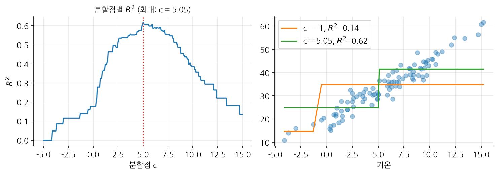
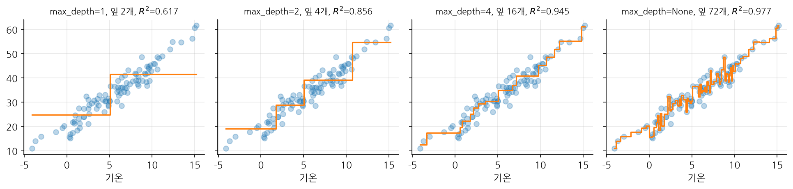
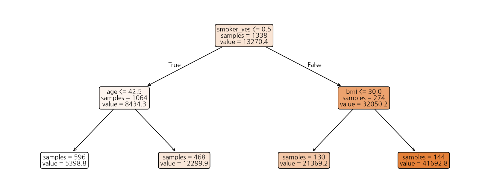
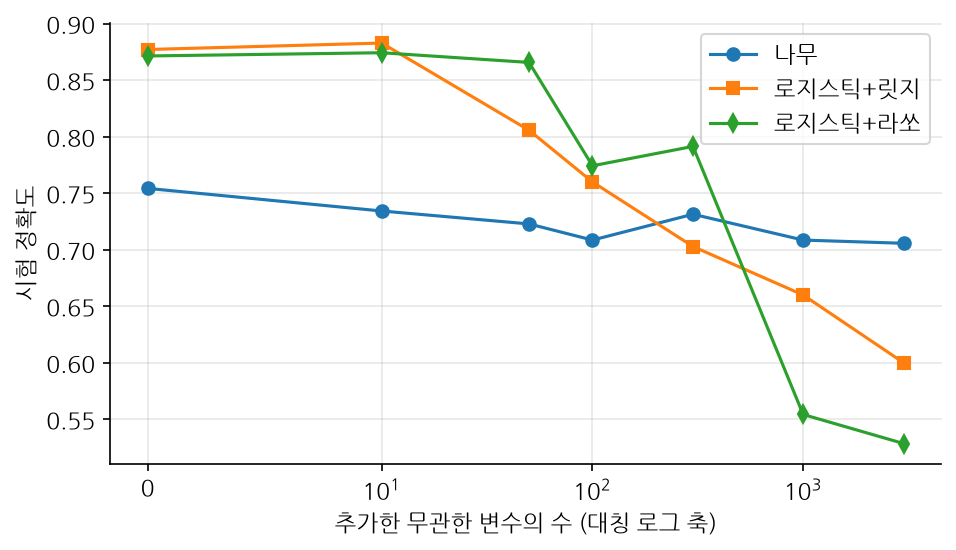
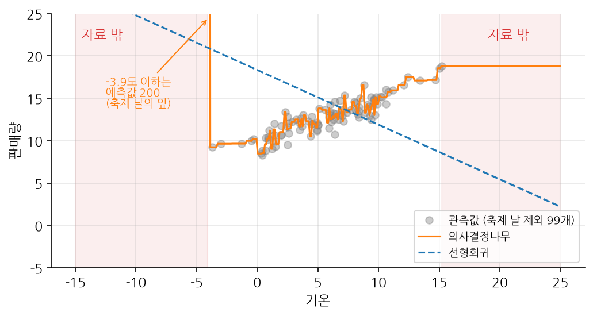

**의사결정나무**(decision tree)는 설명변수 공간을 "변수 $\le$ 분할점" 형태의 질문으로 반복해서 둘로 나누고, 나뉜 영역마다 반응의 평균(회귀) 또는 최빈 범주(분류)를 예측값으로 쓰는 방법이다. 재귀적 이진 분할, 지니 지수, 비용복잡도 가지치기의 이론은 [데이터 마이닝 - 의사결정나무](/posts/dm-tree)에 있다. 이 글은 sklearn의 나무가 분할점을 어떻게 고르는지 직접 재현하고, [앞 글](/posts/ml-06-outlier-interaction)의 "선형모형의 다섯 적"을 나무에 똑같이 던져 본다.

## 분할점 고르기

### 분할이 정해지면 예측값은 평균

(강의 예제) [2편](/posts/ml-02-linear-logistic)의 아이스크림 자료($y = 20 + 2.5x + \varepsilon$, 100일)에 깊이 1인 나무를 적합한다.

```python
predictr = sklearn.tree.DecisionTreeRegressor(max_depth=1)
predictr.fit(X, y)
print(sklearn.tree.export_text(predictr, feature_names=['temp']))
# |--- temp <= 5.050  →  value: 24.788
# |--- temp >  5.050  →  value: 41.489
```

5.05도 이하인 45일의 판매량 평균이 24.788, 나머지 55일의 평균이 41.489다. 분할이 정해지면 각 영역의 예측값은 그 영역의 평균이다. 제곱오차를 가장 작게 만드는 상수가 평균이기 때문이다.

### 좋은 분할은 R²가 큰 분할

그러면 5.05는 어떻게 골랐을까. 좋은 분할이란 좋은 $\hat y$를 만드는 분할이고, 좋은 $\hat y$는 $R^2$가 크다. 경계 $c$를 받아 두 영역의 평균으로 $\hat y$를 만드는 함수를 짜고 $c$를 −5부터 15까지 0.05 간격으로 바꿔 보았다.

```python
def fit_predict(c):
    return np.where(temp <= c, sales[temp <= c].mean(), sales[temp > c].mean())

cuts  = np.arange(-5, 15, 0.05)
score = [sklearn.metrics.r2_score(y, fit_predict(c)) for c in cuts]
```



$R^2$는 5.0 이상 5.1 미만의 $c$에서 최대(0.617)이고, 이 구간의 어느 $c$든 같은 분할을 만든다. sklearn은 인접한 두 관측값(5.0과 5.1)의 중간점 5.05를 경계로 기록한다. 같은 자료라면 $R^2$를 최대로 하는 것과 두 영역의 제곱오차 합을 최소로 하는 것은 같으므로, 이것이 [데이터 마이닝 - 의사결정나무](/posts/dm-tree)의 RSS 기준이다. 분류나무는 $R^2$ 대신 지니 지수나 엔트로피를 쓴다.

알고리즘을 정리하면 다음과 같다.

1. 변수 하나를 고정하고, 가능한 모든 분할점(인접 관측값의 중간점)에서 $R^2$를 계산해 최고의 분할점을 찾는다.
2. 모든 변수에 대해 1을 반복하고 $R^2$가 가장 큰 (변수, 분할점)을 고른다.
3. 나뉜 두 조각을 각각 새 자료로 보고 1~2를 반복한다. 멈춤 조건(`max_depth`, `min_samples_split`, `min_samples_leaf` 등)에 걸리면 멈춘다.

지금 단계에서 가장 좋은 분할만 고르고 뒤의 단계는 고려하지 않으므로 탐욕적(greedy) 알고리즘이다.

### 깊이와 과적합



깊이가 하나 늘 때마다 잎이 최대 두 배가 되고 계단이 잘아진다. 깊이 제한이 없으면 잎 72개가 거의 모든 점을 따로 맞힌다. 5겹 교차검증 $R^2$는 다음과 같다.

| max_depth | 1 | 2 | 3 | 4 | 6 | 제한 없음 | (선형회귀) |
|---|---|---|---|---|---|---|---|
| CV $R^2$ | 0.521 | 0.767 | 0.848 | 0.854 | 0.827 | 0.823 | 0.912 |

깊이 4까지는 오르다가 더 깊어지면 떨어진다. 나무를 어디까지 키울지에 대한 이론적 정답은 없고, 멈춤 조건과 가지치기(`ccp_alpha`)를 교차검증으로 고른다. 참 관계가 직선인 이 자료에서는 가장 좋은 나무도 선형회귀(0.912)를 이기지 못한다. 계단으로 직선을 흉내 내는 데는 한계가 있다.

## 하이퍼파라미터

| 인자 | 기본값 | 뜻 |
|---|---|---|
| `max_depth` | None | 최대 깊이. 클수록 과적합 위험 |
| `min_samples_split` | 2 | 이 수보다 적은 노드는 더 나누지 않음 |
| `min_samples_leaf` | 1 | 잎에 남아야 하는 최소 관측치 수 |
| `max_features` | None (전부) | 분할마다 무작위로 고른 이 수의 변수 중에서만 최적 분할을 찾음 |
| `ccp_alpha` | 0 | 비용복잡도 가지치기의 벌점 |
| `random_state` | None | `max_features`의 무작위 선택과 동점 처리를 고정 |

### max_features

(강의 예제) Medical Cost 자료(8개 설명변수)에 깊이 2인 나무를 적합하면 첫 질문은 흡연 여부다.



비흡연자는 나이로, 흡연자는 BMI로 나뉜다. 흡연자 중 BMI 30 초과(비만)인 144명의 평균 청구액은 41,693달러로, 젊은 비흡연자의 7.7배다. 흡연자 안에서만 BMI가 중요하다는 것은 흡연 × BMI 교호작용이고, 나무는 이것을 따로 지정하지 않아도 찾는다.

`max_features=4`로 두면 분할마다 8개 중 4개만 후보로 본다. `random_state`를 0~99로 바꿔 깊이 1인 나무 100개를 만들었을 때 첫 분할 변수는 다음과 같았다.

| 첫 분할 변수 | smoker_yes | bmi | age | children | region_southeast |
|---|---|---|---|---|---|
| 횟수 | 59 | 20 | 18 | 2 | 1 |

흡연 여부가 후보 4개에 들 확률은 $1 - \binom{7}{4}/\binom{8}{4} = 0.5$이고, 들면 언제나 뽑히므로 약 절반이 흡연으로 시작한다. 혼자서는 나무를 나쁘게 만드는 이 설정이 [다음 글](/posts/ml-08-ensemble)의 랜덤포레스트에서 핵심이 된다.

### sample_weight

관측치마다 중요도가 다르면 `fit(X, y, sample_weight=w)`로 가중치를 준다. $x = 1, \dots, 7$, $y = (10, 11, 12, 20, 21, 22, 23)$이면 첫 분할은 3.5지만, 앞의 두 점에 가중치 5000을 주면 1.5로 바뀐다. 가중치 5000은 그 점을 5000번 복제한 것과 같은 효과다. 희귀 범주를 더 잘 맞혀야 하는 분류 문제에서는 `class_weight='balanced'`가 같은 역할을 한다.

### 특성 중요도

`feature_importances_`는 각 변수가 만든 분할들의 제곱오차 감소량을 모두 더해 합이 1이 되게 나눈 값이다. Medical Cost에서 깊이 제한 없는 나무는 smoker_yes 0.621, bmi 0.210, age 0.122이고 나머지 다섯은 합쳐 0.05가 안 된다. [2편](/posts/ml-02-linear-logistic)에서 선형회귀 계수로는 단위 때문에 할 수 없던 중요도 비교를 단위와 무관하게 할 수 있다.

## 선형모형의 다섯 적과 나무

| 상황 | 자료 | 선형모형 | 의사결정나무 |
|---|---|---|---|
| 이상치 | 축제 날 아이스크림 | 기울기 부호 반전 | 이상치가 자기 잎에만 영향 |
| 교호작용 | 운동 + 보조제 | 곱 항 없으면 $R^2$ 0.821 | 그대로 넣어도 0.973 |
| 교호작용 | 초코/바닐라 기울기 | 곱 항 없으면 시험 0.922 | 시험 0.975 |
| 다중공선성 | 유사 토익 500개 | 시험 $R^2$ 0.117 | 시험 $R^2$ 0.829 |
| 무관한 변수 | 아래 그림 | 3000개에서 시험 0.60 (릿지) | 0.71 근처 유지 |
| 결측치 | | fit 불가 | sklearn 1.3부터 기본 나무는 결측을 직접 처리 |

**교호작용.** 운동·보조제 자료를 곱 항 없이 그대로 넣어도 나무는 잎 4개(깊이 2)로 네 집단의 평균을 정확히 맞혀 $R^2 = 0.973$, 곱 항을 넣은 선형회귀와 같다. 질문을 차례로 던지는 구조 자체가 "운동을 했다면, 그 안에서 보조제를 먹었는가"를 묻는다. 초코/바닐라 자료(7:3 분할)에서는 곱 항 없는 선형회귀 0.922, 나무 0.975, 곱 항 있는 선형회귀 0.983이다. 정답 구조를 아는 선형모형이 가장 좋지만, 모를 때는 나무가 자동으로 상당 부분을 잡는다.

**다중공선성.** 나무는 한 번에 변수 하나로만 나누므로 비슷한 변수 500개가 있어도 그중 하나를 고를 뿐이다. 깊이 제한 없는 나무는 학습 $R^2$ 1.000, 시험 0.829로 과적합되었지만 선형회귀(0.117)만큼 무너지지 않는다. 깊이 4 나무가 실제로 쓴 변수는 502개 중 10개였다. 다만 표준화한 릿지·라쏘([5편](/posts/ml-05-ridge-lasso), 0.91)보다는 못하다.

**무관한 변수.** 취업 자료(학습 150명, 시험 350명)에 무작위 연속형 변수를 $k$개 붙였다.



| 추가 변수 | 0 | 50 | 300 | 1000 | 3000 |
|---|---|---|---|---|---|
| 나무 | 0.754 | 0.723 | 0.731 | 0.709 | 0.706 |
| 로지스틱 + 릿지 (CV) | 0.877 | 0.806 | 0.703 | 0.660 | 0.600 |
| 로지스틱 + 라쏘 (CV) | 0.871 | 0.866 | 0.791 | 0.554 | 0.529 |

변수가 적으면 경계가 직선인 이 자료에서 로지스틱 회귀가 나무보다 0.12 높다. 변수가 학습 표본 수(150)를 크게 넘으면 벌점 모형도 무너지고, 나무는 처음부터 끝까지 0.71 근처다. 나무는 처음부터 학습 정확도 1.000으로 과적합되어 있어서 나빠질 여지가 적다고 볼 수도 있다.

### 약점 1: 외삽을 못 한다

축제 날 이상치가 있는 아이스크림 자료에 깊이 제한 없는 나무를 적합하고, 자료 범위(−4.1~15.2도) 밖까지 예측했다.



- 자료 안에서 나무는 이상치에 끌려가지 않는다. 축제 날은 자기 잎 하나만 차지한다.
- 15.2도보다 더운 날은 18도든 25도든 모두 마지막 잎의 값 18.79다. 나무는 학습 자료의 $y$ 범위 밖의 값을 예측할 수 없다.
- −3.9도보다 추운 날은 모두 축제 날의 잎에 들어가 **200**을 예측한다. 자료 안에서 고립시켰던 이상치가 자료 밖에서는 무한히 확장된다.

기온이 계속 오르는 여름을 예측해야 한다면 선형 추세를 가정하는 모형이 낫다. 시간 추세가 있는 자료에서 나무 모형을 쓸 때 늘 확인할 점이다(11편).

### 약점 2: 흔들린다

깊이 제한이 없으면 학습 자료를 거의 외우고, 자료가 조금만 바뀌어도 나무 모양이 크게 달라진다(분산이 크다). 이것을 잡으려고 나온 것이 여러 나무를 합치는 배깅, 랜덤포레스트, 부스팅이다([다음 글](/posts/ml-08-ensemble)).

## 비교

| | 선형모형 | 의사결정나무 |
|---|---|---|
| 모형의 형태 | $\beta_0 + \sum\beta_j x_j$ (가정) | 영역별 상수 (가정 거의 없음, 비모수) |
| 비선형성, 교호작용 | 직접 항을 만들어야 함 | 자동으로 찾음 |
| 이상치 | 전체가 끌려감 | 자기 영역에만 영향 |
| 공선성, 무관한 변수 | 크게 무너짐 | 덜 무너짐 |
| 스케일링 | 벌점 모형은 필요 | 필요 없음 (순서만 씀) |
| 외삽 | 추세를 연장 | 경계값으로 평평 |
| 매끄러운 관계 | 잘 맞힘 | 계단으로 근사 |
| 해석 | 계수 | 나무 그림, 특성 중요도 |
| 약점 | 구조를 잘못 가정하면 과소적합 | 과적합, 불안정 |

## 요약

- 분할점은 $R^2$(= 제곱오차 감소)를 최대로 하는 값을 전수 탐색으로 찾는다. 잎의 예측값은 평균이다.
- `max_depth`가 클수록 과적합된다. 깊이는 교차검증으로 고른다.
- `max_features`는 분할마다 후보 변수를 무작위로 제한한다. `random_state`로 고정한다.
- 나무는 교호작용, 이상치, 공선성, 무관한 변수에 선형모형보다 강하다.
- 나무는 자료 범위 밖에서 경계 잎의 값을 그대로 쓴다. 외삽이 필요한 문제에 주의한다.

## 참고자료

- 최규빈, 「기계학습활용」 강의노트 (2023), <https://guebin.github.io/MP2023/>
- Breiman, L., Friedman, J., Olshen, R. and Stone, C. (1984). *Classification and Regression Trees*. Wadsworth.
- James, G., Witten, D., Hastie, T. and Tibshirani, R. (2021). *An Introduction to Statistical Learning* (2nd ed.), Section 8.1. Springer.
- scikit-learn User Guide, *1.10 Decision Trees*.
