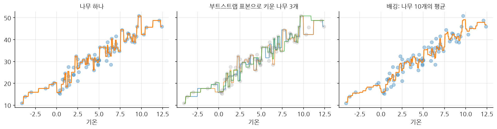
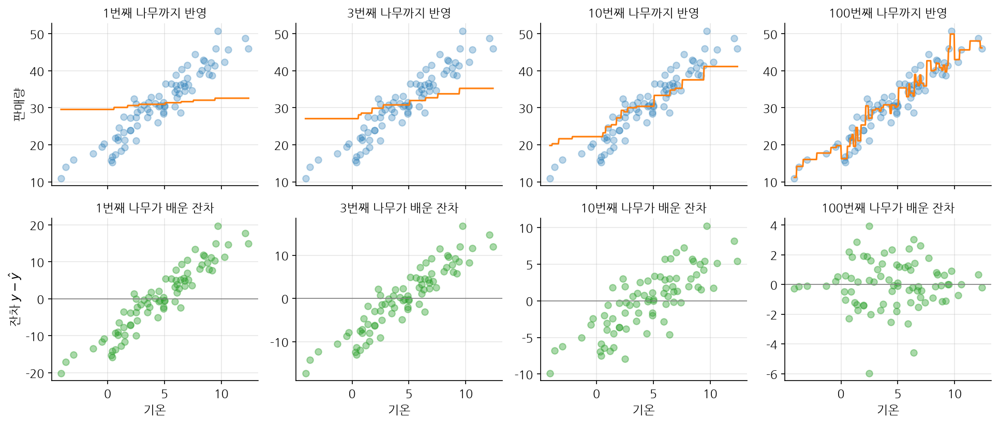
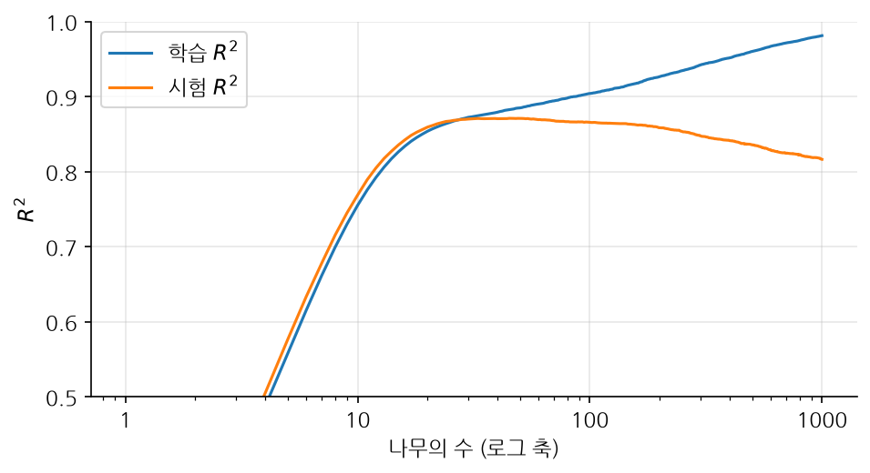

**앙상블**(ensemble)은 여러 모형의 예측을 합쳐 하나의 예측을 만드는 방법이다. 나무를 합치는 방식은 크게 세 가지다. **배깅**(bagging)은 부트스트랩 표본마다 나무를 키워 평균하고, **랜덤포레스트**(random forest)는 여기에 분할마다 후보 변수를 무작위로 제한하는 장치를 더하며, **부스팅**(boosting)은 앞의 나무가 못 맞힌 부분(잔차)을 다음 나무가 조금씩 배우게 한다. [앞 글](/posts/ml-07-decision-tree)에서 본 나무의 약점인 큰 분산을 줄이려는 시도들이다. 분산 감소의 이론과 OOB 오차, 변수 중요도는 [데이터 마이닝 - 앙상블](/posts/dm-ensemble)에 있다. 이 글은 sklearn이 내놓은 결과를 손으로 재현해서 세 방법이 실제로 무엇을 계산하는지 확인한다.

## 배깅

### 부트스트랩 나무의 평균

(강의 예제) 아이스크림 자료 80일치로 `BaggingRegressor`를 적합한다. 기본값은 깊이 제한 없는 회귀나무 10개다.

```python
predictr = sklearn.ensemble.BaggingRegressor(random_state=0).fit(X, y)
len(predictr.estimators_)          # 10
predictr.estimators_samples_[0]    # 첫 나무가 학습한 관측치 번호 80개 (중복 있음)
```

알고리즘은 세 줄이다.

1. 80개 관측치에서 80개를 **복원추출**한다(부트스트랩 표본).
2. 그 표본으로 나무를 끝까지 키운다.
3. 1~2를 $B$번 반복하고, 예측은 $B$개 나무의 평균이다.

$$
\hat f_{\text{bag}}(x) = \frac{1}{B}\sum_{b=1}^B \hat f^{*b}(x)
$$

첫 나무의 부트스트랩 표본 80개에는 서로 다른 관측치가 51개 들어 있다. 10개 나무 평균은 62.6%로, 이론값 $1 - (1 - 1/n)^n \approx 1 - e^{-1} = 0.632$와 맞는다. 저장된 표본 번호로 나무 10개를 직접 다시 키우고 평균하면 `predictr.predict(X)`와 $4\times10^{-15}$까지 같다.

```python
# X, y가 NumPy 배열(ndarray)일 때 기준 (DataFrame/Series라면 X.iloc[s], y.iloc[s] 사용)
trees = [DecisionTreeRegressor(random_state=e.random_state).fit(X[s], y[s])
         for e, s in zip(predictr.estimators_, predictr.estimators_samples_)]
np.mean([t.predict(X) for t in trees], axis=0)     # == predictr.predict(X)
```



나무 하나는 모든 점을 따라가지만, 부트스트랩 표본마다 빠진 점이 달라 나무들이 서로 다른 곳에서 꺾인다. 평균을 내면 각 나무가 외운 잡음은 서로 상쇄되고 공통된 추세만 남는다. 서로 독립이고 분산이 $\sigma^2$인 $B$개의 평균은 분산이 $\sigma^2/B$라는 사실을 나무에 적용한 것이다.

### 다양성이 필요하다

나무들이 서로 독립이 아니면 이야기가 달라진다. 상관이 $\rho$이면 평균의 분산은

$$
\text{Var}\left(\frac{1}{B}\sum_b \hat f^{*b}\right) = \rho\,\sigma^2 + \frac{1-\rho}{B}\,\sigma^2
$$

이고, $B$를 아무리 키워도 $\rho\sigma^2$ 아래로는 내려가지 않는다. 나무를 많이 만드는 것보다 **서로 다른 나무**를 만드는 것이 중요하다. 성능이 뛰어나지만 생각이 비슷한 10명보다, 평범해도 의견이 다양한 10명을 모으는 편이 앙상블에는 낫다.

Medical Cost 자료(학습 936명)로 배깅 나무 100개를 만들면 **100개 모두** 흡연 여부로 시작한다. 흡연의 효과가 압도적이라 부트스트랩 표본이 바뀌어도 첫 질문은 바뀌지 않는다. 나무들이 비슷하니 상관이 높다. 시험 자료에서 나무 두 개씩의 예측 상관을 평균하면 0.868이다.

## 랜덤포레스트

### 배깅 + max_features

랜덤포레스트는 배깅에서 나무를 키울 때 **분할마다** 전체 변수 중 일부만 무작위로 뽑아 그중에서 최적 분할을 찾는다. [앞 글](/posts/ml-07-decision-tree)의 `max_features`다.

```python
# 배깅                                       # 랜덤포레스트
for b in range(B):                           for b in range(B):
    Xb, yb = bootstrap(X, y)                     Xb, yb = bootstrap(X, y)
    tree = DecisionTreeRegressor()               tree = DecisionTreeRegressor(max_features=m)
    trees.append(tree.fit(Xb, yb))               trees.append(tree.fit(Xb, yb))
```

`max_features=1/3`(8개 중 2개)로 100개를 만들면 첫 분할 변수가 age 24, smoker 21, children 17, bmi 14, 그 밖 24개로 흩어진다. 흡연 여부를 후보에서 못 본 "괴짜" 나무들이 다른 변수의 구조를 먼저 배운다. 나무 사이 예측 상관은 0.686으로 배깅(0.868)보다 낮다.

> **주의.** sklearn의 `max_features`는 정수면 개수, 실수면 비율이다. `max_features=1`은 변수 1개, `1.0`은 100%다. `RandomForestRegressor`의 기본값은 `1.0`이라서 **아무것도 지정하지 않으면 랜덤포레스트가 곧 배깅이다.** 분류기(`RandomForestClassifier`)의 기본값은 `'sqrt'`($\sqrt p$개)로 다르다.

### 다양성과 개별 성능의 절충

후보 변수를 줄이면 나무는 다양해지지만 각 나무는 약해진다. Medical Cost 자료 전체(1338명)로 5겹 교차검증 $R^2$를 비교했다.

| `max_features` | 1 | 2 | 3 | 4 | 8 (= 배깅) |
|---|---|---|---|---|---|
| CV $R^2$ | 0.797 | 0.828 | 0.843 | 0.844 | 0.832 |

후보가 1개면 흡연 여부를 거의 못 써서 나무가 너무 약하고, 8개 전부면 나무가 너무 비슷하다. 이 자료에서는 3~4개가 가장 좋다. 이 값은 자료마다 달라서 교차검증으로 고르는 하이퍼파라미터다.

## 부스팅

### 평균이 아니라 합

(강의 예제) 같은 아이스크림 자료에 `GradientBoostingRegressor`를 적합하면 깊이 3인 나무 100개가 저장된다. 그런데 이 나무들의 예측을 평균하면 엉뚱한 값이 나온다(실제 예측과 최대 17.9 차이). 부스팅의 나무들은 $y$가 아니라 **잔차**를 배우기 때문이다.

1. 시작은 $\hat F_0(x) = \bar y$.
2. 잔차 $r_i = y_i - \hat F_{m-1}(x_i)$를 계산한다.
3. 잔차에 깊이 3인 나무 $h_m$을 적합한다.
4. $\hat F_m(x) = \hat F_{m-1}(x) + \nu\, h_m(x)$로 갱신한다. $\nu = 0.1$은 학습률(`learning_rate`).
5. 2~4를 $M = 100$번 반복한다.

```python
F = np.full(n, y.mean())
for m in range(100):
    r = y - F
    h = DecisionTreeRegressor(criterion='friedman_mse', max_depth=3).fit(X, r)
    F = F + 0.1 * h.predict(X)
# F == predictr.predict(X)   (최대 차이 1.4e-14)
```

이 루프가 sklearn의 결과를 기계 정밀도까지 재현한다. 제곱오차 손실에서 잔차는 손실의 음의 기울기 $-\partial L/\partial F$이므로, 이 과정은 함수 공간에서의 경사하강법이고 이름의 "그래디언트"가 여기서 온다([딥러닝 - 경사하강법과 자동미분](/posts/dl-02-gradient-descent)).



- 1번째 나무의 잔차는 기온과 뚜렷한 직선 관계를 보인다. 아직 배울 것이 많다.
- 반복할수록 잔차가 0 주위의 무작위 산포에 가까워진다. 잔차의 표준편차는 1, 3, 10, 30, 100번째에서 8.16, 6.77, 3.87, 2.19, 1.60이다. 참 오차의 표준편차는 3이다.
- 10번째와 30번째 사이에서 잔차의 표준편차가 참 오차(3)보다 작아진다. 그 뒤의 나무는 오차를 배우고 있고, 100번째 적합의 들쭉날쭉한 계단이 그 결과다.

한 번에 다 배우지 않고(학습률 0.1) 부족한 부분만 조금씩 보충하다가, 남은 것이 오차처럼 보이면 멈춰야 한다. **부스팅은 나무 수가 너무 많으면 과적합된다.** 배깅과 랜덤포레스트는 나무를 늘려도 과적합되지 않는 것과 다르다.



Medical Cost 자료에서 시험 $R^2$는 나무 46개에서 최고(0.871), 기본값 100개에서 0.866, 1000개에서 0.816이다. 나무 수, 학습률, 나무 깊이를 함께 교차검증으로 고르거나 `n_iter_no_change`로 조기 종료한다. XGBoost, LightGBM, CatBoost는 이 알고리즘에 2차 근사, 히스토그램 분할, 범주형 처리 같은 개선을 더한 구현이며, 표 자료의 예측 대회에서 가장 많이 쓰인다(10편의 AutoGluon도 이들을 쓴다).

## 같은 자료에서의 비교

Medical Cost 자료, 7:3 분할 한 번의 시험 $R^2$와 5겹 교차검증 $R^2$(전체 1,338명 기준, 평균 ± 표준편차)다.

| 방법 | 학습 $R^2$ | 시험 $R^2$ | CV $R^2$ |
|---|---|---|---|
| 선형회귀 | 0.742 | 0.770 | 0.740 ± 0.052 |
| 나무 (깊이 제한 없음) | 1.000 | 0.742 | 0.700 ± 0.042 |
| 나무 (`max_depth=4`) | 0.866 | 0.858 | 0.846 ± 0.039 |
| 배깅 (100개) | 0.975 | 0.854 | 0.832 ± 0.045 |
| 랜덤포레스트 (`max_features=1/3`) | 0.973 | 0.841 | 0.822 ± 0.040 |
| 그래디언트 부스팅 (기본값) | 0.904 | 0.866 | 0.854 ± 0.037 |

- 깊이 제한 없는 나무(0.700)를 배깅하면 0.832가 된다. 앙상블이 분산을 줄인 효과다.
- 그런데 이 자료에서는 깊이 4로 자른 나무 하나(0.846)도 배깅만큼 좋다. 흡연 × BMI, 나이 정도로 구조가 단순해서 깊은 나무의 분산을 평균으로 줄이는 것과 얕은 나무로 처음부터 분산을 줄이는 것이 비슷한 결과를 낸다.
- 방법 사이의 차이(0.82~0.85)는 fold 간 표준편차(약 0.04)보다 작다. 이 자료 하나로 우열을 말하기는 어렵다.

| | 배깅 | 랜덤포레스트 | 부스팅 |
|---|---|---|---|
| 나무를 만드는 순서 | 독립 (병렬) | 독립 (병렬) | 순차 |
| 각 나무가 배우는 것 | 부트스트랩 표본의 $y$ | 부트스트랩 표본의 $y$, 분할마다 일부 변수 | 앞까지의 잔차 |
| 개별 나무 | 깊게 (편향 작고 분산 큼) | 깊게 | 얕게 (깊이 1~6) |
| 합치는 방법 | 평균 | 평균 | 학습률을 곱해 더함 |
| 줄이는 것 | 분산 | 분산 (나무 사이 상관까지) | 편향 |
| 나무 수를 늘리면 | 수렴, 과적합 없음 | 수렴, 과적합 없음 | 과적합 |
| 주요 하이퍼파라미터 | `n_estimators` | `max_features` | `n_estimators`, `learning_rate`, `max_depth` |

> **주의.** 랜덤포레스트가 "나무를 랜덤으로 자라게 하거나 자른다"는 것이 아니다. 무작위인 것은 부트스트랩 표본과 분할마다의 후보 변수다. 그리고 부스팅은 나무들의 평균이 아니라 학습률을 곱한 합이다.

## 요약

- 배깅: 부트스트랩 나무의 평균. 표본의 약 63%가 각 나무에 쓰인다.
- 나무 사이 상관이 높으면 평균해도 분산이 줄지 않는다. 다양성이 중요하다.
- 랜덤포레스트: 배깅 + 분할마다 `max_features`개 후보. sklearn 회귀 기본값(1.0)은 배깅과 같다.
- 부스팅: $\hat F_m = \hat F_{m-1} + \nu h_m$, $h_m$은 잔차에 적합한 얕은 나무. 나무 수가 많으면 과적합된다.

## 참고자료

- 최규빈, 「기계학습활용」 강의노트 (2023), <https://guebin.github.io/MP2023/>
- Breiman, L. (1996). Bagging predictors. *Machine Learning*, 24(2), 123–140.
- Breiman, L. (2001). Random forests. *Machine Learning*, 45(1), 5–32.
- Friedman, J. H. (2001). Greedy function approximation: A gradient boosting machine. *The Annals of Statistics*, 29(5), 1189–1232.
- Hastie, T., Tibshirani, R. and Friedman, J. (2009). *The Elements of Statistical Learning* (2nd ed.), Sections 10.10, 15.2. Springer.
