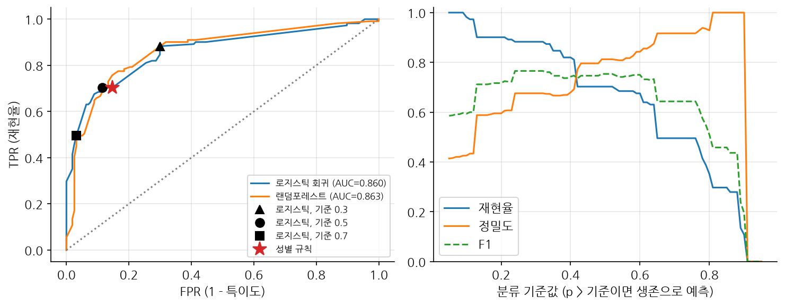

**혼동행렬**(confusion matrix)은 분류 결과를 실제 범주와 예측 범주의 2×2 표로 센 것이고, 분류의 평가지표는 모두 이 네 칸의 비율이다. 지금까지 분류기의 `score`는 정확도였다. 이 글은 정확도가 의미를 잃는 상황에서 출발해 재현율, 정밀도, F1, 특이도, FPR, ROC 곡선과 AUC를 하나씩 정리한다. 의학의 진단검사 평가와 같은 개념이고, 민감도·특이도·예측도는 [생명과학통계 - 진단법 평가](/posts/biostat-diagnostic-test)에서도 다룬다.

## 혼동행렬

관심 있는 범주(퇴사, 생존, 질병 있음)를 양성(1, O), 나머지를 음성(0, X)이라 하자.

| | 예측 양성 | 예측 음성 |
|---|---|---|
| **실제 양성** | TP (O/O) | FN (O/X) |
| **실제 음성** | FP (X/O) | TN (X/X) |

외우는 법: 둘째 글자(P/N)는 **예측**이 무엇이었는지, 첫 글자(T/F)는 그 예측이 **맞았는지**다. FP는 "양성이라고 했는데(P) 틀렸다(F)"이므로 실제 음성이다. sklearn은 행이 실제, 열이 예측이며 0이 먼저다.

```python
(tn, fp), (fn, tp) = sklearn.metrics.confusion_matrix(y, yhat)
```

## 퇴사자 예측: 지표가 하나씩 필요해지는 과정

(강의 예제) 직원 1000명 중 실제로 퇴사하는 사람은 10명이다. 회사가 퇴사자 예측 시스템을 요청했다.

### 정확도로는 부족하다

$$
\text{accuracy} = \frac{TP + TN}{TP + FN + FP + TN}
$$

**"아무도 안 나간다"**고 예측하면 990명을 맞혀 정확도 0.99다. 모수도 계산도 필요 없는 예측이 99점을 받는다. 그러나 인사팀이 원한 것은 나갈 사람 10명을 찾아 면담하는 것이었고, 이 예측은 한 명도 찾지 못했다. 양성이 드문 **불균형 자료**에서 정확도는 다수 범주를 찍기만 해도 높아진다.

### 재현율: 실제 양성 중 몇을 찾았나

$$
\text{recall} = \text{sensitivity} = \text{TPR} = \frac{TP}{TP + FN}
$$

분모는 실제 퇴사자 수, 분자는 그중 퇴사로 예측한 수다. "아무도 안 나간다"의 재현율은 0/10 = 0이다. 이상 상황 감지율이라고 생각하면 된다.

### 정밀도: 양성이라고 한 것 중 몇이 맞았나

재현율을 올리는 가장 쉬운 방법은 조금만 수상해도 다 퇴사할 것이라고 하는 것이다. **100명을 찍었고 실제 퇴사자 10명이 모두 그 안에 있다면** 정확도 0.91, 재현율 1.0이다. 그러나 찍힌 100명 중 90명은 멀쩡히 다니는 사람이다.

$$
\text{precision} = \frac{TP}{TP + FP}
$$

이 예측의 정밀도는 10/100 = 0.1이다. 과녁 중앙을 맞히라고 했더니 기관총으로 한 번 긁은 것과 같다.

### F1: 둘의 균형

재현율과 정밀도는 보통 맞바뀐다. 더 많이 찍으면 재현율이 오르고 정밀도가 내린다. 한 숫자로 비교하려면 두 값의 조화평균을 쓴다.

$$
F_1 = \frac{2}{1/\text{recall} + 1/\text{precision}} = \frac{2\,TP}{2\,TP + FP + FN}
$$

조화평균은 작은 쪽에 끌려간다. 재현율 1.0, 정밀도 0.1이면 산술평균은 0.55지만 $F_1$은 0.18이다.

### 특이도와 FPR: 생사람을 잡은 비율

$$
\text{specificity} = \frac{TN}{FP + TN}, \qquad \text{FPR} = 1 - \text{specificity} = \frac{FP}{FP + TN}
$$

FPR의 분모는 실제 음성, 즉 억울한 사람이 될 수 있는 사람들이다. 정밀도와 FPR은 둘 다 FP를 분자로 가져서 헷갈리기 쉽다. **100명을 찍었고 그중 실제 퇴사자가 8명**(퇴사자 10명 중 2명은 놓침)인 경우로 비교한다.

| | 계산 | 값 | 질문 |
|---|---|---|---|
| 재현율 (TPR) | 8 / 10 | 0.800 | 나갈 사람 중 몇을 찾았나 |
| 정밀도 | 8 / 100 | 0.080 | 찍은 사람 중 몇이 진짜였나 |
| FPR | 92 / 990 | 0.093 | 남을 사람 중 몇을 억울하게 찍었나 |
| 특이도 | 898 / 990 | 0.907 | 남을 사람 중 몇을 남는다고 했나 |
| 정확도 | 906 / 1000 | 0.906 | |
| $F_1$ | 16 / 110 | 0.145 | |

정밀도는 "찍힌 사람" 기준, FPR은 "음성인 사람" 기준이다. 양성이 드물면 FPR은 작아도(0.093) 정밀도는 아주 낮을(0.08) 수 있다.

> **주의.** "정확도는 분류에서 언제나 가장 합리적인 지표"가 아니다. 무엇을 놓치는 것(FN)과 무엇을 잘못 찍는 것(FP)의 비용이 문제마다 다르기 때문이다. 암 검진은 놓치는 비용이 커서 재현율을, 스팸 필터는 정상 메일을 버리는 비용이 커서 정밀도를 중시한다.

## 계산: sklearn.metrics

(강의 예제) 밀실의 100명 중 이중 첩자가 2명 있다. 3명을 사살했고 그중 1명이 실제 첩자였다.

```python
y    = np.array([1]*2 + [0]*98)
yhat = np.array([0, 1, 1, 1] + [0]*96)
sklearn.metrics.confusion_matrix(y, yhat)    # [[96, 2], [1, 1]]
```

| 지표 | 함수 | 손계산 | 값 |
|---|---|---|---|
| 정확도 | `accuracy_score(y, yhat)` | 97 / 100 | 0.970 |
| 재현율 | `recall_score(y, yhat)` | 1 / 2 | 0.500 |
| 정밀도 | `precision_score(y, yhat)` | 1 / 3 | 0.333 |
| $F_1$ | `f1_score(y, yhat)` | 2 / (2 + 2 + 1) | 0.400 |
| FPR | (직접 계산) | 2 / 98 | 0.020 |

함수의 인자 순서는 항상 `(y, yhat)`, 실제가 먼저다. 순서를 바꾸면 재현율과 정밀도가 뒤바뀐다. `classification_report(y, yhat)`는 범주별 정밀도, 재현율, $F_1$을 한 번에 보여 준다.

## 분류 기준값과 ROC 곡선

### 기준값이 지표를 정한다

[2편](/posts/ml-02-linear-logistic)에서 로지스틱 회귀는 $\hat p > 0.5$이면 양성으로 예측했다. 0.5는 관례일 뿐이고, 기준을 낮추면 더 많이 찍고 높이면 덜 찍는다. 타이타닉(학습 623명, 시험 268명, 시험 자료의 생존율 0.414)에 4개 변수 로지스틱 회귀를 적합하고 시험 자료에서 기준값을 바꿨다.

| 기준값 | TP | FN | FP | TN | 정확도 | 재현율 | 정밀도 | FPR | $F_1$ |
|---|---|---|---|---|---|---|---|---|---|
| 0.3 | 98 | 13 | 47 | 110 | 0.776 | 0.883 | 0.676 | 0.299 | 0.766 |
| 0.5 | 78 | 33 | 18 | 139 | 0.810 | 0.703 | 0.813 | 0.115 | 0.754 |
| 0.7 | 55 | 56 | 5 | 152 | 0.772 | 0.496 | 0.917 | 0.032 | 0.643 |
| 성별 규칙 | 78 | 33 | 23 | 134 | 0.791 | 0.703 | 0.772 | 0.147 | 0.736 |

기준값을 0.3에서 0.7로 올리면 재현율은 0.88에서 0.50으로 내려가고 정밀도는 0.68에서 0.92로 올라간다. 같은 모형이라도 기준값을 어디에 두느냐에 따라 전혀 다른 분류기가 된다. 기준 0.5의 로지스틱 회귀는 성별 규칙과 재현율이 같고(78명) FP가 5명 적다.



### ROC 곡선과 AUC

**ROC 곡선**은 기준값을 1에서 0으로 내리면서 (FPR, TPR)을 이은 곡선이다. 기준이 1이면 아무도 찍지 않아 (0, 0), 0이면 모두 찍어 (1, 1)이다. 생사람을 많이 잡을수록(FPR이 커질수록) 감지율(TPR)도 올라가므로 곡선은 오른쪽 위로 올라간다. 좋은 분류기는 FPR이 작을 때 이미 TPR이 높아서 곡선이 왼쪽 위로 붙는다. 대각선은 무작위로 찍는 분류기다.

**AUC**(area under the ROC curve)는 곡선 아래 면적이다. 1이면 완벽, 0.5면 무작위다. AUC는 "양성 하나와 음성 하나를 무작위로 뽑았을 때 양성의 점수 $\hat p$가 더 높을 확률"과 같아서, 기준값을 정하기 전에 **점수의 순위**가 얼마나 좋은지를 잰다.

```python
p = predictr.predict_proba(XX)[:, 1]       # 0/1이 아니라 확률을 넣는다
sklearn.metrics.roc_auc_score(yy, p)       # 0.860
fpr, tpr, thresholds = sklearn.metrics.roc_curve(yy, p)
```

로지스틱 회귀 0.860, 랜덤포레스트 0.863으로 거의 같다. 성별 규칙은 점수가 0과 1 두 값뿐이라 ROC 곡선이 점 하나를 지나는 꺾은선이 되고 AUC는 0.778이다.

> **주의.** `roc_auc_score`에 `predict(XX)`의 0/1 예측을 넣으면 점 하나짜리 ROC가 되어 AUC가 낮게 나온다. 반드시 `predict_proba`의 확률(또는 `decision_function`의 점수)을 넣는다.

기준값을 고르는 방법은 목적에 따라 다르다. $F_1$을 최대로 하는 기준(이 분할에서는 0.24, $F_1 = 0.766$), 재현율을 0.9 이상으로 유지하는 가장 높은 기준, FN과 FP의 비용 비를 반영한 기준 등이 있다. 기준도 시험 자료가 아니라 학습 자료 안의 검증 자료로 골라야 한다. 이 그림은 기준값의 효과를 보여 주려고 시험 자료로 그렸다.

## 비교

| 지표 | 식 | 분모 | 높이는 쉬운 방법 (그래서 혼자 쓰면 안 되는 이유) |
|---|---|---|---|
| 정확도 | $(TP+TN)/n$ | 전체 | 다수 범주만 찍기 |
| 재현율 (TPR, 민감도) | $TP/(TP+FN)$ | 실제 양성 | 모두 양성으로 찍기 |
| 정밀도 | $TP/(TP+FP)$ | 예측 양성 | 확실한 것 하나만 찍기 |
| 특이도 | $TN/(FP+TN)$ | 실제 음성 | 모두 음성으로 찍기 |
| FPR | $FP/(FP+TN)$ | 실제 음성 | 모두 음성으로 찍기 (낮추기) |
| $F_1$ | $2TP/(2TP+FP+FN)$ | | TN을 무시한다 |
| AUC | ROC 곡선 아래 면적 | | 기준값과 무관, 순위만 평가 |

## 요약

- 혼동행렬의 둘째 글자는 예측, 첫 글자는 정답 여부다.
- 불균형 자료에서 정확도는 쓸모가 없다. 재현율과 정밀도를 함께 보고, 하나로 요약하려면 $F_1$을 쓴다.
- 재현율과 정밀도는 분류 기준값에 따라 맞바뀐다.
- ROC 곡선은 기준값 전체의 (FPR, TPR)이고, AUC는 기준값과 무관한 순위 성능이다. 확률을 넣어 계산한다.

## 참고자료

- 최규빈, 「기계학습활용」 강의노트 (2023), <https://guebin.github.io/MP2023/>
- Fawcett, T. (2006). An introduction to ROC analysis. *Pattern Recognition Letters*, 27(8), 861–874.
- Wikipedia, *Positive and negative predictive values*, <https://en.wikipedia.org/wiki/Positive_and_negative_predictive_values>
- scikit-learn User Guide, *3.4 Metrics and scoring: Classification metrics*.
