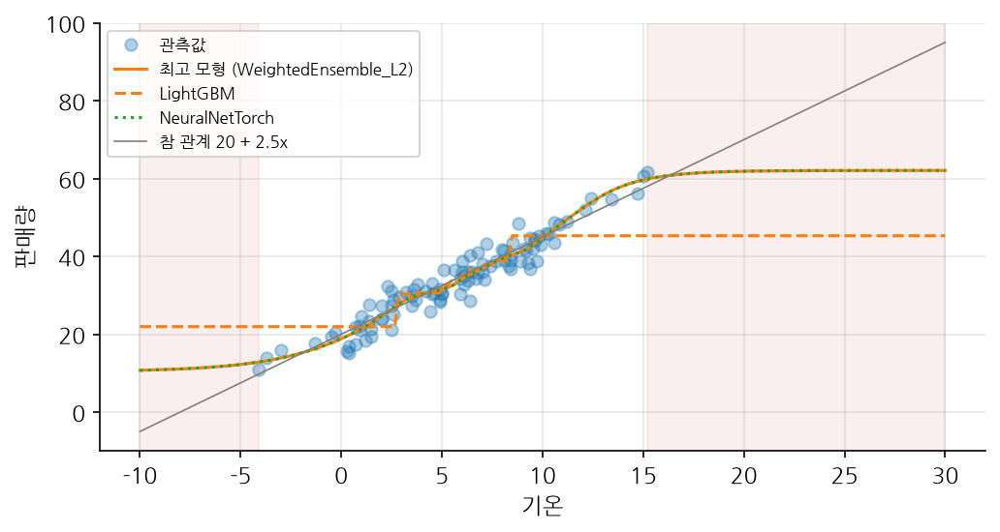

**AutoML**(automated machine learning)은 전처리, 모형 선택, 하이퍼파라미터 조정, 앙상블을 자동으로 수행하는 도구를 말한다. AutoGluon은 그중 하나로, 표 자료에서는 `TabularPredictor`에 자료를 넘기면 LightGBM, CatBoost, XGBoost, 랜덤포레스트, 신경망 등을 차례로 학습하고 검증 점수로 가중평균한 앙상블을 만든다. 쓰는 법은 sklearn과 같은 네 단계다([기계학습 활용 - 예측 문제와 predictor](/posts/ml-01-predictor)). 안에서 돌아가는 부스팅과 배깅은 [기계학습 활용 - 배깅, 랜덤포레스트, 부스팅](/posts/ml-08-ensemble)에서 다뤘다. 이 글은 자동화가 무엇을 대신해 주는지, 그리고 대신해 주지 못하는 것이 무엇인지를 정리한다.

## 네 단계는 그대로다

```python
from autogluon.tabular import TabularPredictor
predictr = TabularPredictor(label='Survived')   # 1. 생성: 타깃 열 이름만 준다
predictr.fit(tr)                                # 2. 적합: X, y를 나누지 않은 표 그대로
yhat = predictr.predict(te)                     # 3. 예측
predictr.evaluate(te)                           # 4. 평가
```

sklearn과 다른 점은 **표를 통째로 넘긴다**는 것이다. 문자열 열, 결측치, 범주형 변수를 그대로 둬도 된다. sklearn에서는 이 상태로 `fit`이 실패했고([기계학습 활용 - 결측치 처리와 스케일링](/posts/ml-03-missing-scaling)), 원핫 인코딩과 결측치 대치를 직접 해야 했다.

(강의 예제) 타이타닉 자료 891명을 7:3으로 나눠(학습 623, 시험 268) 기본 설정으로 적합하면 25초쯤 걸린다. 문제 유형은 타깃이 0/1인 것을 보고 `binary`, 평가지표는 `accuracy`로 자동으로 정한다. `predict_proba`도 sklearn처럼 쓸 수 있다.

## fit이 하는 일

### 1. 자동 전처리

열마다 자료형을 추론해 처리를 달리한다.

| 열 | 추론 | 처리 |
|---|---|---|
| Age, Fare, PassengerId, Pclass, SibSp, Parch | 수치형 | 그대로 (결측은 모형별로 처리) |
| Sex | 값이 둘뿐인 문자열 | 0/1 |
| Ticket, Cabin, Embarked | 범주형 | 범주 코드 |
| Name | 텍스트 | 단어 n-gram 특징, 글자 수·단어 수·대문자 비율 |

원래 11개 열이 26개 특징이 된다. Name에서 만들어진 특징에는 `__nlp__.mr`, `miss`, `mrs`, `master`, `john`, `william` 같은 단어가 있다. 호칭(Mr, Miss, Mrs, Master)은 성별과 나이, 결혼 여부를 담고 있어서 사람이 직접 만들던 대표적인 파생 변수다. AutoGluon은 이를 단어 빈도에서 찾아낸다.

### 2. 여러 모형 학습

기본 설정에서는 학습 자료의 20%(125명)를 **검증 자료**로 떼어 두고, 나머지로 11개 모형을 학습한 뒤 검증 자료에서 점수를 매긴다.

### 3. 가중 앙상블

검증 점수를 높이도록 모형들의 예측을 가중평균한 `WeightedEnsemble_L2`를 만든다. 가중치는 앙상블에 모형을 하나씩 탐욕적으로 추가하며 정한다(Caruana의 ensemble selection). 이 자료에서는 RandomForestGini 0.8, CatBoost 0.2가 뽑혔다. 검증 점수가 가장 높은 이 앙상블이 `model_best`가 되어 `predict`에 쓰인다.

## 리더보드와 검증 점수의 낙관

`leaderboard(te)`에 시험 자료를 넘기면 모형별 검증 점수(`score_val`)와 시험 점수(`score_test`)를 함께 보여 준다.

| 모형 | score_val | score_test |
|---|---|---|
| **WeightedEnsemble_L2** (선택됨) | **0.896** | 0.802 |
| CatBoost | 0.888 | 0.821 |
| RandomForestGini | 0.888 | 0.799 |
| LightGBM | 0.880 | 0.821 |
| RandomForestEntr | 0.872 | 0.817 |
| NeuralNetFastAI | 0.864 | **0.828** |
| LightGBMXT | 0.840 | 0.825 |

검증 점수 1위가 시험 점수로는 12개 중 11위다. 이유는 두 가지다.

- **검증 자료가 작다.** 125명에서 정확도 0.01은 1.25명이다. 모형 간 차이 대부분이 한두 명을 더 맞혔는지의 차이이고, 시험 자료가 바뀌면 순위도 바뀐다.
- **검증 자료로 고르는 것 자체가 적합이다.** 11개 모형 중 검증 점수가 가장 높은 것을 고르고, 다시 그 검증 자료에 맞춰 앙상블 가중치를 정했다. 고른 결과의 검증 점수는 운 좋게 높게 나온 쪽으로 치우친다. 모의고사 문제를 보고 답안 전략을 정했으니 그 모의고사 점수는 실력보다 높다.

학습 정확도는 0.979다. 학습 0.979, 검증 0.896, 시험 0.802로 자료가 "덜 본" 것일수록 점수가 내려간다. 모형 선택에 쓴 점수는 성능 추정치로 쓰지 않는다는 원칙([데이터 마이닝 - 리샘플링: 교차검증과 부트스트랩](/posts/dm-resampling))이 AutoML에서도 그대로다.

## presets: 배깅과 스태킹

`presets`는 시간과 성능의 맞바꿈을 정하는 묶음 설정이다.

| presets | 검증 방식 | 스태킹 | 특징 |
|---|---|---|---|
| `medium_quality` (기본값) | 20% 홀드아웃 | 없음 | 빠름 |
| `high_quality` | k-겹 배깅 | 있음 | 추론 속도 고려 |
| `best_quality` | k-겹 배깅 | 다층 | 가장 느리고 정확 |

`best_quality`에서는 각 모형을 **k-겹 배깅**으로 학습한다. 학습 자료를 k등분해 k개 모형을 만들고, 각 모형이 학습에 쓰지 않은 겹(out-of-fold)을 예측하게 한다. 그러면 학습 자료 623명 **전원**에 대해 "본 적 없는" 예측이 생기고, 검증 점수가 125명이 아니라 623명에서 계산된다. 이 out-of-fold 예측을 입력으로 다음 층 모형을 학습하는 것이 **스태킹**(stacking)이다. 이름 끝의 `_BAG_L1`은 배깅된 1층 모형이라는 뜻이다. 하이퍼파라미터를 바꾼 변형(`_r156` 등)도 함께 탐색한다.

`time_limit=600`으로 적합하면 600초를 다 쓰고 50개 모형을 만든다.

| | 기본값 | `best_quality` |
|---|---|---|
| 적합 시간 | 25초 | 602초 |
| 모형 수 | 12 | 50 |
| 최종 앙상블 | RandomForestGini 0.8 + CatBoost 0.2 | NeuralNetTorch_r79 0.44 + CatBoost_r50 0.56 |
| 앙상블 score_val | 0.896 | 0.864 |
| 앙상블 시험 정확도 | 0.802 | **0.825** |
| 시험 AUC | 0.870 | 0.899 |

검증 점수는 오히려 내려갔다(0.896 → 0.864). 623명에서 계산한 점수가 125명에서 계산한 점수보다 덜 낙관적이기 때문이다. 검증과 시험의 차이가 0.094에서 0.039로 줄었고, 시험 정확도는 0.022(6명) 올랐다. `best_quality`의 이득은 개별 모형이 더 좋아진 것보다 **검증 점수를 믿을 수 있게 된 것**에 가깝다.

50개 중 시험 정확도 1위는 NeuralNetFastAI_r156(0.847)이지만 이것을 미리 알 방법은 없다. 시험 점수로 모형을 고르면 그 순간 시험 자료가 검증 자료가 된다.

## 특성 중요도

`feature_importance(te)`는 **순열 중요도**(permutation importance)를 계산한다. 한 변수의 값을 무작위로 섞어 그 변수와 타깃의 관계를 끊은 뒤 점수가 얼마나 떨어지는지를 잰다. 모형 종류와 상관없이 쓸 수 있다.

기본값 모형의 시험 자료 기준 정확도 감소량은 Name 0.110, Pclass 0.020, Sex 0.019, SibSp 0.006이고 나머지는 0 이하다(Cabin −0.012, Embarked −0.013). 음수는 섞었더니 오히려 나아졌다는 뜻으로, 그 변수가 시험 자료에서는 잡음 역할을 했다는 신호다.

Name이 압도적이다. 그렇다면 Name을 빼면 크게 나빠질까?

| | 시험 정확도 |
|---|---|
| 전체 변수 | 0.802 |
| Name 제외 | 0.806 |

거의 같다. Name의 정보(호칭)는 Sex, Age, Pclass와 겹친다. Name이 있으면 모형이 호칭에 의존하고, 빠지면 Sex와 Age가 그 역할을 넘겨받는다. 순열 중요도는 **이 모형이 이 변수에 얼마나 의존하는가**이지 **이 변수가 없으면 얼마나 손해인가**가 아니다. 서로 상관된 변수가 있으면 둘은 다르다. 다중공선성에서 계수가 불안정했던 것([기계학습 활용 - 과적합과 다중공선성](/posts/ml-04-overfitting-collinearity))과 같은 현상이 중요도에서도 나타난다.

## 회귀: 평가지표 지정

Medical Cost 자료(학습 936명, 시험 402명)에서 타깃 charges는 실수이므로 문제 유형은 `regression`, 평가지표는 기본으로 RMSE다. AutoGluon은 모든 지표를 "클수록 좋다"로 맞추기 때문에 RMSE를 음수로 보고한다(시험 −4267.6).

```python
predictr = TabularPredictor(label='charges', eval_metric='r2').fit(tr)
```

`eval_metric='r2'`로 바꿔도 시험 $R^2$는 0.876으로 같았다. 지표는 앙상블 가중치와 모형 순위를 정할 때 쓰이므로 결과가 달라질 수 있지만, 이 자료에서는 같은 앙상블이 선택됐다. 같은 분할에서 sklearn 그래디언트 부스팅 기본값의 시험 $R^2$는 0.866이었다(8편).

순열 중요도($R^2$ 감소량)는 smoker 1.494, bmi 0.247, age 0.173, children 0.011, region 0.002, sex −0.001이다. smoker를 섞으면 $R^2$가 1.49 떨어져 음수가 된다. sex는 p값 0.68로 영향이 없다. 흡연 × BMI와 나이가 거의 전부라는 8편의 결론과 같다.

## 하이퍼파라미터 지정

`hyperparameters`에 모형 종류와 설정을 사전으로 주면 그 모형들만 학습한다.

```python
hp = {'GBM': {},                                          # LightGBM 기본 설정
      'RF':  [{'n_estimators': 300, 'max_features': 0.5}],  # 랜덤포레스트 한 가지 설정
      'LR':  {}}                                          # 선형모형
predictr.fit(tr, hyperparameters=hp)
```

| 모형 | score_val | score_test ($R^2$) |
|---|---|---|
| WeightedEnsemble_L2 | 0.855 | 0.871 |
| LightGBM | 0.851 | 0.868 |
| RandomForest | 0.851 | 0.867 |
| LinearModel | 0.750 | 0.770 |

목록에 여러 설정을 넣으면 각각 따로 학습된다. 지정하지 않은 값은 AutoGluon의 기본값이 채운다(랜덤포레스트의 `max_leaf_nodes=15000` 등). 선형모형이 크게 뒤처지는 것은 흡연 × BMI 교호작용을 항으로 넣지 않았기 때문이다([기계학습 활용 - 선형모형의 한계: 이상치와 교호작용](/posts/ml-06-outlier-interaction)).

## 자동화가 해 주지 않는 것: 외삽

(강의 예제) 기온 −4.1~15.2°C 범위의 아이스크림 판매 자료 100개(참 관계 $20 + 2.5x$, 오차 표준편차 3)로 적합하고 −10~30°C에서 예측한다.



| 기온 | 참값 $20+2.5x$ | 최고 모형 (= NeuralNetTorch) | LightGBM |
|---|---|---|---|
| −10 | −5.0 | 10.7 | 22.0 |
| 15.2 | 58.0 | 59.9 | 45.3 |
| 20 | 70.0 | 61.9 | 45.3 |
| 30 | 95.0 | 62.1 | 45.3 |

- 앙상블은 NeuralNetTorch 하나에 가중치를 모두 줬다(검증 RMSE 3.39, 오차 표준편차 3에 가깝다).
- LightGBM은 나무의 합이라 관측 범위 밖에서 상수다. 8°C 이후가 이미 평평한 것은 학습에 쓰인 80개(나머지 20개는 검증)에서 잎당 최소 표본 수(LightGBM 기본값 20) 제한으로 위쪽 구간이 더 나뉘지 않은 결과로 보인다.
- 신경망도 활성화 함수가 포화되면서 평평해진다. 범위 밖에서 직선을 이어 주는 장치가 없다.

선형회귀 하나면 30°C에서 95 근처를 예측했을 것이다. AutoML은 **주어진 모형 후보 중에서** 검증 점수가 좋은 것을 고를 뿐이고, 검증 자료도 관측 범위 안에 있으므로 외삽 능력은 점수에 드러나지 않는다. 나무의 외삽 문제([기계학습 활용 - 의사결정나무](/posts/ml-07-decision-tree))는 모형을 많이 섞어도 사라지지 않는다.

## 쓸 때의 체크리스트

| 상황 | 할 일 |
|---|---|
| 성능을 보고할 때 | `score_val`이 아니라 따로 떼어 둔 시험 자료 점수 |
| 자료가 작을 때 | `best_quality`로 배깅해 검증 점수를 안정시킨다 |
| 변수 중요도를 해석할 때 | 상관된 변수를 빼 보고 점수 변화와 함께 본다 |
| 미래·범위 밖을 예측할 때 | 선형 성분이 있는 모형과 비교, 예측 범위 확인 |
| 텍스트·이미지가 주가 될 때 | `MultiModalPredictor` (이 시리즈에서는 다루지 않음) |

## 요약

| 단계 | AutoGluon이 하는 일 |
|---|---|
| 생성 | `TabularPredictor(label=...)`, 문제 유형과 지표 자동 추론 |
| 전처리 | 자료형 추론, 범주 코드, 텍스트 n-gram, 결측 처리 |
| 학습 | GBM, CatBoost, XGBoost, RF, ExtraTrees, 신경망 등 |
| 앙상블 | 검증 점수 기준 탐욕적 가중평균 (`WeightedEnsemble_L2`) |
| 결과 | `leaderboard`, `evaluate`, `feature_importance` |

- 기본값은 20% 홀드아웃(타이타닉 125명)으로 고르므로 검증 점수가 낙관적이다(0.896 vs 시험 0.802).
- `best_quality`는 k-겹 배깅과 스태킹으로 검증 점수를 학습 자료 전체에서 계산한다. 시험 정확도 0.825, 검증과 시험의 차이 0.039.
- 순열 중요도는 의존도다. Name 중요도가 압도적이어도 Name을 빼면 시험 정확도는 0.806으로 같다.
- 모형을 많이 섞어도 외삽은 안 된다.

## 참고자료

- 최규빈, 「기계학습활용」 강의노트 (2023), <https://guebin.github.io/MP2023/>
- AutoGluon Tabular 문서, <https://auto.gluon.ai/stable/tutorials/tabular/index.html>
- Erickson, N. et al. (2020). AutoGluon-Tabular: Robust and accurate AutoML for structured data. *arXiv:2003.06505*.
- Caruana, R., Niculescu-Mizil, A., Crew, G. and Ksikes, A. (2004). Ensemble selection from libraries of models. *Proceedings of ICML*.
- Breiman, L. (2001). Random forests. *Machine Learning*, 45(1), 5–32. (순열 중요도)
