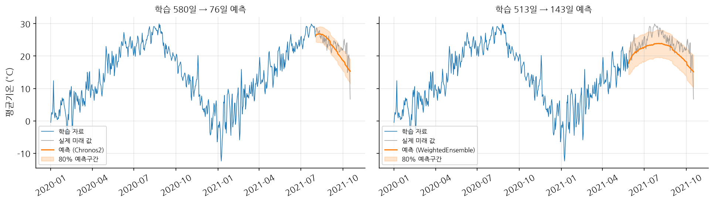
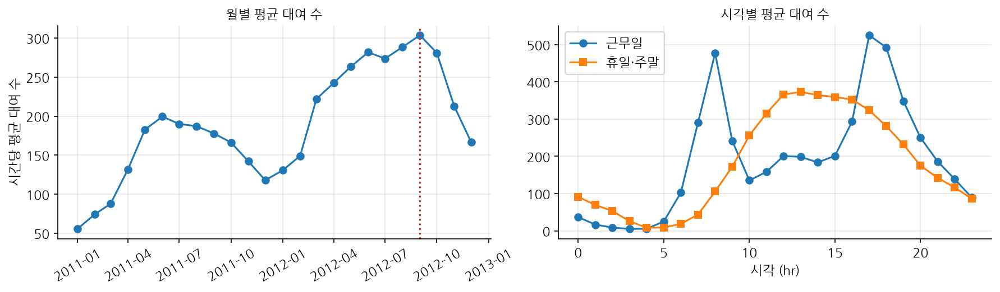

**시계열 예측**(time series forecasting)은 과거의 관측값 $y_1, \dots, y_T$로 미래 값 $y_{T+1}, \dots, y_{T+h}$를 예측하는 문제다. 지금까지의 예측이 설명변수에서 반응변수로 가는 사상 $X \to y$를 배우는 것이었다면, 시계열 예측은 $y_{\text{과거}} \to y_{\text{미래}}$를 배운다. ARIMA 같은 통계 모형으로 같은 문제를 푸는 방법은 [시계열 분석 - 예측](/posts/ts-09-forecasting)과 [시계열 분석 - 계절형 ARIMA 모형](/posts/ts-10-seasonal-arima)에 있다. 이 글은 [앞 글](/posts/ml-10-autogluon)의 AutoGluon을 시계열에 쓰는 법과, 시간에서 특징을 뽑아 표 자료의 회귀로 바꾸는 방법을 정리한다.

## 표 자료와 무엇이 다른가

| | 표 자료 | 시계열 |
|---|---|---|
| 배우는 것 | $X \to y$ | $y_{\text{과거}} \to y_{\text{미래}}$ |
| 시험 시점의 입력 | 시험 자료의 $X$가 주어진다 | 미래의 아무것도 주어지지 않는다 |
| 예측 호출 | `predict(test)` | `predict(train)` + 예측 길이 $h$ |
| 자료 분할 | 무작위 | 시간 순서 (과거로 학습, 미래로 평가) |
| 출력 | 값 하나 | $h$개 값, 보통 분위수까지 |

가장 큰 차이는 두 번째 행이다. 표 자료에서는 시험 자료의 설명변수를 보고 반응변수를 맞혔다. 시계열에서는 미래 시점에 관측되는 것이 아무것도 없으므로, 학습 자료의 끝에서 이어서 예측한다. 무작위로 나누면 미래의 정보로 과거를 맞히는 셈이 되어 성능이 부풀려진다.

## TimeSeriesDataFrame

AutoGluon은 시계열을 **긴 형식**(long format)으로 받는다. 시계열 식별자(`item_id`), 시점(`timestamp`), 타깃의 세 열이다.

| item_id | timestamp | 주가 |
|---|---|---|
| 삼성전자 | 2023-12-07 | 72600 |
| 삼성전자 | 2023-12-08 | 72800 |
| 카카오 | 2023-12-07 | 51700 |
| 카카오 | 2023-12-08 | 51600 |

시계열이 하나뿐이어도 `item_id` 열이 필요하다. 여러 종목처럼 시계열이 여럿이면 한 모형이 모든 시계열에서 함께 배운다(global model).

```python
from autogluon.timeseries import TimeSeriesDataFrame, TimeSeriesPredictor
ts_train = TimeSeriesDataFrame.from_data_frame(
    df_train.assign(item_id='전주'), id_column='item_id', timestamp_column='date')
predictr = TimeSeriesPredictor(target='temp', prediction_length=76, freq='D')
predictr.fit(ts_train, presets='medium_quality')
pred = predictr.predict(ts_train)     # 학습 자료의 다음 76일
```

`pred`에는 평균(`mean`)과 분위수 `0.1`, `0.2`, …, `0.9`가 들어 있다. 점 예측만이 아니라 **예측 분포**를 내놓는다.

## 전주 기온 예측

(강의 예제) 전주의 일평균기온 656일(2020-01-01 ~ 2021-10-17)을 두 가지로 나눴다.

- **분할 1**: 580일로 학습, 마지막 76일(8월 3일 ~ 10월 17일) 예측
- **분할 2**: 513일로 학습, 마지막 143일(5월 28일 ~ 10월 17일) 예측



비교를 위해 두 가지 단순 기준선을 함께 계산했다.

- **마지막 값**: 학습 자료의 마지막 날 기온을 $h$일 동안 그대로 쓴다.
- **작년 같은 날**: 365일 전의 기온을 쓴다(계절 단순 예측).

| | 분할 1 (76일) | 분할 2 (143일) |
|---|---|---|
| 선택된 모형 | Chronos2 (가중치 1.0) | Chronos2 0.875 + DirectTabular 0.125 |
| **AutoGluon MAE** | **2.23** | 2.99 |
| AutoGluon RMSE | 2.90 | 3.54 |
| 80% 구간의 실제 포함률 | 0.776 | 0.790 |
| 마지막 값 MAE | 3.04 | 7.79 |
| 작년 같은 날 MAE | 2.97 | **2.82** |

- 분할 1에서는 AutoGluon이 두 기준선보다 0.7°C 이상 낫다.
- 분할 2에서는 **작년 같은 날**이 AutoGluon보다 낫다. 5월 말 기온을 143일 동안 이어 쓰는 "마지막 값"은 여름을 통째로 놓쳐 7.79로 무너진다.
- 80% 예측구간이 실제 값의 78~79%를 덮는다. 구간의 폭이 명목 수준에 맞게 보정되어 있다.

### 리더보드의 모형들

`medium_quality`는 성격이 다른 세 종류의 모형을 학습한다.

| 종류 | 모형 | 방식 |
|---|---|---|
| 지역 통계 모형 | SeasonalNaive, ETS, Theta | 시계열마다 따로 적합하는 고전적 방법 ([시계열 분석 - 평활법](/posts/ts-03-smoothing)) |
| 표 모형 | RecursiveTabular, DirectTabular | 시차 값과 날짜 특징을 만들어 LightGBM으로 회귀 |
| 사전학습 모형 | Chronos2, Toto2 | 대량의 시계열로 미리 학습한 트랜스포머, 이 자료로는 학습하지 않고 바로 예측 |

평가지표는 기본값이 **WQL**(weighted quantile loss)이다. 분위수 0.1 ~ 0.9 각각에 대한 분위수 손실을 합해 실제 값의 크기로 나눈 것으로, 점 예측의 정확도와 예측구간의 보정을 함께 본다. 작을수록 좋고, AutoGluon은 앞 글처럼 부호를 바꿔 보고한다. (아래 표에서는 해석이 직관적이도록 AutoGluon이 음수로 보고한 값의 부호를 다시 양수로 되돌려 적었다.)

| 모형 | 분할 1 시험 WQL | 분할 2 시험 WQL |
|---|---|---|
| Chronos2 | **0.073** | **0.070** |
| DirectTabular | 0.086 | 0.296 |
| Toto2 | 0.103 | 0.178 |
| SeasonalNaive | 0.167 | 0.222 |
| ETS | 0.173 | 0.280 |
| Theta | 0.180 | 0.301 |
| RecursiveTabular | 0.197 | 0.315 |

두 분할 모두 사전학습 모형 Chronos2가 1위다. 이 전주 자료를 한 번도 학습하지 않은 모형이 이 자료로 적합한 모형들보다 낫다. 수많은 시계열에서 "기온 같은 계절 곡선은 이렇게 이어진다"를 이미 배웠기 때문이다. AutoGluon의 SeasonalNaive는 일별 자료에서 주기 7(요일)을 쓰므로 위 표의 "작년 같은 날"(주기 365)과 다르다.

### 검증 구간이 시험 구간을 대표하지 못할 때

분할 2에서 Chronos2 하나의 시험 WQL은 0.070인데, 선택된 앙상블은 0.092로 더 나쁘다. AutoGluon은 학습 자료의 **마지막 $h$일**을 검증 구간으로 쓴다. 분할 2의 검증 구간은 2021년 1월 ~ 5월 말이고, 시험 구간은 5월 말 ~ 10월이다.

| | 검증 구간 | 시험 구간 |
|---|---|---|
| 분할 1 | 5월 중순 ~ 8월 초 (여름으로 가는 길) | 8월 ~ 10월 (여름에서 내려옴) |
| 분할 2 | 1월 ~ 5월 (겨울에서 올라감) | 5월 말 ~ 10월 (여름 정점을 지남) |

분할 2는 검증 구간에 여름 정점이 없다. 겨울에서 봄으로 오르는 구간을 잘 맞힌 모형 조합이 여름을 지나는 구간에서도 좋다는 보장이 없다. 검증 WQL도 분할 1(0.058)보다 훨씬 크게(0.263) 나와 검증 구간 자체가 어려웠음을 보여 준다. 표 자료에서 검증 자료가 작아 선택이 흔들렸던 것([기계학습 활용 - AutoML: AutoGluon](/posts/ml-10-autogluon))과 같은 문제가 시계열에서는 **계절**의 형태로 나타난다. 예측 길이가 계절 주기의 상당 부분을 차지하면 `num_val_windows`로 검증 구간을 여러 개 두거나, 작년 같은 날 같은 계절 기준선과 반드시 비교한다.

## 피처엔지니어링: 시계열을 회귀로 바꾸기

시점마다 그 시점을 설명하는 특징을 뽑으면 시계열 예측을 표 자료의 회귀로 바꿀 수 있다. 시각, 요일, 월, 연도, 공휴일 여부 같은 **달력 특징**은 미래 시점에도 미리 알 수 있으므로 시험 시점의 입력으로 쓸 수 있다. 앞의 DirectTabular·RecursiveTabular가 이 방식이다.

(강의 예제) 워싱턴 D.C. 자전거 대여 자료(UCI, 2011 ~ 2012년 시간별 17,379행)로 시간당 대여 수 cnt(평균 189.5)를 예측한다. 설명변수는 계절, 연도(yr), 월, 시각(hr), 공휴일, 요일, 근무일 여부, 날씨, 기온, 체감기온, 습도, 풍속이다.



두 가지 패턴이 보인다.

- **시각 × 근무일**: 근무일은 8시와 17시(평균 525.3) 두 번의 출퇴근 정점, 휴일·주말은 13시(372.7)에 한 번의 정점이다. 근무일 여부와 시각의 교호작용이다.
- **연도 추세**: 2012년이 2011년보다 전반적으로 많다. 서비스가 성장 중이다.

### 두 가지 분할

- **분할 A**: 매달 1 ~ 19일 학습, 20일 이후 시험. 원래 대회의 분할 방식이다.
- **분할 B**: 2012년 8월까지 학습, 9 ~ 12월 시험. 시간 순서를 지킨 미래 구간 평가다(다만 아래 실험에서는 시험 기간 `9 ~ 12월` 전체의 시간별 기상 실측값도 입력에 넣었으므로, 실제 배포 가능한 4개월 실시간 예측이라기보다 기상 조건이 주어졌을 때의 이상적 조건 평가다).

HistGradientBoosting으로 $\log(1+\text{cnt})$를 적합했다(대여 수는 오른쪽으로 치우쳐 로그를 취한다). 평가지표는 대회 기준인 RMSLE $\sqrt{\frac1n\sum(\log(1+\hat y_i) - \log(1+y_i))^2}$와 원래 척도의 $R^2$다. 두 분할 모두 기상 변수(날씨, 기온, 체감기온, 습도, 풍속)는 시험 시점의 관측값을 그대로 사용했다.

| 모형 | 분할 A RMSLE | 분할 A $R^2$ | 분할 B RMSLE | 분할 B $R^2$ |
|---|---|---|---|---|
| 전체 특징 | 0.404 | 0.908 | 0.393 | 0.881 |
| hr 제외 | 1.187 | 0.259 | 1.245 | −0.019 |
| yr 제외 | 0.440 | 0.821 | 0.517 | 0.642 |
| 선형회귀 (원핫) | 0.641 | 0.679 | 0.613 | 0.698 |

- **hr가 없으면 무너진다.** 하루 안의 변동이 대여 수 변동의 대부분이다. 분할 B에서 $R^2$가 음수, 즉 평균으로 예측하느니만 못하다.
- **yr를 빼면 분할 B에서 더 크게 손해 본다**(0.881 → 0.642). 분할 A는 매달 앞 19일로 학습하므로 시험 시점과 같은 달의 수준을 이미 보고 있지만, 분할 B는 수준이 계속 오르는 추세 위의 미래를 예측해야 한다. 연도 특징이 없으면 2011년과 2012년의 같은 달을 구분하지 못한다.
- **선형회귀는 시각 × 근무일 교호작용을 못 잡는다.** 시각을 원핫으로 넣어도 근무일과 휴일의 하루 패턴이 같다고 가정하게 된다. 나무 모형은 이 교호작용을 분할로 자동으로 잡는다.
- 분할 A가 분할 B보다 $R^2$가 높다. 날짜를 섞어 나누면 시험 날의 앞뒤 날을 학습에 쓰므로 미래 예측보다 쉬워진다. 실제 미래를 예측하는 상황이라면 시간 순서를 지킨 분할 B의 방식이 기준에 가깝지만, 4개월 전체 구간의 실측 날씨를 사용했다는 점에서 실제 실시간 예측의 성능보다는 이상적 상한으로 해석해야 한다.

### 정보누수: 시험 시점에 알 수 없는 변수

원자료에는 cnt 외에 비회원 대여 casual과 회원 대여 registered가 있다. 두 열을 설명변수에 넣으면 어떻게 될까.

| | 분할 A $R^2$ | 분할 B $R^2$ |
|---|---|---|
| 전체 특징 | 0.908 | 0.881 |
| + casual, registered | **0.999** | **0.998** |

거의 완벽하다. 그런데 $\text{cnt} = \text{casual} + \text{registered}$다. 답의 두 부분을 문제에 넣은 것이고, 미래 시점의 casual과 registered는 cnt와 똑같이 모른다. 이 모형은 실제로 쓸 수 없다. 스케일러를 시험 자료까지 포함해 적합한 것([기계학습 활용 - 결측치 처리와 스케일링](/posts/ml-03-missing-scaling))보다 훨씬 노골적인 **정보누수**(data leakage)다. 특징마다 **예측하는 시점에 이 값을 알 수 있는가**를 물어야 한다.

| 특징 | 예측 시점에 아는가 |
|---|---|
| 시각, 요일, 월, 연도, 공휴일 | 안다 (달력) |
| 기온, 날씨, 습도 | 수일 앞 단기 예보로는 근사적으로 안다 (4개월 뒤 실측은 모른다) |
| casual, registered | 모른다 (타깃의 일부) |
| 어제의 대여 수 | 1일 앞 예측이면 안다, 30일 앞이면 모른다 |

마지막 행이 시계열 피처엔지니어링에서 가장 헷갈리는 부분이다. 시차 특징(lag)은 예측 길이 $h$보다 먼 과거만 쓸 수 있다. RecursiveTabular는 한 단계씩 예측해 그 예측값을 다음 단계의 시차 특징으로 쓰고, DirectTabular는 시점마다 $h$ 이상 떨어진 시차만 쓴다.

## 요약

| 접근 | 방법 | 이 글의 결과 |
|---|---|---|
| AutoGluon 시계열 | `TimeSeriesDataFrame` + `TimeSeriesPredictor(prediction_length=h)` | 전주 기온 76일 MAE 2.23, 작년 같은 날 2.97 |
| 사전학습 모형 | Chronos2 등, 이 자료로 학습하지 않고 예측 | 두 분할 모두 시험 WQL 1위 |
| 회귀로 바꾸기 | 달력 특징 + 나무 모형 | 자전거 미래 4개월 $R^2$ 0.881 |

- 시계열은 시간 순서로 나눈다. 시험 시점에는 미래의 아무것도 주어지지 않는다.
- AutoGluon은 학습 자료의 마지막 $h$일로 검증한다. 검증 구간이 시험 구간과 다른 계절이면 선택이 틀릴 수 있다(분할 2: 작년 같은 날 2.82 < AutoGluon 2.99).
- 단순 기준선(마지막 값, 작년 같은 날)과 반드시 비교한다.
- 시간 특징 중 시각(hr)과 추세(yr)가 핵심이다. 추세는 미래 예측(분할 B)에서 더 중요하다.
- 예측 시점에 알 수 없는 변수(casual + registered = cnt)를 넣으면 $R^2$ 0.999의 쓸 수 없는 모형이 된다.

## 참고자료

- 최규빈, 「기계학습활용」 강의노트 (2023), <https://guebin.github.io/MP2023/>
- AutoGluon Time Series 문서, <https://auto.gluon.ai/stable/tutorials/timeseries/index.html>
- Ansari, A. F. et al. (2024). Chronos: Learning the language of time series. *Transactions on Machine Learning Research*.
- Fanaee-T, H. and Gama, J. (2014). Event labeling combining ensemble detectors and background knowledge. *Progress in Artificial Intelligence*, 2, 113–127. (UCI Bike Sharing Dataset)
- Hyndman, R. J. and Athanasopoulos, G. (2021). *Forecasting: Principles and Practice* (3rd ed.), Chapter 5. OTexts.
