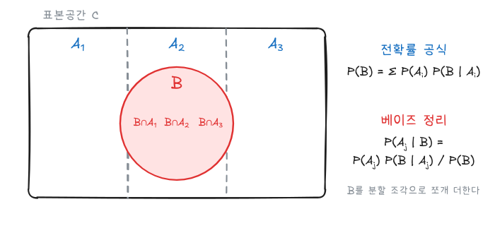
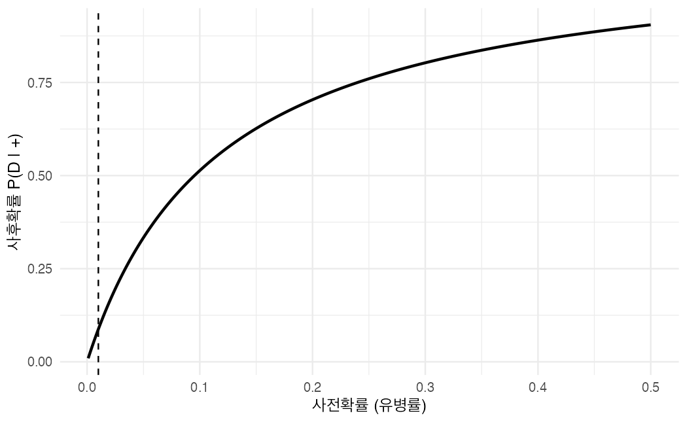

Hogg·McKean·Craig 『Introduction to Mathematical Statistics』(8판)를 바탕으로 수리통계학을 정리하는 시리즈의 첫 글이다. 1장 앞부분(1.1–1.4)을 다룬다. 통계적 추론은 "자료가 어떤 확률모형에서 나왔다"는 가정에서 출발하므로, 확률을 집합 위의 함수로 엄밀하게 정의하는 것부터 시작한다.

```r title="환경 설정"
library(tidyverse)
theme_set(theme_minimal(base_size = 12))
```

## 1. 표본공간과 사건

결과를 미리 알 수 없지만 가능한 결과의 집합은 아는 실험을 **확률실험**이라 한다. 가능한 모든 결과의 집합을 **표본공간** $\mathcal{C}$, 그 부분집합을 **사건**이라 한다.

- 동전 두 번: $\mathcal{C} = \{HH, HT, TH, TT\}$
- 전구 수명: $\mathcal{C} = [0, \infty)$

사건은 집합이므로 집합 연산으로 새 사건을 만든다. 합집합 $A \cup B$("A 또는 B"), 교집합 $A \cap B$("A 그리고 B"), 여집합 $A^c$("A가 아님")이다. $A \cap B = \emptyset$이면 두 사건은 **배반**이다. 드모르간 법칙 $(A \cup B)^c = A^c \cap B^c$, $(A \cap B)^c = A^c \cup B^c$는 무한 개의 사건에도 성립한다.

사건열의 극한도 정의한다. $C_1 \subset C_2 \subset \cdots$(증가)이면 $\lim C_n = \bigcup_n C_n$, $C_1 \supset C_2 \supset \cdots$(감소)이면 $\lim C_n = \bigcap_n C_n$이다.

표본공간이 셀 수 없이 많은 원소를 가지면 모든 부분집합에 확률을 일관되게 줄 수 없다. 그래서 확률을 줄 사건들의 모임 $\mathcal{B}$를 정하는데, $\mathcal{B}$는 $\mathcal{C}$를 포함하고 여집합과 가산 합집합에 닫혀 있어야 한다. 이런 모임을 **$\sigma$-대수**라 한다. 실수 위에서는 구간들로 만든 보렐 $\sigma$-대수를 쓴다. 학부 수준에서는 "보통 생각하는 사건은 모두 $\mathcal{B}$에 들어 있다"고 보면 충분하다.

## 2. 확률의 공리

**확률**은 $\mathcal{B}$ 위에서 정의된 실함수 $P$로, 다음 세 공리를 만족한다(콜모고로프).

1. 모든 사건 $C$에 대해 $P(C) \ge 0$
2. $P(\mathcal{C}) = 1$
3. 서로 배반인 사건열 $C_1, C_2, \dots$에 대해 $P\left(\bigcup_{n=1}^\infty C_n\right) = \sum_{n=1}^\infty P(C_n)$ (가산 가법성)

확률이 "무엇"인지(상대도수의 극한인지, 믿음의 정도인지)는 공리가 정하지 않는다. 어떤 해석이든 이 세 성질만 지키면 아래의 모든 정리가 성립한다.

### 공리에서 유도되는 성질

| 성질 | 식 | 유도의 핵심 |
|---|---|---|
| 여사건 | $P(C^c) = 1 - P(C)$ | $C$와 $C^c$는 배반이고 합이 $\mathcal{C}$ |
| 공집합 | $P(\emptyset) = 0$ | $\emptyset = \mathcal{C}^c$ |
| 단조성 | $C_1 \subset C_2 \Rightarrow P(C_1) \le P(C_2)$ | $C_2 = C_1 \cup (C_1^c \cap C_2)$ |
| 범위 | $0 \le P(C) \le 1$ | 단조성과 공리 2 |
| 합의 법칙 | $P(C_1 \cup C_2) = P(C_1) + P(C_2) - P(C_1 \cap C_2)$ | $C_1 \cup C_2 = C_1 \cup (C_1^c \cap C_2)$ |
| 불 부등식 | $P\left(\bigcup C_n\right) \le \sum P(C_n)$ | 서로 배반이 되도록 쪼갠 뒤 단조성 |

합의 법칙을 세 사건 이상으로 늘린 것이 **포함배제 원리**다.

$$
P\left(\bigcup_{i=1}^k C_i\right) = \sum_i P(C_i) - \sum_{i<j} P(C_i \cap C_j) + \sum_{i<j<l} P(C_i \cap C_j \cap C_l) - \cdots + (-1)^{k+1} P(C_1 \cap \cdots \cap C_k)
$$

### 확률의 연속성

**정리.** 증가 사건열이면 $\lim_n P(C_n) = P\left(\bigcup_n C_n\right)$, 감소 사건열이면 $\lim_n P(C_n) = P\left(\bigcap_n C_n\right)$이다.

증가하는 경우를 보이면 $R_1 = C_1$, $R_n = C_n \cap C_{n-1}^c$로 고리 모양의 배반 사건을 만든다. $\bigcup_n C_n = \bigcup_n R_n$이고 $C_n = R_1 \cup \cdots \cup R_n$이므로 가산 가법성에서

$$
P\left(\bigcup_n C_n\right) = \sum_{j=1}^\infty P(R_j) = \lim_{n\to\infty} \sum_{j=1}^n P(R_j) = \lim_{n\to\infty} P(C_n)
$$

감소하는 경우는 여사건을 취하면 증가 사건열이 된다. 이 정리는 2편에서 누적분포함수가 오른쪽 연속이라는 사실을 보일 때 쓴다.

## 3. 등가능 확률과 셈

표본공간이 $m$개의 결과로 이루어지고 각 결과가 같은 확률 $1/m$을 가지면, 사건 $C$의 확률은 $P(C) = \#(C)/m$이다. 이때 확률 계산은 세는 문제가 된다.

| 상황 | 경우의 수 | 예 |
|---|---|---|
| $n$개에서 $k$개를 순서 있게, 중복 없이 | $P^n_k = \dfrac{n!}{(n-k)!}$ | 반장·부반장 뽑기 |
| $n$개에서 $k$개를 순서 없이, 중복 없이 | $\dbinom{n}{k} = \dfrac{n!}{k!(n-k)!}$ | 카드 패 |
| $n$개에서 $k$번 순서 있게, 중복 허용 | $n^k$ | 비밀번호 |
| $n$개를 $k$개 묶음(크기 $n_1, \dots, n_k$)으로 | $\dfrac{n!}{n_1! \cdots n_k!}$ | 다항계수 |

**생일 문제.** $k$명 중 적어도 두 명의 생일이 같을 확률을 구한다(1년 365일, 등가능). 여사건 "모두 다르다"는 순서 있게 중복 없이 고르는 경우이므로

$$
P(\text{적어도 한 쌍 같음}) = 1 - \frac{P^{365}_k}{365^k} = 1 - \prod_{j=0}^{k-1}\frac{365 - j}{365}
$$

```r
birthday <- function(k) 1 - prod((365 - 0:(k - 1)) / 365)
sapply(c(10, 23, 30, 50), birthday) |> round(4)
min(which(sapply(1:100, birthday) > 0.5))
```

```text
[1] 0.1169 0.5073 0.7063 0.9704
[1] 23
```

23명이면 확률이 0.5를 넘는다. 쌍의 수가 $\binom{23}{2} = 253$개로 많기 때문이다.

**카드 예.** 52장에서 5장을 뽑을 때 하트가 정확히 2장일 확률은 하트 13장 중 2장, 나머지 39장 중 3장을 고르는 경우이므로 $\binom{13}{2}\binom{39}{3}/\binom{52}{5}$이다. 이 구조가 4편의 초기하분포다.

```r
choose(13, 2) * choose(39, 3) / choose(52, 5)
dhyper(2, m = 13, n = 39, k = 5)
```

```text
[1] 0.2742797
[1] 0.2742797
```

## 4. 조건부확률

사건 $A$가 일어났다는 정보가 있으면 표본공간이 $A$로 줄어든다. $P(A) > 0$일 때 $A$가 주어졌을 때 $B$의 **조건부확률**을

$$
P(B \mid A) = \frac{P(A \cap B)}{P(A)}
$$

로 정의한다. $A$를 고정하면 $P(\cdot \mid A)$는 세 공리를 모두 만족하므로 그 자체로 확률이다. 따라서 여사건, 합의 법칙 같은 성질이 조건부확률에도 그대로 성립한다.

정의를 뒤집으면 **곱셈법칙** $P(A \cap B) = P(A)P(B \mid A)$를 얻는다. 여러 사건으로 늘리면

$$
P(A_1 \cap A_2 \cap \cdots \cap A_k) = P(A_1)P(A_2 \mid A_1)P(A_3 \mid A_1 \cap A_2)\cdots P(A_k \mid A_1 \cap \cdots \cap A_{k-1})
$$

이다. 비복원 추출처럼 단계마다 조건이 바뀌는 문제를 이 식으로 푼다. 예를 들어 빨간 공 3개, 파란 공 5개에서 비복원으로 2개를 뽑을 때 둘 다 빨간 공일 확률은 $\frac{3}{8} \cdot \frac{2}{7} = \frac{3}{28}$이다.

### 전확률 공식과 베이즈 정리

$A_1, \dots, A_k$가 서로 배반이고 합이 $\mathcal{C}$이면(표본공간의 **분할**), 임의의 사건 $B$에 대해

$$
P(B) = \sum_{i=1}^k P(A_i)P(B \mid A_i) \qquad \text{(전확률 공식)}
$$

이다. $B = \bigcup_i (A_i \cap B)$가 배반 합이기 때문이다. 이것을 조건부확률의 정의에 넣으면 **베이즈 정리**를 얻는다.

$$
P(A_j \mid B) = \frac{P(A_j)P(B \mid A_j)}{\sum_{i=1}^k P(A_i)P(B \mid A_i)}
$$



$P(A_j)$를 **사전확률**, $P(A_j \mid B)$를 **사후확률**이라 한다. 베이즈 정리는 "원인 → 결과"의 확률 $P(B \mid A_j)$를 "결과 → 원인"의 확률로 뒤집는다. 14편의 베이즈 통계는 이 식을 모수에 적용한 것이다.

**진단검사 예.** 유병률 1%인 질병의 검사가 민감도 $P(+ \mid D) = 0.95$, 특이도 $P(- \mid D^c) = 0.90$이라 하자. 양성이 나왔을 때 실제 환자일 확률은

$$
P(D \mid +) = \frac{0.01 \times 0.95}{0.01 \times 0.95 + 0.99 \times 0.10} = \frac{0.0095}{0.1085} \approx 0.0876
$$

이다. 검사가 꽤 정확해도 유병률이 낮으면 양성 중 대부분은 위양성이다. 분모의 $0.99 \times 0.10 = 0.099$(건강한 사람의 위양성)가 분자 $0.0095$보다 10배 이상 크기 때문이다.

```r
ppv <- function(prev, sens = 0.95, spec = 0.90) {
  prev * sens / (prev * sens + (1 - prev) * (1 - spec))
}
round(ppv(c(0.001, 0.01, 0.1, 0.3)), 4)
```

```text
[1] 0.0094 0.0876 0.5135 0.8028
```

```r
tibble(prev = seq(0.001, 0.5, length.out = 300)) |>
  mutate(ppv = ppv(prev)) |>
  ggplot(aes(prev, ppv)) +
  geom_line(linewidth = 1) +
  geom_vline(xintercept = 0.01, linetype = 2) +
  labs(x = "사전확률 (유병률)", y = "사후확률 P(D | +)")
```



사전확률이 0.01에서 0.1로 10배가 되면 사후확률은 0.09에서 0.51로 뛴다. 같은 자료(양성)라도 사전확률에 따라 결론이 크게 달라진다. 진단 평가의 실제 계산은 [진단검사 글](/posts/biostat-diagnostic-test)에 있다.

## 5. 독립

$B$에 대한 정보가 $A$의 확률을 바꾸지 않을 때, 즉 $P(A \mid B) = P(A)$일 때 두 사건이 독립이라 하고 싶다. 이 식은 $P(B) > 0$을 요구하므로 대칭적인 형태로 정의한다.

$$
A, B \text{ 독립} \iff P(A \cap B) = P(A)P(B)
$$

$A, B$가 독립이면 $A$와 $B^c$, $A^c$와 $B$, $A^c$와 $B^c$도 독립이다. 예를 들어 $P(A \cap B^c) = P(A) - P(A \cap B) = P(A)(1 - P(B)) = P(A)P(B^c)$이다.

배반과 독립은 다르다. $P(A), P(B) > 0$이고 배반이면 $P(A \cap B) = 0 \ne P(A)P(B)$이므로 독립이 아니다. 배반은 "하나가 일어나면 다른 하나는 반드시 안 일어난다"는 강한 의존 관계다.

### 쌍별 독립과 상호 독립

세 사건 $A_1, A_2, A_3$가 **상호 독립**이려면 네 식이 모두 성립해야 한다.

$$
P(A_i \cap A_j) = P(A_i)P(A_j)\ (i < j), \qquad P(A_1 \cap A_2 \cap A_3) = P(A_1)P(A_2)P(A_3)
$$

앞의 세 식(쌍별 독립)만으로는 마지막 식이 따라오지 않는다. 동전을 두 번 던져 $A_1$ = 첫째가 앞, $A_2$ = 둘째가 앞, $A_3$ = 두 결과가 같음이라 하자. 각 확률은 1/2이고 어느 두 사건의 교집합도 확률 1/4이라 쌍별 독립이지만, 세 사건의 교집합 $\{HH\}$의 확률은 $1/4 \ne 1/8$이다. $A_1$과 $A_2$를 알면 $A_3$가 완전히 정해지기 때문이다.

```r
omega <- expand.grid(first = c("H", "T"), second = c("H", "T"))
A1 <- omega$first == "H"; A2 <- omega$second == "H"; A3 <- omega$first == omega$second
p <- function(e) mean(e)   # 등가능
c(p12 = p(A1 & A2), p13 = p(A1 & A3), p23 = p(A2 & A3), p123 = p(A1 & A2 & A3), prod = p(A1) * p(A2) * p(A3))
```

```text
  p12   p13   p23  p123  prod 
0.250 0.250 0.250 0.250 0.125
```

$k$개의 사건이 상호 독립이라는 것은 그중 어떤 부분집합을 골라도 교집합의 확률이 개별 확률의 곱이라는 뜻이다. 확인할 식이 $2^k - k - 1$개다. 이후 "확률표본" $X_1, \dots, X_n$이 독립이라 할 때는 항상 상호 독립을 뜻한다.

**독립 시행의 예.** 성공 확률 $p$인 독립 시행을 반복할 때 처음 성공까지 $k$번 걸릴 확률은 $(1 - p)^{k-1}p$(기하분포)이고, $n$번 중 적어도 한 번 성공할 확률은 $1 - (1 - p)^n$이다. 확률 0.01인 사건도 300번 반복하면 $1 - 0.99^{300} \approx 0.95$의 확률로 한 번은 일어난다. 다중검정에서 유의수준을 보정하는 이유가 이것이다.

## 6. 비교

| 구분 | 앞의 것 | 뒤의 것 |
|---|---|---|
| 배반 대 독립 | $P(A \cap B) = 0$, 하나가 일어나면 다른 것은 불가능 | $P(A \cap B) = P(A)P(B)$, 서로 정보를 주지 않음 |
| 쌍별 대 상호 독립 | 두 개씩의 곱셈 조건만 | 모든 부분집합의 곱셈 조건 |
| $P(B \mid A)$ 대 $P(A \mid B)$ | 원인이 주어졌을 때 결과 (민감도) | 결과가 주어졌을 때 원인 (양성예측도). 베이즈 정리로 연결 |
| 사전 대 사후확률 | 자료를 보기 전 $P(A_j)$ | 자료 $B$를 본 뒤 $P(A_j \mid B)$ |
| 순열 대 조합 | 순서를 구분 $n!/(n-k)!$ | 순서 무시 $\binom{n}{k}$ |

## 요약

| 개념 | 핵심 |
|---|---|
| 확률 공리 | 비음, 전체 1, 가산 가법성. 나머지 성질은 모두 여기서 유도 |
| 포함배제 | 합집합의 확률 = 개별 합 − 쌍 교집합 + 세 개 교집합 − ⋯ |
| 연속성 | 단조 사건열에서 극한과 확률의 순서를 바꿀 수 있음 |
| 등가능 확률 | $P(C) = \#(C)/m$, 순열·조합으로 셈 |
| 조건부확률 | $P(B \mid A) = P(A \cap B)/P(A)$, 그 자체로 확률 |
| 베이즈 정리 | 사후 ∝ 사전 × 가능도, 낮은 사전확률은 양성예측도를 낮춤 |
| 독립 | $P(A \cap B) = P(A)P(B)$, 셋 이상은 모든 부분집합에서 확인 |

## 참고자료

- Hogg, R. V., McKean, J. W., & Craig, A. T. *Introduction to Mathematical Statistics* (8th ed.), Chapter 1.1–1.4.

다음 글: [수리통계학 - 확률변수와 기댓값](/posts/ms-02-random-variables)
