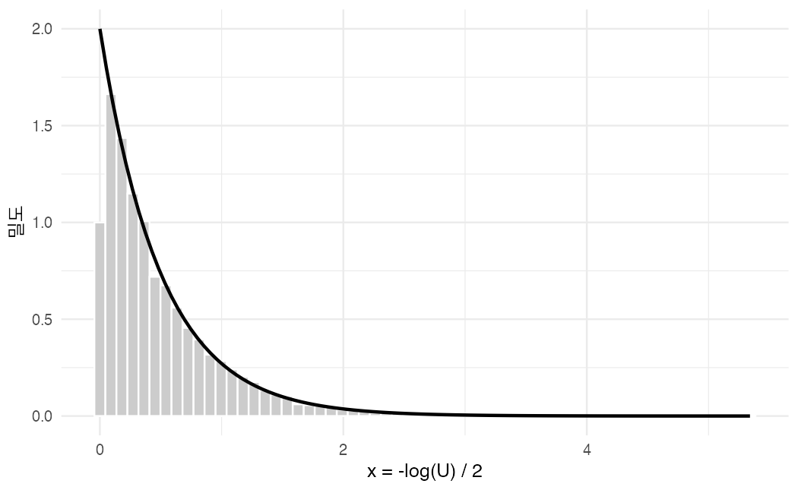

Hogg·McKean·Craig 『Introduction to Mathematical Statistics』 1장 뒷부분(1.5–1.10)을 정리했다. [1편](/posts/ms-01-probability)에서는 확률을 사건(집합)에 주었다. 실제 자료는 숫자이므로, 실험의 결과를 실수로 바꾸는 **확률변수**를 도입하고 그 분포를 함수(cdf, pmf, pdf, mgf)로 다룬다.

```r title="환경 설정"
library(tidyverse)
theme_set(theme_minimal(base_size = 12))
```

## 1. 확률변수와 누적분포함수

표본공간 $\mathcal{C}$의 각 원소 $c$에 실수 $X(c)$를 대응시키는 함수를 **확률변수**라 한다. $X$가 가질 수 있는 값의 집합을 $\mathcal{D}$라 하면, 실수 위의 사건 $D$에 대해

$$
P_X(D) = P(\{c \in \mathcal{C} : X(c) \in D\})
$$

로 $\mathcal{D}$ 위에 새 확률 $P_X$가 생긴다. 이것을 $X$의 **분포**라 한다. 이후로는 원래의 $\mathcal{C}$를 거의 언급하지 않고 $P_X$만 다룬다.

분포를 하나의 함수로 나타내는 가장 일반적인 방법이 **누적분포함수**(cdf)다.

$$
F_X(x) = P(X \le x), \qquad x \in \mathbb{R}
$$

**정리.** cdf는 다음을 만족한다.

1. 비감소: $a < b \Rightarrow F(a) \le F(b)$
2. $\lim_{x \to -\infty} F(x) = 0$, $\lim_{x \to \infty} F(x) = 1$
3. 오른쪽 연속: $\lim_{x \downarrow x_0} F(x) = F(x_0)$

3은 [1편](/posts/ms-01-probability)의 확률의 연속성에서 나온다. $x_n \downarrow x_0$이면 $C_n = \{X \le x_n\}$이 감소 사건열이고 $\bigcap C_n = \{X \le x_0\}$이다. 반대로 이 세 성질을 만족하는 함수는 어떤 확률변수의 cdf가 된다.

cdf로 구간과 점의 확률을 모두 계산할 수 있다.

$$
P(a < X \le b) = F(b) - F(a), \qquad P(X = x) = F(x) - F(x^-)
$$

$F(x^-)$는 왼쪽 극한이다. 따라서 cdf가 $x$에서 연속이면 $P(X = x) = 0$이고, 점프가 있으면 점프의 크기가 그 점의 확률이다.

## 2. 이산형과 연속형

**이산형** 확률변수는 $\mathcal{D}$가 셀 수 있는 집합이다. **확률질량함수**(pmf) $p_X(x) = P(X = x)$로 분포를 나타내고, $p_X(x) > 0$인 점의 집합을 **받침**이라 한다. cdf는 받침의 점에서 점프하는 계단함수다.

**연속형** 확률변수는 cdf가 다음처럼 적분으로 표현된다.

$$
F_X(x) = \int_{-\infty}^x f_X(t)\,dt
$$

$f_X$를 **확률밀도함수**(pdf)라 한다. $f_X \ge 0$, $\int f_X = 1$이고, $f_X$가 연속인 점에서 $F_X'(x) = f_X(x)$다. 연속형에서는 모든 점의 확률이 0이므로 $P(a < X \le b) = P(a \le X \le b)$이다.

pdf 값 자체는 확률이 아니다. $f_X(x)\,\Delta x \approx P(x < X \le x + \Delta x)$로, 짧은 구간의 확률을 구간 길이로 나눈 **밀도**다. 그래서 $f_X(x) > 1$일 수도 있다. 예를 들어 $U(0, 1/2)$의 pdf는 구간 위에서 2다.

**예.** $f(x) = 2x$, $0 < x < 1$이면 $F(x) = x^2$, $P(1/4 < X \le 1/2) = 1/4 - 1/16 = 3/16$이다.

## 3. 확률변수의 변환

$X$의 분포를 알 때 $Y = g(X)$의 분포를 구한다.

**이산형.** $g$가 일대일이면 $p_Y(y) = p_X(g^{-1}(y))$이다. 일대일이 아니면 $g(x) = y$인 $x$들의 확률을 더한다.

**연속형: cdf 기법.** $F_Y(y) = P(g(X) \le y)$를 $X$에 대한 사건으로 바꿔 계산한 뒤 미분한다. 단조가 아닌 변환에도 쓸 수 있다.

예를 들어 $X \sim U(-1, 1)$, $Y = X^2$이면 $0 < y < 1$에서

$$
F_Y(y) = P(-\sqrt y \le X \le \sqrt y) = \sqrt y, \qquad f_Y(y) = \frac{1}{2\sqrt y}
$$

이다. $y \to 0$에서 밀도가 무한대로 커진다. 0 근처의 $x$ 값들이 매우 좁은 $y$ 구간으로 몰리기 때문이다.

**연속형: 단조변환 공식.** $g$가 미분 가능하고 순증가 또는 순감소이면, 역함수 $x = g^{-1}(y)$에 대해

$$
f_Y(y) = f_X\big(g^{-1}(y)\big)\left|\frac{dx}{dy}\right|, \qquad y \in g(\mathcal{S}_X)
$$

이다. 증가하는 경우 $F_Y(y) = P(X \le g^{-1}(y)) = F_X(g^{-1}(y))$를 연쇄법칙으로 미분하면 나온다. 감소하는 경우는 부등호가 뒤집혀 $1 - F_X(g^{-1}(y))$가 되고, 미분하면 $dx/dy < 0$이 붙어 절댓값이 된다. $|dx/dy|$는 $x$ 구간이 $y$ 구간으로 늘어나거나 줄어드는 비율이다. 3편에서 이것을 여러 변수로 늘린 것이 야코비안이다.

### 확률적분변환

**정리.** $X$가 연속형이고 cdf가 $F$이면 $U = F(X) \sim U(0, 1)$이다. 반대로 $U \sim U(0, 1)$이면 $X = F^{-1}(U)$의 cdf는 $F$다.

$F$가 순증가라 하면 $0 < u < 1$에서 $P(F(X) \le u) = P(X \le F^{-1}(u)) = F(F^{-1}(u)) = u$이다. 뒤쪽은 $P(F^{-1}(U) \le x) = P(U \le F(x)) = F(x)$이다.

뒤쪽 결과가 **역변환 샘플링**이다. 균일난수만 있으면 cdf의 역함수를 알 때 어떤 분포든 만들 수 있다. 지수분포 $F(x) = 1 - e^{-\lambda x}$이면 $F^{-1}(u) = -\log(1 - u)/\lambda$이고, $1 - U$도 균일분포이므로 $X = -\log U/\lambda$로 써도 된다.

```r
set.seed(2)
u <- runif(10000)
x <- -log(u) / 2          # 지수분포, λ = 2
c(mean = mean(x), theory = 1 / 2)
ks.test(x, "pexp", rate = 2)$p.value
```

```text
     mean    theory 
0.4947561 0.5000000 
[1] 0.2333703
```

```r
tibble(x) |>
  ggplot(aes(x)) +
  geom_histogram(aes(y = after_stat(density)), bins = 60, fill = "grey80", color = "white") +
  stat_function(fun = dexp, args = list(rate = 2), linewidth = 1) +
  labs(x = "x = -log(U) / 2", y = "밀도")
```



콜모고로프-스미르노프 검정의 $p$값이 크므로 만든 표본은 $\text{Exp}(2)$와 구분되지 않는다. 표본평균도 이론값 0.5에 가깝다.

## 4. 기댓값

$X$의 **기댓값**은 다음과 같다.

$$
E(X) = \sum_x x\,p_X(x) \quad \text{(이산)}, \qquad E(X) = \int_{-\infty}^\infty x f_X(x)\,dx \quad \text{(연속)}
$$

단, 합이나 적분이 **절대수렴**할 때($E|X| < \infty$)만 정의한다. 코시분포 $f(x) = \frac{1}{\pi(1 + x^2)}$는 $\int |x| f(x)\,dx = \infty$라서 평균이 없다. 대칭이라 "0일 것 같지만" 정의되지 않는다. 표본평균이 아무리 표본을 늘려도 한 값으로 모이지 않는다는 뜻이고, 7편의 대수의 법칙이 성립하지 않는 대표 예다.

$Y = g(X)$의 기댓값은 $Y$의 분포를 구하지 않고 $X$의 분포로 바로 계산할 수 있다.

$$
E[g(X)] = \int g(x) f_X(x)\,dx
$$

기댓값은 선형이다. $E[k_1 g_1(X) + k_2 g_2(X)] = k_1 E[g_1(X)] + k_2 E[g_2(X)]$. 적분(합)이 선형이기 때문이다.

## 5. 분산과 적률생성함수

평균 $\mu = E(X)$ 주위의 흩어짐을 **분산**으로 잰다.

$$
\sigma^2 = \text{Var}(X) = E[(X - \mu)^2] = E(X^2) - \mu^2, \qquad \text{Var}(aX + b) = a^2 \text{Var}(X)
$$

뒤 식은 상수 $b$만큼 옮겨도 흩어짐은 그대로이고, $a$배 늘리면 편차가 $a$배, 제곱이 $a^2$배가 된다는 뜻이다.

$E(X^k)$를 $k$차 **적률**이라 한다. 적률을 한꺼번에 담는 함수가 **적률생성함수**(mgf)다.

$$
M_X(t) = E(e^{tX}), \qquad -h < t < h \text{ 에서 존재할 때}
$$

$e^{tX} = \sum_k (tX)^k/k!$를 기댓값 안에서 항별로 정리하면 $M_X(t) = \sum_k E(X^k)t^k/k!$이므로

$$
M_X^{(k)}(0) = E(X^k)
$$

이다. 특히 $\mu = M'(0)$, $\sigma^2 = M''(0) - M'(0)^2$이다.

**정리 (유일성).** 0을 포함하는 열린 구간에서 두 확률변수의 mgf가 같으면 두 분포는 같다.

mgf는 계산 도구로서보다 이 유일성 때문에 중요하다. 변환한 확률변수의 mgf가 알려진 분포의 mgf와 같으면 그 분포라고 결론 내릴 수 있고, 7편에서 mgf의 수렴으로 분포의 수렴(중심극한정리)을 보인다.

**예.** $p(x) = (1/2)^x$, $x = 1, 2, \dots$(공정한 동전으로 처음 앞면이 나올 때까지 던진 횟수)이면, $t < \log 2$에서

$$
M(t) = \sum_{x=1}^\infty e^{tx}(1/2)^x = \frac{e^t/2}{1 - e^t/2} = \frac{e^t}{2 - e^t}
$$

$M'(t) = 2e^t/(2 - e^t)^2$이므로 $\mu = M'(0) = 2$이다. $M''(0) = 6$이므로 $\sigma^2 = 6 - 4 = 2$이다.

```r
x <- 1:200; p <- 0.5^x
c(mean = sum(x * p), var = sum(x^2 * p) - sum(x * p)^2)
M <- function(t) exp(t) / (2 - exp(t)); h <- 1e-4
c(M1 = (M(h) - M(-h)) / (2 * h), M2 = (M(h) - 2 * M(0) + M(-h)) / h^2)
```

```text
mean  var 
   2    2 
M1 M2 
 2  6
```

mgf가 존재하지 않는 분포도 있다(코시분포, 로그정규분포). 이때는 항상 존재하는 **특성함수** $\varphi(t) = E(e^{itX})$를 쓴다. 성질은 mgf와 같다.

## 6. 부등식

분포를 정확히 모를 때 평균이나 분산만으로 확률의 상한을 준다.

**마르코프 부등식.** $u(X) \ge 0$이면 $c > 0$에 대해

$$
P[u(X) \ge c] \le \frac{E[u(X)]}{c}
$$

$A = \{x : u(x) \ge c\}$로 두면 $E[u(X)] \ge \int_A u(x)f(x)\,dx \ge c\,P(A)$이다.

**체비셰프 부등식.** 마르코프 부등식에 $u(X) = (X - \mu)^2$, $c = k^2\sigma^2$를 넣으면

$$
P(|X - \mu| \ge k\sigma) \le \frac{1}{k^2}
$$

이다. 어떤 분포든 평균에서 $2\sigma$ 이상 떨어질 확률은 1/4 이하다. 7편에서 대수의 약한 법칙을 이 부등식으로 보인다.

```r
k <- c(1.5, 2, 3)
tibble(k, chebyshev = 1 / k^2, normal = 2 * pnorm(-k),
       exponential = pexp(1 + k, 1, lower.tail = FALSE)) |>   # Exp(1): μ = σ = 1, k ≥ 1이면 아래쪽 꼬리는 없음
  mutate(across(-k, \(v) round(v, 4)))
```

```text
# A tibble: 3 × 4
      k chebyshev normal exponential
  <dbl>     <dbl>  <dbl>       <dbl>
1   1.5     0.444 0.134       0.0821
2   2       0.25  0.0455      0.0498
3   3       0.111 0.0027      0.0183
```

체비셰프 상한은 실제 확률보다 훨씬 크다. 모든 분포에 대해 성립해야 하므로 보수적이다. 하지만 상한을 실제로 달성하는 분포가 있으므로 더 줄일 수는 없다.

**옌센 부등식.** $\phi$가 볼록함수이면

$$
\phi(E X) \le E[\phi(X)]
$$

이고, $\phi$가 순볼록이면 $X$가 상수일 때만 등호가 성립한다. $\phi(x) = x^2$이면 $(EX)^2 \le E(X^2)$, 즉 분산이 0 이상이라는 사실이다. $\phi(x) = -\log x$이면 $E(\log X) \le \log E(X)$이고, 산술평균 ≥ 기하평균이 여기서 나온다. 8편의 MLE 일치성 증명에도 이 부등식이 들어간다.

## 7. 비교

| 구분 | 이산형 | 연속형 |
|---|---|---|
| 분포를 나타내는 함수 | pmf $p(x) = P(X = x)$ | pdf $f(x) = F'(x)$ |
| 함수값의 의미 | 확률 (≤ 1) | 밀도 (1보다 클 수 있음) |
| cdf 모양 | 계단함수 | 연속함수 |
| 한 점의 확률 | 점프 크기 | 0 |
| 기댓값 | $\sum x p(x)$ | $\int x f(x)\,dx$ |

| 함수 | 정의 | 항상 존재? | 쓰는 곳 |
|---|---|---|---|
| cdf | $P(X \le x)$ | 예 | 모든 분포를 통일적으로 표현, 분위수 |
| pmf/pdf | 점의 확률 / 밀도 | 이산·연속형일 때 | 확률 계산, 가능도 |
| mgf | $E(e^{tX})$ | 아니오 | 적률 계산, 분포 판별(유일성), CLT |
| 특성함수 | $E(e^{itX})$ | 예 | mgf가 없을 때 |

| 부등식 | 필요한 정보 | 상한 |
|---|---|---|
| 마르코프 | $u(X) \ge 0$의 평균 | $E[u(X)]/c$ |
| 체비셰프 | 평균과 분산 | $1/k^2$ |
| 옌센 | 볼록성 | 기댓값과 함수의 순서 |

## 요약

| 개념 | 핵심 |
|---|---|
| cdf | 비감소, 0에서 1, 오른쪽 연속. 점프 = 점의 확률 |
| 단조변환 | $f_Y(y) = f_X(g^{-1}(y))\lvert dx/dy\rvert$ |
| 확률적분변환 | $F(X) \sim U(0,1)$, 역으로 $F^{-1}(U) \sim F$ |
| 기댓값 | 절대수렴할 때만 정의, 선형 |
| 분산 | $E(X^2) - \mu^2$, $\text{Var}(aX + b) = a^2\text{Var}(X)$ |
| mgf | $M^{(k)}(0) = E(X^k)$, 같으면 같은 분포 |
| 체비셰프 | $P(\lvert X - \mu\rvert \ge k\sigma) \le 1/k^2$ |
| 옌센 | 볼록 $\phi$에 대해 $\phi(EX) \le E\phi(X)$ |

## 참고자료

- Hogg, R. V., McKean, J. W., & Craig, A. T. *Introduction to Mathematical Statistics* (8th ed.), Chapter 1.5–1.10.

다음 글: [수리통계학 - 다변량분포](/posts/ms-03-multivariate)
