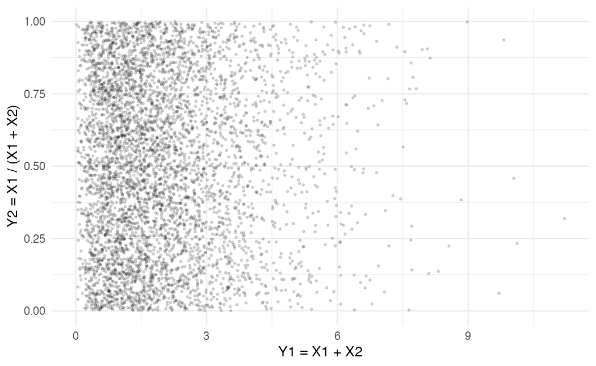

Hogg·McKean·Craig 『Introduction to Mathematical Statistics』 2장을 정리했다. 통계량은 표본 $X_1, \dots, X_n$ 여러 개의 함수이므로, 확률변수 여러 개를 한꺼번에 다루는 도구가 필요하다. 결합분포에서 주변·조건부 분포를 꺼내는 법, 여러 변수의 변환, 그리고 변수 사이의 관계(독립, 상관)를 다룬다.

```r title="환경 설정"
library(tidyverse)
theme_set(theme_minimal(base_size = 12))
```

## 1. 결합분포와 주변분포

같은 표본공간 위의 두 확률변수 $(X_1, X_2)$를 **확률벡터**라 한다. 결합 cdf는 $F(x_1, x_2) = P(X_1 \le x_1, X_2 \le x_2)$다. 연속형이면 결합 pdf $f(x_1, x_2)$가 있어서 평면의 영역 $A$에 대해

$$
P[(X_1, X_2) \in A] = \iint_A f(x_1, x_2)\,dx_1\,dx_2
$$

이다. 이산형이면 결합 pmf $p(x_1, x_2)$를 더한다.

한 변수만의 분포인 **주변분포**는 다른 변수를 적분(합)해 없앤다.

$$
f_1(x_1) = \int_{-\infty}^\infty f(x_1, x_2)\,dx_2
$$

**예.** $f(x_1, x_2) = x_1 + x_2$, $0 < x_1, x_2 < 1$을 이 글의 예로 계속 쓴다. 주변 pdf는 $f_1(x_1) = x_1 + 1/2$이고, $P(X_1 + X_2 \le 1)$은 삼각형 영역의 적분이다.

$$
P(X_1 + X_2 \le 1) = \int_0^1 \int_0^{1 - x_1} (x_1 + x_2)\,dx_2\,dx_1 = \int_0^1 \frac{1 - x_1^2}{2}\,dx_1 = \frac{1}{3}
$$

```r
f <- function(x1, x2) x1 + x2
inner <- function(x1) sapply(x1, \(a) integrate(\(x2) f(a, x2), 0, 1 - a)$value)
integrate(inner, 0, 1)$value
```

```text
[1] 0.3333333
```

기댓값은 결합 pdf로 계산한다. $E[g(X_1, X_2)] = \iint g(x_1, x_2) f(x_1, x_2)\,dx_1\,dx_2$이고 선형이다. 결합 mgf $M(t_1, t_2) = E(e^{t_1 X_1 + t_2 X_2})$에서 $M(t_1, 0)$은 $X_1$의 mgf다.

## 2. 이변량 변환

$(X_1, X_2)$의 결합 pdf가 $f$이고 $Y_1 = u_1(X_1, X_2)$, $Y_2 = u_2(X_1, X_2)$가 받침 $\mathcal{S}$에서 $\mathcal{T}$로의 일대일 변환이라 하자. 역변환 $x_1 = w_1(y_1, y_2)$, $x_2 = w_2(y_1, y_2)$의 **야코비안**

$$
J = \begin{vmatrix} \partial x_1/\partial y_1 & \partial x_1/\partial y_2 \\ \partial x_2/\partial y_1 & \partial x_2/\partial y_2 \end{vmatrix}
$$

이 0이 아니면

$$
g(y_1, y_2) = f\big(w_1(y_1, y_2), w_2(y_1, y_2)\big)\,|J|, \qquad (y_1, y_2) \in \mathcal{T}
$$

이다. [2편](/posts/ms-02-random-variables)의 $|dx/dy|$가 면적 확대율 $|J|$로 바뀐 것이다. 변수 하나($Y_1$)의 분포만 필요해도 보조 변수 $Y_2$를 만들어 결합 pdf를 구한 뒤 적분해 없애는 것이 일반적인 방법이다. 받침 $\mathcal{T}$를 정확히 그리는 것이 실수가 가장 많은 단계다.

**예.** $X_1, X_2$가 독립이고 $\text{Exp}(1)$이면 $f(x_1, x_2) = e^{-x_1 - x_2}$, $x_1, x_2 > 0$이다. $Y_1 = X_1 + X_2$, $Y_2 = X_1/(X_1 + X_2)$로 두면 역변환은 $x_1 = y_1 y_2$, $x_2 = y_1(1 - y_2)$이고

$$
J = \begin{vmatrix} y_2 & y_1 \\ 1 - y_2 & -y_1 \end{vmatrix} = -y_1, \qquad g(y_1, y_2) = y_1 e^{-y_1} \cdot 1, \quad y_1 > 0,\ 0 < y_2 < 1
$$

이다. 결합 pdf가 $y_1$만의 함수와 $y_2$만의 함수의 곱이고 받침이 직사각형이므로 $Y_1$과 $Y_2$는 독립이다. $Y_1 \sim \text{Gamma}(2, 1)$, $Y_2 \sim U(0, 1)$이다. 합이 얼마든 그 합을 두 변수가 나누는 비율은 균일하다는 뜻이다.

```r
set.seed(1)
x1 <- rexp(5000); x2 <- rexp(5000)
y1 <- x1 + x2; y2 <- x1 / (x1 + x2)
c(cor = cor(y1, y2), ks_gamma = ks.test(y1, "pgamma", 2, 1)$p.value, ks_unif = ks.test(y2, "punif")$p.value)
```

```text
       cor   ks_gamma    ks_unif 
0.01336531 0.57398087 0.57263247
```

```r
tibble(y1, y2) |>
  ggplot(aes(y1, y2)) +
  geom_point(alpha = 0.15, size = 0.6) +
  labs(x = "Y1 = X1 + X2", y = "Y2 = X1 / (X1 + X2)")
```

표본상관은 0에 가깝고, 두 KS 검정 모두 $p$값이 커서 감마분포와 균일분포에서 벗어난다는 증거가 없다.



합의 분포만 필요하면 mgf가 더 빠르다. 독립이면 $M_{X_1 + X_2}(t) = M_{X_1}(t)M_{X_2}(t) = (1 - t)^{-2}$이고, 이것이 $\text{Gamma}(2, 1)$의 mgf다(4편).

## 3. 조건부분포와 조건부기댓값

$f_1(x_1) > 0$일 때 $X_1 = x_1$이 주어진 $X_2$의 **조건부 pdf**는

$$
f_{2|1}(x_2 \mid x_1) = \frac{f(x_1, x_2)}{f_1(x_1)}
$$

이다. $x_1$을 고정하면 $x_2$의 pdf다(음이 아니고 적분이 1). 이 분포의 평균이 **조건부기댓값** $E(X_2 \mid x_1) = \int x_2 f_{2|1}(x_2 \mid x_1)\,dx_2$이고, $x_1$의 함수다. $x_1$ 자리에 확률변수 $X_1$을 넣은 $E(X_2 \mid X_1)$은 확률변수다.

**예.** $f = x_1 + x_2$에서

$$
E(X_2 \mid x_1) = \int_0^1 x_2 \frac{x_1 + x_2}{x_1 + 1/2}\,dx_2 = \frac{x_1/2 + 1/3}{x_1 + 1/2}
$$

이다. $x_1 = 0$이면 $2/3$, $x_1 = 1$이면 $5/9$로, $x_1$이 커질수록 조건부평균이 작아진다.

**정리 (반복기댓값과 전분산 공식).**

$$
E[E(X_2 \mid X_1)] = E(X_2), \qquad \text{Var}(X_2) = E[\text{Var}(X_2 \mid X_1)] + \text{Var}[E(X_2 \mid X_1)]
$$

앞의 식은 $\int \left[\int x_2 f_{2|1}\,dx_2\right] f_1\,dx_1 = \iint x_2 f\,dx_2\,dx_1$로 바로 나온다. 뒤의 식은 $X_2 - \mu_2 = [X_2 - E(X_2 \mid X_1)] + [E(X_2 \mid X_1) - \mu_2]$로 나누어 제곱의 기댓값을 취하면, 교차항이 반복기댓값으로 0이 되어 나온다.

전분산 공식에서 $\text{Var}[E(X_2 \mid X_1)] \le \text{Var}(X_2)$가 따라온다. $X_2$ 대신 $E(X_2 \mid X_1)$을 쓰면 평균은 그대로이고 분산은 줄어든다. 10편의 라오-블랙웰 정리가 이 관찰에서 나온다.

```r
f1 <- function(a) a + 0.5
cond_mean <- function(a) (a / 2 + 1 / 3) / (a + 1 / 2)
cond_m2 <- function(a) (a / 3 + 1 / 4) / (a + 1 / 2)             # E(X2^2 | x1)
EX2 <- integrate(\(a) cond_mean(a) * f1(a), 0, 1)$value           # 반복기댓값
VarX2 <- integrate(\(b) b^2 * (b + 0.5), 0, 1)$value - EX2^2       # 주변분포로 직접
within <- integrate(\(a) (cond_m2(a) - cond_mean(a)^2) * f1(a), 0, 1)$value
between <- integrate(\(a) cond_mean(a)^2 * f1(a), 0, 1)$value - EX2^2
c(EX2 = EX2, VarX2 = VarX2, within_plus_between = within + between, between = between)
```

```text
                EX2               VarX2 within_plus_between             between 
       0.5833333333        0.0763888889        0.0763888889        0.0006848076
```

$E(X_2) = 7/12$, $\text{Var}(X_2) = 11/144 \approx 0.0764$이다. 조건부평균의 분산(between)은 그중 아주 작은 부분이다. $X_1$을 알아도 $X_2$의 예측이 별로 나아지지 않는다는 뜻이다.

## 4. 독립

$X_1, X_2$가 **독립**이라는 것은 결합 pdf가 주변 pdf의 곱이라는 것이다.

$$
f(x_1, x_2) = f_1(x_1) f_2(x_2) \quad \text{모든 } (x_1, x_2)
$$

동치 조건이 여럿 있다.

| 조건 | 내용 |
|---|---|
| 조건부분포 | $f_{2\vert 1}(x_2 \mid x_1) = f_2(x_2)$ |
| 분해 | $f(x_1, x_2) = g(x_1)h(x_2)$로 쓸 수 있고 받침이 곱집합(직사각형) |
| cdf | $F(x_1, x_2) = F_1(x_1)F_2(x_2)$ |
| 사건 | $P(a < X_1 \le b, c < X_2 \le d) = P(a < X_1 \le b)P(c < X_2 \le d)$ |
| mgf | $M(t_1, t_2) = M(t_1, 0)M(0, t_2)$ |

분해 조건에서 받침을 빠뜨리기 쉽다. $f(x_1, x_2) = 8x_1x_2$, $0 < x_1 < x_2 < 1$은 식만 보면 곱으로 나뉘지만 받침이 삼각형이라 독립이 아니다. $x_1$을 알면 $x_2$의 범위가 $(x_1, 1)$로 바뀐다. 이 글의 예 $f = x_1 + x_2$는 곱으로 나눌 수 없으므로 독립이 아니다.

독립이면 $E[u(X_1)v(X_2)] = E[u(X_1)]E[v(X_2)]$가 성립한다. 특히 공분산이 0이다.

## 5. 공분산과 상관계수

$$
\text{Cov}(X, Y) = E[(X - \mu_1)(Y - \mu_2)] = E(XY) - \mu_1\mu_2, \qquad \rho = \frac{\text{Cov}(X, Y)}{\sigma_1\sigma_2}
$$

**정리.** $-1 \le \rho \le 1$이고, $|\rho| = 1$일 필요충분조건은 $Y = a + bX$가 확률 1로 성립하는 것이다.

모든 $t$에 대해 $h(t) = E\{[(X - \mu_1) + t(Y - \mu_2)]^2\} = \sigma_1^2 + 2t\rho\sigma_1\sigma_2 + t^2\sigma_2^2 \ge 0$이므로 판별식이 0 이하여야 한다. 즉 $4\rho^2\sigma_1^2\sigma_2^2 - 4\sigma_1^2\sigma_2^2 \le 0$이다. 판별식이 0이면 $h(t_0) = 0$인 $t_0$가 있어 괄호 안이 확률 1로 0, 즉 선형 관계다.

$\rho$는 **선형** 관계의 정도만 잰다. 독립이면 $\rho = 0$이지만 역은 성립하지 않는다. $X \sim N(0, 1)$, $Y = X^2$이면 $Y$는 $X$로 완전히 정해지는데도 $\text{Cov}(X, X^2) = E(X^3) = 0$이다.

**정리 (선형 조건부평균).** $E(Y \mid x)$가 $x$의 일차함수이면

$$
E(Y \mid x) = \mu_2 + \rho\frac{\sigma_2}{\sigma_1}(x - \mu_1), \qquad E[\text{Var}(Y \mid X)] = \sigma_2^2(1 - \rho^2)
$$

이다. $E(Y \mid x) = a + bx$로 두고 양변에 기댓값을 취하면 $\mu_2 = a + b\mu_1$, 양변에 $x$를 곱하고 기댓값을 취하면 $E(XY) = a\mu_1 + bE(X^2)$이다. 두 식을 풀면 $b = \rho\sigma_2/\sigma_1$이다. 뒤 식은 $Y$의 분산 중 $1 - \rho^2$만큼이 $X$로 설명되지 않고 남는다는 뜻으로, 회귀의 결정계수 $R^2 = \rho^2$와 같은 이야기다. 이변량 정규분포에서는 조건부평균이 항상 선형이다(4편).

```r
EX1 <- 7 / 12; EX1X2 <- integrate(\(a) sapply(a, \(s) integrate(\(b) s * b * (s + b), 0, 1)$value), 0, 1)$value
cov12 <- EX1X2 - EX1^2
c(cov = cov12, rho = cov12 / (11 / 144))
```

```text
         cov          rho 
-0.006944444 -0.090909091
```

$f = x_1 + x_2$에서 $\text{Cov} = 1/3 - 49/144 = -1/144$, $\rho = -1/11$이다. 3절에서 조건부평균이 $x_1$에 따라 조금 감소한 것과 같은 방향이다. 다만 그 조건부평균은 선형이 아니므로 위 정리를 그대로 쓸 수는 없다.

## 6. 확률벡터와 공분산행렬

$n$개의 확률변수를 벡터 $\mathbf{X} = (X_1, \dots, X_n)'$로 모은다. 결합·주변·조건부 분포, 독립, 변환(야코비안이 $n \times n$ 행렬식)은 2변수와 같다. 평균벡터와 **공분산행렬**은

$$
\boldsymbol\mu = E(\mathbf{X}), \qquad \boldsymbol\Sigma = \text{Cov}(\mathbf{X}) = E[(\mathbf{X} - \boldsymbol\mu)(\mathbf{X} - \boldsymbol\mu)']
$$

이다. $\boldsymbol\Sigma$의 대각원소는 분산, 비대각원소는 공분산이다.

**정리.** $\mathbf{Y} = \mathbf{A}\mathbf{X} + \mathbf{b}$이면 $E(\mathbf{Y}) = \mathbf{A}\boldsymbol\mu + \mathbf{b}$, $\text{Cov}(\mathbf{Y}) = \mathbf{A}\boldsymbol\Sigma\mathbf{A}'$이다.

$\mathbf{a}'\boldsymbol\Sigma\mathbf{a} = \text{Var}(\mathbf{a}'\mathbf{X}) \ge 0$이므로 공분산행렬은 항상 양의 준정부호다. 고유값이 모두 0 이상이고, 0인 고유값이 있으면 변수들 사이에 확률 1인 선형 관계가 있다. 이 구조를 고유분해로 보는 것이 주성분분석이다([선형대수 고유값 글](/posts/la-eigen)).

## 7. 선형결합

$T = \sum_{i=1}^n a_i X_i$이면 6절의 정리에서 바로

$$
E(T) = \sum a_i\mu_i, \qquad \text{Var}(T) = \sum_i a_i^2\sigma_i^2 + 2\sum_{i<j} a_i a_j \text{Cov}(X_i, X_j)
$$

이다. 독립이면 공분산 항이 사라진다.

$X_1, \dots, X_n$이 평균 $\mu$, 분산 $\sigma^2$인 분포에서 나온 확률표본(iid)이면 $a_i = 1/n$으로

$$
E(\bar X) = \mu, \qquad \text{Var}(\bar X) = \frac{\sigma^2}{n}
$$

이다. 표본분산 $S^2 = \frac{1}{n-1}\sum (X_i - \bar X)^2$는 $\sum (X_i - \bar X)^2 = \sum X_i^2 - n\bar X^2$이고 $E(X_i^2) = \sigma^2 + \mu^2$, $E(\bar X^2) = \sigma^2/n + \mu^2$이므로

$$
E\left[\sum (X_i - \bar X)^2\right] = n(\sigma^2 + \mu^2) - n(\sigma^2/n + \mu^2) = (n - 1)\sigma^2
$$

이 되어 $E(S^2) = \sigma^2$이다. $n$이 아니라 $n - 1$로 나누는 이유다. $\bar X$를 추정해서 썼기 때문에 편차들이 $\sum (X_i - \bar X) = 0$이라는 제약 하나를 받아 자유도가 하나 준다.

## 8. 비교

| 구분 | 앞의 것 | 뒤의 것 |
|---|---|---|
| 주변 대 조건부 | 다른 변수를 적분해 없앰 $\int f\,dx_2$ | 다른 변수를 고정하고 정규화 $f/f_1$ |
| $E(Y \mid x)$ 대 $E(Y \mid X)$ | $x$의 함수 (숫자) | $X$의 함수 (확률변수), 기댓값이 $E(Y)$ |
| 독립 대 무상관 | 결합 = 주변의 곱, 모든 함수에 대해 $E[u(X)v(Y)] = E u E v$ | $\text{Cov} = 0$, 선형 관계만 없음. 독립 ⇒ 무상관, 역은 거짓 |
| 일변량 대 다변량 변환 | $\lvert dx/dy \rvert$ | 야코비안 행렬식 $\lvert J \rvert$ |
| 변환 기법 대 mgf 기법 | 결합 pdf 전체를 얻음 | 독립 합의 분포를 빠르게 판별 |

## 요약

| 개념 | 핵심 |
|---|---|
| 주변분포 | $f_1(x_1) = \int f(x_1, x_2)\,dx_2$ |
| 이변량 변환 | $g(y_1, y_2) = f(w_1, w_2)\lvert J \rvert$, 받침을 정확히 |
| 조건부분포 | $f_{2\vert 1} = f/f_1$, $E(X_2 \mid x_1)$은 $x_1$의 함수 |
| 반복기댓값 | $E[E(X_2 \mid X_1)] = E(X_2)$ |
| 전분산 공식 | $\text{Var}(X_2) = E[\text{Var}(X_2 \mid X_1)] + \text{Var}[E(X_2 \mid X_1)]$ |
| 독립 | $f = f_1 f_2$, 분해 + 직사각형 받침 |
| 상관계수 | $\lvert \rho \rvert \le 1$, $\pm 1$이면 선형 |
| 공분산행렬 | $\text{Cov}(\mathbf{AX}) = \mathbf{A\Sigma A'}$, 양의 준정부호 |
| 표본평균·분산 | $\text{Var}(\bar X) = \sigma^2/n$, $E(S^2) = \sigma^2$ |

## 참고자료

- Hogg, R. V., McKean, J. W., & Craig, A. T. *Introduction to Mathematical Statistics* (8th ed.), Chapter 2.

다음 글: [수리통계학 - 주요 분포](/posts/ms-04-special-distributions)
