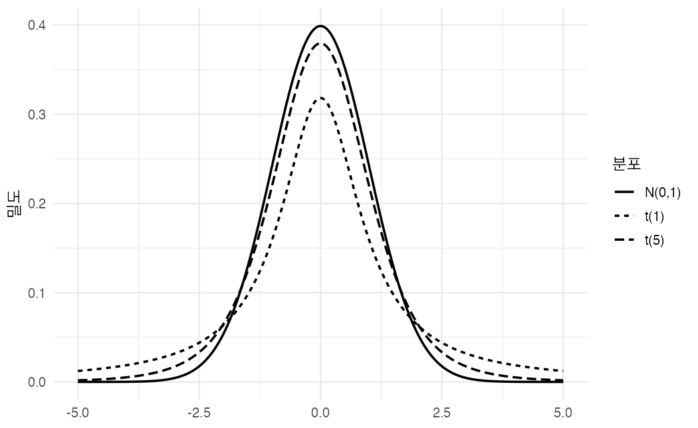

Hogg·McKean·Craig 『Introduction to Mathematical Statistics』 3장을 정리했다. 통계적 추론에 거듭 나오는 분포들을 모으고, 각 분포가 어떤 실험에서 나오는지와 분포 사이의 관계를 정리한다. 관계는 대부분 [2편](/posts/ms-02-random-variables)의 mgf 유일성과 [3편](/posts/ms-03-multivariate)의 변환으로 보인다.

```r title="환경 설정"
library(tidyverse)
theme_set(theme_minimal(base_size = 12))
```

## 1. 베르누이 시행에서 나오는 분포

성공 확률 $p$인 독립 시행(베르누이 시행)에서 무엇을 세느냐에 따라 분포가 달라진다.

**이항분포** $b(n, p)$: $n$번 중 성공 횟수.

$$
p(x) = \binom{n}{x}p^x(1 - p)^{n-x}, \quad x = 0, \dots, n, \qquad M(t) = (1 - p + pe^t)^n
$$

$M'(0) = np$, $M''(0) = n(n-1)p^2 + np$이므로 $\mu = np$, $\sigma^2 = np(1 - p)$이다. mgf가 베르누이 mgf $(1 - p + pe^t)$의 $n$제곱이므로 이항변수는 독립 베르누이 $n$개의 합이다. 같은 $p$의 독립 이항변수를 더하면 $b(\sum n_i, p)$가 된다.

**음이항분포**: $r$번째 성공 전까지의 실패 횟수 $Y$. 마지막 시행이 $r$번째 성공이고 그 앞 $y + r - 1$번에서 성공 $r - 1$번이 나와야 하므로

$$
p(y) = \binom{y + r - 1}{r - 1}p^r(1 - p)^y, \quad y = 0, 1, \dots, \qquad M(t) = \frac{p^r}{[1 - (1 - p)e^t]^r}
$$

이다. $r = 1$이면 **기하분포**다. 평균은 $r(1 - p)/p$, 분산은 $r(1 - p)/p^2$로 분산이 평균보다 크다.

**다항분포**: 시행마다 결과가 $k$가지(확률 $p_1, \dots, p_k$)일 때 각 결과의 횟수 $(X_1, \dots, X_k)$.

$$
p(x_1, \dots, x_k) = \frac{n!}{x_1! \cdots x_k!}p_1^{x_1} \cdots p_k^{x_k}, \qquad \text{Cov}(X_i, X_j) = -np_ip_j
$$

주변분포는 $X_i \sim b(n, p_i)$다. 합이 $n$으로 고정되어 있어 한 범주가 많으면 다른 범주가 적으므로 공분산이 음수다.

**초기하분포**: $N$개 중 성공 $D$개가 있는 모집단에서 $n$개를 **비복원**으로 뽑을 때의 성공 수. $p(x) = \binom{D}{x}\binom{N-D}{n-x}/\binom{N}{n}$이고 평균은 $nD/N$(이항과 같음), 분산은 이항 분산에 유한모집단 수정계수 $(N - n)/(N - 1)$을 곱한 값이다.

## 2. 포아송분포

$$
p(x) = \frac{\lambda^x e^{-\lambda}}{x!}, \quad x = 0, 1, \dots, \qquad M(t) = \exp[\lambda(e^t - 1)]
$$

$M'(0) = \lambda$, $M''(0) = \lambda^2 + \lambda$이므로 **평균과 분산이 모두 $\lambda$**다.

포아송분포는 **포아송 과정**에서 나온다. 길이 $w$인 구간에서 사건이 일어나는 횟수를 $X$라 하고 다음을 가정한다.

1. 짧은 구간 $h$에서 사건이 한 번 일어날 확률은 $\lambda h + o(h)$
2. 두 번 이상 일어날 확률은 $o(h)$
3. 겹치지 않는 구간의 사건 수는 독립

$g(x, w) = P(X = x)$에 대한 미분방정식 $\partial g(x, w)/\partial w = -\lambda g(x, w) + \lambda g(x - 1, w)$를 풀면 $X \sim \text{Poisson}(\lambda w)$가 된다. 독립 포아송변수의 합은 $\text{Poisson}(\sum \lambda_i)$다(mgf의 곱).

이항분포에서 $n \to \infty$, $p \to 0$, $np = \lambda$로 두면 $M(t) = [1 + \lambda(e^t - 1)/n]^n \to \exp[\lambda(e^t - 1)]$이므로 포아송분포로 수렴한다. 드문 사건을 많이 시행할 때의 근사다.

```r
x <- 0:8
m <- rbind(binom_100 = dbinom(x, 100, 0.03), binom_1000 = dbinom(x, 1000, 0.003), poisson = dpois(x, 3))
colnames(m) <- x
round(m, 4)
```

```text
                0      1      2      3      4      5      6      7      8
binom_100  0.0476 0.1471 0.2252 0.2275 0.1706 0.1013 0.0496 0.0206 0.0074
binom_1000 0.0496 0.1491 0.2242 0.2244 0.1683 0.1009 0.0503 0.0215 0.0080
poisson    0.0498 0.1494 0.2240 0.2240 0.1680 0.1008 0.0504 0.0216 0.0081
```

$n$이 커질수록 이항확률이 포아송확률에 가까워진다.

## 3. 감마분포와 그 친척들

감마함수 $\Gamma(\alpha) = \int_0^\infty y^{\alpha - 1}e^{-y}\,dy$는 $\Gamma(\alpha) = (\alpha - 1)\Gamma(\alpha - 1)$, $\Gamma(n) = (n - 1)!$, $\Gamma(1/2) = \sqrt\pi$를 만족한다. **감마분포** $\Gamma(\alpha, \beta)$는

$$
f(x) = \frac{1}{\Gamma(\alpha)\beta^\alpha}x^{\alpha - 1}e^{-x/\beta}, \quad x > 0, \qquad M(t) = (1 - \beta t)^{-\alpha},\ t < 1/\beta
$$

이고 평균 $\alpha\beta$, 분산 $\alpha\beta^2$이다. $\alpha$는 모양, $\beta$는 척도 모수다. 같은 $\beta$의 독립 감마변수의 합은 $\Gamma(\sum \alpha_i, \beta)$다.

| 특수한 경우 | 모수 | 나오는 곳 |
|---|---|---|
| 지수분포 | $\Gamma(1, \beta)$ | 포아송 과정에서 첫 사건까지의 대기시간, 무기억성 |
| 얼랑분포 | $\Gamma(k, \beta)$, $k$ 정수 | $k$번째 사건까지의 대기시간 |
| 카이제곱분포 $\chi^2(r)$ | $\Gamma(r/2, 2)$ | 표준정규의 제곱합, 평균 $r$, 분산 $2r$ |

포아송 과정(비율 $\lambda$)에서 $k$번째 사건까지의 시간 $W$는 $P(W > w) = P(\text{구간 } w \text{에서 사건이 } k \text{번 미만}) = \sum_{x=0}^{k-1}(\lambda w)^x e^{-\lambda w}/x!$이고, 이를 미분하면 $\Gamma(k, 1/\lambda)$의 pdf가 나온다. 이산형(포아송)과 연속형(감마)이 같은 과정의 두 측면이다.

**베타분포.** $X_1 \sim \Gamma(\alpha, 1)$, $X_2 \sim \Gamma(\beta, 1)$이 독립이면 [3편](/posts/ms-03-multivariate)의 변환 $Y_1 = X_1 + X_2$, $Y_2 = X_1/(X_1 + X_2)$에서 $Y_1$과 $Y_2$가 독립이고

$$
f(y_2) = \frac{\Gamma(\alpha + \beta)}{\Gamma(\alpha)\Gamma(\beta)}y_2^{\alpha - 1}(1 - y_2)^{\beta - 1}, \quad 0 < y_2 < 1
$$

이 나온다. 평균 $\alpha/(\alpha + \beta)$, 분산 $\alpha\beta/[(\alpha + \beta)^2(\alpha + \beta + 1)]$이다. 3편 예는 $\alpha = \beta = 1$인 경우($U(0, 1)$)였다. 0과 1 사이의 값(비율)을 모형화하고, 14편에서 이항 성공확률의 사전분포로 쓴다. 감마변수 $k$개로 늘리면 **디리클레분포**가 된다.

## 4. 정규분포

$$
f(x) = \frac{1}{\sigma\sqrt{2\pi}}\exp\left[-\frac{(x - \mu)^2}{2\sigma^2}\right], \qquad M(t) = \exp\left(\mu t + \frac{\sigma^2t^2}{2}\right)
$$

$Z = (X - \mu)/\sigma \sim N(0, 1)$이다. 적분이 1이라는 것은 $\left(\int e^{-z^2/2}dz\right)^2$을 극좌표로 계산해 $2\pi$를 얻어 보인다.

| 성질 | 내용 | 이유 |
|---|---|---|
| 선형변환 | $aX + b \sim N(a\mu + b, a^2\sigma^2)$ | mgf |
| 독립 합 | $\sum a_iX_i \sim N(\sum a_i\mu_i, \sum a_i^2\sigma_i^2)$ | mgf의 곱 |
| 제곱 | $Z^2 \sim \chi^2(1)$ | cdf 기법: $P(Z^2 \le w) = 2\Phi(\sqrt w) - 1$을 미분 |
| 제곱합 | $Z_1^2 + \cdots + Z_r^2 \sim \chi^2(r)$ | 독립 $\chi^2(1)$의 합 |

## 5. 다변량정규분포

$\mathbf{Z} = (Z_1, \dots, Z_n)'$가 독립 표준정규이면 $\mathbf{X} = \mathbf{A}\mathbf{Z} + \boldsymbol\mu$를 **다변량정규분포** $N_n(\boldsymbol\mu, \boldsymbol\Sigma)$, $\boldsymbol\Sigma = \mathbf{AA}'$라 한다. $\boldsymbol\Sigma$가 정칙이면

$$
f(\mathbf{x}) = \frac{1}{(2\pi)^{n/2}|\boldsymbol\Sigma|^{1/2}}\exp\left[-\frac12(\mathbf{x} - \boldsymbol\mu)'\boldsymbol\Sigma^{-1}(\mathbf{x} - \boldsymbol\mu)\right], \qquad M(\mathbf{t}) = \exp\left(\mathbf{t}'\boldsymbol\mu + \frac12\mathbf{t}'\boldsymbol\Sigma\mathbf{t}\right)
$$

이다. $|\boldsymbol\Sigma|$(일반화 분산)는 [선형대수 행렬식 글](/posts/la-determinant)에서 본 부피 확대율이다.

**정리.** $\mathbf{X} \sim N_n(\boldsymbol\mu, \boldsymbol\Sigma)$이면

1. $\mathbf{Y} = \mathbf{CX} + \mathbf{b} \sim N_m(\mathbf{C}\boldsymbol\mu + \mathbf{b}, \mathbf{C}\boldsymbol\Sigma\mathbf{C}')$ (mgf에 대입)
2. 부분벡터의 주변분포도 정규 (1에서 $\mathbf{C}$를 선택행렬로)
3. $\mathbf{X}_1$과 $\mathbf{X}_2$가 독립 $\iff$ $\boldsymbol\Sigma_{12} = \mathbf{0}$
4. 조건부분포: $\mathbf{X}_1 \mid \mathbf{x}_2 \sim N\big(\boldsymbol\mu_1 + \boldsymbol\Sigma_{12}\boldsymbol\Sigma_{22}^{-1}(\mathbf{x}_2 - \boldsymbol\mu_2),\ \boldsymbol\Sigma_{11} - \boldsymbol\Sigma_{12}\boldsymbol\Sigma_{22}^{-1}\boldsymbol\Sigma_{21}\big)$
5. $(\mathbf{X} - \boldsymbol\mu)'\boldsymbol\Sigma^{-1}(\mathbf{X} - \boldsymbol\mu) \sim \chi^2(n)$

3은 다변량정규에서만 성립하는 특별한 성질이다. 일반적으로 무상관은 독립을 뜻하지 않지만([3편](/posts/ms-03-multivariate)), 결합분포가 정규이면 공분산이 0일 때 mgf가 곱으로 나뉜다. 단, "각각 정규"인 것만으로는 부족하고 **결합분포가 정규**여야 한다.

4에서 조건부평균은 $\mathbf{x}_2$의 일차함수이고 조건부분산은 $\mathbf{x}_2$와 무관하다. 이변량이면 $E(X_1 \mid x_2) = \mu_1 + \rho(\sigma_1/\sigma_2)(x_2 - \mu_2)$, $\text{Var}(X_1 \mid x_2) = \sigma_1^2(1 - \rho^2)$로, 3편의 선형 조건부평균 정리가 정확히 성립하는 경우다. 증명은 $\mathbf{W} = \mathbf{X}_1 - \boldsymbol\Sigma_{12}\boldsymbol\Sigma_{22}^{-1}\mathbf{X}_2$가 $\mathbf{X}_2$와 공분산이 0이어서 독립이라는 것을 이용한다.

5는 $\mathbf{Z} = \boldsymbol\Sigma^{-1/2}(\mathbf{X} - \boldsymbol\mu)$가 독립 표준정규이므로 $\mathbf{Z}'\mathbf{Z} \sim \chi^2(n)$이라는 데서 나온다. 마할라노비스 거리의 분포이고, 다변량 이상치 탐지와 신뢰타원의 근거다.

## 6. t분포와 F분포

$Z \sim N(0, 1)$, $V \sim \chi^2(r)$이 독립일 때

$$
T = \frac{Z}{\sqrt{V/r}} \sim t(r), \qquad F = \frac{U/r_1}{V/r_2} \sim F(r_1, r_2) \quad (U \sim \chi^2(r_1),\ V \sim \chi^2(r_2) \text{ 독립})
$$

이다. 두 pdf는 [3편](/posts/ms-03-multivariate)의 이변량 변환(보조변수를 두고 적분)으로 구한다.

- $t(r)$은 0에 대칭이고 정규분포보다 꼬리가 두껍다. $r > 2$이면 분산은 $r/(r - 2)$다. $r = 1$이면 코시분포라 평균이 없다. $r \to \infty$이면 $V/r \to 1$이라 $N(0, 1)$로 간다.
- $T^2 \sim F(1, r)$, $1/F \sim F(r_2, r_1)$이다.

```r
tibble(x = seq(-5, 5, length.out = 400)) |>
  mutate(`t(1)` = dt(x, 1), `t(5)` = dt(x, 5), `N(0,1)` = dnorm(x)) |>
  pivot_longer(-x, names_to = "분포", values_to = "밀도") |>
  ggplot(aes(x, 밀도, linetype = 분포)) +
  geom_line(linewidth = 0.8) +
  labs(x = NULL)
```



```r
c(t1_tail = 2 * pt(-3, 1), t5_tail = 2 * pt(-3, 5), normal_tail = 2 * pnorm(-3))
```

```text
    t1_tail     t5_tail normal_tail 
0.204832765 0.030099248 0.002699796
```

$|X| > 3$일 확률이 정규분포에서는 0.0027이지만 $t(5)$에서는 0.03, $t(1)$에서는 0.2다.

### Student 정리

**정리.** $X_1, \dots, X_n$이 $N(\mu, \sigma^2)$의 확률표본이면

1. $\bar X \sim N(\mu, \sigma^2/n)$
2. $\bar X$와 $S^2$은 독립
3. $(n - 1)S^2/\sigma^2 \sim \chi^2(n - 1)$
4. $T = (\bar X - \mu)/(S/\sqrt n) \sim t(n - 1)$

2는 $(\bar X, X_1 - \bar X, \dots, X_n - \bar X)$가 $\mathbf{X}$의 선형변환이라 다변량정규이고, $\text{Cov}(\bar X, X_i - \bar X) = \sigma^2/n - \sigma^2/n = 0$이라는 데서 나온다(5절의 성질 3). $S^2$은 $X_i - \bar X$들의 함수이므로 $\bar X$와 독립이다.

3은 분해 $\sum (X_i - \mu)^2/\sigma^2 = (n-1)S^2/\sigma^2 + n(\bar X - \mu)^2/\sigma^2$에서 나온다. 왼쪽은 $\chi^2(n)$, 오른쪽 둘째 항은 $\chi^2(1)$이고 두 항이 독립이므로 mgf가 $(1 - 2t)^{-n/2} = M_{(n-1)S^2/\sigma^2}(t)(1 - 2t)^{-1/2}$, 따라서 $M_{(n-1)S^2/\sigma^2}(t) = (1 - 2t)^{-(n-1)/2}$이다. 4는 $T = \dfrac{(\bar X - \mu)/(\sigma/\sqrt n)}{\sqrt{[(n-1)S^2/\sigma^2]/(n - 1)}}$로 쓰면 1–3과 $t$분포의 정의에서 나온다.

평균과 분산이 독립이라는 성질은 정규분포의 특징이다. 지수분포처럼 비대칭 분포에서는 평균이 클 때 분산도 크다.

```r
set.seed(4)
sim <- function(r) { m <- matrix(r(10 * 5000), ncol = 10); c(cor = cor(rowMeans(m), apply(m, 1, var))) }
c(normal = sim(rnorm), exponential = sim(rexp))
```

```text
     normal.cor exponential.cor 
    -0.01058167      0.70868218
```

크기 10인 표본 5,000개에서 표본평균과 표본분산의 상관이 정규분포에서는 0에 가깝고, 지수분포에서는 0.71이다.

## 7. 혼합분포

모수 자체가 확률변수인 모형을 **혼합분포**라 한다. $X \mid \theta$의 pdf가 $f(x \mid \theta)$이고 $\theta$의 pdf가 $h(\theta)$이면 $X$의 주변 pdf는 $\int f(x \mid \theta)h(\theta)\,d\theta$다.

$X \mid \lambda \sim \text{Poisson}(\lambda)$이고 $\lambda \sim \Gamma(r, \beta)$이면 $X$는 음이항분포가 된다($p = 1/(1 + \beta)$). 전분산 공식으로 $\text{Var}(X) = E(\lambda) + \text{Var}(\lambda) = r\beta + r\beta^2 > E(X)$이다. 개체마다 발생률이 다르면 셈 자료의 분산이 평균보다 커지는 **과대산포**가 생기고, 이것이 [포아송 회귀 글](/posts/biostat-poisson-glm)에서 음이항 회귀를 쓰는 근거다.

```r
set.seed(5)
lambda <- rgamma(1e5, shape = 3, scale = 2); x <- rpois(1e5, lambda)
c(mean = mean(x), var = var(x), theory_var = 3 * 2 + 3 * 2^2)
```

```text
      mean        var theory_var 
   5.99947   18.07385   18.00000
```

## 8. 비교

| 분포 | pmf/pdf | 평균 | 분산 | mgf |
|---|---|---|---|---|
| $b(n, p)$ | $\binom{n}{x}p^x q^{n-x}$ | $np$ | $npq$ | $(q + pe^t)^n$ |
| 음이항 $(r, p)$ | $\binom{y+r-1}{r-1}p^r q^y$ | $rq/p$ | $rq/p^2$ | $p^r(1 - qe^t)^{-r}$ |
| $\text{Poisson}(\lambda)$ | $\lambda^x e^{-\lambda}/x!$ | $\lambda$ | $\lambda$ | $e^{\lambda(e^t - 1)}$ |
| $\Gamma(\alpha, \beta)$ | $x^{\alpha-1}e^{-x/\beta}/[\Gamma(\alpha)\beta^\alpha]$ | $\alpha\beta$ | $\alpha\beta^2$ | $(1 - \beta t)^{-\alpha}$ |
| $\chi^2(r)$ | $\Gamma(r/2, 2)$ | $r$ | $2r$ | $(1 - 2t)^{-r/2}$ |
| $\text{Beta}(\alpha, \beta)$ | $\propto x^{\alpha-1}(1-x)^{\beta-1}$ | $\frac{\alpha}{\alpha+\beta}$ | $\frac{\alpha\beta}{(\alpha+\beta)^2(\alpha+\beta+1)}$ | 닫힌 형태 없음 |
| $N(\mu, \sigma^2)$ | $\frac{1}{\sigma\sqrt{2\pi}}e^{-(x-\mu)^2/(2\sigma^2)}$ | $\mu$ | $\sigma^2$ | $e^{\mu t + \sigma^2t^2/2}$ |

$q = 1 - p$다. 분포 사이의 관계는 다음과 같다.

| 관계 | 조건 |
|---|---|
| 베르누이 합 → 이항 | 독립, 같은 $p$ |
| 이항 → 포아송 | $n \to \infty$, $np = \lambda$ |
| 포아송 개수 ↔ 감마 대기시간 | 같은 포아송 과정 |
| 지수 합 → 감마 | 독립, 같은 $\beta$ |
| 정규 제곱합 → 카이제곱 | 독립 표준정규 |
| 감마 비율 → 베타 | $X_1/(X_1 + X_2)$, 같은 $\beta$ |
| 정규/√(카이제곱/자유도) → t | 독립 |
| 카이제곱 비 → F | 독립, 각각 자유도로 나눔 |
| 포아송-감마 혼합 → 음이항 | 발생률이 감마분포 |

## 요약

| 개념 | 핵심 |
|---|---|
| 이항·음이항·다항 | 독립 시행에서 무엇을 세는지에 따라 |
| 포아송 | 평균 = 분산 = $\lambda$, 포아송 과정, 이항의 극한 |
| 감마 | 지수·카이제곱의 일반형, 대기시간 |
| 베타 | 감마 비율, (0, 1) 위의 분포 |
| 다변량정규 | 선형변환·주변·조건부 모두 정규, 무상관 ⇔ 독립 |
| t, F | 정규와 카이제곱의 비 |
| Student 정리 | $\bar X \perp S^2$, $(n-1)S^2/\sigma^2 \sim \chi^2(n-1)$, $T \sim t(n-1)$ |
| 혼합 | 포아송-감마 = 음이항, 과대산포 |

## 참고자료

- Hogg, R. V., McKean, J. W., & Craig, A. T. *Introduction to Mathematical Statistics* (8th ed.), Chapter 3.

다음 글: [수리통계학 - 점추정, 신뢰구간, 순서통계량](/posts/ms-05-estimation-intervals)
