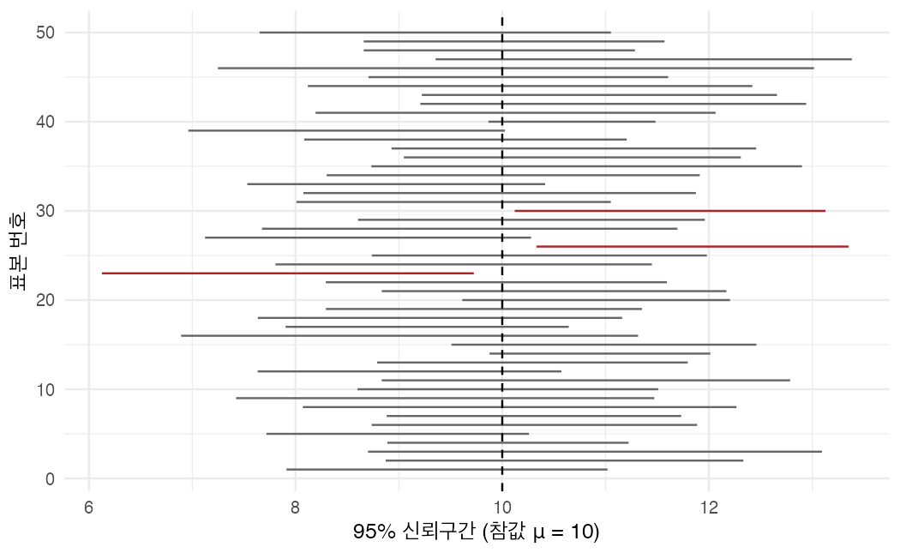

Hogg·McKean·Craig 『Introduction to Mathematical Statistics』 4장 앞부분(4.1–4.4)을 정리했다. 4편까지는 분포를 알 때 확률을 계산했다. 이제 방향을 뒤집어, 분포의 모수를 모를 때 자료로 모수를 추측한다. 값 하나로 추측하는 **점추정**과 범위로 추측하는 **구간추정**, 그리고 분포 가정 없이 쓸 수 있는 **순서통계량**을 다룬다.

```r title="환경 설정"
library(tidyverse)
theme_set(theme_minimal(base_size = 12))
```

## 1. 확률표본과 통계량

모집단 분포가 $f(x; \theta)$이고 모수 $\theta \in \Omega$를 모른다고 하자. $X_1, \dots, X_n$이 독립이고 모두 $f(x; \theta)$를 따르면 **확률표본**(iid)이라 한다. 결합 pdf는 $\prod_{i=1}^n f(x_i; \theta)$다.

표본의 함수 $T = T(X_1, \dots, X_n)$으로 $\theta$에 의존하지 않는 것을 **통계량**이라 한다. $\theta$를 추측하는 데 쓰는 통계량을 **추정량**, 관측값을 넣어 얻은 숫자 $T(x_1, \dots, x_n)$을 **추정값**이라 한다. 추정량은 확률변수라 분포(표본분포)를 갖고, 추정량의 좋고 나쁨은 이 분포로 판단한다.

**불편성.** $E_\theta(T) = \theta$가 모든 $\theta$에서 성립하면 $T$를 **불편추정량**이라 한다. [3편](/posts/ms-03-multivariate)에서 $E(\bar X) = \mu$, $E(S^2) = \sigma^2$을 보였다.

불편성만으로는 부족하다. 추정량이 평균적으로 맞더라도 흩어짐이 크면 쓸모가 없다. 흩어짐과 치우침을 함께 재는 것이 **평균제곱오차**다.

$$
\text{MSE}(T) = E[(T - \theta)^2] = \text{Var}(T) + [E(T) - \theta]^2
$$

치우침(편향)을 조금 허용하고 분산을 크게 줄이면 MSE가 더 작아질 수 있다. 정규표본에서 $\sigma^2$의 두 추정량 $S^2$(분모 $n - 1$)과 $\hat\sigma^2 = \frac{n-1}{n}S^2$(분모 $n$)을 비교하면, $(n-1)S^2/\sigma^2 \sim \chi^2(n-1)$([4편](/posts/ms-04-special-distributions))의 분산 $2(n - 1)$에서

$$
\text{MSE}(S^2) = \frac{2\sigma^4}{n - 1}, \qquad \text{MSE}(\hat\sigma^2) = \frac{2(n - 1)\sigma^4}{n^2} + \frac{\sigma^4}{n^2} = \frac{(2n - 1)\sigma^4}{n^2}
$$

이고 $\frac{2n - 1}{n^2} < \frac{2}{n - 1}$이 항상 성립한다. 불편추정량 $S^2$보다 편향된 $\hat\sigma^2$의 MSE가 작다.

```r
n <- c(5, 10, 30)
tibble(n, mse_S2 = 2 / (n - 1), mse_hat = (2 * n - 1) / n^2) |> mutate(across(-n, \(v) round(v, 4)))   # σ = 1
```

```text
# A tibble: 3 × 3
      n mse_S2 mse_hat
  <dbl>  <dbl>   <dbl>
1     5  0.5    0.36  
2    10  0.222  0.19  
3    30  0.069  0.0656
```

추정량을 만드는 일반적인 방법은 **최대가능도추정**이다. 관측값의 결합 pdf를 $\theta$의 함수로 본 가능도 $L(\theta) = \prod f(x_i; \theta)$를 최대로 하는 $\theta$를 고른다. 지수분포 $f(x; \theta) = \theta^{-1}e^{-x/\theta}$이면 $\log L = -n\log\theta - \sum x_i/\theta$를 미분해 $\hat\theta = \bar X$를 얻는다. 성질은 8편에서 자세히 다룬다.

pmf나 pdf 자체를 추정할 수도 있다. 이산형이면 상대도수, 연속형이면 히스토그램이나 커널밀도추정 $\hat f(x) = \frac{1}{nh}\sum K\left(\frac{x - X_i}{h}\right)$을 쓴다. 띠폭 $h$가 작으면 분산이, 크면 편향이 커진다. MSE의 분산·편향 상충이 여기에도 나타난다.

## 2. 신뢰구간

**정의.** $0 < \alpha < 1$에 대해 두 통계량 $L < U$가

$$
P_\theta(L < \theta < U) = 1 - \alpha \quad \text{모든 } \theta
$$

를 만족하면 $(L, U)$를 $\theta$의 $100(1 - \alpha)\%$ **신뢰구간**이라 한다.

확률변수는 $\theta$가 아니라 구간 $(L, U)$다. 자료를 얻어 계산한 구간 $(l, u)$는 고정된 숫자이므로 "$\theta$가 이 구간에 있을 확률이 95%"라고 말할 수 없다. 95%는 **구간을 만드는 방법**의 성질이다. 같은 방법을 반복하면 만든 구간의 95%가 $\theta$를 포함한다.

```r
set.seed(5)
ci <- map_dfr(1:50, \(i) { x <- rnorm(15, mean = 10, sd = 3); tt <- t.test(x)$conf.int
  tibble(i, lo = tt[1], hi = tt[2]) }) |> mutate(cover = lo < 10 & hi > 10)
sum(ci$cover)
ggplot(ci, aes(y = i, xmin = lo, xmax = hi, color = cover)) +
  geom_linerange() + geom_vline(xintercept = 10, linetype = 2) +
  scale_color_manual(values = c(`TRUE` = "grey40", `FALSE` = "firebrick"), guide = "none") +
  labs(x = "95% 신뢰구간 (참값 μ = 10)", y = "표본 번호")
```



```text
[1] 47
```

이번 50개 중 47개(94%)가 참값을 포함했다. 다시 뽑으면 이 개수는 달라지지만, 평균적으로 95%다.

### 피벗

신뢰구간은 보통 **피벗**으로 만든다. 피벗은 자료와 $\theta$의 함수인데 그 분포가 $\theta$에 의존하지 않는 확률변수다. 피벗의 분위수로 확률 $1 - \alpha$인 부등식을 세운 뒤 $\theta$에 대해 푼다.

| 상황 | 피벗 | 신뢰구간 |
|---|---|---|
| 정규, $\sigma$ 앎 | $\dfrac{\bar X - \mu}{\sigma/\sqrt n} \sim N(0, 1)$ | $\bar x \pm z_{\alpha/2}\sigma/\sqrt n$ |
| 정규, $\sigma$ 모름 | $\dfrac{\bar X - \mu}{S/\sqrt n} \sim t(n-1)$ | $\bar x \pm t_{\alpha/2, n-1}s/\sqrt n$ |
| 정규, 분산 | $\dfrac{(n-1)S^2}{\sigma^2} \sim \chi^2(n-1)$ | $\left(\dfrac{(n-1)s^2}{\chi^2_{\alpha/2}}, \dfrac{(n-1)s^2}{\chi^2_{1-\alpha/2}}\right)$ |
| 분포 무관, 대표본 | $\dfrac{\bar X - \mu}{S/\sqrt n} \overset{\cdot}{\sim} N(0, 1)$ (7편 CLT) | $\bar x \pm z_{\alpha/2}s/\sqrt n$ |
| 비율, 대표본 | $\dfrac{\hat p - p}{\sqrt{\hat p(1 - \hat p)/n}} \overset{\cdot}{\sim} N(0, 1)$ | $\hat p \pm z_{\alpha/2}\sqrt{\hat p(1 - \hat p)/n}$ |

$z_{\alpha/2}$는 위쪽 $\alpha/2$ 분위수다. 같은 신뢰수준에서 구간 길이가 짧을수록 좋다. 대칭인 피벗 분포에서는 양쪽 꼬리를 같게 자르는 것이 가장 짧은 구간을 준다.

### 두 모집단의 차이

독립인 두 정규표본(크기 $n_1, n_2$)의 평균 차이 $\mu_1 - \mu_2$는 분산이 같다고 가정하면 합동분산 $S_p^2 = \frac{(n_1 - 1)S_1^2 + (n_2 - 1)S_2^2}{n_1 + n_2 - 2}$을 써서

$$
T = \frac{(\bar X - \bar Y) - (\mu_1 - \mu_2)}{S_p\sqrt{1/n_1 + 1/n_2}} \sim t(n_1 + n_2 - 2)
$$

가 피벗이다. 분산이 같지 않으면 정확한 피벗이 없어 웰치 근사를 쓴다. 두 비율의 차이는 $\hat p_1 - \hat p_2 \pm z_{\alpha/2}\sqrt{\hat p_1\hat q_1/n_1 + \hat p_2\hat q_2/n_2}$이다.

R의 `sleep` 자료(수면제 두 종류의 수면 증가량, 10명씩)로 합동 $t$ 구간을 직접 계산하고 `t.test`와 비교한다. 원래는 같은 사람에게 두 약을 쓴 짝지은 자료이지만, 공식 확인을 위해 독립 두 표본으로 본다.

```r
x <- sleep$extra[sleep$group == 1]; y <- sleep$extra[sleep$group == 2]
sp <- sqrt(((10 - 1) * var(x) + (10 - 1) * var(y)) / 18)
diff <- mean(x) - mean(y)
c(lower = diff - qt(0.975, 18) * sp * sqrt(2 / 10), upper = diff + qt(0.975, 18) * sp * sqrt(2 / 10))
t.test(x, y, var.equal = TRUE)$conf.int
```

```text
    lower     upper 
-3.363874  0.203874 
[1] -3.363874  0.203874
attr(,"conf.level")
[1] 0.95
```

## 3. 이산분포의 신뢰구간

대표본 비율 구간(왈드 구간)은 $n$이 작거나 $p$가 0이나 1에 가까우면 실제 포함확률이 명목 수준보다 크게 낮다. 정규근사를 쓰지 않고 이항분포에서 직접 구간을 만들 수 있다.

관측값이 $x$일 때, 하한 $p_L$은 "$p = p_L$이면 $x$ 이상이 나올 확률이 $\alpha/2$"가 되는 값, 상한 $p_U$는 "$p = p_U$이면 $x$ 이하가 나올 확률이 $\alpha/2$"가 되는 값이다.

$$
P_{p_L}(X \ge x) = \frac{\alpha}{2}, \qquad P_{p_U}(X \le x) = \frac{\alpha}{2}
$$

이항분포의 cdf가 $p$에 대해 단조이므로 이 방정식의 해가 하나씩 있다. 이것이 **클로퍼-피어슨 구간**이다. 이산분포라 포함확률을 정확히 $1 - \alpha$로 맞출 수 없어 **적어도** $1 - \alpha$가 되도록 만든다. 포아송 평균도 같은 방식으로 구한다.

```r
x <- 3; n <- 20; phat <- x / n
wald <- phat + c(-1, 1) * qnorm(0.975) * sqrt(phat * (1 - phat) / n)
pL <- uniroot(\(p) pbinom(x - 1, n, p, lower.tail = FALSE) - 0.025, c(1e-6, 1 - 1e-6))$root
pU <- uniroot(\(p) pbinom(x, n, p) - 0.025, c(1e-6, 1 - 1e-6))$root
rbind(wald = wald, clopper_pearson = c(pL, pU), binom.test = binom.test(x, n)$conf.int) |> round(4)
```

```text
                   [,1]   [,2]
wald            -0.0065 0.3065
clopper_pearson  0.0321 0.3789
binom.test       0.0321 0.3789
```

$n = 20$에 성공 3번이면 왈드 구간의 하한이 음수(−0.0065)로 나와 확률이 가질 수 없는 값까지 포함하고, 구간이 대칭이다. 클로퍼-피어슨 구간은 오른쪽으로 긴 비대칭 구간으로, 분포의 비대칭을 반영한다.

## 4. 순서통계량

연속형 확률표본을 크기 순으로 정렬한 $Y_1 < Y_2 < \cdots < Y_n$을 **순서통계량**이라 한다. 최솟값 $Y_1$, 최댓값 $Y_n$, 중앙값, 범위 $Y_n - Y_1$이 모두 순서통계량의 함수다.

**정리.** 결합 pdf와 $k$번째 순서통계량의 pdf는 다음과 같다.

$$
g(y_1, \dots, y_n) = n!\prod_{i=1}^n f(y_i), \quad y_1 < \cdots < y_n
$$

$$
g_k(y) = \frac{n!}{(k-1)!(n-k)!}[F(y)]^{k-1}[1 - F(y)]^{n-k}f(y)
$$

결합 pdf의 $n!$은 정렬하기 전 표본이 $n!$가지 순서 중 어느 것이든 같은 정렬 결과를 주기 때문이다. $g_k$는 "$y$ 아래에 $k - 1$개, $y$ 근처에 1개, 위에 $n - k$개"가 놓이는 다항확률로 읽으면 바로 나온다. 특히 $g_n(y) = n[F(y)]^{n-1}f(y)$, $g_1(y) = n[1 - F(y)]^{n-1}f(y)$다.

$U(0, 1)$에서는 $F(y) = y$이므로 $Y_k \sim \text{Beta}(k, n - k + 1)$이고 $E(Y_k) = k/(n + 1)$이다. $n$개의 점이 구간을 평균적으로 $n + 1$등분한다. [2편](/posts/ms-02-random-variables)의 확률적분변환으로 $F(Y_k)$는 어떤 연속분포에서든 이 베타분포를 따른다.

### 분위수와 분포무관 신뢰구간

$p$번째 분위수 $\xi_p$는 $F(\xi_p) = p$인 값이다. 순서통계량 $Y_i < Y_j$에 대해 "$\xi_p$보다 작은 관측값의 개수" $W$가 $b(n, p)$를 따르므로

$$
P(Y_i < \xi_p < Y_j) = P(i \le W \le j - 1) = \sum_{w=i}^{j-1}\binom{n}{w}p^w(1 - p)^{n-w}
$$

이다. 이 확률은 $F$의 모양과 무관하다. 연속분포라는 가정만으로 중앙값($p = 0.5$)이나 다른 분위수의 신뢰구간을 만들 수 있다. 13편의 부호검정과 같은 원리다.

```r
n <- 15
cover <- function(i, j, p = 0.5) sum(dbinom(i:(j - 1), n, p))
tibble(i = 1:7, j = n + 1 - i) |> mutate(coverage = map2_dbl(i, j, cover)) |>
  filter(coverage > 0.9) |> mutate(coverage = round(coverage, 4))
```

```text
# A tibble: 4 × 3
      i     j coverage
  <int> <dbl>    <dbl>
1     1    15    1.000
2     2    14    0.999
3     3    13    0.993
4     4    12    0.965
```

$n = 15$이면 $(Y_4, Y_{12})$가 중앙값의 96.5% 신뢰구간이다. 이산적인 이항확률이라 정확히 95%인 구간은 없고, 95%를 넘는 가장 짧은 대칭 구간을 고른다.

## 5. 비교

| 구분 | 앞의 것 | 뒤의 것 |
|---|---|---|
| 추정량 대 추정값 | 확률변수 $T(X_1, \dots, X_n)$, 분포가 있음 | 숫자 $T(x_1, \dots, x_n)$ |
| 불편성 대 MSE | 평균이 맞음 | 분산 + 편향², 편향을 허용해 더 작게 만들 수 있음 |
| 신뢰구간의 확률 | 구간 $(L, U)$가 확률변수, 방법의 성질 | 계산한 구간에 대해서는 확률을 말하지 않음 (14편 신용구간과 대비) |
| $z$ 대 $t$ 구간 | $\sigma$를 앎 또는 대표본 | 정규표본에서 $\sigma$를 $S$로 추정, 꼬리가 두꺼워 구간이 김 |
| 왈드 대 정확 구간 | 정규근사, 대칭, 소표본에서 포함확률 부족 | 이항 cdf를 뒤집음, 포함확률 ≥ $1 - \alpha$ |
| 모수적 대 분포무관 구간 | 분포 가정이 맞으면 짧음 | 연속성만 가정, 순서통계량 |

## 요약

| 개념 | 핵심 |
|---|---|
| 통계량 | 모수에 의존하지 않는 표본의 함수, 표본분포를 가짐 |
| MSE | $\text{Var}(T) + \text{bias}^2$, 정규 분산에서 분모 $n$이 MSE가 더 작음 |
| 신뢰구간 | $P_\theta(L < \theta < U) = 1 - \alpha$, 반복했을 때의 포함 비율 |
| 피벗 | 분포가 모수에 의존하지 않는 함수, 분위수로 부등식을 세워 뒤집음 |
| 클로퍼-피어슨 | 이항 cdf를 $p$에 대해 풀어 만든 정확 구간 |
| 순서통계량 | $g_k(y) = \frac{n!}{(k-1)!(n-k)!}F^{k-1}(1-F)^{n-k}f$ |
| 분위수 구간 | $P(Y_i < \xi_p < Y_j) = \sum_{w=i}^{j-1}\binom{n}{w}p^w q^{n-w}$, 분포무관 |

## 참고자료

- Hogg, R. V., McKean, J. W., & Craig, A. T. *Introduction to Mathematical Statistics* (8th ed.), Chapter 4.1–4.4.

다음 글: [수리통계학 - 가설검정의 기초](/posts/ms-06-testing-basics)
