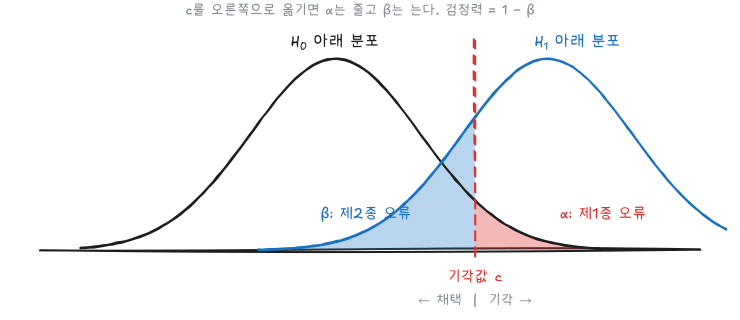
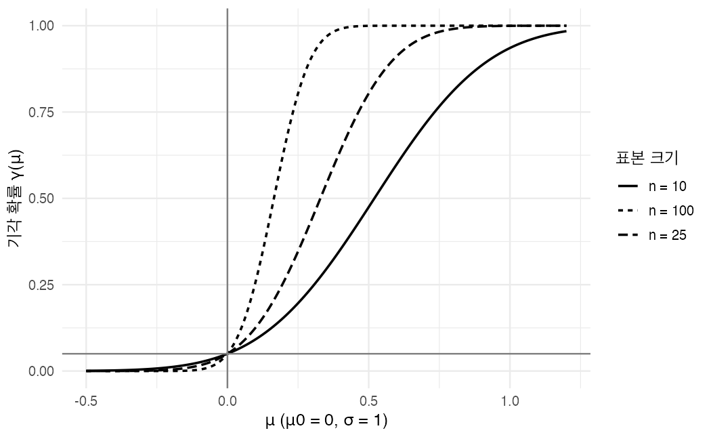

Hogg·McKean·Craig 『Introduction to Mathematical Statistics』 4장 뒷부분(4.5–4.9)을 정리했다. [5편](/posts/ms-05-estimation-intervals)의 추정이 "모수가 얼마인가"를 묻는다면, 검정은 "모수가 이 범위에 있다는 주장을 받아들일 수 있는가"를 묻는다. 검정의 기본 언어(오류, 크기, 검정력, $p$값)를 정의하고, 분포를 계산으로 구하기 어려울 때 쓰는 모의실험 방법(몬테카를로, 부트스트랩)을 다룬다. 최적의 검정을 찾는 이론은 11편에서 다룬다.

```r title="환경 설정"
library(tidyverse)
theme_set(theme_minimal(base_size = 12))
```

## 1. 가설, 기각역, 두 가지 오류

모수공간 $\Omega$를 서로 겹치지 않는 $\omega_0$와 $\omega_1$로 나누고 두 가설을 세운다.

$$
H_0: \theta \in \omega_0 \quad \text{대} \quad H_1: \theta \in \omega_1
$$

$\omega_0$가 점 하나이면 **단순가설**, 여러 점이면 **복합가설**이다. 검정은 표본공간을 나누는 규칙이다. 자료가 **기각역** $C$에 들어가면 $H_0$를 기각하고, 아니면 기각하지 않는다.

| | $H_0$ 참 | $H_1$ 참 |
|---|---|---|
| $H_0$ 기각 | 제1종 오류 | 옳은 결정 |
| $H_0$ 기각 안 함 | 옳은 결정 | 제2종 오류 |

표본 크기가 고정되면 두 오류를 동시에 줄일 수 없다. 기각역을 넓히면 제1종 오류가, 좁히면 제2종 오류가 커진다. 그래서 제1종 오류의 상한을 먼저 정하고 그 안에서 제2종 오류를 가장 작게 하는 검정을 찾는다. $H_0$를 "기각하지 않음"은 $H_0$가 참이라는 증거가 아니다. 이 비대칭 때문에 입증하고 싶은 주장을 $H_1$에 둔다.

**검정력 함수** $\gamma_C(\theta) = P_\theta(\mathbf{X} \in C)$는 $\theta$에서 $H_0$를 기각할 확률이다. $\theta \in \omega_1$에서는 클수록 좋고(검정력), $\theta \in \omega_0$에서는 작을수록 좋다(제1종 오류). 검정의 **크기**는

$$
\alpha = \max_{\theta \in \omega_0}\gamma_C(\theta)
$$

이다. $H_0$가 복합가설이면 그중 가장 나쁜 경우의 제1종 오류다.



**예.** $X_1, \dots, X_n \sim N(\mu, \sigma^2)$, $\sigma$를 안다고 하고 $H_0: \mu \le \mu_0$ 대 $H_1: \mu > \mu_0$를 검정한다. 기각역을 $\bar X > \mu_0 + z_\alpha\sigma/\sqrt n$으로 두면

$$
\gamma(\mu) = P_\mu\left(\frac{\bar X - \mu}{\sigma/\sqrt n} > z_\alpha - \frac{\mu - \mu_0}{\sigma/\sqrt n}\right) = 1 - \Phi\left(z_\alpha - \frac{\sqrt n(\mu - \mu_0)}{\sigma}\right)
$$

이다. $\mu$에 대해 증가하므로 $\omega_0 = \{\mu \le \mu_0\}$에서 최댓값은 $\mu = \mu_0$일 때의 $\alpha$다. 복합 귀무가설인데도 경계점 하나만 보면 크기가 정해진다.

```r
power_fn <- function(mu, n, mu0 = 0, sigma = 1, alpha = 0.05) 1 - pnorm(qnorm(1 - alpha) - sqrt(n) * (mu - mu0) / sigma)
tibble(mu = seq(-0.5, 1.2, length.out = 300)) |>
  mutate(`n = 10` = power_fn(mu, 10), `n = 25` = power_fn(mu, 25), `n = 100` = power_fn(mu, 100)) |>
  pivot_longer(-mu, names_to = "표본 크기", values_to = "power") |>
  ggplot(aes(mu, power, linetype = `표본 크기`)) +
  geom_line(linewidth = 0.8) + geom_hline(yintercept = 0.05, color = "grey50") + geom_vline(xintercept = 0, color = "grey50") +
  labs(x = "μ (μ0 = 0, σ = 1)", y = "기각 확률 γ(μ)")
```



```r
round(c(n10 = power_fn(0.5, 10), n25 = power_fn(0.5, 25), n100 = power_fn(0.5, 100)), 4)
```

```text
   n10    n25   n100 
0.4746 0.8038 0.9996
```

$\mu = 0.5$(표준편차의 절반)를 검출할 확률이 $n = 10$이면 0.47, $n = 25$이면 0.80이다. [표본크기 글](/posts/biostat-sample-size)의 계산이 이 함수를 원하는 검정력에 맞춰 $n$에 대해 푼 것이다.

### 검정과 신뢰구간의 쌍대성

양측 검정 $H_0: \mu = \mu_0$ 대 $H_1: \mu \ne \mu_0$를 크기 $\alpha$로 할 때, $t$검정이 $H_0$를 기각하지 **않는** $\mu_0$의 집합은

$$
\left\{\mu_0 : \left|\frac{\bar x - \mu_0}{s/\sqrt n}\right| \le t_{\alpha/2, n-1}\right\} = \left[\bar x - t_{\alpha/2}\frac{s}{\sqrt n},\ \bar x + t_{\alpha/2}\frac{s}{\sqrt n}\right]
$$

로 $100(1 - \alpha)\%$ 신뢰구간과 같다. 일반적으로 각 $\theta_0$에 대한 크기 $\alpha$ 검정을 모으면 신뢰구간이 되고, 신뢰구간이 있으면 "$\theta_0$가 구간 밖이면 기각"으로 검정이 된다. [5편](/posts/ms-05-estimation-intervals)의 클로퍼-피어슨 구간이 이 방식으로 만든 것이다.

## 2. p값

기각역은 $\alpha$를 미리 정해야 한다. 같은 자료라도 $\alpha$에 따라 결론이 바뀌므로, 자료가 $H_0$에 반하는 정도를 하나의 숫자로 보고한다. 검정통계량 $T$가 클수록 $H_0$에 불리하다면 관측값 $t$에 대해

$$
p\text{값} = \sup_{\theta \in \omega_0}P_\theta(T \ge t)
$$

이다. "$H_0$가 참일 때 지금 관측한 것만큼 또는 그보다 극단적인 결과가 나올 확률"이고, 동시에 **이 자료로 $H_0$를 기각할 수 있는 가장 작은 유의수준**이다. $p \le \alpha$이면 크기 $\alpha$ 검정이 기각한다.

$p$값은 $H_0$가 참일 확률이 아니다. $p = 0.03$은 "$P(H_0 \mid \text{자료}) = 0.03$"이 아니라 "$H_0$ 아래에서 이런 자료가 나올 확률이 0.03"이다. 앞의 확률은 베이즈 정리와 사전확률이 있어야 계산할 수 있다([1편](/posts/ms-01-probability)의 진단검사 예와 같은 구조).

**정리.** $T$가 연속형이고 $H_0$가 단순가설이면 $H_0$ 아래에서 $p$값 $= 1 - F_T(T) \sim U(0, 1)$이다.

[2편](/posts/ms-02-random-variables)의 확률적분변환이다. 그래서 $H_0$가 참이면 $p$값이 0과 1 사이에 고르게 흩어지고, 크기 $\alpha$ 검정은 정확히 $\alpha$의 비율로 기각한다.

이산형 통계량에서는 $p$값이 몇 개의 값만 가지므로 크기를 정확히 $\alpha$로 맞추지 못한다. 경계점에서 동전을 던져 확률적으로 기각하는 **확률화 검정**을 쓰면 정확히 맞출 수 있지만, 실제로는 크기가 $\alpha$ 이하가 되는 보수적 검정을 쓴다.

## 3. 카이제곱 검정

$k$개 범주의 다항분포 $(X_1, \dots, X_k)$에서 $H_0: p_i = p_{i0}$ ($i = 1, \dots, k$)를 검정한다. 피어슨 통계량은

$$
Q_{k-1} = \sum_{i=1}^k \frac{(X_i - np_{i0})^2}{np_{i0}} \overset{\cdot}{\sim} \chi^2(k - 1) \quad (H_0 \text{ 아래, 대표본})
$$

이다. $k = 2$이면 $Q_1 = \dfrac{(X_1 - np_{10})^2}{np_{10}(1 - p_{10})}$으로, 이항비율 $z$통계량의 제곱이다. 일반적인 $k$에서는 다변량 CLT를 쓴다. $Z_i = (X_i - np_{i0})/\sqrt{np_{i0}}$로 두면 $\mathbf{X}$는 $n$개의 독립 다항 시행의 합이므로 $\mathbf{Z}$는 평균 $\mathbf{0}$, 공분산 $\mathbf{I} - \mathbf{q}\mathbf{q}'$ ($\mathbf{q} = (\sqrt{p_{10}}, \dots, \sqrt{p_{k0}})'$)인 다변량정규로 분포수렴한다. $\mathbf{q}'\mathbf{q} = \sum p_{i0} = 1$이라 $\mathbf{I} - \mathbf{qq}'$은 계수 $k - 1$인 정사영행렬이고, [12편](/posts/ms-12-normal-linear-models)의 이차형식 정리로 $Q_{k-1} = \mathbf{Z}'\mathbf{Z} \xrightarrow{D} \chi^2(k - 1)$이다. 범주의 합이 $n$으로 고정되어 있어 자유도가 $k$가 아니라 $k - 1$이다. 각 범주의 기대도수 $np_{i0}$가 5 이상이면 근사가 괜찮다.

| 용도 | 귀무가설 | 자유도 |
|---|---|---|
| 적합도 (모수 앎) | $p_i = p_{i0}$ | $k - 1$ |
| 적합도 (모수 $q$개를 추정) | 분포족에 속함 | $k - 1 - q$ |
| 동질성 ($c$개 모집단, $r$개 범주) | 모집단마다 범주 비율이 같음 | $(r - 1)(c - 1)$ |
| 독립성 ($r \times c$ 분할표) | 두 분류가 독립 $p_{ij} = p_{i\cdot}p_{\cdot j}$ | $(r - 1)(c - 1)$ |

추정한 모수마다 자유도가 하나씩 준다. 독립성 검정에서 $rc - 1$개의 자유로운 칸에서 주변 비율 $(r - 1) + (c - 1)$개를 추정하므로 $rc - 1 - (r - 1) - (c - 1) = (r - 1)(c - 1)$이다.

**예.** 주사위를 120번 던져 1~6이 각각 15, 25, 18, 22, 12, 28번 나왔다. 공정하면 기대도수는 모두 20이다.

```r
obs <- c(15, 25, 18, 22, 12, 28)
Q <- sum((obs - 20)^2 / 20)
c(Q = Q, p_value = pchisq(Q, df = 5, lower.tail = FALSE))
chisq.test(obs)$statistic
```

```text
         Q    p_value 
9.30000000 0.09768005 
X-squared 
      9.3
```

$Q = 9.3$, 자유도 5에서 $p = 0.098$이다. 유의수준 0.05에서 공정하지 않다는 증거가 부족하다.

## 4. 몬테카를로 방법

검정통계량의 분포를 해석적으로 구하기 어려우면 컴퓨터로 표본을 많이 만들어 근사한다. 기댓값은 표본평균으로, 확률은 상대도수로 추정하고, 7편의 대수의 법칙이 근사의 정당성을, CLT가 오차의 크기($\propto 1/\sqrt{N}$)를 준다.

모의실험은 원하는 분포에서 난수를 만들 수 있어야 한다. [2편](/posts/ms-02-random-variables)의 역변환은 $F^{-1}$을 알아야 한다. 그렇지 않을 때 쓰는 일반적인 방법이 **채택-기각 알고리즘**이다.

**알고리즘.** 목표 pdf $f$를 직접 뽑기 어렵고, 뽑기 쉬운 pdf $g$와 상수 $M$이 모든 $x$에서 $f(x) \le Mg(x)$를 만족한다고 하자.

1. $Y \sim g$, $U \sim U(0, 1)$을 독립으로 뽑는다.
2. $U \le f(Y)/[Mg(Y)]$이면 $X = Y$로 채택하고, 아니면 1로 돌아간다.

채택된 $X$의 pdf는 $f$다. $P(Y \le x, \text{채택}) = \int_{-\infty}^x \frac{f(y)}{Mg(y)}g(y)\,dy = F(x)/M$이고 $P(\text{채택}) = 1/M$이므로 조건부 cdf가 $F(x)$다. 채택 확률이 $1/M$이므로 $Mg$가 $f$를 바짝 감쌀수록 효율적이다.

$\text{Beta}(2, 2)$의 pdf $f(x) = 6x(1 - x)$는 최댓값이 $x = 1/2$에서 1.5이므로 $g = U(0, 1)$, $M = 1.5$로 뽑는다.

```r
set.seed(6)
y <- runif(20000); u <- runif(20000)
x <- y[u <= 6 * y * (1 - y) / 1.5]
c(accept_rate = length(x) / 20000, theory = 1 / 1.5, mean = mean(x), var = var(x), var_theory = 2 * 2 / (4^2 * 5))
```

```text
accept_rate      theory        mean         var  var_theory 
 0.66995000  0.66666667  0.50224849  0.05028781  0.05000000
```

채택률 0.67이 이론값 $1/M$과 맞고, 평균 0.5와 분산 0.05도 베타분포의 값과 맞는다.

몬테카를로로 검정의 실제 크기도 확인할 수 있다. 예를 들어 지수분포 표본($n = 10$)에 $t$검정을 쓰면 정규성이 깨져 실제 크기가 명목 수준 0.05와 다르다.

```r
set.seed(7)
pv <- replicate(20000, t.test(rexp(10), mu = 1, alternative = "greater")$p.value)
c(size = mean(pv <= 0.05), mc_se = sqrt(0.05 * 0.95 / 20000))
```

```text
       size       mc_se 
0.013600000 0.001541104
```

오른쪽 꼬리가 긴 분포에서 위쪽 단측 $t$검정의 실제 크기는 0.05보다 작다. 몬테카를로 표준오차가 0.0015이므로 이 차이는 모의실험 오차로 설명되지 않는다.

## 5. 부트스트랩

몬테카를로는 모집단 분포를 알 때 쓴다. 분포를 모르면 자료의 **경험분포** $\hat F_n$(관측값마다 확률 $1/n$)을 모집단 대신 쓴다. 이것이 **부트스트랩**이다.

1. 관측값 $x_1, \dots, x_n$에서 **복원추출**로 크기 $n$인 표본 $\mathbf{x}^*$를 만든다.
2. 추정량 $\hat\theta^* = T(\mathbf{x}^*)$를 계산한다.
3. 1–2를 $B$번 반복해 $\hat\theta^*_1, \dots, \hat\theta^*_B$를 얻는다.

$\hat\theta^*$의 흩어짐이 $\hat\theta$의 표본분포를 근사한다. **백분위수 신뢰구간**은 $\hat\theta^*$의 $\alpha/2$, $1 - \alpha/2$ 분위수다. 부트스트랩 표준오차는 $\hat\theta^*$들의 표준편차다. 중앙값처럼 표준오차 공식이 복잡한 추정량에 특히 유용하다.

```r
set.seed(8)
x <- round(rlnorm(25, meanlog = 1, sdlog = 0.8), 2)       # 오른쪽으로 치우친 자료
boot_med <- replicate(5000, median(sample(x, replace = TRUE)))
c(median = median(x), boot_se = sd(boot_med), quantile(boot_med, c(0.025, 0.975)))
```

```text
   median   boot_se      2.5%     97.5% 
2.4900000 0.3317734 1.8800000 3.4300000
```

표본 중앙값 2.49의 95% 백분위수 구간은 (1.88, 3.43)으로, 자료가 오른쪽으로 치우친 만큼 위쪽이 더 길다. 정규근사 구간 $\hat\theta \pm 1.96 \cdot \text{SE}$는 이런 비대칭을 담지 못한다.

부트스트랩 검정은 $H_0$가 참인 상태의 경험분포에서 재표집한다. 예를 들어 $H_0: \mu = \mu_0$이면 자료를 $x_i - \bar x + \mu_0$로 옮겨 평균이 $\mu_0$가 되게 한 뒤 재표집하고, 원래 통계량보다 극단적인 재표집 통계량의 비율을 $p$값으로 쓴다. 두 표본 비교에서는 두 표본을 합친 자료에서 재표집하면 "두 분포가 같다"는 $H_0$를 반영한다.

## 6. 비교

| 구분 | 앞의 것 | 뒤의 것 |
|---|---|---|
| 제1종 대 제2종 오류 | 참인 $H_0$를 기각, 상한 $\alpha$로 통제 | 거짓인 $H_0$를 유지, 검정력 $1 - \beta$로 표현 |
| 크기 대 검정력 | $\omega_0$에서 기각 확률의 최댓값 | $\omega_1$에서 기각 확률 |
| 유의수준 대 $p$값 | 자료 전에 정한 기준 | 자료로 계산, 기각 가능한 최소 유의수준 |
| $p$값 대 $P(H_0 \mid \text{자료})$ | $H_0$ 아래 극단적 결과의 확률 | 사전확률이 있어야 계산 가능 |
| 적합도 대 독립성 검정 | 한 다항분포의 확률 벡터, 자유도 $k - 1 - q$ | 분할표의 행·열 독립, 자유도 $(r-1)(c-1)$ |
| 몬테카를로 대 부트스트랩 | 알려진 모형 $F$에서 난수 생성 | 경험분포 $\hat F_n$에서 복원추출 |

## 요약

| 개념 | 핵심 |
|---|---|
| 기각역 | 자료가 $C$에 들면 $H_0$ 기각 |
| 검정력 함수 | $\gamma(\theta) = P_\theta(\mathbf{X} \in C)$, 크기 $= \max_{\omega_0}\gamma$ |
| 쌍대성 | 기각하지 않는 $\theta_0$의 집합 = 신뢰구간 |
| $p$값 | $H_0$ 아래 관측값 이상으로 극단적일 확률, 연속형이면 $U(0,1)$ |
| 피어슨 카이제곱 | $\sum (O - E)^2/E$, 자유도 = 자유로운 칸 수 − 추정 모수 수 |
| 채택-기각 | $U \le f(Y)/[Mg(Y)]$면 채택, 채택률 $1/M$ |
| 부트스트랩 | 경험분포에서 복원추출, 백분위수 구간 |

## 참고자료

- Hogg, R. V., McKean, J. W., & Craig, A. T. *Introduction to Mathematical Statistics* (8th ed.), Chapter 4.5–4.9.

다음 글: [수리통계학 - 극한분포와 중심극한정리](/posts/ms-07-limiting-distributions)
