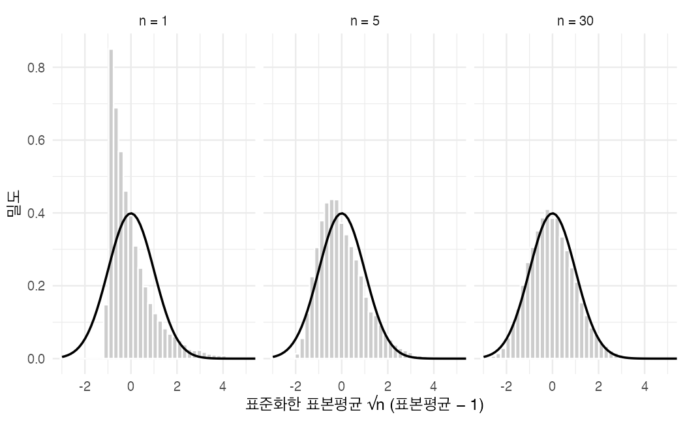

Hogg·McKean·Craig 『Introduction to Mathematical Statistics』 5장을 정리했다. 대부분의 통계량은 정확한 분포를 구하기 어렵다. 대신 표본 크기 $n$이 커질 때 통계량이 어떻게 행동하는지(어디로 모이는지, 어떤 분포에 가까워지는지)를 본다. [5편](/posts/ms-05-estimation-intervals)의 대표본 신뢰구간과 8편 이후 MLE의 성질이 모두 이 장의 결과 위에 서 있다.

```r title="환경 설정"
library(tidyverse)
theme_set(theme_minimal(base_size = 12))
```

## 1. 확률수렴

**정의.** 모든 $\epsilon > 0$에 대해

$$
\lim_{n\to\infty}P(|X_n - X| \ge \epsilon) = 0
$$

이면 $X_n$이 $X$로 **확률수렴**한다고 하고 $X_n \xrightarrow{P} X$로 쓴다. $n$이 크면 $X_n$이 $X$에서 $\epsilon$ 이상 벗어날 확률이 작다는 뜻이다.

**정리 (대수의 약한 법칙).** $X_1, X_2, \dots$가 평균 $\mu$, 분산 $\sigma^2 < \infty$인 iid이면 $\bar X_n \xrightarrow{P} \mu$이다.

[2편](/posts/ms-02-random-variables)의 체비셰프 부등식에 $\text{Var}(\bar X_n) = \sigma^2/n$을 넣으면

$$
P(|\bar X_n - \mu| \ge \epsilon) \le \frac{\sigma^2}{n\epsilon^2} \to 0
$$

이다. 분산이 없어도 평균만 있으면 성립한다는 것이 알려져 있지만(힌친), 증명이 더 길다. 평균이 없는 코시분포에서는 성립하지 않는다.

확률수렴은 대수 연산과 연속함수를 보존한다.

| 성질 | 내용 |
|---|---|
| 합 | $X_n \xrightarrow{P} X$, $Y_n \xrightarrow{P} Y$이면 $X_n + Y_n \xrightarrow{P} X + Y$ |
| 상수배 | $aX_n \xrightarrow{P} aX$ |
| 연속함수 | $g$가 $a$에서 연속이고 $X_n \xrightarrow{P} a$이면 $g(X_n) \xrightarrow{P} g(a)$ |
| 곱 | $X_n Y_n \xrightarrow{P} XY$ |

### 일치성

추정량 $T_n$이 모든 $\theta$에서 $T_n \xrightarrow{P} \theta$이면 **일치추정량**이라 한다. 표본을 늘리면 참값으로 모이는 추정량이다.

- $\bar X$는 $\mu$의 일치추정량이다(대수의 법칙).
- $S^2 = \frac{n}{n-1}\left(\frac1n\sum X_i^2 - \bar X^2\right)$에서 $\frac1n\sum X_i^2 \xrightarrow{P} \sigma^2 + \mu^2$, $\bar X^2 \xrightarrow{P} \mu^2$이므로 $S^2 \xrightarrow{P} \sigma^2$이다. 연속함수 성질로 $S \xrightarrow{P} \sigma$이다. $S$는 불편이 아니지만 일치적이다.
- $U(0, \theta)$의 최댓값 $Y_n$은 $P(|Y_n - \theta| \ge \epsilon) = P(Y_n \le \theta - \epsilon) = [(\theta - \epsilon)/\theta]^n \to 0$이므로 일치적이다.

불편성은 고정된 $n$에서의 성질이고 일치성은 $n \to \infty$의 성질이다. 둘은 서로를 함의하지 않는다. 다만 불편추정량의 분산이 0으로 가면 체비셰프 부등식으로 일치적이다.

## 2. 분포수렴

**정의.** $X_n$의 cdf $F_n$과 $X$의 cdf $F$에 대해, $F$가 연속인 모든 점 $x$에서

$$
\lim_{n\to\infty}F_n(x) = F(x)
$$

이면 $X_n$이 $X$로 **분포수렴**한다고 하고 $X_n \xrightarrow{D} X$로 쓴다. $X$의 분포를 **극한분포**라 한다.

연속점에서만 요구하는 이유가 있다. $X_n = 1/n$(확률 1)은 직관적으로 0으로 가야 하는데, $F_n(0) = 0$이고 극한분포의 $F(0) = 1$이다. 불연속점 0을 빼면 정의가 맞게 작동한다.

**예.** $U(0, \theta)$의 최댓값 $Y_n$은 $\theta$로 확률수렴하지만, 차이를 $n$배로 확대한 $Z_n = n(\theta - Y_n)$은

$$
P(Z_n > z) = P\left(Y_n < \theta - \frac{z}{n}\right) = \left(1 - \frac{z}{n\theta}\right)^n \to e^{-z/\theta}
$$

이므로 평균 $\theta$인 지수분포로 분포수렴한다. 최댓값은 $\theta$에 $1/n$의 속도로 다가간다. 평균의 $1/\sqrt n$보다 빠르다.

**정리.** 확률수렴과 분포수렴의 관계는 다음과 같다.

1. $X_n \xrightarrow{P} X$이면 $X_n \xrightarrow{D} X$
2. $X_n \xrightarrow{D} b$(상수)이면 $X_n \xrightarrow{P} b$
3. $X_n \xrightarrow{D} X$이고 $g$가 연속이면 $g(X_n) \xrightarrow{D} g(X)$

1의 역은 일반적으로 거짓이다. $X \sim N(0, 1)$, $X_n = -X$이면 $X_n$의 분포는 항상 $N(0, 1)$이라 $X$로 분포수렴하지만, $|X_n - X| = 2|X|$는 작아지지 않는다. 분포수렴은 분포만 비교하고 확률변수의 값은 비교하지 않는다.

모든 $\epsilon$에 대해 $P(|X_n| \le B_\epsilon) \ge 1 - \epsilon$인 상수 $B_\epsilon$이 있으면 $X_n$이 **확률적으로 유계**라 한다. 분포수렴하는 수열은 확률적으로 유계다. 유계인 $X_n$과 0으로 확률수렴하는 $Y_n$의 곱은 0으로 확률수렴한다. 이것이 슬러츠키 정리와 델타방법 증명의 핵심 단계다.

### 슬러츠키 정리

**정리.** $X_n \xrightarrow{D} X$, $A_n \xrightarrow{P} a$, $B_n \xrightarrow{P} b$이면

$$
A_n + B_nX_n \xrightarrow{D} a + bX
$$

이다. 분포수렴하는 것과 상수로 확률수렴하는 것을 섞어 계산할 수 있다는 뜻이다.

가장 많이 쓰는 경우가 모르는 $\sigma$를 $S$로 바꾸는 것이다. CLT(4절)로 $\sqrt n(\bar X - \mu)/\sigma \xrightarrow{D} N(0, 1)$이고 $\sigma/S \xrightarrow{P} 1$이므로

$$
\frac{\sqrt n(\bar X - \mu)}{S} = \frac{\sigma}{S}\cdot\frac{\sqrt n(\bar X - \mu)}{\sigma} \xrightarrow{D} N(0, 1)
$$

이다. 정규모집단이 아니어도 대표본 신뢰구간 $\bar x \pm z_{\alpha/2}s/\sqrt n$을 쓸 수 있는 근거다.

### 델타방법

**정리.** $\sqrt n(X_n - \theta) \xrightarrow{D} N(0, \sigma^2)$이고 $g$가 $\theta$에서 미분가능하며 $g'(\theta) \ne 0$이면

$$
\sqrt n[g(X_n) - g(\theta)] \xrightarrow{D} N\big(0, \sigma^2[g'(\theta)]^2\big)
$$

이다. 일차 테일러 전개 $g(X_n) = g(\theta) + g'(\theta)(X_n - \theta) + o_p(|X_n - \theta|)$에 $\sqrt n$을 곱하면, 나머지 항은 (유계) × (0으로 확률수렴)이라 사라지고 앞 항에 슬러츠키 정리를 쓴다.

**예 (로그 오즈).** 베르누이 표본에서 $\sqrt n(\hat p - p) \xrightarrow{D} N(0, p(1 - p))$이다. $g(p) = \log[p/(1 - p)]$이면 $g'(p) = 1/[p(1 - p)]$이므로

$$
\sqrt n\left[\log\frac{\hat p}{1 - \hat p} - \log\frac{p}{1 - p}\right] \xrightarrow{D} N\left(0, \frac{1}{p(1 - p)}\right)
$$

이다. 로지스틱 회귀 계수의 표준오차가 이 형태다.

```r
set.seed(9)
n <- 200; p <- 0.3
phat <- rbinom(20000, n, p) / n
c(sd_sim = sd(log(phat / (1 - phat))), sd_delta = sqrt(1 / (n * p * (1 - p))))
```

```text
   sd_sim  sd_delta 
0.1559688 0.1543033
```

**분산안정화 변환.** 분산이 평균에 의존하면($\sigma^2 = \sigma^2(\theta)$) $g'(\theta) \propto 1/\sigma(\theta)$인 $g$를 고르면 극한분포의 분산이 $\theta$와 무관해진다. 포아송은 $\sigma^2 = \theta$이므로 $g(x) = \sqrt x$이고 $\sqrt{\bar X}$의 근사 분산이 $1/(4n)$이다. 이항비율은 $g(p) = \arcsin\sqrt p$다.

## 3. mgf로 극한분포 구하기

**정리.** $X_n$의 mgf $M_n(t)$가 0을 포함하는 열린 구간에서 존재하고, 그 구간의 모든 $t$에서 $M_n(t) \to M(t)$이며 $M$이 $X$의 mgf이면 $X_n \xrightarrow{D} X$이다.

[4편](/posts/ms-04-special-distributions)의 이항 → 포아송 수렴이 이 정리의 예였다. 계산에서는 $\lim (1 + b/n + \psi(n)/n)^{cn} = e^{bc}$ ($\psi(n) \to 0$) 꼴의 극한을 자주 쓴다.

**예.** $X_n \sim \chi^2(n)$이면 $Z_n = (X_n - n)/\sqrt{2n}$의 mgf는

$$
M_{Z_n}(t) = e^{-t\sqrt{n/2}}\left(1 - \frac{2t}{\sqrt{2n}}\right)^{-n/2}
$$

이고, 로그를 취해 전개하면 $t^2/2$로 간다. 자유도가 큰 카이제곱분포는 정규분포로 근사된다.

## 4. 중심극한정리

**정리.** $X_1, X_2, \dots$가 평균 $\mu$, 분산 $\sigma^2$ ($0 < \sigma^2 < \infty$)인 iid이면

$$
\frac{\sqrt n(\bar X_n - \mu)}{\sigma} = \frac{\sum X_i - n\mu}{\sigma\sqrt n} \xrightarrow{D} N(0, 1)
$$

이다.

mgf가 존재하는 경우의 증명은 다음과 같다. $Y_i = (X_i - \mu)/\sigma$로 두면 $E(Y_i) = 0$, $E(Y_i^2) = 1$이고 $Z_n = \sum Y_i/\sqrt n$의 mgf는 $[M_Y(t/\sqrt n)]^n$이다. $M_Y(s) = 1 + s^2/2 + o(s^2)$이므로

$$
\left[1 + \frac{t^2}{2n} + o\left(\frac1n\right)\right]^n \to e^{t^2/2}
$$

이고, 이것이 $N(0, 1)$의 mgf다. mgf가 없을 때는 특성함수로 같은 계산을 한다.

모집단 분포가 무엇이든(분산만 유한하면) 표본평균은 정규분포에 가까워진다. 수렴 속도는 모집단의 비대칭에 달려 있다. 대칭에 가까우면 $n = 10$ 정도로도 충분하고, 지수분포처럼 치우치면 더 큰 $n$이 필요하다.

```r
set.seed(10)
z <- map_dfr(c(1, 5, 30), \(n) tibble(size = paste("n =", n), z = (rowMeans(matrix(rexp(n * 20000), ncol = n)) - 1) * sqrt(n)))
ggplot(z, aes(z)) +
  geom_histogram(aes(y = after_stat(density)), bins = 60, fill = "grey80", color = "white") +
  stat_function(fun = dnorm, linewidth = 0.8) +
  facet_wrap(~ factor(size, levels = c("n = 1", "n = 5", "n = 30"))) +
  coord_cartesian(xlim = c(-3, 5)) +
  labs(x = "표준화한 표본평균 √n (표본평균 − 1)", y = "밀도")
```



### 이항분포의 정규근사와 연속성 수정

$X \sim b(n, p)$는 베르누이 $n$개의 합이므로 $(X - np)/\sqrt{np(1 - p)} \overset{\cdot}{\sim} N(0, 1)$이다. 정수값 분포를 연속분포로 근사하므로, 정수 $k$의 확률을 구간 $(k - 0.5, k + 0.5)$의 넓이로 근사하면 더 정확하다(**연속성 수정**).

```r
n <- 50; p <- 0.3; mu <- n * p; s <- sqrt(n * p * (1 - p))
c(exact = pbinom(18, n, p), no_correction = pnorm((18 - mu) / s), correction = pnorm((18.5 - mu) / s))
```

```text
        exact no_correction    correction 
    0.8594401     0.8227303     0.8599564
```

$P(X \le 18)$의 정확한 값 0.8594에 대해 수정 없는 근사는 0.8227로 낮고, 18.5로 수정하면 0.8600으로 소수 셋째 자리까지 맞는다.

## 5. 다변량으로의 확장

확률벡터의 확률수렴은 성분별 확률수렴과 같다. 분포수렴은 결합 cdf로 정의하고, 다음 결과가 성립한다.

- **다변량 CLT**: 평균벡터 $\boldsymbol\mu$, 공분산행렬 $\boldsymbol\Sigma$인 iid 확률벡터의 표본평균에 대해 $\sqrt n(\bar{\mathbf{X}}_n - \boldsymbol\mu) \xrightarrow{D} N_p(\mathbf{0}, \boldsymbol\Sigma)$
- **다변량 델타방법**: $\mathbf{g}: \mathbb{R}^p \to \mathbb{R}^k$의 야코비안 행렬 $\mathbf{B} = \partial\mathbf{g}/\partial\boldsymbol\mu'$에 대해 $\sqrt n[\mathbf{g}(\bar{\mathbf{X}}_n) - \mathbf{g}(\boldsymbol\mu)] \xrightarrow{D} N_k(\mathbf{0}, \mathbf{B}\boldsymbol\Sigma\mathbf{B}')$
- **크라메르-왈드 장치**: 모든 상수벡터 $\mathbf{a}$에 대해 $\mathbf{a}'\mathbf{X}_n \xrightarrow{D} \mathbf{a}'\mathbf{X}$이면 $\mathbf{X}_n \xrightarrow{D} \mathbf{X}$. 다변량 문제를 일변량으로 바꿔 증명한다.

[6편](/posts/ms-06-testing-basics) 피어슨 카이제곱 통계량의 극한분포가 다변량 CLT의 응용이다.

## 6. 비교

| 구분 | 확률수렴 $\xrightarrow{P}$ | 분포수렴 $\xrightarrow{D}$ |
|---|---|---|
| 비교 대상 | 확률변수의 값 | cdf (분포) |
| 강도 | 더 강함 ($P \Rightarrow D$) | 더 약함 (상수로 갈 때만 $D \Rightarrow P$) |
| 대표 정리 | 대수의 약한 법칙 | 중심극한정리 |
| 추정에서 | 일치성 | 점근정규성, 대표본 구간 |

| 구분 | 대수의 법칙 | 중심극한정리 |
|---|---|---|
| 대상 | $\bar X_n$ | $\sqrt n(\bar X_n - \mu)/\sigma$ |
| 결론 | 상수 $\mu$로 모임 | $N(0, 1)$로 분포수렴 |
| 필요 조건 | 평균 존재 | 분산 유한 |
| 말해 주는 것 | 어디로 가는가 | 얼마나 빨리 ($1/\sqrt n$), 어떤 모양으로 흩어지는가 |

| 도구 | 언제 쓰나 |
|---|---|
| 슬러츠키 | 분포수렴하는 통계량에 확률수렴하는 양(추정한 $\sigma$ 등)을 곱하거나 더할 때 |
| 델타방법 | 점근정규인 통계량의 매끄러운 함수의 분포가 필요할 때 |
| mgf 극한 | 정확한 mgf를 알 때 극한분포를 직접 구할 때 |

## 요약

| 개념 | 핵심 |
|---|---|
| 확률수렴 | $P(\lvert X_n - X\rvert \ge \epsilon) \to 0$, 연속함수 보존 |
| 대수의 약한 법칙 | $\bar X_n \xrightarrow{P} \mu$, 체비셰프로 증명 |
| 일치성 | $T_n \xrightarrow{P} \theta$, 불편성과 별개 |
| 분포수렴 | 연속점에서 $F_n \to F$ |
| 슬러츠키 | $A_n + B_nX_n \xrightarrow{D} a + bX$ |
| 델타방법 | 분산이 $[g'(\theta)]^2$배 |
| CLT | $\sqrt n(\bar X - \mu)/\sigma \xrightarrow{D} N(0, 1)$, 분산만 유한하면 |
| 연속성 수정 | 정수 $k$를 $k \pm 0.5$로 |

## 참고자료

- Hogg, R. V., McKean, J. W., & Craig, A. T. *Introduction to Mathematical Statistics* (8th ed.), Chapter 5.

다음 글: [수리통계학 - 최대가능도추정](/posts/ms-08-mle)
