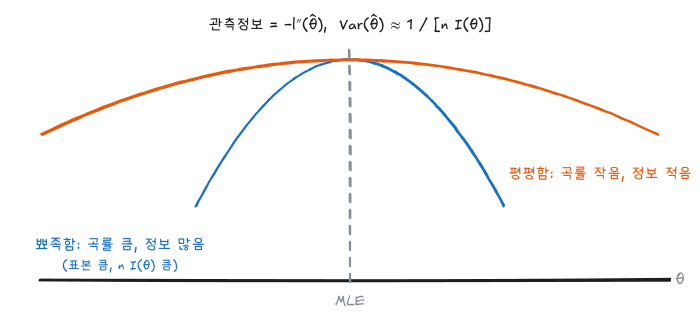
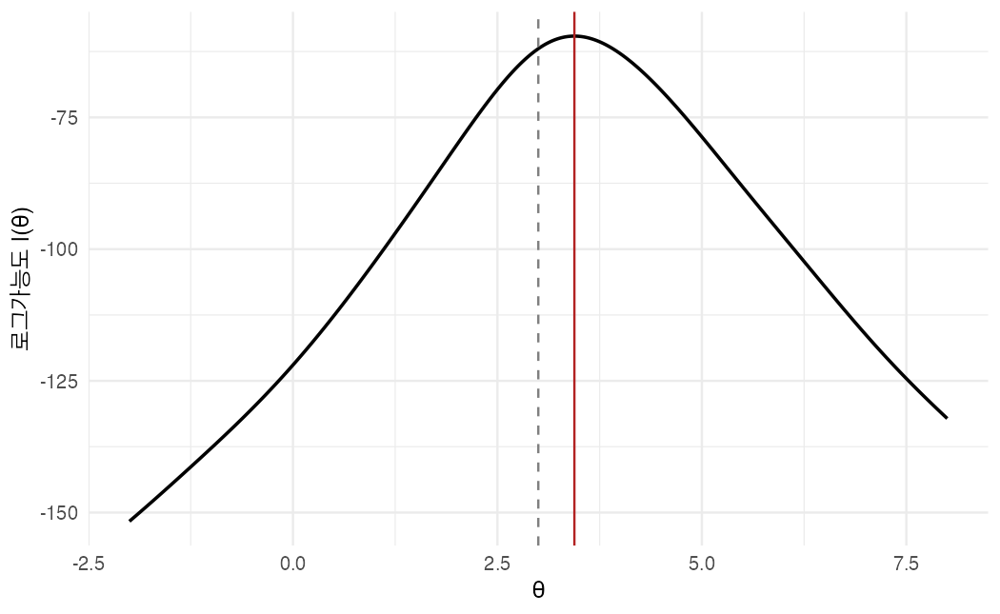

Hogg·McKean·Craig 『Introduction to Mathematical Statistics』 6장 앞부분(6.1–6.2)을 정리했다. [5편](/posts/ms-05-estimation-intervals)에서 최대가능도추정을 잠깐 소개했다. 이 글은 MLE가 왜 좋은 추정량인지를 보인다. 핵심은 피셔정보다. 피셔정보가 모든 불편추정량의 분산 하한(라오-크라메르)을 정하고, MLE는 표본이 크면 그 하한을 달성한다.

```r title="환경 설정"
library(tidyverse)
theme_set(theme_minimal(base_size = 12))
```

## 1. 최대가능도추정량

$X_1, \dots, X_n$이 pdf $f(x; \theta)$, $\theta \in \Omega$의 확률표본일 때, 관측값을 고정하고 $\theta$의 함수로 본 결합 pdf를 **가능도함수**라 한다.

$$
L(\theta) = \prod_{i=1}^n f(x_i; \theta), \qquad l(\theta) = \log L(\theta) = \sum_{i=1}^n \log f(x_i; \theta)
$$

$L(\theta)$를 최대로 하는 $\hat\theta$가 **최대가능도추정량**(MLE)이다. 로그는 단조함수이므로 $l$을 최대화해도 된다. 미분가능하면 **가능도방정식** $l'(\theta) = 0$을 푼다.

| 모형 | 가능도방정식 | MLE |
|---|---|---|
| 베르누이 $(p)$ | $\sum x_i/p - (n - \sum x_i)/(1 - p) = 0$ | $\bar X$ |
| 포아송 $(\theta)$ | $\sum x_i/\theta - n = 0$ | $\bar X$ |
| 정규 $(\mu, \sigma^2)$ | $\sum(x_i - \mu) = 0$, $-n/(2\sigma^2) + \sum(x_i - \mu)^2/(2\sigma^4) = 0$ | $\bar X$, $\frac1n\sum(X_i - \bar X)^2$ |
| 균일 $U(0, \theta)$ | 미분으로 풀지 않음 | $\max X_i$ |
| 라플라스 $\frac12 e^{-\lvert x - \theta\rvert}$ | $\sum \text{sgn}(x_i - \theta) = 0$ | 표본 중앙값 |

균일분포는 $L(\theta) = \theta^{-n}$이 $\theta \ge \max x_i$에서만 양수이고 $\theta$에 대해 감소하므로, 받침의 경계인 $\max x_i$에서 최대다. 받침이 $\theta$에 의존하는 경우라 아래의 정칙조건을 만족하지 않고, MLE의 성질도 다르다([7편](/posts/ms-07-limiting-distributions)에서 본 $1/n$ 속도).

### MLE가 참값을 고르는 이유

**정칙조건** (이후 정리들의 가정):

- (R0) 다른 $\theta$는 다른 분포를 준다(식별가능성).
- (R1) 받침이 $\theta$에 의존하지 않는다.
- (R2) 참값 $\theta_0$는 $\Omega$의 내점이다.

**정리.** (R0), (R1) 아래에서 $\theta \ne \theta_0$이면 $\lim_{n\to\infty}P_{\theta_0}[L(\theta_0; \mathbf{X}) > L(\theta; \mathbf{X})] = 1$이다.

$L(\theta_0) > L(\theta)$는 $\frac1n\sum \log\frac{f(X_i; \theta)}{f(X_i; \theta_0)} < 0$과 같다. 대수의 법칙으로 왼쪽은 $E_{\theta_0}\left[\log\frac{f(X; \theta)}{f(X; \theta_0)}\right]$로 확률수렴하고, 로그가 순오목이므로 [2편](/posts/ms-02-random-variables)의 옌센 부등식에서

$$
E_{\theta_0}\left[\log\frac{f(X; \theta)}{f(X; \theta_0)}\right] < \log E_{\theta_0}\left[\frac{f(X; \theta)}{f(X; \theta_0)}\right] = \log\int f(x; \theta)\,dx = 0
$$

이다. 참값의 가능도가 다른 값의 가능도보다 클 확률이 1로 간다. 위 기댓값의 부호를 바꾼 것이 쿨백-라이블러 발산이고, MLE는 자료의 경험분포와 모형 사이의 KL 발산을 최소로 하는 추정량으로 볼 수 있다.

**정리 (불변성).** $\hat\theta$가 $\theta$의 MLE이면 $g(\theta)$의 MLE는 $g(\hat\theta)$다.

$g$가 일대일이면 $\eta = g(\theta)$로 모수를 바꾼 가능도는 $L^*(\eta) = L(g^{-1}(\eta))$이고, $L^*$의 최대는 $g^{-1}(\eta) = \hat\theta$, 즉 $\eta = g(\hat\theta)$에서 얻는다. 일대일이 아니면 **유도 가능도** $L^*(\eta) = \sup_{\theta: g(\theta) = \eta}L(\theta)$를 정의한다. 모든 $\eta$에서 $L^*(\eta) \le \sup_\theta L(\theta) = L(\hat\theta) = L^*(g(\hat\theta))$이므로 $g(\hat\theta)$가 $L^*$의 최대점이다.

정규분포에서 $\sigma$의 MLE는 $\sqrt{\hat\sigma^2}$, 베르누이에서 오즈 $p/(1 - p)$의 MLE는 $\bar X/(1 - \bar X)$다. 불편추정량은 이런 성질이 없다($E(S) \ne \sigma$).

## 2. 피셔정보

$\partial \log f(X; \theta)/\partial\theta$를 **스코어**라 한다. 적분과 미분의 순서를 바꿀 수 있다는 정칙조건 아래에서 $\int f(x; \theta)\,dx = 1$을 $\theta$로 미분하면

$$
0 = \int \frac{\partial f}{\partial\theta}dx = \int \frac{\partial \log f}{\partial\theta}f\,dx = E\left[\frac{\partial \log f(X; \theta)}{\partial\theta}\right]
$$

이므로 스코어의 평균은 0이다. 한 번 더 미분하면

$$
0 = \int \frac{\partial^2 \log f}{\partial\theta^2}f\,dx + \int \left(\frac{\partial \log f}{\partial\theta}\right)^2 f\,dx
$$

이다. 스코어의 분산을 **피셔정보**라 한다.

$$
I(\theta) = E\left[\left(\frac{\partial \log f(X; \theta)}{\partial\theta}\right)^2\right] = -E\left[\frac{\partial^2 \log f(X; \theta)}{\partial\theta^2}\right]
$$

두 번째 표현은 로그가능도 곡률의 평균이다. 로그가능도가 참값 근처에서 뾰족할수록 자료가 $\theta$를 잘 구분해 주고, 정보가 많다. 확률표본 $n$개의 정보는 독립이라 더해져서 $nI(\theta)$다.

| 모형 | $\partial^2 \log f/\partial\theta^2$ | $I(\theta)$ |
|---|---|---|
| 베르누이 $(p)$ | $-x/p^2 - (1 - x)/(1 - p)^2$ | $\dfrac{1}{p(1 - p)}$ |
| 포아송 $(\theta)$ | $-x/\theta^2$ | $\dfrac1\theta$ |
| 정규 평균 ($\sigma$ 앎) | $-1/\sigma^2$ | $\dfrac{1}{\sigma^2}$ |
| 코시 위치 $\frac{1}{\pi[1 + (x - \theta)^2]}$ | 아래 계산 (스코어 제곱의 평균) | $\dfrac12$ |

코시 위치모수의 스코어는 $2u/(1 + u^2)$ ($u = x - \theta$)이고 $U = X - \theta$는 표준 코시이므로, $u = \tan\phi$로 치환하면

$$
I(\theta) = \frac{4}{\pi}\int_{-\infty}^\infty \frac{u^2}{(1 + u^2)^3}\,du = \frac4\pi\int_{-\pi/2}^{\pi/2}\sin^2\phi\cos^2\phi\,d\phi = \frac4\pi\cdot\frac\pi8 = \frac12
$$

이다.

## 3. 라오-크라메르 하한과 효율성

**정리 (라오-크라메르 하한).** 정칙조건 아래에서 $Y = u(X_1, \dots, X_n)$의 평균이 $E(Y) = k(\theta)$이면

$$
\text{Var}(Y) \ge \frac{[k'(\theta)]^2}{nI(\theta)}
$$

이다. 특히 $\theta$의 불편추정량($k(\theta) = \theta$)은 $\text{Var}(Y) \ge 1/[nI(\theta)]$이다.

증명은 $Y$와 표본 스코어 $Z = \sum \partial \log f(X_i; \theta)/\partial\theta$의 공분산에서 시작한다. $k(\theta) = \int u\prod f\,d\mathbf{x}$를 미분하면 $k'(\theta) = E(YZ) = \text{Cov}(Y, Z)$이다($E(Z) = 0$이므로). 상관계수가 1 이하이므로

$$
[k'(\theta)]^2 = \text{Cov}(Y, Z)^2 \le \text{Var}(Y)\text{Var}(Z) = \text{Var}(Y)\cdot nI(\theta)
$$

이다. 등호는 $Y$가 스코어 $Z$의 일차함수일 때 성립한다.

불편추정량의 분산이 하한과 같으면 **효율추정량**이라 하고, 하한/분산의 비를 **효율**이라 한다.

- 포아송: $\bar X$의 분산 $\theta/n$이 하한 $1/[n \cdot (1/\theta)]$과 같으므로 효율적이다.
- 베르누이: $\bar X$의 분산 $p(1-p)/n$이 하한과 같다.
- 정규분포의 $\sigma^2$: 정보가 $1/(2\sigma^4)$이라 하한은 $2\sigma^4/n$인데, $S^2$의 분산은 $2\sigma^4/(n - 1)$이다. 효율이 $(n - 1)/n < 1$이므로 효율적이지 않지만 $n \to \infty$에서 1로 간다.

하한을 달성하는 추정량이 없는 경우도 많다. 하한은 스코어의 일차함수만 달성할 수 있기 때문이다. 하한을 달성하지 못해도 불편추정량 중 분산이 가장 작은 것(MVUE)은 있을 수 있고, 10편에서 충분통계량으로 그것을 찾는다.

## 4. MLE의 점근적 성질

**정리 (일치성).** (R0)–(R2)와 $f$의 미분가능성 아래에서 가능도방정식은 $\theta_0$로 확률수렴하는 해 $\hat\theta_n$을 갖는다.

증명: $a > 0$을 $(\theta_0 - a, \theta_0 + a) \subset \Omega$가 되도록 잡는다(R2). 1절의 정리를 $\theta_0 \pm a$에 쓰면 사건

$$
S_n = \{L(\theta_0) > L(\theta_0 - a)\} \cap \{L(\theta_0) > L(\theta_0 + a)\}
$$

의 확률이 1로 간다. $S_n$ 위에서 $l$은 구간 $(\theta_0 - a, \theta_0 + a)$ 안에 극대점을 가지므로 $l'(\hat\theta_n) = 0$인 해가 $|\hat\theta_n - \theta_0| < a$에 있다. 여러 개면 $\theta_0$에 가장 가까운 것을 택한다. 따라서 $P(|\hat\theta_n - \theta_0| < a) \ge P(S_n) \to 1$이고, 작은 $a$마다 성립하므로 $\hat\theta_n \xrightarrow{P} \theta_0$이다.

**정리 (점근정규성).** 추가 정칙조건(세 번 미분가능, $0 < I(\theta_0) < \infty$, 3차 도함수가 적분가능한 함수로 유계) 아래에서 일치적인 해 $\hat\theta_n$은

$$
\sqrt n(\hat\theta_n - \theta_0) \xrightarrow{D} N\left(0, \frac{1}{I(\theta_0)}\right)
$$

을 만족한다.

증명은 스코어의 테일러 전개다. $\theta_0$와 $\hat\theta_n$ 사이의 $\theta_n^*$에 대해

$$
0 = l'(\hat\theta_n) = l'(\theta_0) + (\hat\theta_n - \theta_0)l''(\theta_0) + \frac12(\hat\theta_n - \theta_0)^2l'''(\theta_n^*)
$$

이므로

$$
\sqrt n(\hat\theta_n - \theta_0) = \frac{n^{-1/2}l'(\theta_0)}{-n^{-1}l''(\theta_0) - (2n)^{-1}(\hat\theta_n - \theta_0)l'''(\theta_n^*)}
$$

이다. 3차 도함수 조건 $|\partial^3\log f(x; \theta)/\partial\theta^3| \le M(x)$, $E[M(X)] < \infty$ ($\theta_0$ 근방에서)에서 $|n^{-1}l'''(\theta_n^*)| \le n^{-1}\sum M(X_i) \xrightarrow{P} E[M(X)]$로 확률적 유계이고, $\hat\theta_n - \theta_0 \xrightarrow{P} 0$이므로 분모의 둘째 항은 0으로 확률수렴한다. 분자는 평균 0, 분산 $I(\theta_0)$인 iid 스코어의 합이므로 CLT로 $N(0, I(\theta_0))$에 분포수렴하고, 분모는 대수의 법칙으로 $I(\theta_0)$로 확률수렴한다. [7편](/posts/ms-07-limiting-distributions)의 슬러츠키 정리로 비는 $N(0, I(\theta_0))/I(\theta_0) = N(0, 1/I(\theta_0))$이다.

극한분포의 분산 $1/I(\theta_0)$이 라오-크라메르 하한과 같다. MLE는 **점근효율적**이다. 두 추정량의 점근분산 비를 **점근상대효율**(ARE)이라 한다. 델타방법을 함께 쓰면 $\sqrt n[g(\hat\theta) - g(\theta_0)] \xrightarrow{D} N(0, [g'(\theta_0)]^2/I(\theta_0))$이고, 이것이 $g(\theta)$에 대한 라오-크라메르 하한과 같으므로 불변성과 점근효율이 함께 성립한다.

이로부터 대표본 신뢰구간 $\hat\theta \pm z_{\alpha/2}/\sqrt{nI(\hat\theta)}$를 얻는다. $I(\hat\theta)$ 대신 관측정보 $-l''(\hat\theta)/n$을 써도 된다.



### 예: 코시분포의 위치모수

코시분포 $f(x; \theta) = \frac{1}{\pi[1 + (x - \theta)^2]}$는 평균이 없어 $\bar X$가 일치적이지도 않다. 가능도방정식 $\sum \frac{2(x_i - \theta)}{1 + (x_i - \theta)^2} = 0$은 닫힌 해가 없어 수치적으로 푼다. $I(\theta) = 1/2$이므로 MLE의 점근분산은 $2/n$이다. 표본 중앙값의 점근분산은 $1/[4f(\theta)^2 n] = \pi^2/(4n) \approx 2.47/n$이므로, 중앙값의 MLE에 대한 ARE는 $2/2.47 = 0.81$이다.

```r
set.seed(11)
x <- rcauchy(40, location = 3)
loglik <- function(theta) sapply(theta, \(t) -sum(log(1 + (x - t)^2)))
mle <- optimize(loglik, interval = median(x) + c(-3, 3), maximum = TRUE)$maximum
c(mean = mean(x), median = median(x), mle = mle, se_asym = sqrt(2 / 40))
tibble(theta = seq(-2, 8, length.out = 500), l = loglik(theta)) |>
  ggplot(aes(theta, l)) + geom_line(linewidth = 0.8) +
  geom_vline(xintercept = c(3, mle), linetype = c(2, 1), color = c("grey50", "firebrick")) +
  labs(x = "θ", y = "로그가능도 l(θ)")
```



```text
     mean    median       mle   se_asym 
2.4575304 3.4110916 3.4409784 0.2236068
```

표본평균은 몇 개의 극단값 때문에 참값 3에서 멀리 있을 수 있지만, MLE와 중앙값은 3 근처다. 코시 로그가능도는 표본에 따라 여러 개의 극대점을 가질 수 있으므로, 중앙값처럼 일치적인 출발점 근처에서 해를 찾는다.

```r
set.seed(12)
est <- replicate(3000, { x <- rcauchy(100)
  c(med = median(x), mle = optimize(\(t) -sum(log(1 + (x - t)^2)), median(x) + c(-2, 2), maximum = TRUE)$maximum) })
c(var_median_x_n = 100 * var(est["med", ]), var_mle_x_n = 100 * var(est["mle", ]), theory_median = pi^2 / 4, theory_mle = 2)
```

```text
var_median_x_n    var_mle_x_n  theory_median     theory_mle 
      2.515687       2.038042       2.467401       2.000000
```

$n \times$ 분산이 중앙값은 $\pi^2/4 \approx 2.47$, MLE는 하한 2에 가깝다.

## 5. 수치적으로 MLE 구하기

가능도방정식이 닫힌 해를 갖지 않으면 **뉴턴-랩슨** 반복을 쓴다.

$$
\hat\theta^{(k+1)} = \hat\theta^{(k)} - \frac{l'(\hat\theta^{(k)})}{l''(\hat\theta^{(k)})}
$$

$l''$ 대신 기대값 $-nI(\hat\theta^{(k)})$를 쓰면 **피셔 스코어링**이다. 일반화선형모형의 반복가중최소제곱(IRLS)이 피셔 스코어링이다.

출발점 $\tilde\theta$가 $\sqrt n$-일치적이면(예: 표본 중앙값) 뉴턴-랩슨을 **한 번만** 한 값도 MLE와 같은 점근분포를 갖는다. 이것을 **원스텝 추정량**이라 한다. 반복이 수렴하지 않거나 여러 해가 있을 때 실용적인 대안이다.

## 6. 비교

| 구분 | 앞의 것 | 뒤의 것 |
|---|---|---|
| 가능도 대 pdf | $\theta$의 함수, 자료 고정 | $x$의 함수, 모수 고정 |
| 피셔정보의 두 표현 | 스코어 제곱의 평균 | 로그가능도 곡률의 평균에 음수 |
| 기대정보 대 관측정보 | $nI(\hat\theta)$ | $-l''(\hat\theta)$, 실제 자료의 곡률 |
| 효율 대 점근효율 | 고정된 $n$에서 하한 달성 | $n \to \infty$에서 분산이 하한에 도달 |
| 정칙 모형 대 비정칙 | 받침이 $\theta$와 무관, $\sqrt n$ 속도, 점근정규 | 받침이 $\theta$에 의존(균일), 속도와 극한분포가 다름 |
| MLE 대 불편추정 | 불변, 점근효율, 소표본에서 편향 가능 | 고정 $n$에서 평균이 맞음, 변환하면 불편성 깨짐 |

## 요약

| 개념 | 핵심 |
|---|---|
| MLE | $L(\theta) = \prod f(x_i; \theta)$를 최대로 하는 $\theta$ |
| 참값을 고르는 이유 | 옌센 부등식, KL 발산 ≥ 0 |
| 불변성 | $g(\theta)$의 MLE = $g(\hat\theta)$ |
| 피셔정보 | $I(\theta) = \text{Var}(\text{스코어}) = -E[\partial^2 \log f/\partial\theta^2]$ |
| 라오-크라메르 | 불편추정량의 분산 $\ge 1/[nI(\theta)]$ |
| 점근정규성 | $\sqrt n(\hat\theta - \theta_0) \xrightarrow{D} N(0, 1/I(\theta_0))$ |
| 대표본 구간 | $\hat\theta \pm z_{\alpha/2}/\sqrt{nI(\hat\theta)}$ |
| 수치해법 | 뉴턴-랩슨, 피셔 스코어링, 원스텝 |

## 참고자료

- Hogg, R. V., McKean, J. W., & Craig, A. T. *Introduction to Mathematical Statistics* (8th ed.), Chapter 6.1–6.2.

다음 글: [수리통계학 - 가능도 기반 검정과 EM 알고리즘](/posts/ms-09-likelihood-tests-em)
