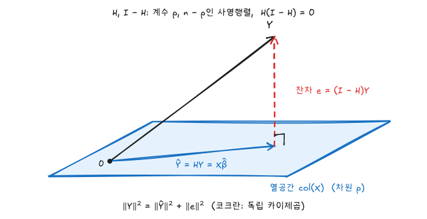

Hogg·McKean·Craig 『Introduction to Mathematical Statistics』 9장을 정리했다. 분산분석과 회귀는 "정규 오차 + 평균이 모수의 일차식"인 같은 모형이다. 두 분석의 검정통계량은 모두 정규벡터의 **이차형식**의 비이고, 그 분포가 카이제곱과 F인 이유를 행렬로 보인다. [11편](/posts/ms-11-optimal-tests)의 가능도비 검정이 여기서 분산분석 F검정이 된다.

```r title="환경 설정"
library(tidyverse)
theme_set(theme_minimal(base_size = 12))
```

## 1. 이차형식

$\mathbf{X} = (X_1, \dots, X_n)'$과 대칭행렬 $\mathbf{A}$에 대해 $Q = \mathbf{X}'\mathbf{A}\mathbf{X} = \sum_i\sum_j a_{ij}X_iX_j$를 **이차형식**이라 한다. 분산분석의 제곱합은 모두 이차형식이다. 예를 들어 $\mathbf{J}$를 모든 원소가 1인 $n \times n$ 행렬이라 하면

$$
\sum_{i=1}^n (X_i - \bar X)^2 = \mathbf{X}'\left(\mathbf{I} - \frac1n\mathbf{J}\right)\mathbf{X}
$$

이다.

**정리 (평균).** $E(\mathbf{X}) = \boldsymbol\mu$, $\text{Cov}(\mathbf{X}) = \boldsymbol\Sigma$이면 $E(\mathbf{X}'\mathbf{A}\mathbf{X}) = \text{tr}(\mathbf{A}\boldsymbol\Sigma) + \boldsymbol\mu'\mathbf{A}\boldsymbol\mu$.

스칼라는 자기 자신의 대각합이고 $\text{tr}(\mathbf{BC}) = \text{tr}(\mathbf{CB})$이므로 $\mathbf{X}'\mathbf{AX} = \text{tr}(\mathbf{AXX}')$이다. 기댓값과 대각합의 순서를 바꾸고 $E(\mathbf{XX}') = \boldsymbol\Sigma + \boldsymbol\mu\boldsymbol\mu'$을 넣으면 $\text{tr}(\mathbf{A}\boldsymbol\Sigma) + \text{tr}(\mathbf{A}\boldsymbol\mu\boldsymbol\mu') = \text{tr}(\mathbf{A}\boldsymbol\Sigma) + \boldsymbol\mu'\mathbf{A}\boldsymbol\mu$이다. 정규성은 필요 없다.

$\boldsymbol\Sigma = \sigma^2\mathbf{I}$, $\mathbf{A} = \mathbf{I} - \mathbf{J}/n$이면 $\text{tr}(\mathbf{A}) = n - 1$이고 $\mathbf{A}\boldsymbol\mu = \mathbf{0}$($\boldsymbol\mu = \mu\mathbf{1}$)이므로 $E[\sum(X_i - \bar X)^2] = (n - 1)\sigma^2$이다. [3편](/posts/ms-03-multivariate)의 결과를 한 줄로 얻는다.

**정리 (분포).** $\mathbf{X} \sim N_n(\mathbf{0}, \sigma^2\mathbf{I})$이고 $\mathbf{A}$가 계수 $r$인 대칭행렬이면

$$
\frac{\mathbf{X}'\mathbf{A}\mathbf{X}}{\sigma^2} \sim \chi^2(r) \iff \mathbf{A}^2 = \mathbf{A} \text{ (멱등)}
$$

멱등 대칭행렬은 고유값이 0 또는 1뿐이고, 1인 고유값이 $r$개다. 고유분해 $\mathbf{A} = \boldsymbol\Gamma'\text{diag}(1, \dots, 1, 0, \dots, 0)\boldsymbol\Gamma$에서 $\mathbf{W} = \boldsymbol\Gamma\mathbf{X}/\sigma$는 다시 독립 표준정규이므로 $\mathbf{X}'\mathbf{A}\mathbf{X}/\sigma^2 = W_1^2 + \cdots + W_r^2 \sim \chi^2(r)$이다(⇐). 반대로(⇒) 대칭행렬 $\mathbf{A}$의 고유값을 $\lambda_1, \dots, \lambda_n$이라 하면 같은 변환으로 $\mathbf{X}'\mathbf{AX}/\sigma^2 = \sum\lambda_iW_i^2$이고 mgf는 $\prod_i(1 - 2t\lambda_i)^{-1/2}$이다. 이것이 0 근방에서 $(1 - 2t)^{-r/2}$와 같으면 $\prod_i(1 - 2t\lambda_i) = (1 - 2t)^r$이 $t$의 다항식으로 같아야 하므로, 근을 비교해 0이 아닌 고유값은 모두 1이고 그 개수가 $r$이다. 고유값이 0과 1뿐인 대칭행렬은 $\mathbf{A}^2 = \mathbf{A}$이다. 멱등 대칭행렬은 **정사영행렬**이다. 이차형식은 $\mathbf{X}$를 $r$차원 부분공간에 사영한 벡터의 길이 제곱이고, 자유도는 그 부분공간의 차원이다([선형대수 사영 글](/posts/la-orthonormal)).

**정리 (독립).** $\mathbf{X} \sim N_n(\boldsymbol\mu, \sigma^2\mathbf{I})$일 때 두 이차형식 $\mathbf{X}'\mathbf{A}\mathbf{X}$와 $\mathbf{X}'\mathbf{B}\mathbf{X}$가 독립일 필요충분조건은 $\mathbf{AB} = \mathbf{0}$이다(크레이그 정리). 사영으로 말하면 두 부분공간이 직교한다는 뜻이다.

충분조건을 보인다. $\mathbf{AB} = \mathbf{0}$이면 $\mathbf{BA} = (\mathbf{AB})' = \mathbf{0}$이다. 고유분해 $\mathbf{A} = \sum_i\lambda_i\mathbf{a}_i\mathbf{a}_i'$, $\mathbf{B} = \sum_j\mu_j\mathbf{b}_j\mathbf{b}_j'$ (0이 아닌 고유값만)에서 $\mathbf{0} = \mathbf{a}_k'\mathbf{AB}\mathbf{b}_l = \lambda_k\mu_l\mathbf{a}_k'\mathbf{b}_l$이므로 $\mathbf{a}_k'\mathbf{b}_l = 0$이다. $\mathbf{X}'\mathbf{AX} = \sum\lambda_i(\mathbf{a}_i'\mathbf{X})^2$은 $\mathbf{a}_i'\mathbf{X}$들의, $\mathbf{X}'\mathbf{BX}$는 $\mathbf{b}_j'\mathbf{X}$들의 함수이고, 이 정규변수들은 $\text{Cov}(\mathbf{a}_i'\mathbf{X}, \mathbf{b}_j'\mathbf{X}) = \sigma^2\mathbf{a}_i'\mathbf{b}_j = 0$이라 [4편](/posts/ms-04-special-distributions)의 성질 3으로 서로 독립이다. 필요조건의 증명은 더 길어 생략한다.

**정리 (코크란).** $\mathbf{X}'\mathbf{X} = \sum_{j=1}^k \mathbf{X}'\mathbf{A}_j\mathbf{X}$이고 $\mathbf{A}_j$의 계수가 $r_j$일 때, 다음은 동치다.

1. $\sum r_j = n$
2. $\mathbf{X}'\mathbf{A}_j\mathbf{X}/\sigma^2$들이 서로 독립이고 각각 $\chi^2(r_j)$ ($\mathbf{X} \sim N(\mathbf{0}, \sigma^2\mathbf{I})$일 때)

2 ⇒ 1은 기댓값으로 바로 나온다. $n = E(\mathbf{X}'\mathbf{X})/\sigma^2 = \sum_jE(\mathbf{X}'\mathbf{A}_j\mathbf{X})/\sigma^2 = \sum r_j$이다.

1 ⇒ 2: 모든 $\mathbf{x}$에서 성립하므로 $\sum_j\mathbf{A}_j = \mathbf{I}$이다.

- **각 $\mathbf{A}_j$가 멱등.** $\mathbf{I} = \mathbf{A}_1 + (\mathbf{I} - \mathbf{A}_1)$에서 $n \le r_1 + \text{rank}(\mathbf{I} - \mathbf{A}_1)$이고, $\mathbf{I} - \mathbf{A}_1 = \sum_{j \ge 2}\mathbf{A}_j$에서 $\text{rank}(\mathbf{I} - \mathbf{A}_1) \le n - r_1$이다. 따라서 $\mathbf{I} - \mathbf{A}_1$의 영공간, 즉 $\mathbf{A}_1$의 고유값 1의 고유공간이 정확히 $r_1$차원이다. $\mathbf{A}_1$의 0이 아닌 고유값이 $r_1$개뿐이므로 모두 1이고, $\mathbf{A}_1$은 멱등이다. 다른 $j$도 같다.
- **서로 곱하면 0.** $\mathbf{A}_i + \mathbf{A}_j$를 한 조각으로 보고 같은 논리를 쓰면 $\mathbf{A}_i + \mathbf{A}_j$도 멱등이므로 $\mathbf{A}_i\mathbf{A}_j + \mathbf{A}_j\mathbf{A}_i = \mathbf{0}$이다. 왼쪽과 오른쪽에서 각각 $\mathbf{A}_i$를 곱해 빼면 $\mathbf{A}_i\mathbf{A}_j = \mathbf{A}_j\mathbf{A}_i$이고, 따라서 $\mathbf{A}_i\mathbf{A}_j = \mathbf{0}$이다.

멱등이므로 분포 정리로 각 조각이 $\chi^2(r_j)$, 서로 곱해 0이므로 크레이그 정리로 독립이다.

제곱합을 쪼갰을 때 자유도의 합이 $n$이면 각 조각이 독립인 카이제곱이다. $\mathbf{X}'\mathbf{X} = \mathbf{X}'(\mathbf{J}/n)\mathbf{X} + \mathbf{X}'(\mathbf{I} - \mathbf{J}/n)\mathbf{X} = n\bar X^2 + \sum(X_i - \bar X)^2$에서 계수가 $1 + (n - 1) = n$이므로, [4편](/posts/ms-04-special-distributions) Student 정리의 독립성과 $\chi^2(n - 1)$이 다시 나온다.

## 2. 일원분산분석

$b$개 집단에서 $X_{ij} = \mu_j + e_{ij}$ ($j = 1, \dots, b$, $i = 1, \dots, n_j$), $e_{ij} \overset{iid}{\sim} N(0, \sigma^2)$이라 하고 $H_0: \mu_1 = \cdots = \mu_b$를 검정한다. $n = \sum n_j$이다.

전체 제곱합이 두 조각으로 나뉜다.

$$
\underbrace{\sum_j\sum_i(X_{ij} - \bar X_{\cdot\cdot})^2}_{SST} = \underbrace{\sum_j n_j(\bar X_{\cdot j} - \bar X_{\cdot\cdot})^2}_{SSB \text{ (집단 간)}} + \underbrace{\sum_j\sum_i(X_{ij} - \bar X_{\cdot j})^2}_{SSW \text{ (집단 내)}}
$$

교차항은 각 집단 안에서 $\sum_i(X_{ij} - \bar X_{\cdot j}) = 0$이라 사라진다.

**가능도비 유도.** $\Omega$에서 MLE는 $\hat\mu_j = \bar x_{\cdot j}$, $\hat\sigma^2_\Omega = SSW/n$이고, $\omega$(평균이 모두 같음)에서는 $\hat\mu = \bar x_{\cdot\cdot}$, $\hat\sigma^2_\omega = SST/n$이다. 따라서

$$
\Lambda^{2/n} = \frac{SSW}{SST} = \frac{1}{1 + SSB/SSW}
$$

이고 $\Lambda$는 $SSB/SSW$의 감소함수다. 자유도로 나눈

$$
F = \frac{SSB/(b - 1)}{SSW/(n - b)}
$$

가 클 때 기각한다. 1절의 결과로 $SSW/\sigma^2 \sim \chi^2(n - b)$(가정과 무관), $H_0$ 아래 $SSB/\sigma^2 \sim \chi^2(b - 1)$이고 둘은 독립이므로 $F \sim F(b - 1, n - b)$이다. 실험계획의 관점은 [일원배치 글](/posts/doe-02-one-way)에 있다.

R의 `PlantGrowth`(대조군과 처리 두 가지, 각 10개체의 건조 중량)로 직접 계산하고 `aov`와 비교한다.

```r
d <- PlantGrowth; b <- 3; n <- nrow(d)
gm <- mean(d$weight); means <- tapply(d$weight, d$group, mean); nj <- table(d$group)
SSB <- sum(nj * (means - gm)^2); SSW <- sum((d$weight - means[d$group])^2)
F_stat <- (SSB / (b - 1)) / (SSW / (n - b))
c(SSB = SSB, SSW = SSW, F = F_stat, p = pf(F_stat, b - 1, n - b, lower.tail = FALSE))
summary(aov(weight ~ group, data = d))
```

```text
        SSB         SSW           F           p 
 3.76634000 10.49209000  4.84608786  0.01590996 
            Df Sum Sq Mean Sq F value Pr(>F)  
group        2  3.766  1.8832   4.846 0.0159 *
Residuals   27 10.492  0.3886                 
---
Signif. codes:  0 ‘***’ 0.001 ‘**’ 0.01 ‘*’ 0.05 ‘.’ 0.1 ‘ ’ 1
```

## 3. 비중심 분포와 검정력

$H_0$가 거짓이면 $SSB/\sigma^2$은 중심 카이제곱이 아니다. $X_i \sim N(\mu_i, \sigma^2)$ 독립일 때 $\sum X_i^2/\sigma^2$의 분포를 자유도 $r$, **비중심모수** $\theta = \sum\mu_i^2/\sigma^2$인 **비중심 카이제곱분포** $\chi^2(r, \theta)$라 한다. mgf는 $(1 - 2t)^{-r/2}\exp[t\theta/(1 - 2t)]$이고 평균은 $r + \theta$다. 비중심 카이제곱을 중심 카이제곱(독립)과 각 자유도로 나눈 비는 **비중심 F분포** $F(r_1, r_2, \theta)$다.

일원분산분석에서 $SSB/\sigma^2 \sim \chi^2(b - 1, \theta)$이고

$$
\theta = \frac{\sum_j n_j(\mu_j - \bar\mu)^2}{\sigma^2}, \qquad \bar\mu = \frac{\sum n_j\mu_j}{n}
$$

이다. 집단 평균이 흩어질수록, 표본이 클수록 $\theta$가 크고 검정력이 크다. 검정력은 $P[F(b - 1, n - b, \theta) > F_{\alpha}(b - 1, n - b)]$이다.

```r
mu <- c(50, 55, 58); sigma <- 10; nj <- 31
theta <- nj * sum((mu - mean(mu))^2) / sigma^2; df2 <- 3 * nj - 3
power_ncf <- pf(qf(0.95, 2, df2), 2, df2, ncp = theta, lower.tail = FALSE)
c(theta = theta, power = power_ncf,
  power.anova.test = power.anova.test(groups = 3, n = nj, between.var = var(mu), within.var = sigma^2)$power)
```

```text
           theta            power power.anova.test 
      10.1266667        0.8068179        0.8068179
```

군당 31명이면 검정력이 0.80을 조금 넘는다. [표본크기 글](/posts/biostat-sample-size)에서 같은 조건으로 구한 군당 31명이 이 계산이다.

## 4. 다중비교

$F$검정이 기각하면 어느 집단이 다른지 알고 싶다. 대비 $\sum c_j\mu_j$ ($\sum c_j = 0$)를 여러 개 검정하면 전체 제1종 오류가 커진다.

| 방법 | 대상 | 방식 |
|---|---|---|
| 본페로니 | 미리 정한 $m$개 비교 | 각 비교를 $\alpha/m$로 (불 부등식) |
| 셰페 | 모든 대비 (사후에 고른 것 포함) | $\sum c_j\hat\mu_j \pm \sqrt{(b - 1)F_\alpha}\cdot SE$ |
| 튜키 | 모든 쌍별 비교 | 스튜던트화 범위 분포 |

셰페 구간은 무한히 많은 대비를 동시에 포함하므로 가장 넓지만, $F$검정과 정확히 대응한다($F$검정이 기각할 때만 유의한 대비가 존재). 쌍별 비교만 하면 튜키가, 비교 수가 적으면 본페로니가 더 좁다.

## 5. 이원분산분석

두 인자 A($a$수준), B($b$수준)에 각 칸 $c$번 반복이면 $X_{ijk} = \mu + \alpha_i + \beta_j + \gamma_{ij} + e_{ijk}$로 쓰고, 전체 제곱합을 $SS_A + SS_B + SS_{AB} + SSE$로 나눈다. 자유도는 $(a - 1) + (b - 1) + (a - 1)(b - 1) + ab(c - 1) = abc - 1$이고, 코크란 정리로 각 제곱합은 독립인 카이제곱(귀무가설 아래)이다. 각 효과는 $SSE$로 나눈 $F$로 검정한다. 반복이 없으면($c = 1$) 교호작용과 오차를 분리할 수 없어 가법모형을 가정한다. 자세한 내용은 [이원배치 글](/posts/doe-03-two-way)에 있다.

## 6. 회귀

$Y_i = \alpha + \beta(x_i - \bar x) + e_i$, $e_i \overset{iid}{\sim} N(0, \sigma^2)$이면 로그가능도는

$$
l(\alpha, \beta, \sigma^2) = -\frac n2\log(2\pi\sigma^2) - \frac{1}{2\sigma^2}\sum[y_i - \alpha - \beta(x_i - \bar x)]^2
$$

이므로 $\alpha, \beta$의 MLE는 잔차제곱합을 최소로 하는 **최소제곱추정량**과 같다.

$$
\hat\alpha = \bar Y, \qquad \hat\beta = \frac{\sum(x_i - \bar x)Y_i}{\sum(x_i - \bar x)^2}, \qquad \hat\sigma^2 = \frac1n\sum[Y_i - \hat\alpha - \hat\beta(x_i - \bar x)]^2
$$

$\hat\alpha, \hat\beta$는 $Y_i$의 일차결합이므로 정규분포를 따른다.

$$
\hat\alpha \sim N\left(\alpha, \frac{\sigma^2}{n}\right), \qquad \hat\beta \sim N\left(\beta, \frac{\sigma^2}{\sum(x_i - \bar x)^2}\right), \qquad \frac{n\hat\sigma^2}{\sigma^2} \sim \chi^2(n - 2)
$$

이고 셋은 독립이다. 따라서 $\beta$에 대한 검정과 신뢰구간은

$$
T = \frac{\hat\beta - \beta}{\sqrt{n\hat\sigma^2/[(n - 2)\sum(x_i - \bar x)^2]}} \sim t(n - 2)
$$

으로 만든다. 자유도 $n - 2$는 모수 두 개를 추정했기 때문이다.

**행렬 형태.** $\mathbf{Y} = \mathbf{X}\boldsymbol\beta + \mathbf{e}$, $\mathbf{e} \sim N_n(\mathbf{0}, \sigma^2\mathbf{I})$이고 $\mathbf{X}$가 $n \times p$ 완전계수이면

$$
\hat{\boldsymbol\beta} = (\mathbf{X}'\mathbf{X})^{-1}\mathbf{X}'\mathbf{Y} \sim N_p\left(\boldsymbol\beta, \sigma^2(\mathbf{X}'\mathbf{X})^{-1}\right)
$$

이다. 적합값은 $\hat{\mathbf{Y}} = \mathbf{H}\mathbf{Y}$, $\mathbf{H} = \mathbf{X}(\mathbf{X}'\mathbf{X})^{-1}\mathbf{X}'$이고, $\mathbf{H}$와 $\mathbf{I} - \mathbf{H}$는 계수가 $p$와 $n - p$인 멱등행렬이며 서로 곱하면 $\mathbf{0}$이다. $(\mathbf{I} - \mathbf{H})\mathbf{X} = \mathbf{0}$이므로 잔차는 $(\mathbf{I} - \mathbf{H})\mathbf{Y} = (\mathbf{I} - \mathbf{H})\mathbf{e}$로 $\boldsymbol\beta$와 무관하고, 1절의 분포 정리로 잔차제곱합 $\mathbf{e}'(\mathbf{I} - \mathbf{H})\mathbf{e}/\sigma^2 \sim \chi^2(n - p)$이다. 또

$$
\text{Cov}\big(\hat{\boldsymbol\beta}, (\mathbf{I} - \mathbf{H})\mathbf{Y}\big) = (\mathbf{X}'\mathbf{X})^{-1}\mathbf{X}'\,\sigma^2\mathbf{I}\,(\mathbf{I} - \mathbf{H}) = \sigma^2(\mathbf{X}'\mathbf{X})^{-1}[(\mathbf{I} - \mathbf{H})\mathbf{X}]' = \mathbf{0}
$$

이고 둘은 결합정규이므로 $\hat{\boldsymbol\beta}$와 잔차(따라서 잔차제곱합)는 독립이다. 회귀의 모든 $t$, $F$검정이 여기서 나온다.



```r
x <- cars$speed; y <- cars$dist; n <- length(y)
bhat <- sum((x - mean(x)) * y) / sum((x - mean(x))^2)
ahat <- mean(y) - bhat * mean(x)
s2 <- sum((y - ahat - bhat * x)^2) / (n - 2)
se_b <- sqrt(s2 / sum((x - mean(x))^2))
c(intercept = ahat, slope = bhat, se_slope = se_b, t = bhat / se_b)
coef(summary(lm(dist ~ speed, data = cars)))["speed", ]
```

```text
  intercept       slope    se_slope           t 
-17.5790949   3.9324088   0.4155128   9.4639900 
    Estimate   Std. Error      t value     Pr(>|t|) 
3.932409e+00 4.155128e-01 9.463990e+00 1.489836e-12
```

## 7. 상관계수 검정

$(X_i, Y_i)$가 이변량정규분포에서 나왔을 때 $H_0: \rho = 0$(독립)을 표본상관계수 $R$로 검정한다.

$$
T = \frac{R\sqrt{n - 2}}{\sqrt{1 - R^2}} \sim t(n - 2) \quad (H_0 \text{ 아래})
$$

$X$를 고정하고 보면 [4편](/posts/ms-04-special-distributions)의 조건부분포로 $Y \mid x$가 정규 회귀모형이고, $\rho = 0$은 기울기 $\beta = 0$과 같다. 실제로 위 $T$는 6절 기울기의 $t$통계량과 대수적으로 같은 값이다. $S_{xx} = \sum(x_i - \bar x)^2$, $S_{yy} = \sum(y_i - \bar y)^2$, $S_{xy} = \sum(x_i - \bar x)(y_i - \bar y)$로 쓰면 $\hat\beta = S_{xy}/S_{xx}$, $r = S_{xy}/\sqrt{S_{xx}S_{yy}}$이고 잔차제곱합은 $S_{yy} - \hat\beta^2S_{xx} = S_{yy}(1 - r^2)$이므로

$$
\frac{\hat\beta}{\sqrt{S_{yy}(1 - r^2)/[(n - 2)S_{xx}]}} = \frac{r\sqrt{S_{yy}/S_{xx}}}{\sqrt{S_{yy}(1 - r^2)/[(n - 2)S_{xx}]}} = \frac{r\sqrt{n - 2}}{\sqrt{1 - r^2}}
$$

이다. 조건부분포가 $x$와 무관하므로 무조건부 분포도 $t(n - 2)$다.

```r
r <- cor(x, y)
c(r = r, t_from_r = r * sqrt(n - 2) / sqrt(1 - r^2), t_slope = bhat / se_b)
```

```text
        r  t_from_r   t_slope 
0.8068949 9.4639900 9.4639900
```

## 8. 비교

| 구분 | 분산분석 | 회귀 |
|---|---|---|
| 설명변수 | 범주 (집단 지시변수) | 연속 |
| 평균 구조 | $\mu_j$ | $\alpha + \beta x$ |
| 추정 | 집단평균 | 최소제곱 = MLE |
| 검정 | $F = MSB/MSW$ | 계수의 $t$, 모형의 $F$ |
| 공통 틀 | $\mathbf{Y} = \mathbf{X}\boldsymbol\beta + \mathbf{e}$, 잔차제곱합 $\sim \sigma^2\chi^2(n - p)$ | 같음 |

| 분포 | 언제 | 쓰는 곳 |
|---|---|---|
| 중심 $\chi^2$, $F$ | 귀무가설 아래 | 기각값, $p$값 |
| 비중심 $\chi^2(r, \theta)$, $F(r_1, r_2, \theta)$ | 대립가설 아래 | 검정력, 표본크기 |

| 다중비교 | 장점 | 단점 |
|---|---|---|
| 본페로니 | 단순, 어떤 검정에도 적용 | 비교가 많으면 보수적 |
| 셰페 | 사후에 고른 대비도 보호 | 쌍별 비교만 할 때는 넓음 |
| 튜키 | 쌍별 비교에 최적 | 쌍별 비교 전용 |

## 요약

| 개념 | 핵심 |
|---|---|
| 이차형식의 분포 | $\mathbf{A}$가 계수 $r$인 멱등행렬 ⇔ $\mathbf{X'AX}/\sigma^2 \sim \chi^2(r)$ |
| 독립 | $\mathbf{AB} = \mathbf{0}$ (직교하는 사영) |
| 코크란 | 계수의 합 = $n$ ⇔ 각 조각이 독립 카이제곱 |
| 일원분산분석 | $SST = SSB + SSW$, $F = \frac{SSB/(b-1)}{SSW/(n-b)}$, 가능도비 검정 |
| 비중심모수 | $\theta = \sum n_j(\mu_j - \bar\mu)^2/\sigma^2$, 검정력을 결정 |
| 회귀 | 최소제곱 = MLE, $\hat{\boldsymbol\beta} \sim N(\boldsymbol\beta, \sigma^2(\mathbf{X'X})^{-1})$ |
| 상관 검정 | $R\sqrt{n-2}/\sqrt{1-R^2} \sim t(n-2)$ = 기울기 $t$ |

## 참고자료

- Hogg, R. V., McKean, J. W., & Craig, A. T. *Introduction to Mathematical Statistics* (8th ed.), Chapter 9.

다음 글: [수리통계학 - 비모수 통계와 로버스트 추정](/posts/ms-13-nonparametric)
