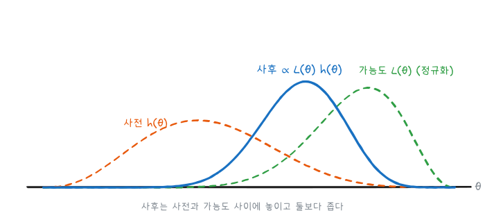
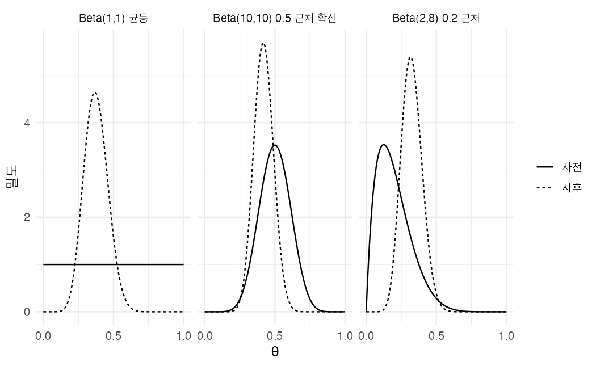

Hogg·McKean·Craig 『Introduction to Mathematical Statistics』 11장을 정리했다. 지금까지는 $\theta$를 모르는 상수로 보았다. 베이즈 관점은 $\theta$에 대한 불확실성을 확률분포(사전분포)로 표현하고, 자료를 본 뒤 베이즈 정리로 갱신한다. [1편](/posts/ms-01-probability)의 베이즈 정리를 모수에 적용하는 것이 전부이고, 나머지는 그 결과(사후분포)를 요약하고 계산하는 방법이다.

```r title="환경 설정"
library(tidyverse)
theme_set(theme_minimal(base_size = 12))
```

## 1. 사전분포와 사후분포

$\Theta$를 확률변수로 보고 pdf $h(\theta)$(**사전분포**)를 준다. 자료의 pdf $f(\mathbf{x} \mid \theta)$는 이제 $\Theta = \theta$가 주어졌을 때의 조건부 pdf다. 베이즈 정리로

$$
k(\theta \mid \mathbf{x}) = \frac{f(\mathbf{x} \mid \theta)h(\theta)}{\int f(\mathbf{x} \mid \theta)h(\theta)\,d\theta} \propto L(\theta \mid \mathbf{x})\,h(\theta)
$$

를 **사후분포**라 한다. 분모(주변 pdf $g(\mathbf{x})$)는 $\theta$와 무관한 정규화 상수이므로, 계산할 때는 "가능도 × 사전분포"의 모양만 보고 어느 분포인지 알아내면 된다.



가능도가 $\theta$에 대해 충분통계량 $Y$를 통해서만 의존하면([10편](/posts/ms-10-sufficiency) 분해정리) 사후분포도 $Y$에만 의존한다. 베이즈 추론도 충분통계량으로 요약된다.

## 2. 켤레사전분포

사후분포가 사전분포와 같은 분포족에 속하면 그 족을 **켤레사전분포**라 한다. 갱신이 모수의 덧셈으로 끝난다.

| 자료 모형 | 켤레사전 | 사후분포 |
|---|---|---|
| 베르누이 $(\theta)$, $y = \sum x_i$ | 베타 $(\alpha, \beta)$ | 베타 $(\alpha + y, \beta + n - y)$ |
| 포아송 $(\theta)$ | 감마 $(\alpha, \beta)$ (척도 $\beta$) | 감마 $\left(\alpha + \sum x_i, \dfrac{\beta}{n\beta + 1}\right)$ |
| 정규 $(\theta, \sigma^2)$, $\sigma^2$ 앎 | 정규 $(\theta_0, \tau^2)$ | 정규 (아래) |

**베타-이항.** $L(\theta) \propto \theta^y(1 - \theta)^{n - y}$, $h(\theta) \propto \theta^{\alpha - 1}(1 - \theta)^{\beta - 1}$이므로 곱은 $\theta^{\alpha + y - 1}(1 - \theta)^{\beta + n - y - 1}$, 즉 베타$(\alpha + y, \beta + n - y)$다. 사전분포의 $\alpha, \beta$는 미리 본 "가상의 성공·실패 수"처럼 작동한다. 감마-포아송도 같다. $L(\theta) \propto \theta^{\sum x_i}e^{-n\theta}$와 $h(\theta) \propto \theta^{\alpha - 1}e^{-\theta/\beta}$의 곱은 $\theta^{\alpha + \sum x_i - 1}e^{-\theta(n + 1/\beta)}$이고, 척도모수가 $1/(n + 1/\beta) = \beta/(n\beta + 1)$인 감마분포다.

**정규-정규.** 정밀도(분산의 역수)로 쓰면 깔끔하다.

$$
\Theta \mid \mathbf{x} \sim N\left(\frac{\frac{n}{\sigma^2}\bar x + \frac{1}{\tau^2}\theta_0}{\frac{n}{\sigma^2} + \frac{1}{\tau^2}},\ \frac{1}{\frac{n}{\sigma^2} + \frac{1}{\tau^2}}\right)
$$

유도는 제곱을 완성하는 것이다. $\sum(x_i - \theta)^2 = \sum(x_i - \bar x)^2 + n(\bar x - \theta)^2$이므로 $\theta$에 의존하는 부분만 남기면

$$
k(\theta \mid \mathbf{x}) \propto \exp\left[-\frac{n(\theta - \bar x)^2}{2\sigma^2} - \frac{(\theta - \theta_0)^2}{2\tau^2}\right] \propto \exp\left[-\frac a2\left(\theta - \frac ba\right)^2\right], \quad a = \frac{n}{\sigma^2} + \frac1{\tau^2},\ b = \frac{n\bar x}{\sigma^2} + \frac{\theta_0}{\tau^2}
$$

이고, 이것이 $N(b/a, 1/a)$의 모양이다. 사후 정밀도 = 자료 정밀도 + 사전 정밀도이고, 사후평균은 $\bar x$와 $\theta_0$를 각 정밀도로 가중평균한 값이다. $n$이 커지면 자료의 가중치가 1로 가서 사후평균이 $\bar x$(MLE)에 가까워지고 사후분산은 $\sigma^2/n$에 가까워진다. 표본이 크면 사전분포의 영향이 사라진다.

```r
set.seed(19)
x <- rbinom(30, 1, 0.3); y <- sum(x); n <- 30
priors <- tibble(prior = c("Beta(1,1) 균등", "Beta(10,10) 0.5 근처 확신", "Beta(2,8) 0.2 근처"),
                 a = c(1, 10, 2), b = c(1, 10, 8))
priors |> mutate(post_mean = (a + y) / (a + b + n), lower = qbeta(0.025, a + y, b + n - y),
                 upper = qbeta(0.975, a + y, b + n - y)) |> mutate(across(post_mean:upper, \(v) round(v, 3)))
c(y = y, mle = y / n)
crossing(priors, theta = seq(0, 1, length.out = 400)) |>
  mutate(prior_d = dbeta(theta, a, b), post_d = dbeta(theta, a + y, b + n - y)) |>
  pivot_longer(c(prior_d, post_d), names_to = "type", values_to = "density") |>
  mutate(type = if_else(type == "prior_d", "사전", "사후")) |>
  ggplot(aes(theta, density, linetype = type)) + geom_line() +
  facet_wrap(~ prior) + scale_x_continuous(breaks = c(0, 0.5, 1)) + labs(x = "θ", y = "밀도", linetype = NULL)
```



```text
# A tibble: 3 × 6
  prior                         a     b post_mean lower upper
  <chr>                     <dbl> <dbl>     <dbl> <dbl> <dbl>
1 Beta(1,1) 균등                1     1     0.375 0.218 0.546
2 Beta(10,10) 0.5 근처 확신    10    10     0.42  0.288 0.558
3 Beta(2,8) 0.2 근처            2     8     0.325 0.191 0.476
         y        mle 
11.0000000  0.3666667
```

30번 중 11번 성공(MLE 0.367)이다. 균등 사전분포의 사후평균 0.375는 MLE와 거의 같고, 0.5 근처를 강하게 믿는 Beta(10,10)은 0.42로, 0.2 근처를 믿는 Beta(2,8)은 0.325로 끌려간다. 사전분포의 가상 표본 크기($\alpha + \beta$ = 2, 20, 10)가 실제 표본 30에 비해 클수록 끌려가는 정도가 크다.

## 3. 베이즈 추정량

사후분포 전체가 추론 결과지만, 하나의 값이 필요하면 손실함수를 정하고 **사후 기대손실**을 최소로 하는 값을 고른다.

$$
\delta(\mathbf{x}) = \arg\min_d \int \mathcal{L}(\theta, d)\,k(\theta \mid \mathbf{x})\,d\theta
$$

| 손실 | 베이즈 추정량 |
|---|---|
| 제곱 $(\theta - d)^2$ | 사후평균 $E(\Theta \mid \mathbf{x})$ |
| 절대 $\lvert\theta - d\rvert$ | 사후중앙값 |
| 0-1 (작은 구간 밖이면 1) | 사후최빈값 (MAP) |

제곱손실이면 $E[(\Theta - d)^2 \mid \mathbf{x}] = \text{Var}(\Theta \mid \mathbf{x}) + [E(\Theta \mid \mathbf{x}) - d]^2$이므로 $d = E(\Theta \mid \mathbf{x})$에서 최소다. 절대손실이 중앙값을 주는 것은 [2편](/posts/ms-02-random-variables)의 $E|X - b|$ 최소화와 같은 논리다.

베타-이항에서 사후평균은

$$
\frac{\alpha + y}{\alpha + \beta + n} = \frac{n}{\alpha + \beta + n}\cdot\frac{y}{n} + \frac{\alpha + \beta}{\alpha + \beta + n}\cdot\frac{\alpha}{\alpha + \beta}
$$

로 MLE와 사전평균의 가중평균이다. MLE를 사전평균 쪽으로 **축소**한다.

**빈도론적 성질.** 베이즈 추정량은 편향되어 있지만 MSE가 작을 수 있다. 사전분포로 평균한 위험(**베이즈 위험**)을 최소로 하는 것이 베이즈 추정량이고, 위험이 $\theta$에 대해 상수인 베이즈 추정량은 [10편](/posts/ms-10-sufficiency)에서 말한 **미니맥스** 추정량이다. 베르누이에서 $\alpha = \beta = \sqrt n/2$인 베타 사전분포의 베이즈 추정량 $\delta^* = (y + \sqrt n/2)/(n + \sqrt n)$은 위험이 상수라 미니맥스다. 위험을 계산하면

$$
R(p, \delta^*) = \frac{\text{Var}(Y) + [E(Y) + \sqrt n/2 - (n + \sqrt n)p]^2}{(n + \sqrt n)^2} = \frac{np(1 - p) + n(1/2 - p)^2}{(n + \sqrt n)^2} = \frac{n/4}{(n + \sqrt n)^2} = \frac{1}{4(1 + \sqrt n)^2}
$$

로 $p$와 무관하다. 상수 위험 $c$를 갖는 베이즈 추정량 $\delta_h$가 미니맥스인 이유는, 다른 어떤 $\delta$에 대해서도

$$
\max_\theta R(\theta, \delta) \ge \int R(\theta, \delta)h(\theta)\,d\theta \ge \int R(\theta, \delta_h)h(\theta)\,d\theta = c = \max_\theta R(\theta, \delta_h)
$$

이기 때문이다(가운데 부등식이 베이즈 추정량의 정의).

```r
n <- 30; p <- seq(0.01, 0.99, by = 0.01)
risk <- tibble(p, MLE = p * (1 - p) / n,
               minimax = 1 / (4 * (1 + sqrt(n))^2),
               `Beta(1,1)` = (n * p * (1 - p) + (1 - 2 * p)^2) / (n + 2)^2)
risk |> filter(p %in% c(0.05, 0.2, 0.5)) |> mutate(across(-p, \(v) signif(v, 3)))
```

```text
# A tibble: 3 × 4
      p     MLE minimax `Beta(1,1)`
  <dbl>   <dbl>   <dbl>       <dbl>
1  0.05 0.00158 0.00596     0.00218
2  0.2  0.00533 0.00596     0.00504
3  0.5  0.00833 0.00596     0.00732
```

MLE는 $p$가 0이나 1 근처에서 위험이 가장 작고 $p = 0.5$에서 가장 크다. 미니맥스 추정량은 위험이 어디서나 같고 최대 위험이 MLE보다 작다. 어느 추정량도 모든 $p$에서 이기지 못한다.

## 4. 신용구간

사후분포에서 $P(a < \Theta < b \mid \mathbf{x}) = 1 - \alpha$인 구간을 $100(1 - \alpha)\%$ **신용구간**이라 한다. 해석이 직접적이다. "자료를 보았을 때 $\theta$가 이 구간에 있을 확률이 95%"다. [5편](/posts/ms-05-estimation-intervals)의 신뢰구간은 "이 방법을 반복하면 95%가 참값을 포함한다"는 절차의 성질이었고, 개별 구간에 확률을 말할 수 없었다.

양쪽 꼬리에 $\alpha/2$씩 두는 **등꼬리** 구간과, 사후밀도가 높은 점부터 모은 **최고사후밀도**(HPD) 구간이 있다. HPD는 주어진 확률에서 길이가 가장 짧고, 사후분포가 대칭이면 둘이 같다. 정규-정규 모형에서 $\tau^2 \to \infty$(평평한 사전분포)이면 신용구간이 $\bar x \pm z_{\alpha/2}\sigma/\sqrt n$으로 신뢰구간과 숫자가 같아진다. 해석만 다르다.

## 5. 베이즈 검정

$H_0: \theta \in \omega_0$ 대 $H_1: \theta \in \omega_1$이면 두 가설의 사후확률 $P(\Theta \in \omega_0 \mid \mathbf{x})$, $P(\Theta \in \omega_1 \mid \mathbf{x})$를 직접 비교한다. 0-1 손실이면 사후확률이 큰 쪽을 택하는 것이 베이즈 규칙이다.

사전 오즈에 곱해져 사후 오즈를 만드는 인자를 **베이즈 인자**라 한다.

$$
\underbrace{\frac{P(H_1 \mid \mathbf{x})}{P(H_0 \mid \mathbf{x})}}_{\text{사후 오즈}} = \underbrace{\frac{g(\mathbf{x} \mid H_1)}{g(\mathbf{x} \mid H_0)}}_{\text{베이즈 인자 } B_{10}} \times \underbrace{\frac{P(H_1)}{P(H_0)}}_{\text{사전 오즈}}
$$

$g(\mathbf{x} \mid H_j)$는 각 가설 아래에서 사전분포로 평균한 가능도(주변가능도)다. 단순가설 대 단순가설이면 베이즈 인자는 가능도비이고, [11편](/posts/ms-11-optimal-tests)의 네이만-피어슨 검정과 같은 통계량을 쓴다. 점 귀무가설 $\theta = \theta_0$은 연속 사전분포에서 확률이 0이므로, $\theta_0$에 양의 확률 질량을 따로 주어야 한다. 이 경우 $p$값이 작아도 $H_0$의 사후확률은 꽤 클 수 있다(린들리 역설).

## 6. 사전분포 고르기

- **켤레사전**: 계산이 쉽고 모수에 "가상 자료"라는 해석이 있다.
- **무정보(평평한) 사전**: $h(\theta) \propto 1$. 적분이 무한한 **부적절 사전분포**여도 사후분포가 적절하면 쓸 수 있다. 하지만 모수를 변환하면 평평하지 않게 된다($\theta$에 평평하면 $\log\theta$에는 평평하지 않다).
- **제프리스 사전**: $h(\theta) \propto \sqrt{I(\theta)}$. [8편](/posts/ms-08-mle)의 피셔정보를 쓰며, 어떤 일대일 변환 $\eta = g(\theta)$에 대해서도 같은 규칙이 성립한다($\sqrt{I(\eta)} = \sqrt{I(\theta)}|d\theta/d\eta|$). 베르누이면 $\theta^{-1/2}(1 - \theta)^{-1/2}$, 즉 베타$(1/2, 1/2)$이고, 정규 평균이면 평평한 사전분포, 정규 표준편차면 $1/\sigma$이다.

## 7. 깁스 표본추출

사후분포가 켤레가 아니거나 모수가 여럿이면 정규화 상수 $\int L h\,d\theta$를 계산하기 어렵다. 대신 사후분포에서 **표본을 뽑아** 평균, 분위수 등을 표본으로 근사한다(몬테카를로). 대수의 법칙으로 $\frac1m\sum W(\theta^{(i)}) \to E[W(\Theta) \mid \mathbf{x}]$다.

결합분포에서 바로 뽑기 어려워도 **완전조건부분포**에서는 쉽게 뽑을 수 있는 경우가 많다. **깁스 표본추출**은 모수를 하나씩 나머지에 대한 조건부분포에서 차례로 뽑는다.

$$
\theta_1^{(i+1)} \sim k(\theta_1 \mid \theta_2^{(i)}, \mathbf{x}), \qquad \theta_2^{(i+1)} \sim k(\theta_2 \mid \theta_1^{(i+1)}, \mathbf{x})
$$

이 수열은 마르코프 연쇄이고, 정상분포가 결합 사후분포다. $(\theta_1, \theta_2)$가 결합 사후분포 $k$를 따를 때 첫 단계로 $\theta_1' \sim k(\theta_1 \mid \theta_2)$를 뽑으면 $(\theta_1', \theta_2)$의 결합 pdf는 $k(\theta_2)k(\theta_1' \mid \theta_2) = k(\theta_1', \theta_2)$로 그대로이고, 둘째 단계도 같다. 따라서 결합 사후분포는 한 번의 갱신에서 보존되고(불변분포), 연쇄가 기약이고 비주기적이면 시작점과 무관하게 이 분포로 수렴한다. 처음 일부(번인)를 버리고 나머지를 사후표본으로 쓴다. 자기상관이 있어 같은 수의 독립 표본보다 정보가 적다.

**예: 정규분포, 평균과 분산 모두 모름.** 사전분포 $\mu \sim N(\mu_0, \tau_0^2)$, $1/\sigma^2 \sim \text{Gamma}(a, \text{rate } b)$를 독립으로 주면 결합 사후분포는 켤레가 아니지만, 완전조건부는

$$
\mu \mid \sigma^2, \mathbf{x} \sim N(\text{2절의 정규-정규 공식}), \qquad \frac{1}{\sigma^2} \mid \mu, \mathbf{x} \sim \text{Gamma}\left(a + \frac n2,\ \text{rate } b + \frac12\sum(x_i - \mu)^2\right)
$$

로 모두 표준 분포다.

```r
set.seed(20)
x <- rnorm(25, mean = 72, sd = 8); n <- length(x)
mu0 <- 60; tau0 <- 20; a <- 0.01; b <- 0.01
draws <- matrix(NA, 6000, 2, dimnames = list(NULL, c("mu", "sigma")))
mu <- mean(x); prec <- 1 / var(x)
for (i in 1:6000) {
  v <- 1 / (n * prec + 1 / tau0^2); mu <- rnorm(1, v * (prec * sum(x) + mu0 / tau0^2), sqrt(v))
  prec <- rgamma(1, a + n / 2, rate = b + sum((x - mu)^2) / 2)
  draws[i, ] <- c(mu, 1 / sqrt(prec))
}
post <- draws[-(1:1000), ]
rbind(mean = colMeans(post), q025 = apply(post, 2, quantile, 0.025), q975 = apply(post, 2, quantile, 0.975)) |> round(2)
c(xbar = mean(x), s = sd(x), t_lower = t.test(x)$conf.int[1], t_upper = t.test(x)$conf.int[2]) |> round(2)
```

```text
        mu sigma
mean 71.05  8.10
q025 67.74  6.18
q975 74.26 10.96
   xbar       s t_lower t_upper 
  71.10    7.84   67.86   74.34
```

사전분포가 약해서(분산이 큼) $\mu$의 사후평균과 95% 신용구간이 $t$ 신뢰구간과 거의 같다. 깁스 표본추출과 그 일반화인 메트로폴리스-헤이스팅스가 현대 베이즈 계산(Stan, JAGS)의 기반이다.

## 8. 계층 베이즈와 경험적 베이즈

사전분포의 모수(초모수)도 모르면, 그것에 다시 사전분포를 주는 것이 **계층 베이즈**다.

$$
X_j \mid \theta_j \sim f(x \mid \theta_j), \qquad \theta_j \mid \gamma \sim h(\theta \mid \gamma), \qquad \gamma \sim \psi(\gamma)
$$

여러 집단(학교, 병원, 지역)의 모수 $\theta_j$가 공통 분포에서 나왔다고 보면, 각 집단의 추정에 다른 집단의 정보가 섞인다. 깁스 표본추출로 쉽게 계산된다.

초모수를 사전분포로 처리하는 대신 자료의 주변분포 $g(\mathbf{x} \mid \gamma)$에서 추정해 대입하는 것이 **경험적 베이즈**다. 정규 모형 $X_j \mid \theta_j \sim N(\theta_j, \sigma^2)$, $\theta_j \sim N(\mu, \tau^2)$에서 각 $\theta_j$의 사후평균은

$$
E(\theta_j \mid x_j) = \mu + \left(1 - \frac{\sigma^2}{\sigma^2 + \tau^2}\right)(x_j - \mu)
$$

이고, $\mu$와 $\tau^2$을 모든 $x_j$에서 추정해 넣으면 각 관측값을 전체 평균 쪽으로 축소하는 추정량이 된다. $k \ge 3$개 평균을 동시에 추정할 때 이런 축소 추정량(제임스-스타인)은 개별 $x_j$보다 **모든** $\boldsymbol\theta$에서 전체 MSE가 작다. 각 집단만 따로 보는 MLE는 여러 모수를 함께 추정하면 허용적이지 않다.

```r
set.seed(21)
k <- 20; theta <- rnorm(k, 50, 3); sigma <- 5
mse <- replicate(4000, { x <- rnorm(k, theta, sigma)
  tau2_hat <- max(var(x) - sigma^2, 0); B <- sigma^2 / (sigma^2 + tau2_hat)
  eb <- mean(x) + (1 - B) * (x - mean(x))
  c(MLE = mean((x - theta)^2), EB = mean((eb - theta)^2)) })
rowMeans(mse)
```

```text
     MLE       EB 
24.99774 10.27214
```

집단 간 차이($\tau = 3$)가 측정오차($\sigma = 5$)보다 작으면 축소의 이득이 크다. 경험적 베이즈 추정량의 평균 제곱오차가 개별 관측값을 그대로 쓴 MLE보다 훨씬 작다.

## 9. 비교

| 구분 | 빈도론 | 베이즈 |
|---|---|---|
| 모수 | 모르는 상수 | 확률변수 (불확실성을 분포로) |
| 추론의 근거 | 반복 표본추출에서의 성질 | 관측된 자료에 조건부인 사후분포 |
| 점추정 | MLE, MVUE | 사후평균, 중앙값, 최빈값 (손실에 따라) |
| 구간 | 신뢰구간 (절차의 포함 확률) | 신용구간 ($\theta$가 들어 있을 확률) |
| 검정 | $p$값, 크기 $\alpha$ | 사후확률, 베이즈 인자 |
| 대표본 | MLE 점근정규 | 사후분포가 $N(\hat\theta, 1/[nI(\hat\theta)])$에 가까움 (번스타인-폰 미제스) |

| 사전분포 | 장점 | 단점 |
|---|---|---|
| 켤레 | 닫힌 형태, 해석 쉬움 | 표현력이 제한됨 |
| 평평한 | 자료가 말하게 함 | 변환에 불변 아님, 부적절할 수 있음 |
| 제프리스 | 변환에 불변 | 다모수에서 문제가 생길 수 있음 |
| 계층 | 집단 간 정보 공유, 축소 | 계산이 무거움 (MCMC) |

## 요약

| 개념 | 핵심 |
|---|---|
| 사후분포 | $k(\theta \mid \mathbf{x}) \propto L(\theta)h(\theta)$ |
| 켤레 | 베타-이항, 감마-포아송, 정규-정규 |
| 베이즈 추정량 | 제곱손실 → 사후평균, 절대손실 → 사후중앙값 |
| 축소 | 사후평균 = MLE와 사전평균의 가중평균 |
| 신용구간 | $P(a < \Theta < b \mid \mathbf{x}) = 1 - \alpha$, HPD가 가장 짧음 |
| 베이즈 인자 | 사후 오즈 = 베이즈 인자 × 사전 오즈 |
| 제프리스 | $h(\theta) \propto \sqrt{I(\theta)}$, 변환 불변 |
| 깁스 | 완전조건부에서 차례로 뽑는 마르코프 연쇄 |
| 경험적 베이즈 | 초모수를 자료로 추정, 제임스-스타인 축소 |

## 참고자료

- Hogg, R. V., McKean, J. W., & Craig, A. T. *Introduction to Mathematical Statistics* (8th ed.), Chapter 11.

수리통계학 시리즈의 마지막 글이다. 처음 글은 [수리통계학 - 확률의 공리와 조건부확률](/posts/ms-01-probability)다.
