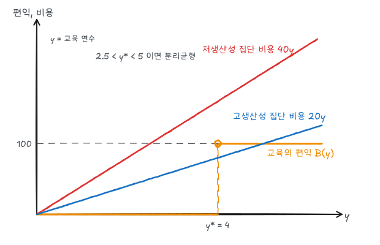

[일반균형](/posts/micro-general-equilibrium-efficiency)에서 경쟁시장이 효율적이려면 모든 참가자가 같은 정보를 가져야 한다. 이 글은 거래 당사자 한쪽이 더 많이 아는 **비대칭 정보** 상황을 다룬다.

| 상황 | 정보를 가진 쪽 | 시점 | 문제 |
|---|---|---|---|
| 중고차, 보험 가입 | 판매자, 가입자 | 계약 **전** 숨겨진 특성 | 역선택 |
| 보험 가입 후 행동, 근로자의 노력 | 가입자, 근로자 | 계약 **후** 숨겨진 행동 | 도덕적 해이 |

## 1. 레몬시장

중고차 판매자는 자기 차의 품질을 알지만 구매자는 모른다. 품질이 나쁜 차를 '레몬'이라 한다.

### 예제

고품질 차와 저품질 차가 반반씩 있다(단위: 만 원).

| | 판매자가 받고자 하는 최소 가격 | 구매자의 지불의사 |
|---|---|---|
| 고품질 | 1,600 | 2,000 |
| 저품질 | 750 | 1,000 |

정보가 대칭이면 두 품질 모두 거래되어야 한다. 구매자의 가치가 판매자의 최소 가격보다 크기 때문이다. 고품질 차 한 대당 거래 이득이 400, 저품질 차 한 대당 250이다.

품질을 구별할 수 없으면 구매자는 기대가치만 지불하려 한다.

$$
0.5 \times 2{,}000 + 0.5 \times 1{,}000 = 1{,}500
$$

1,500은 고품질 판매자의 최소 가격 1,600보다 낮으므로 고품질 차는 시장에서 빠진다. 구매자가 이를 알면 남은 차는 모두 저품질이므로 지불의사가 1,000으로 떨어진다. 결국 **저품질 차만 거래**되고 고품질 차의 거래 이득(대당 400)이 사라진다.

정보가 부족한 쪽이 평균 품질로 가격을 매기면, 평균보다 좋은 품질을 가진 쪽이 시장을 떠나 평균 품질이 더 낮아진다. 이것이 **역선택**이다.

### 다른 시장의 역선택

| 시장 | 역선택 | 대응 |
|---|---|---|
| 보험 | 위험이 높은 사람일수록 보험에 많이 가입 → 보험료 상승 → 건강한 사람 이탈 | 단체보험, 의무가입 |
| 신용 | 갚을 의사가 적은 사람일수록 높은 금리도 받아들임 | 신용평가, 신용기록 |
| 노동 | 평균 임금 제시 시 생산성 높은 사람은 지원하지 않음 | 시장신호 |

## 2. 시장신호

정보를 가진 쪽이 자신의 품질을 알리는 행동이다. 신호가 유효하려면 **품질이 낮은 쪽이 따라 하기 더 비싸야** 한다.

### 교육 신호 모형

노동자는 생산성이 낮은 집단 I과 높은 집단 II로 나뉜다. 고용주는 생산성을 관찰할 수 없고 교육 연수 $y$만 관찰한다. 교육 자체는 생산성을 높이지 않는다고 가정한다.

| | 생산성(평생 가치) | 교육 1년 비용 |
|---|---|---|
| 집단 I | 100 | 40 |
| 집단 II | 200 | 20 |

생산성 높은 사람에게 교육 비용이 낮다(학업이 쉬움, 장학금 등). 고용주가 "교육 $y^*$년 이상이면 200, 미만이면 100"을 지급한다고 하자. 교육으로 얻는 편익은 $y^*$에서 100만큼 뛰는 계단 함수다.

- 집단 I: $y^*$를 받는 비용 $40y^*$가 편익 100보다 크면 교육을 받지 않는다 → $y^* > 2.5$
- 집단 II: 비용 $20y^*$가 편익 100보다 작으면 교육을 받는다 → $y^* < 5$

$2.5 < y^* < 5$이면 집단 I은 교육 0년, 집단 II는 $y^*$년을 선택해 교육이 두 집단을 정확히 구별한다(**분리균형**). 그림의 $y^* = 4$에서 집단 II의 순편익은 $100 - 80 = 20$, 집단 I은 교육을 받으면 $100 - 160 = -60$이므로 받지 않는다.

교육이 생산성을 높이지 않아도 신호로서 가치가 있다. 다만 사회 전체로 보면 신호 비용($20y^*$)은 생산성을 높이지 않는 지출이다.

### 보증과 평판

- **보증**: 품질이 낮은 생산자는 보증 수리 비용이 커서 넓은 보증을 제공하기 어렵다. 넓은 보증 자체가 고품질 신호다.
- **평판**: 반복 거래가 있는 시장(식당 체인, 브랜드)은 평판이 품질을 보증한다. 관광지 식당처럼 반복 구매가 드문 곳은 평판 효과가 약하다.
- **표준화**: 프랜차이즈는 지역과 관계없이 같은 품질을 제공해 낯선 곳의 소비자에게 정보를 준다.

## 3. 도덕적 해이

계약 후 정보를 가진 쪽의 행동이 관찰되지 않아, 그 행동이 상대방에게 비용을 지우는 문제다.

### 예제: 화재보험

창고 가치가 10,000이고 화재 확률은 예방 프로그램(연 50)을 시행하면 1%, 시행하지 않으면 2%다.

| | 예방 프로그램 | 기대손실 | 소유주 총비용 |
|---|---|---|---|
| 보험 없음 | 시행 | $0.01 \times 10{,}000 = 100$ | 150 |
| 보험 없음 | 미시행 | 200 | 200 |

보험이 없으면 소유주는 예방 프로그램을 시행한다(150 < 200). 보험회사가 프로그램 시행을 전제로 보험료를 100으로 책정했다고 하자. 완전보험에 가입하면 화재 손실을 소유주가 부담하지 않으므로 소유주는 50을 아끼려고 프로그램을 중단한다. 실제 기대손실은 200이 되어 보험회사는 손해를 본다.

보험회사는 이를 예상해 보험료를 200으로 올린다. 그러면 사회적으로 비용 150으로 해결할 수 있던 위험을 200의 비용으로 처리하게 된다. 효율 손실은 50이다.

### 대응

| 방법 | 원리 |
|---|---|
| 자기부담금(공제) | 손실 일부를 가입자가 부담해 주의할 유인 유지 |
| 공동보험(정률 부담) | 손실의 일정 비율을 가입자 부담 |
| 감시 | 예방 프로그램 시행 여부 확인 후 보험료 할인 |
| 경험요율 | 사고 기록에 따라 보험료 조정 |

도덕적 해이는 보험 외에도 나타난다. 정부의 예금보호나 구제금융이 예상되면 금융기관은 지나치게 위험한 투자를 한다.

## 4. 주인-대리인 문제

주인(소유주, 주주)이 대리인(경영자, 근로자)에게 일을 맡기지만 대리인의 노력을 관찰할 수 없는 상황이다. 대리인은 주인의 목표가 아닌 자신의 목표를 추구한다.

- 주주는 기업가치 극대화를 원하지만 경영자는 기업 규모, 특권적 소비, 안정성을 원할 수 있다.
- 공기업 경영자는 생산 효율보다 조직 확대를 추구할 수 있다.

### 유인 설계 예제

시계 수리점 주인이 수리공을 고용한다. 수입은 수리공의 노력과 운(확률 0.5씩)에 따라 정해진다. 노력 비용은 10,000이다.

| | 운이 나쁨 | 운이 좋음 | 기대수입 |
|---|---|---|---|
| 노력 안 함 | 10,000 | 20,000 | 15,000 |
| 노력 함 | 20,000 | 40,000 | 30,000 |

주인은 노력을 관찰하지 못하고 수입 20,000이 나와도 그것이 노력 덕분인지 운 덕분인지 모른다.

- **고정임금**: 노력 여부와 관계없이 임금이 같으므로 수리공은 노력하지 않는다.
- **수입 연동 보수** $w = R - 18{,}000$ (주인이 18,000을 받고 나머지를 수리공이 가짐):

$$
\text{노력 안 함: } 0.5(-8{,}000) + 0.5(2{,}000) = -3{,}000
$$

$$
\text{노력 함: } 0.5(2{,}000) + 0.5(22{,}000) - 10{,}000 = 2{,}000
$$

수리공은 노력을 선택하고, 주인은 18,000을 얻는다. 노력하지 않을 때의 기대수입 15,000보다 크다. 보수가 성과와 연동되면 대리인의 이해가 주인과 일치한다.

단, 성과 연동 보수는 대리인에게 위험(운)을 떠넘긴다. 대리인이 위험기피적이면 위험프리미엄만큼 기대보수를 더 줘야 하므로 유인과 위험분담 사이에 상충관계가 있다. 스톡옵션, 성과급, 프랜차이즈 수수료가 이런 설계의 예다.

## 5. 효율임금 이론

노동시장에 실업이 있는데도 임금이 내려가지 않는 이유를 설명한다.

근로자의 태만을 완벽히 감시할 수 없다. 시장 청산 임금을 받는 근로자는 태만하다 해고되어도 바로 같은 임금의 일자리를 구할 수 있으므로 태만할 유인이 있다. 기업이 시장 임금보다 높은 **효율임금**을 지급하면 해고의 비용이 커져 근로자가 성실하게 일한다.

- 모든 기업이 효율임금을 지급하면 노동 수요가 줄어 실업이 생기고, 실업 자체가 해고의 비용을 높인다.
- 실업률이 낮을수록 태만 방지에 필요한 효율임금이 높다.
- 1914년 포드의 일당 5달러(당시 시장 임금의 약 2배) 정책 이후 이직률과 결근율이 크게 줄고 생산성이 오른 사례가 대표적이다.

## 정리

| 문제 | 원인 | 결과 | 대응 |
|---|---|---|---|
| 역선택 | 계약 전 숨겨진 특성 | 고품질이 시장에서 퇴출 | 신호, 보증, 평판, 의무가입 |
| 시장신호 | | 분리균형 $2.5 < y^* < 5$ | 교육, 보증 |
| 도덕적 해이 | 계약 후 숨겨진 행동 | 예방 노력 감소, 효율 손실 50 | 자기부담금, 감시 |
| 주인-대리인 | 노력 관찰 불가 | 고정임금에서 노력 없음 | 성과 연동 보수 |
| 효율임금 | 태만 감시 불가 | 시장 임금보다 높은 임금, 실업 | |
