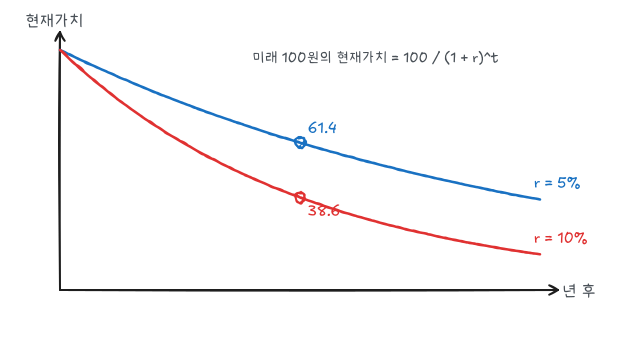

자본은 한 번 사서 여러 해에 걸쳐 쓰는 요소다. 오늘의 비용과 미래의 수익을 비교해야 하므로 **시간**을 다루는 도구가 필요하다.

## 1. 저량과 유량

| 구분 | 의미 | 예 |
|---|---|---|
| 저량(stock) | 한 시점에서 측정 | 공장 설비, 보유 자본 |
| 유량(flow) | 일정 기간 동안 측정 | 연간 생산량, 노동 시간, 연간 이자 |

투입되는 노동과 원자재는 유량이고 자본은 저량이다. 자본의 비용은 오늘 지출하지만 수익은 미래 유량으로 들어온다.

## 2. 현재가치

이자율이 $r$일 때 $n$년 후 받는 금액 $F$의 **현재가치**(PV)는

$$
PV = \frac{F}{(1 + r)^n}
$$

오늘 $PV$를 이자율 $r$로 예금하면 $n$년 후 $F$가 되기 때문이다.

10년 후 받는 100의 현재가치는 $r = 5\%$에서 $100/1.05^{10} = 61.4$, $r = 10\%$에서 $100/1.1^{10} = 38.6$이다. 이자율이 높을수록, 먼 미래일수록 현재가치가 작다.

### 소득흐름의 현재가치

매년 말 $C_1, C_2, \dots, C_n$을 받으면

$$
PV = \sum_{t=1}^{n}\frac{C_t}{(1 + r)^t}
$$

영원히 매년 $C$를 받는 **영구채**는 등비급수 합으로

$$
PV = \frac{C}{r}
$$

이다. $r = 5\%$에서 매년 10을 영원히 받는 권리의 가치는 200이다.

## 3. 채권 가격과 실효수익률

채권은 매년 이자(쿠폰)를 지급하고 만기에 원금(액면가)을 상환한다. 쿠폰 10, 액면 100, 만기 5년 채권의 가격은

$$
P = \sum_{t=1}^{5}\frac{10}{(1 + r)^t} + \frac{100}{(1 + r)^5}
$$

| 이자율 $r$ | 채권 가격 |
|---|---|
| 5% | 121.6 |
| 8% | 108.0 |
| 10% | 100.0 |
| 15% | 83.2 |

이자율이 오르면 채권 가격은 내린다. 쿠폰율과 이자율이 같으면(10%) 액면가에 거래된다.

반대로 시장가격이 주어졌을 때 위 식을 만족하는 $r$이 **실효수익률**(만기수익률)이다. 위험한 회사의 채권은 가격이 낮게 형성되어 실효수익률이 높다. 높은 수익률은 채무불이행 위험에 대한 보상이다.

## 4. 투자 결정: 순현재가치 기준

투자의 **순현재가치**(NPV)는 미래 수익의 현재가치에서 투자비용을 뺀 것이다.

$$
NPV = -C_0 + \sum_{t=1}^{n}\frac{\pi_t}{(1 + R)^t}
$$

**NPV > 0이면 투자**한다. $R$은 할인율로, 자금을 다른 곳에 투자했을 때 얻을 수 있는 수익률(기회비용)이다.

### 예제

오늘 1,000을 투자하면 4년간 매년 300의 이윤이 생긴다.

| 할인율 $R$ | NPV |
|---|---|
| 5% | $-1{,}000 + 300\left(\frac{1}{1.05} + \cdots + \frac{1}{1.05^4}\right) = +63.8$ |
| 10% | $-49.0$ |

자금의 기회비용이 5%면 투자하고 10%면 하지 않는다.

**내부수익률**(IRR)은 NPV를 0으로 만드는 할인율이다. 이 예제에서 IRR ≈ 7.7%이므로, 할인율이 7.7%보다 낮으면 투자한다. 현금흐름의 부호가 여러 번 바뀌면 IRR이 여러 개일 수 있어 NPV 기준이 더 안전하다.

### 실질과 명목

물가가 오르면 미래 현금흐름의 명목값이 커진다. **명목 현금흐름은 명목 할인율로, 실질 현금흐름은 실질 할인율로** 할인해야 한다. 섞으면 NPV가 왜곡된다. 실질이자율 ≈ 명목이자율 − 기대인플레이션이다.

## 5. 위험 조정 할인율

미래 수익이 불확실하면 할인율에 위험프리미엄을 더한다. 다만 분산투자로 없앨 수 있는 **비체계적 위험**은 보상받지 못하고, 경제 전체와 같이 움직이는 **체계적 위험**만 보상받는다.

**자본자산가격결정모형**(CAPM):

$$
R = R_f + \beta\,(R_m - R_f)
$$

$\beta$는 자산 수익률이 시장 수익률에 얼마나 민감한지를 나타낸다. $R_f = 4\%$, $R_m = 10\%$, $\beta = 1.5$이면 할인율은 $4 + 1.5 \times 6 = 13\%$이다. 경기 민감도가 높은 사업일수록 높은 할인율을 적용한다.

## 6. 소비자의 시점 간 선택

내구재 구매(자동차, 에어컨)도 투자 결정이다. 에어컨 A는 가격 500, 연 전기료 100이고 에어컨 B는 가격 700, 연 전기료 60이다. 8년 사용, 할인율 5%이면

$$
\text{비용 현재가치} = \text{가격} + \text{연간 운영비} \times \sum_{t=1}^{8}\frac{1}{1.05^t} = \text{가격} + \text{연간 운영비} \times 6.46
$$

| | 가격 | 운영비 PV | 총비용 PV |
|---|---|---|---|
| A | 500 | 646 | 1,146 |
| B | 700 | 388 | 1,088 |

할인율 5%에서는 B가 싸다. 할인율이 높으면(미래를 덜 중시하면) 초기 비용이 싼 A가 유리해진다.

## 7. 고갈자원의 가격

원유처럼 양이 정해진 자원을 생산하면 미래에 생산할 기회를 잃는다. 이 기회비용이 **사용자 비용**이다.

$$
P - MC = \text{사용자 비용}
$$

경쟁시장에서 생산자는 오늘 한 단위를 팔아 이자를 받는 것과 땅에 두었다가 나중에 파는 것이 무차별해야 한다. 따라서

$$
P_t - MC \text{가 이자율 } r \text{로 상승한다}
$$

(호텔링 규칙). 실제 자원 가격은 새로운 매장량 발견, 기술 진보, 수요 변화 때문에 이 규칙대로 움직이지 않는 경우가 많다. 자원이 희소할수록 사용자 비용이 가격에서 차지하는 비중이 크다.

## 8. 이자율의 결정

이자율은 대부자금의 수요와 공급으로 결정된다.

| 대부자금 | 주체 | 이자율과의 관계 |
|---|---|---|
| 공급 | 가계 저축 | 이자율이 높으면 오늘 소비의 기회비용이 커져 저축 증가 |
| 수요 | 가계 차입 + 기업 투자 + 정부 차입 | 이자율이 높으면 NPV가 감소해 투자 감소 |

경기 확장으로 투자 수요가 늘면 이자율이 오르고, 정부 재정적자가 늘면 대부자금 수요가 늘어 이자율이 오른다(민간투자 구축). 현실에는 만기와 위험이 다른 여러 이자율이 있다(국채, 회사채, 우대금리, 콜금리 등).

## 정리

| 개념 | 식 | 예제 |
|---|---|---|
| 현재가치 | $F/(1 + r)^n$ | 100, 10년, 5% → 61.4 |
| 영구채 | $C/r$ | $10/0.05 = 200$ |
| 채권 가격 | 쿠폰 PV + 원금 PV | 8%에서 108.0 |
| NPV | $-C_0 + \sum \pi_t/(1 + R)^t$ | 5%: +63.8, 10%: −49.0 |
| IRR | NPV = 0인 할인율 | 7.7% |
| CAPM | $R_f + \beta(R_m - R_f)$ | 13% |
| 고갈자원 | $P - MC$가 $r$로 상승 | |
