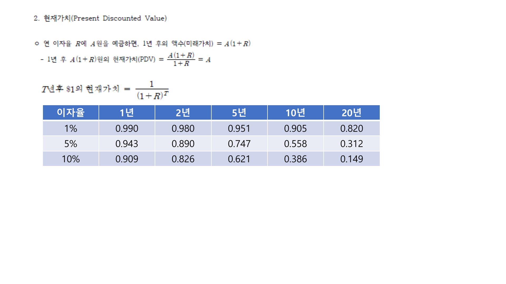
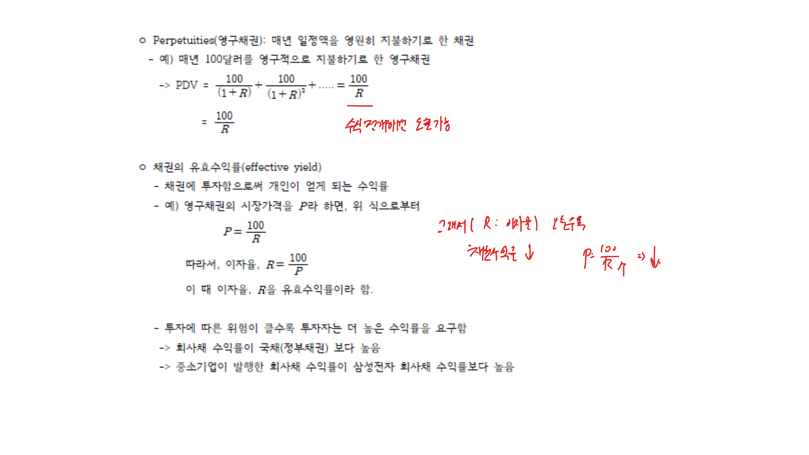

자본시장은 현재의 자원과 미래의 자원을 교환하는 시장이다. 투자결정에서는 서로 다른 시점의 현금흐름을 비교해야 하므로 할인과 현재가치 개념이 필요하다.

## 1. 현재가치

미래에 받을 금액은 현재의 같은 금액보다 가치가 낮다. 이자율이 $R$일 때 1년 후 받을 $F$의 현재가치는 다음과 같다.

$$
PV = \frac{F}{1 + R}
$$

$t$년 후 받을 금액의 현재가치는

$$
PV = \frac{F_t}{(1 + R)^t}
$$

할인율이 높을수록 미래 현금흐름의 현재가치는 작아진다.

 

 

## 2. 현금흐름의 현재가치

여러 시점에 발생하는 현금흐름의 현재가치는 각 시점의 현금흐름을 할인한 뒤 모두 더한다.

$$
PDV = \sum_{t=0}^{T} \frac{CF_t}{(1 + R)^t}
$$

예를 들어 A와 B 두 투자안의 현금흐름이 다르면, 할인율에 따라 어느 투자안의 현재가치가 더 큰지도 달라질 수 있다. 가까운 시점에 현금흐름이 많은 투자안은 높은 할인율에서 상대적으로 유리하다.

## 3. 순현재가치

순현재가치(NPV)는 투자로 얻는 현금흐름의 현재가치에서 초기 투자비용을 뺀 것이다.

$$
NPV = PDV(\text{수익}) - \text{투자비용}
$$

투자결정의 기준은 다음과 같다.

$$
NPV > 0 \Rightarrow \text{투자}
$$

$$
NPV < 0 \Rightarrow \text{투자하지 않음}
$$

여러 투자안 중에서는 NPV가 가장 큰 대안을 선택한다.

## 4. 내부수익률

내부수익률(IRR)은 NPV를 0으로 만드는 할인율이다.

$$
NPV(R^*) = 0
$$

투자안의 내부수익률이 시장이자율보다 높으면 투자할 가치가 있다. 다만 현금흐름 부호가 여러 번 바뀌는 경우 IRR이 여러 개 존재할 수 있으므로 NPV 기준이 더 일반적이다.

 

 

## 5. 채권가격

채권은 미래에 정해진 현금흐름을 지급하는 자산이다. 채권가격은 미래 이자와 원금의 현재가치 합이다.

$$
P_B = \sum_{t=1}^{T} \frac{C}{(1 + R)^t} + \frac{F}{(1 + R)^T}
$$

이자율이 상승하면 채권가격은 하락한다. 미래에 고정된 금액을 받는 자산이기 때문이다.

## 6. 천연자원과 사용자비용

채굴 가능한 천연자원은 오늘 채굴하면 미래에 팔 수 없다는 기회비용을 가진다. 이 기회비용을 사용자비용이라고 한다.

자원가격은 한계채굴비용뿐 아니라 사용자비용을 반영해야 한다.

$$
P = MC + \text{user cost}
$$

자원 보유자는 오늘 팔지 않고 미래에 팔 수 있으므로, 자원의 순가격은 이자율만큼 상승해야 무차별하다. 이를 핫elling 원리로 볼 수 있다.

## 정리

자본시장 분석의 핵심은 시간의 차이를 할인으로 비교하는 것이다. 투자안은 NPV가 양수인지로 판단하고, 채권과 천연자원 가격도 미래 현금흐름 또는 미래 판매기회의 현재가치로 이해할 수 있다.
