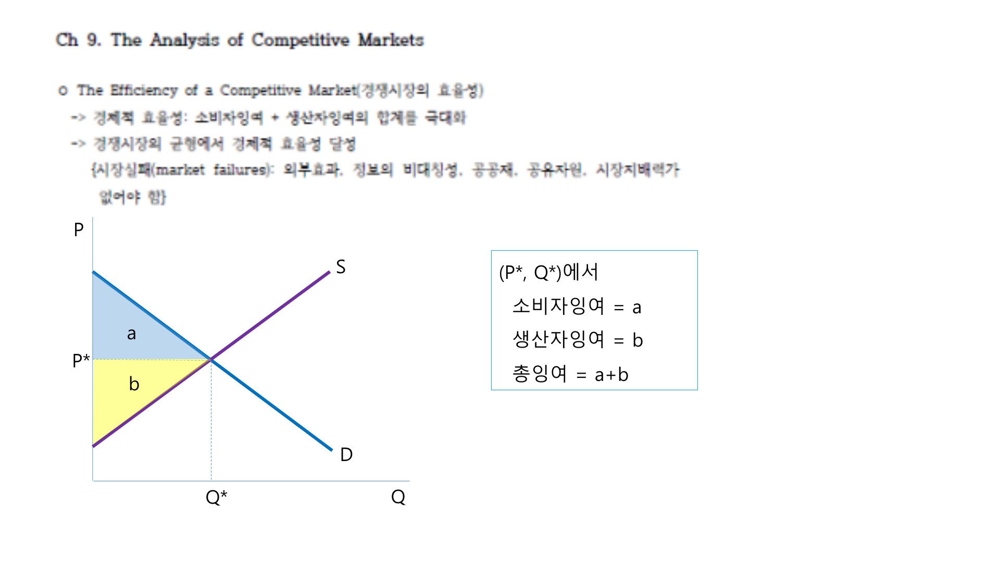
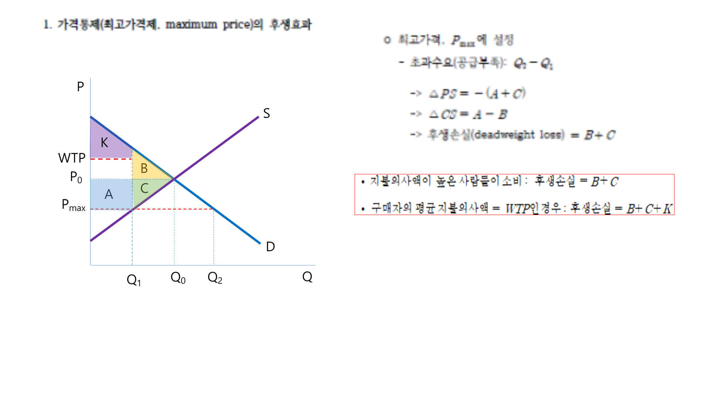

경쟁시장 분석에서는 수요와 공급을 이용해 정책 변화가 소비자, 생산자, 정부, 전체 후생에 미치는 영향을 비교한다. 핵심 도구는 소비자잉여, 생산자잉여, 총잉여다.

## 1. 소비자잉여와 생산자잉여

소비자잉여는 소비자의 지불의사와 실제 지불가격의 차이다. 수요곡선 아래, 시장가격 위의 면적으로 나타난다.

생산자잉여는 생산자가 실제로 받은 가격과 공급하려는 최소가격의 차이다. 시장가격 아래, 공급곡선 위의 면적으로 나타난다.

경쟁시장 균형에서 총잉여는 소비자잉여와 생산자잉여의 합이다.

$$
TS = CS + PS
$$

 

 

## 2. 가격상한

가격상한은 정부가 가격을 일정 수준 이상으로 올리지 못하게 하는 정책이다. 가격상한이 균형가격보다 낮으면 초과수요가 발생한다.

$$
P_{\max} < P^*
$$

이때 수요량은 증가하고 공급량은 감소한다.

$$
Q_D(P_{\max}) > Q_S(P_{\max})
$$

거래량은 공급량으로 제한되며, 부족과 배급 문제가 발생한다. 일부 소비자는 낮은 가격 덕분에 이익을 얻지만, 재화를 구하지 못하는 소비자와 생산자는 손실을 본다.

 

 

## 3. 가격하한

가격하한은 가격을 일정 수준 이하로 내리지 못하게 하는 정책이다. 가격하한이 균형가격보다 높으면 초과공급이 발생한다.

$$
P_{\min} > P^*
$$

최저임금제는 노동시장에서의 가격하한으로 볼 수 있다. 최저임금이 균형임금보다 높으면 노동공급은 증가하고 노동수요는 감소하여 실업이 발생한다.

## 4. 조세의 효과

단위세 $t$가 부과되면 소비자가 지불하는 가격과 생산자가 받는 가격 사이에 차이가 생긴다.

$$
P_B - P_S = t
$$

세금은 거래량을 줄이고 사중손실을 만든다.

$$
DWL = \frac{1}{2}t(Q^* - Q_t)
$$

누가 세금을 법적으로 납부하는지는 조세부담의 최종 귀착과 다를 수 있다. 조세부담은 수요와 공급의 탄력성에 따라 결정된다.

- 수요가 더 비탄력적이면 소비자가 더 많이 부담한다.
- 공급이 더 비탄력적이면 생산자가 더 많이 부담한다.

## 5. 보조금

보조금은 조세와 반대로 소비자가 지불하는 가격과 생산자가 받는 가격 사이에 차이를 만든다.

$$
P_S - P_B = s
$$

보조금은 거래량을 늘리지만 정부지출이 발생하고, 경쟁시장 균형에서 벗어나므로 사중손실이 생길 수 있다.

## 6. 관세와 수입쿼터

국제무역이 가능하면 국내가격은 세계가격의 영향을 받는다. 세계가격이 국내 균형가격보다 낮으면 수입이 발생한다.

관세는 수입품 가격을 올려 국내 생산자를 보호하지만 소비자잉여를 줄이고 사중손실을 만든다.

수입쿼터는 수입량 자체를 제한한다. 관세와 비슷하게 국내가격을 올리지만, 관세수입 대신 쿼터권을 가진 주체에게 지대가 생길 수 있다.

## 정리

정책 분석의 기본 절차는 가격과 거래량의 변화를 찾고, 소비자잉여, 생산자잉여, 정부수입 또는 정부지출, 사중손실을 비교하는 것이다. 탄력성이 작을수록 가격 변화와 조세부담이 크게 나타나며, 거래량 왜곡이 작을수록 사중손실은 작아진다.
