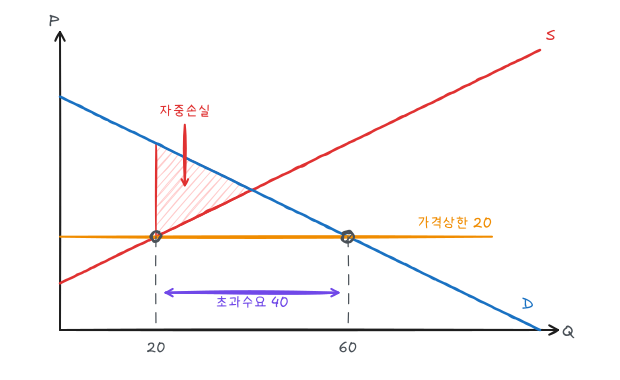
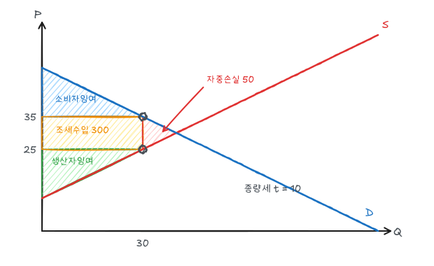

경쟁시장에 정부가 개입하면 누가 얻고 누가 잃는지를 잉여로 측정한다. 이 글의 모든 예제는 [수요와 공급](/posts/micro-supply-demand)의 곡선을 그대로 쓴다.

$$
\text{수요: } P = 50 - \tfrac12 Q, \qquad \text{공급: } P = 10 + \tfrac12 Q, \qquad (Q^*, P^*) = (40, 30)
$$

## 1. 기준: 경쟁균형의 잉여

$$
CS = \tfrac12 \times 40 \times (50 - 30) = 400, \qquad PS = \tfrac12 \times 40 \times (30 - 10) = 400
$$

총잉여 800이다. 경쟁균형은 총잉여를 극대화한다. 균형보다 적게 거래하면 지불의사가 한계비용보다 큰 거래가 사라지고, 많이 거래하면 한계비용이 지불의사보다 큰 거래가 생긴다.

정부 개입의 효율성 손실은 사라진 총잉여, **자중손실**(DWL)로 측정한다.

## 2. 가격상한

가격을 20 이하로 규제한다.

- 공급량: $20 = 10 + Q/2 \Rightarrow Q_s = 20$
- 수요량: $20 = 50 - Q/2 \Rightarrow Q_d = 60$
- 초과수요 40

거래량은 공급량 20으로 줄어든다. 지불의사가 가장 높은 소비자가 물건을 얻는다고 가정하면

| 잉여 | 규제 전 | 규제 후 | 변화 |
|---|---|---|---|
| 소비자잉여 | 400 | 500 | +100 |
| 생산자잉여 | 400 | 100 | −300 |
| 총잉여 | 800 | 600 | **−200** |

규제 후 CS는 $Q = 0$~$20$ 구간에서 수요곡선(50에서 40)과 가격 20 사이 면적이다: $\frac{(30 + 20)}{2} \times 20 = 500$. PS는 공급곡선(10에서 20)과 가격 20 사이: $\frac12 \times 20 \times 10 = 100$.

자중손실은 꼭짓점 $(20, 20), (40, 30), (20, 40)$인 삼각형이다.

$$
DWL = \tfrac12 \times 20 \times (40 - 20) = 200
$$

수요가 매우 비탄력적이면 소비자잉여도 감소할 수 있다. 줄을 서는 시간 비용, 암시장, 품질 저하는 이 계산에 포함되지 않은 추가 손실이다.

## 3. 가격하한과 최저임금

가격을 균형보다 높은 40으로 정하면

- 수요량: $40 = 50 - Q/2 \Rightarrow Q_d = 20$
- 공급량: $40 = 10 + Q/2 \Rightarrow Q_s = 60$

거래량은 수요량 20이다. 생산자가 실제 판매할 20단위만 생산한다면

$$
CS = \tfrac12 \times 20 \times 10 = 100,\quad PS = \tfrac{(30 + 20)}{2}\times 20 = 500 \;(\text{가격 40과 공급곡선 사이}),\quad DWL = 200
$$

생산자가 팔지 못할 60단위까지 생산하면 추가 40단위의 생산비($Q = 20$~$60$ 구간 공급곡선 아래 면적 $= \frac{(20 + 40)}{2}\times 40 = 1{,}200$)가 그대로 손실이 되어 생산자도 손해를 볼 수 있다.

**최저임금**은 노동시장의 가격하한이다. 균형임금보다 높으면 노동 공급이 수요를 넘어 실업이 발생한다. 일자리를 유지한 노동자는 이득을 보지만 일자리를 잃은 노동자는 손해를 본다.

## 4. 가격지지와 생산할당

**가격지지**: 정부가 가격 40을 보장하고 남는 물량을 사들인다.

- 소비자는 20을 사고, 정부가 나머지 $60 - 20 = 40$을 구매한다.
- $\Delta CS = 100 - 400 = -300$
- $\Delta PS$: 가격 40에서 60을 판매하므로 $PS = \frac12 \times 60 \times 30 = 900$, $+500$
- 정부 지출: $40 \times 40 = 1{,}600$
- 총변화: $-300 + 500 - 1{,}600 = -1{,}400$

생산자 잉여 증가 500을 위해 사회 전체가 1,400을 잃는다. 생산자에게 직접 500을 지급하는 편이 훨씬 싸다.

**생산할당(경작 제한)**: 공급량을 20으로 제한해 가격을 40으로 올린다. 가격하한과 같은 결과($DWL = 200$)이지만, 생산자에게 생산을 줄인 대가를 지급하는 경우 그 지급액이 추가 비용이 된다.

## 5. 수입할당과 관세

국내 수요·공급이 위와 같고 국제가격이 20이라 하자. 자유무역이면 가격 20에서 국내 생산 20, 소비 60, 수입 40이다.

관세 10을 부과하면 국내가격이 30이 되어 국내 생산과 소비가 모두 40, 수입은 0이 된다(이 예제는 관세가 수입을 완전히 막는 경우다). 관세를 5만 부과하면

- 국내가격 25, 국내 생산 30, 소비 50, 수입 20
- 관세수입 $5 \times 20 = 100$
- $\Delta CS = -\frac{(60 + 50)}{2}\times 5 = -275$, $\Delta PS = +\frac{(20 + 30)}{2}\times 5 = +125$
- $DWL = 275 - 125 - 100 = 50$

자중손실은 국내 과잉생산 삼각형($\frac12 \times 10 \times 5 = 25$)과 과소소비 삼각형($\frac12 \times 10 \times 5 = 25$)의 합이다.

**수입할당**으로 수입을 20으로 제한해도 국내가격과 물량은 관세 5와 같다. 차이는 관세수입 100이 정부 대신 수입 허가권을 가진 외국 생산자나 수입업자에게 돌아간다는 것이다. 그만큼 국가 전체의 손실이 더 크다.

## 6. 조세

단위당 세금 $t$를 부과하면 구매자 가격 $P_b$와 판매자 가격 $P_s$가 달라진다.

$$
Q_D(P_b) = Q_S(P_s), \qquad P_b - P_s = t
$$

$t = 10$이면 $100 - 2P_b = 2(P_b - 10) - 20$에서

$$
P_b = 35,\quad P_s = 25,\quad Q = 30
$$

| 항목 | 값 |
|---|---|
| 소비자 부담 | $35 - 30 = 5$ |
| 생산자 부담 | $30 - 25 = 5$ |
| 조세수입 | $10 \times 30 = 300$ |
| $\Delta CS$ | $-\frac{(40 + 30)}{2}\times 5 = -175$ |
| $\Delta PS$ | $-175$ |
| 자중손실 | $\frac12 \times 10 \times 10 = 50$ |

검산: $-175 - 175 + 300 = -50$.

### 귀착은 탄력성이 결정한다

누구에게 세금을 걷든 결과는 같다. 부담 비율은 상대적 탄력성으로 정해진다.

$$
\text{소비자 부담 비율} = \frac{E_S}{E_S - E_D}
$$

예제의 균형점에서 $E_D = -1.5$, $E_S = 1.5$이므로 소비자 부담 비율은 $1.5/3 = 0.5$이다. 수요가 비탄력적일수록(담배, 휘발유) 소비자가 더 많이 부담한다.

자중손실은 세율의 제곱에 비례한다. 위 예제에서 $t = 20$이면 $Q = 20$, $DWL = \frac12 \times 20 \times 20 = 200$으로 세율 2배에 손실 4배다.

## 7. 보조금

단위당 보조금 $s$는 음(−)의 세금이다. $P_s - P_b = s$.

$s = 10$이면 $100 - 2P_b = 2(P_b + 10) - 20$에서 $P_b = 25$, $P_s = 35$, $Q = 50$이다.

| 항목 | 값 |
|---|---|
| $\Delta CS$ | $+\frac{(40 + 50)}{2}\times 5 = +225$ |
| $\Delta PS$ | $+225$ |
| 정부 지출 | $10 \times 50 = 500$ |
| 자중손실 | $500 - 450 = 50$ |

보조금도 한계비용이 지불의사보다 큰 거래를 만들어내므로 자중손실이 생긴다.

## 정리

| 정책 | 거래량 | 자중손실 | 비고 |
|---|---|---|---|
| 가격상한 20 | 20 | 200 | 초과수요 40 |
| 가격하한 40 | 20 | 200 | 초과생산 시 손실 확대 |
| 가격지지 40 | 60 (정부 40 구매) | 1,400 | 생산자 +500 |
| 관세 5 (국제가 20) | 소비 50 | 50 | 관세수입 100 |
| 조세 10 | 30 | 50 | 조세수입 300, 귀착 5:5 |
| 보조금 10 | 50 | 50 | 정부 지출 500 |
