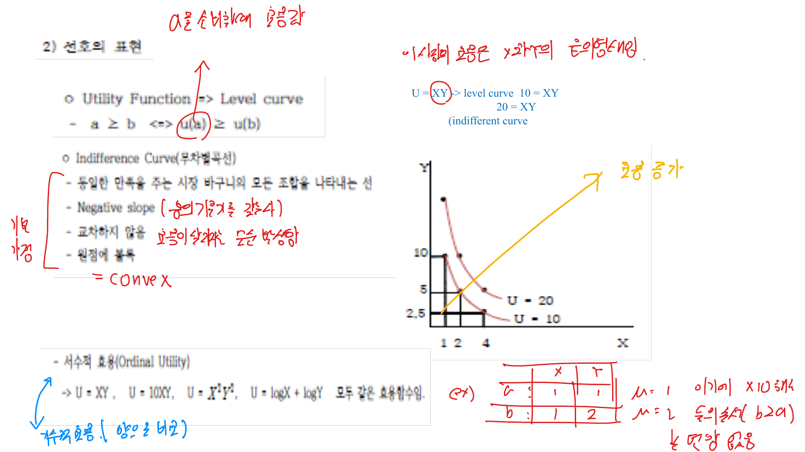
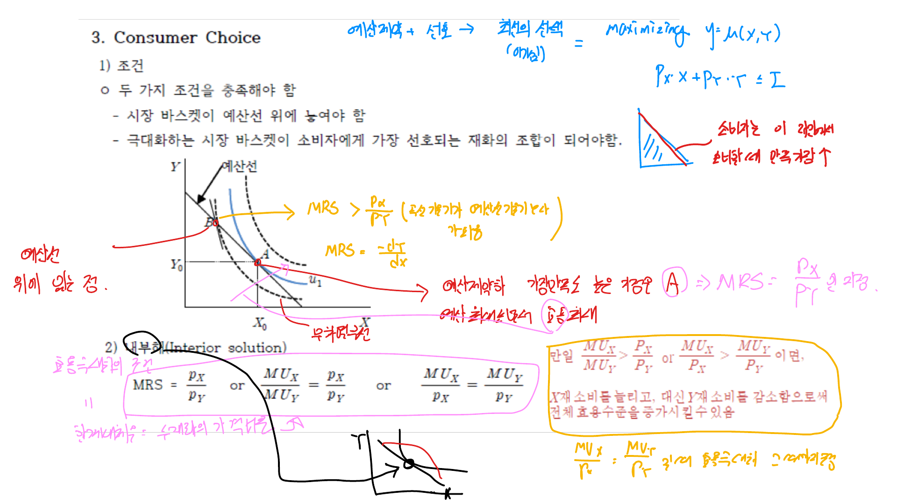

소비자 행동 이론은 주어진 소득과 가격 아래에서 소비자가 어떤 상품묶음을 선택하는지를 설명한다. 핵심은 선호를 효용함수와 무차별곡선으로 표현하고, 예산제약 안에서 가장 높은 효용을 주는 점을 찾는 것이다.

## 1. 선호체계

상품묶음은 여러 재화의 소비량을 한 번에 나타낸 것이다. 예를 들어 사과와 배만 있는 경제에서는 다음과 같은 묶음을 생각할 수 있다.

- $A = (2, 2)$
- $B = (1, 3)$
- $C = (3, 1)$

소비자는 상품묶음 사이에 선호관계를 가진다. $A \succ B$는 $A$를 $B$보다 선호한다는 뜻이고, $A \sim B$는 두 묶음에 대해 무차별하다는 뜻이다.

소비자 선택 모형은 보통 다음 가정을 둔다.

- 완비성: 어떤 두 묶음도 비교할 수 있다.
- 이행성: $A \succ B$, $B \succ C$이면 $A \succ C$이다.
- 연속성: 선호가 갑자기 끊어지지 않는다.
- 국지적 불만족성: 더 많은 재화를 선호한다.
- 미분가능성: 한계대체율을 다룰 수 있을 만큼 매끄럽다.

## 2. 효용함수와 무차별곡선

효용함수는 상품묶음에 숫자를 붙여 선호순서를 표현한다.

$$
U = U(X, Y)
$$

효용값 자체보다 중요한 것은 효용값이 만드는 순서다. 예를 들어 $U = XY$라면 $XY = 10$, $XY = 20$ 같은 곡선이 각각 하나의 무차별곡선이다.

$$
U(X,Y) = XY = \bar U
$$

무차별곡선은 같은 효용을 주는 상품묶음의 집합이다. 일반적으로 원점에서 멀수록 더 높은 효용을 나타내며, 우하향하고 서로 교차하지 않는다.

 

 

## 3. 한계대체율

한계대체율(MRS)은 소비자가 효용을 일정하게 유지하면서 한 재화를 다른 재화로 얼마나 대체할 수 있는지를 나타낸다.

$$
MRS_{XY} = -\frac{dY}{dX}
$$

효용함수로 표현하면 다음과 같다.

$$
MRS_{XY} = \frac{MU_X}{MU_Y}
$$

여기서 $MU_X = \frac{\partial U}{\partial X}$, $MU_Y = \frac{\partial U}{\partial Y}$이다. 무차별곡선이 볼록하다는 것은 한 재화를 많이 가질수록 그 재화의 상대적 가치가 낮아진다는 뜻이다. 따라서 일반적인 경우 한계대체율은 체감한다.

## 4. 예산제약

소비자는 가격과 소득으로 제한된다. $X$재 가격이 $P_X$, $Y$재 가격이 $P_Y$, 소득이 $I$라면 예산선은 다음과 같다.

$$
P_X X + P_Y Y = I
$$

예산선의 기울기는 두 재화의 상대가격이다.

$$
\frac{dY}{dX} = -\frac{P_X}{P_Y}
$$

상대가격은 시장에서 $X$ 한 단위를 더 소비하기 위해 포기해야 하는 $Y$의 양을 뜻한다.

## 5. 소비자균형

내부해에서는 무차별곡선과 예산선이 접하는 점에서 소비자균형이 결정된다.

$$
MRS_{XY} = \frac{P_X}{P_Y}
$$

즉 소비자가 주관적으로 평가하는 교환비율과 시장에서 주어진 객관적 교환비율이 같아지는 점이다.

예를 들어 $U = XY$이고 예산선이 $X + 2Y = 60$이라면 $P_X = 1$, $P_Y = 2$, $I = 60$이다.

$$
MU_X = Y,\quad MU_Y = X
$$

$$
MRS_{XY} = \frac{Y}{X} = \frac{1}{2}
$$

따라서 $X = 2Y$이고, 이를 예산식에 대입하면

$$
2Y + 2Y = 60
$$

$$
Y^* = 15,\quad X^* = 30
$$

 

 

## 6. 코너해와 특수한 선호

항상 접점해가 나오는 것은 아니다. 완전대체재에서는 더 효율적인 재화만 소비하는 코너해가 나타날 수 있다. 완전보완재에서는 일정한 비율로만 소비하므로 예산선과 L자형 무차별곡선의 꼭짓점에서 균형이 정해진다.

코너해에서는 접점조건 $MRS = P_X/P_Y$가 성립하지 않을 수 있다. 이때는 예산집합의 경계에서 가능한 효용을 직접 비교해야 한다.

## 7. 가격변화와 소비자 선택

가격이 변하면 예산선의 기울기가 바뀐다. 가격 상승은 해당 재화의 상대가격을 높여 소비를 줄이는 방향으로 작용한다. 가격 변화의 효과는 대체효과와 소득효과로 나눌 수 있다.

- 대체효과: 상대적으로 비싸진 재화를 덜 소비하고 싸진 재화를 더 소비하는 효과
- 소득효과: 가격 변화로 실질구매력이 변하면서 소비가 바뀌는 효과

정상재에서는 가격 상승 시 두 효과가 모두 수요를 줄이는 방향으로 작용한다. 열등재에서는 소득효과가 반대 방향으로 작용할 수 있다. 기펜재는 열등재 중에서도 소득효과가 대체효과보다 커서 가격이 오를 때 수요량이 증가하는 특수한 경우다.

## 정리

소비자 행동의 핵심 조건은 $MRS = P_X/P_Y$이다. 이 조건은 소비자가 느끼는 주관적 교환비율과 시장 상대가격이 같다는 뜻이다. 다만 완전대체재, 완전보완재, 코너해처럼 접점조건만으로 설명되지 않는 경우도 있으므로 예산집합과 선호의 모양을 함께 확인해야 한다.
