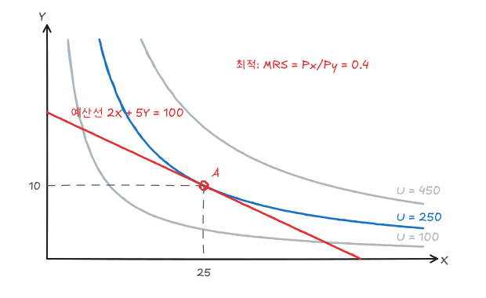

소비자 이론은 세 단계로 구성된다. 소비자가 무엇을 좋아하는지(선호), 무엇을 살 수 있는지(예산제약), 그 안에서 무엇을 고르는지(선택)다. 예제는 효용함수 $U = XY$, 가격 $P_X = 2,\ P_Y = 5$, 소득 $I = 100$으로 통일한다.

## 1. 선호에 대한 가정

| 가정 | 내용 |
|---|---|
| 완비성 | 임의의 두 묶음 A, B에 대해 A ≻ B, B ≻ A, A ~ B 중 하나가 성립한다 |
| 이행성 | A ≻ B이고 B ≻ C이면 A ≻ C이다 |
| 강단조성 | 많을수록 좋다 (재화는 모두 '좋은 것'이다) |
| 볼록성 | 극단적인 묶음보다 섞인 묶음을 선호한다 |

## 2. 무차별곡선

무차별곡선은 같은 만족을 주는 묶음들의 집합이다. 위 가정에서 다음 성질이 나온다.

1. 우하향한다 (한 재화를 줄이면 다른 재화를 늘려야 같은 만족).
2. 원점에서 멀수록 높은 만족을 나타낸다.
3. 서로 교차하지 않는다 (교차하면 이행성과 단조성에 모순).
4. 원점에 대해 볼록하다 (한계대체율 체감).

### 한계대체율

한계대체율(MRS)은 같은 만족을 유지하면서 X 한 단위를 더 얻기 위해 포기할 수 있는 Y의 양이다.

$$
MRS_{XY} = -\frac{\Delta Y}{\Delta X}\Big|_{U=\bar U} = \frac{MU_X}{MU_Y}
$$

무차별곡선 위에서 $dU = MU_X\,dX + MU_Y\,dY = 0$이므로 위 식의 두 번째 등호가 성립한다. $U = XY$이면 $MU_X = Y,\ MU_Y = X$이므로 $MRS = Y/X$이다. X를 많이 가질수록 MRS가 작아진다(체감).

### 특수한 선호

| 선호 | 효용함수 | 무차별곡선 | MRS |
|---|---|---|---|
| 완전대체재 | $U = aX + bY$ | 직선 | $a/b$ (일정) |
| 완전보완재 | $U = \min(aX, bY)$ | L자 | 꺾인 점에서 정의되지 않음 |
| 콥-더글러스 | $U = X^\alpha Y^{1-\alpha}$ | 볼록한 곡선 | $\frac{\alpha}{1-\alpha}\frac{Y}{X}$ |
| 비재화(bad) 포함 | 예: 공해 | 우상향 | 음수 |

## 3. 효용함수

효용함수는 선호에 숫자를 붙인 것이다. 소비자 이론에서 효용은 **서수적**이다. 순서만 의미가 있고 크기 차이는 의미가 없다. 따라서 $U = XY$와 $V = \ln X + \ln Y$, $W = (XY)^2$는 같은 선호를 나타내며(단조증가 변환), MRS도 같다.

## 4. 예산제약

$$
P_X X + P_Y Y = I
$$

예제에서는 $2X + 5Y = 100$이다. 예산선의 절편은 $I/P_X = 50$, $I/P_Y = 20$이고 기울기는 $-P_X/P_Y = -0.4$다.

| 변화 | 예산선 |
|---|---|
| 소득 증가 | 기울기 그대로 바깥쪽 평행이동 |
| $P_X$ 하락 | Y절편 고정, X축 쪽으로 회전 |
| 모든 가격과 소득이 같은 비율로 변화 | 변화 없음 |

## 5. 효용극대화

예산선 위에서 가장 높은 무차별곡선에 닿는 점이 최적 선택이다. 내부해에서는 무차별곡선과 예산선이 접한다.

$$
MRS = \frac{MU_X}{MU_Y} = \frac{P_X}{P_Y}
\quad\Leftrightarrow\quad
\frac{MU_X}{P_X} = \frac{MU_Y}{P_Y}
$$

두 번째 식은 **한계효용 균등의 원리**다. 1원당 한계효용이 재화 사이에 같아야 한다. X의 1원당 한계효용이 더 크다면 Y에서 X로 지출을 옮겨 효용을 높일 수 있다.

### 예제 풀이

$U = XY$에서 $Y/X = 2/5$, 즉 $Y = 0.4X$. 예산식에 대입하면

$$
2X + 5(0.4X) = 100 \;\Rightarrow\; X^* = 25,\quad Y^* = 10,\quad U^* = 250
$$

U = 100인 곡선은 예산선을 두 번 자르므로 최적이 아니다(교차점에서는 MRS ≠ 가격비). U = 450은 예산 밖이다.

콥-더글러스 $U = X^\alpha Y^{1-\alpha}$의 일반해는

$$
X^* = \frac{\alpha I}{P_X}, \qquad Y^* = \frac{(1-\alpha)I}{P_Y}
$$

로, 소득의 일정 비율 $\alpha$를 X에 쓴다. 예제는 $\alpha = 0.5$이므로 소득 100 중 50을 X에, 50을 Y에 쓴다.

### 라그랑지 풀이

$$
\mathcal L = XY + \lambda(100 - 2X - 5Y)
$$

$$
\frac{\partial \mathcal L}{\partial X} = Y - 2\lambda = 0,\quad
\frac{\partial \mathcal L}{\partial Y} = X - 5\lambda = 0,\quad
2X + 5Y = 100
$$

에서 $X = 25,\ Y = 10,\ \lambda = 5$다. $\lambda$는 소득의 한계효용이다. 소득이 1 늘면 효용이 약 5 늘어난다($U^* = I^2/40$이므로 $dU^*/dI = I/20 = 5$).

### 구석해

MRS와 가격비가 어디서도 같아지지 않으면 한 재화만 소비하는 구석해가 나온다. 완전대체재 $U = X + Y$에서 $P_X < P_Y$이면 X만 산다. 구석해에서는 $MRS \ge P_X/P_Y$ (X만 소비하는 경우)이다.

## 6. 현시선호

효용함수를 몰라도 실제 선택에서 선호를 추론할 수 있다. 묶음 A를 살 때 B도 살 수 있었다면 A가 B보다 **현시선호**된다. 

- 약공리: A가 B보다 현시선호되면 B가 A보다 현시선호될 수 없다.
- 가격이 바뀐 뒤의 선택을 관찰하면 무차별곡선이 놓일 수 있는 영역을 점점 좁힐 수 있다.

## 7. 생계비 지수

소비자 이론은 물가지수 해석에도 쓰인다.

| 지수 | 기준 바구니 | 특징 |
|---|---|---|
| 라스파이레스 | 기준연도 수량 | 대체효과를 무시해 생계비 상승을 과대평가 |
| 파셰 | 비교연도 수량 | 생계비 상승을 과소평가 |
| 이상적 생계비 지수 | 같은 효용을 유지하는 최소 지출 | 이론적 기준 |

CPI처럼 라스파이레스형 지수로 연금이나 임금을 연동하면 소비자가 싸진 재화로 옮겨가는 대체를 반영하지 못해 실제 필요한 보상보다 많이 지급하게 된다.

## 정리

| 개념 | 식 | 예제 값 |
|---|---|---|
| MRS | $MU_X/MU_Y$ | $Y/X$ |
| 예산선 | $P_X X + P_Y Y = I$ | $2X + 5Y = 100$ |
| 최적 조건 | $MRS = P_X/P_Y$ | $Y/X = 0.4$ |
| 최적 선택 | 접점 | $(25, 10)$, $U = 250$ |
| 소득의 한계효용 | $\lambda$ | 5 |
