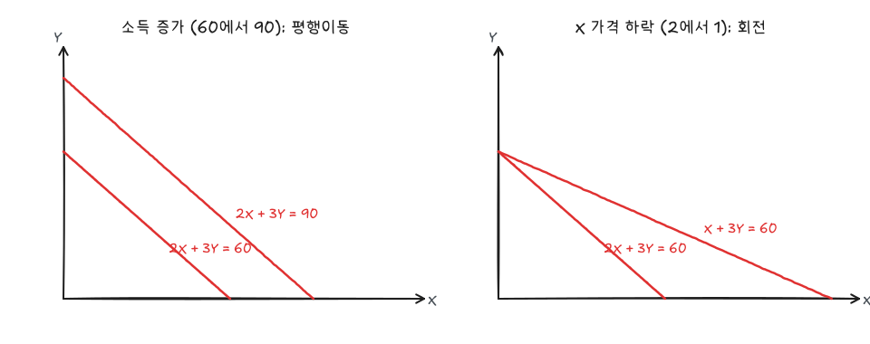
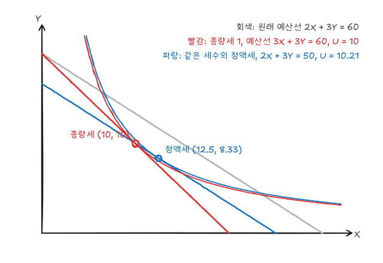
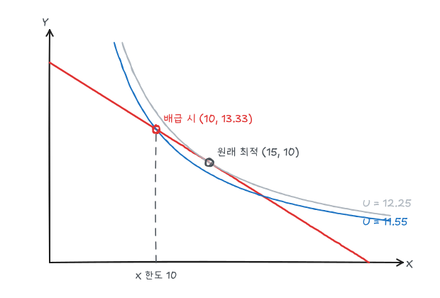
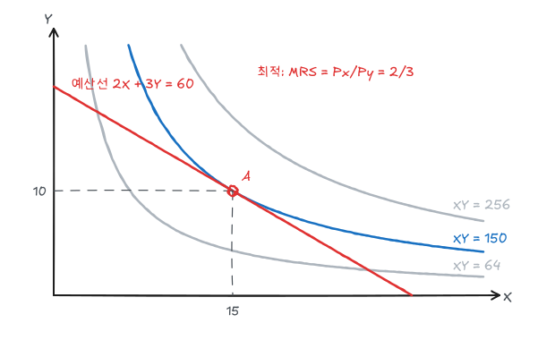
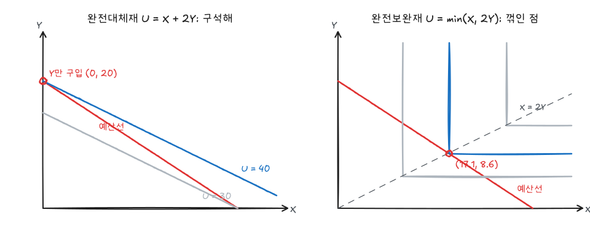

소비자 이론은 세 단계로 구성된다. 소비자가 무엇을 좋아하는지(선호), 무엇을 살 수 있는지(예산제약), 그 안에서 무엇을 고르는지(선택)다. 예제는 강의와 같이 효용함수 $U = X^{0.5}Y^{0.5}$, 가격 $P_X = 2,\ P_Y = 3$, 소득 $I = 60$으로 통일한다.

## 1. 선호에 대한 가정

| 가정 | 내용 |
|---|---|
| 완비성 | 임의의 두 묶음 A, B에 대해 A ≻ B, B ≻ A, A ~ B 중 하나가 성립한다 |
| 이행성 | A ≻ B이고 B ≻ C이면 A ≻ C이다 |
| 강단조성 | 많을수록 좋다 (재화는 모두 '좋은 것'이다) |
| 볼록성 | 극단적인 묶음보다 섞인 묶음을 선호한다 |

## 2. 무차별곡선

무차별곡선은 같은 만족을 주는 묶음들의 집합이다. 위 가정에서 다음 성질이 나온다.

1. 우하향한다 (한 재화를 줄이면 다른 재화를 늘려야 같은 만족).
2. 원점에서 멀수록 높은 만족을 나타낸다.
3. 서로 교차하지 않는다 (교차하면 이행성과 단조성에 모순).
4. 원점에 대해 볼록하다 (한계대체율 체감).

### 한계대체율

한계대체율(MRS)은 같은 만족을 유지하면서 X 한 단위를 더 얻기 위해 포기할 수 있는 Y의 양이다.

$$
MRS_{XY} = -\frac{\Delta Y}{\Delta X}\Big|_{U=\bar U} = \frac{MU_X}{MU_Y}
$$

무차별곡선 위에서 $dU = MU_X\,dX + MU_Y\,dY = 0$이므로 위 식의 두 번째 등호가 성립한다. $U = X^{0.5}Y^{0.5}$이면 $MU_X = 0.5X^{-0.5}Y^{0.5}$, $MU_Y = 0.5X^{0.5}Y^{-0.5}$이므로 $MRS = Y/X$이다. X를 많이 가질수록 MRS가 작아진다(체감).

### 특수한 선호

| 선호 | 효용함수 | 무차별곡선 | MRS |
|---|---|---|---|
| 완전대체재 | $U = aX + bY$ | 직선 | $a/b$ (일정) |
| 완전보완재 | $U = \min(aX, bY)$ | L자 | 꺾인 점에서 정의되지 않음 |
| 콥-더글러스 | $U = X^\alpha Y^{1-\alpha}$ | 볼록한 곡선 | $\frac{\alpha}{1-\alpha}\frac{Y}{X}$ |
| 비재화(bad) 포함 | 예: 공해 | 우상향 | 음수 |

## 3. 효용함수

효용함수는 선호에 숫자를 붙인 것이다. 소비자 이론에서 효용은 **서수적**이다. 순서만 의미가 있고 크기 차이는 의미가 없다. 따라서 $U = X^{0.5}Y^{0.5}$와 $V = XY$, $W = \ln X + \ln Y$는 같은 선호를 나타내며(단조증가 변환), MRS도 같다. 5절 효용극대화 그림의 무차별곡선은 계산이 쉬운 $XY$ 값으로 표시했다($XY = 150$이면 $U = \sqrt{150} \approx 12.25$).

## 4. 예산제약

$$
P_X X + P_Y Y = I
$$

예제에서는 $2X + 3Y = 60$이다. 예산선의 절편은 $I/P_X = 30$, $I/P_Y = 20$이고 기울기는 $-P_X/P_Y = -2/3$이다.

| 변화 | 예산선 |
|---|---|
| 소득 증가 | 기울기 그대로 바깥쪽 평행이동 |
| $P_X$ 하락 | Y절편 고정, X축 쪽으로 회전 |
| 모든 가격과 소득이 같은 비율로 변화 | 변화 없음 |

소득이 60에서 90으로 늘면 두 절편이 모두 1.5배가 되어 같은 기울기로 바깥쪽에 평행이동한다. $P_X$가 2에서 1로 내리면 Y만 살 때의 양(Y절편 20)은 그대로이고 X절편만 30에서 60으로 늘어 예산선이 Y절편을 축으로 회전한다. 소득 변화는 구매력만, 가격 변화는 구매력과 상대가격을 함께 바꾼다는 차이가 대체효과와 소득효과를 나누는 출발점이다.

### 조세, 보조금, 배급

정부 정책은 예산선의 모양을 바꾼다.

| 정책 | 예산선 변화 |
|---|---|
| X에 종량세 $t$ | $P_X$가 $P_X + t$로 올라 회전 |
| 정액세(lump-sum) $T$ | 소득이 $I - T$로 줄어 평행이동 |
| X에 종량보조금 $s$ | $P_X$가 $P_X - s$로 내려 회전 |
| 정액보조금 | 소득 증가, 평행이동 |
| 배급(X 구매 상한 $\bar X$) | $X = \bar X$에서 예산선이 끊김 |

**같은 세수라면 정액세가 종량세보다 소비자에게 낫다.** 예제에서 X에 종량세 1을 매기면 $P_X = 3$이 되어 $X = 60/(2 \times 3) = 10$, $Y = 10$, $U = 10$이고 세수는 10이다. 같은 10을 정액세로 걷으면 소득 50에서 $X = 12.5$, $Y = 8.33$, $U = \sqrt{104.2} = 10.21$로 효용이 더 높다. 종량세는 상대가격까지 바꿔 소비 선택을 왜곡하기 때문이다. 같은 논리로 같은 금액이면 정액보조금이 종량보조금보다 효용을 더 높인다(정부가 X 소비 자체를 늘리려는 목적이면 종량보조금이 낫다).

두 세금 아래의 예산선은 모두 종량세의 선택점 $(10, 10)$을 지난다. 정액세의 예산선은 세금 전과 같은 기울기 $-2/3$이므로 $(10, 10)$에서 무차별곡선을 가로지르고, 오른쪽 아래로 옮겨 더 높은 무차별곡선($U = 10.21$)에 닿을 수 있다. 종량세는 X를 상대적으로 비싸게 만들어 소비자가 X를 지나치게 줄이도록 왜곡하지만, 정액세는 상대가격을 건드리지 않는다. 같은 세수에서 효용의 차이(10.21과 10)가 이 왜곡의 비용이다.

**배급**: X를 10단위까지만 살 수 있으면 원래 최적 $X = 15$를 고를 수 없다. $X = 10$, $Y = (60 - 20)/3 = 13.33$에서 $U = \sqrt{133.3} = 11.55$로 효용이 원래 12.25보다 낮다. 배급 한도가 원래 최적량보다 크면 아무 영향이 없다.

한도가 있으면 예산선 중 $X > 10$인 부분(점선)을 고를 수 없다. 남은 구간에서 가장 높은 무차별곡선에 닿는 점은 꺾이는 점 $(10, 13.33)$이며, 이 점에서는 $MRS = Y/X = 1.33$이 가격비 0.67보다 크다. 소비자는 X를 더 사고 싶지만 살 수 없는 상태이고, 암시장이 생기는 이유가 이 차이에 있다.

## 5. 효용극대화

예산선 위에서 가장 높은 무차별곡선에 닿는 점이 최적 선택이다. 내부해에서는 무차별곡선과 예산선이 접한다.

$$
MRS = \frac{MU_X}{MU_Y} = \frac{P_X}{P_Y}
\quad\Leftrightarrow\quad
\frac{MU_X}{P_X} = \frac{MU_Y}{P_Y}
$$

두 번째 식은 **한계효용 균등의 원리**다. 1원당 한계효용이 재화 사이에 같아야 한다. X의 1원당 한계효용이 더 크다면 Y에서 X로 지출을 옮겨 효용을 높일 수 있다.

### 예제 풀이

$MRS = Y/X = 2/3$, 즉 $Y = \tfrac23 X$. 예산식에 대입하면

$$
2X + 3\left(\tfrac23 X\right) = 60 \;\Rightarrow\; X^* = 15,\quad Y^* = 10,\quad U^* = \sqrt{150} \approx 12.25
$$

XY = 64(U = 8)인 곡선은 예산선을 두 번 자르므로 최적이 아니다(교차점에서는 MRS ≠ 가격비). XY = 256(U = 16)은 예산 밖이다.

콥-더글러스 $U = X^\alpha Y^{1-\alpha}$의 일반해는

$$
X^* = \frac{\alpha I}{P_X}, \qquad Y^* = \frac{(1-\alpha)I}{P_Y}
$$

로, 소득의 일정 비율 $\alpha$를 X에 쓴다. 예제는 $\alpha = 0.5$이므로 소득 60 중 30을 X에, 30을 Y에 쓴다.

### 라그랑지 풀이

$$
\mathcal L = X^{0.5}Y^{0.5} + \lambda(60 - 2X - 3Y)
$$

$$
\frac{\partial \mathcal L}{\partial X} = 0.5X^{-0.5}Y^{0.5} - 2\lambda = 0,\quad
\frac{\partial \mathcal L}{\partial Y} = 0.5X^{0.5}Y^{-0.5} - 3\lambda = 0,\quad
2X + 3Y = 60
$$

처음 두 식을 나누면 $Y/X = 2/3$이고, $X = 15,\ Y = 10$, $\lambda = 0.5\sqrt{10/15}/2 \approx 0.204$다. $\lambda$는 소득의 한계효용이다. 최적 효용을 소득의 함수로 쓰면 $U^* = I/(2\sqrt{P_X P_Y}) = I/(2\sqrt6)$이므로 $dU^*/dI = 1/(2\sqrt6) \approx 0.204$로 일치한다.

### 구석해

MRS와 가격비가 어디서도 같아지지 않으면 한 재화만 소비하는 구석해가 나온다. 구석해에서는 $MRS \ge P_X/P_Y$ (X만 소비하는 경우)이다.

| | 내부해 | 구석해 |
|---|---|---|
| 소비 | 두 재화 모두 양수 | 한 재화만 소비 ($X = 0$ 또는 $Y = 0$) |
| 최적 조건 | $MRS = P_X/P_Y$ (등식) | 부등식: Y만 소비하면 $MRS \le P_X/P_Y$, X만 소비하면 $MRS \ge P_X/P_Y$ |
| 흔한 경우 | 볼록한 무차별곡선(콥-더글러스) | 완전대체재, 가격비가 극단적일 때 |

같은 가격과 소득($P_X = 2$, $P_Y = 3$, $I = 60$)에서

- **완전대체재** $U = X + 2Y$: 1원당 한계효용이 $MU_X/P_X = 1/2$, $MU_Y/P_Y = 2/3$으로 Y가 항상 크므로 Y만 산다. $Y = 20$, $U = 40$이다.
- **완전보완재** $U = \min(X, 2Y)$: 남는 재화가 없도록 $X = 2Y$에서 소비한다. $2(2Y) + 3Y = 60$에서 $Y = 60/7 \approx 8.57$, $X \approx 17.14$이다. 가격비와 무관하게 꺾인 점에서 소비하므로 대체효과가 0이다.

완전대체재의 무차별곡선(기울기 $-1/2$)은 예산선(기울기 $-2/3$)보다 완만하므로, 예산선을 따라 Y 쪽으로 갈수록 효용이 계속 높아져 Y축 위의 구석 $(0, 20)$에 도달한다. 완전보완재의 L자 무차별곡선은 꼭짓점이 $X = 2Y$ 선 위에 있고, 예산선이 이 선과 만나는 점이 최적이다. 두 경우 모두 접선 조건 $MRS = P_X/P_Y$가 성립하지 않지만, 앞의 경우는 MRS가 가격비와 어디서도 같아지지 않기 때문이고 뒤의 경우는 꺾인 점에서 MRS가 정의되지 않기 때문이다.

## 6. 현시선호

효용함수를 몰라도 실제 선택에서 선호를 추론할 수 있다. 묶음 A를 살 때 B도 살 수 있었다면 A가 B보다 **현시선호**된다.

- 약공리: A가 B보다 현시선호되면 B가 A보다 현시선호될 수 없다.
- 가격이 바뀐 뒤의 선택을 관찰하면 무차별곡선이 놓일 수 있는 영역을 점점 좁힐 수 있다.

## 7. 생계비 지수

소비자 이론은 물가지수 해석에도 쓰인다.

| 지수 | 기준 바구니 | 특징 |
|---|---|---|
| 라스파이레스 | 기준연도 수량 | 대체효과를 무시해 생계비 상승을 과대평가 |
| 파셰 | 비교연도 수량 | 생계비 상승을 과소평가 |
| 연쇄가중지수 | 해마다 직전 연도 수량으로 지수를 만들어 연결 | 기준 바구니를 자주 바꿔 대체 편의를 줄임 |
| 이상적 생계비 지수 | 같은 효용을 유지하는 최소 지출 | 이론적 기준 |

예제에서 $P_X$가 2에서 1로 내리고 소득은 60으로 같다고 하자. 기준 묶음은 $(15, 10)$이고 새 가격에서의 최적 묶음은 $X = 30,\ Y = 10$이다.

- 라스파이레스: 기준 묶음의 비용이 $15(2) + 10(3) = 60$에서 $15(1) + 10(3) = 45$로 변하므로 $45/60 = 0.75$.
- 파셰: 새 묶음의 비용이 옛 가격으로 $30(2) + 10(3) = 90$, 새 가격으로 $60$이므로 $60/90 = 0.667$.
- 이상적 지수: 효용 $\sqrt{150}$을 새 가격에서 얻는 최소 지출은 $U^* = I/(2\sqrt{P_X P_Y})$에서 $I = 2\sqrt3 \times \sqrt{150} \approx 42.43$이므로 $42.43/60 = 0.707$.

$0.667 < 0.707 < 0.75$로 이상적 지수가 두 지수 사이에 놓인다. 라스파이레스는 소비자가 싸진 X로 옮겨 가는 대체를 무시해 필요한 지출 감소를 작게(0.75) 잡는다.

CPI처럼 라스파이레스형 지수로 연금이나 임금을 연동하면 소비자가 싸진 재화로 옮겨가는 대체를 반영하지 못해 실제 필요한 보상보다 많이 지급하게 된다.

## 정리

| 개념 | 식 | 예제 값 |
|---|---|---|
| MRS | $MU_X/MU_Y$ | $Y/X$ |
| 예산선 | $P_X X + P_Y Y = I$ | $2X + 3Y = 60$ |
| 최적 조건 | $MRS = P_X/P_Y$ | $Y/X = 2/3$ |
| 최적 선택 | 접점 | $(15, 10)$, $U = \sqrt{150}$ |
| 소득의 한계효용 | $\lambda$ | 0.204 |
| 정액세 vs 종량세 | 같은 세수면 정액세가 효용이 높음 | 10.21 > 10 |
