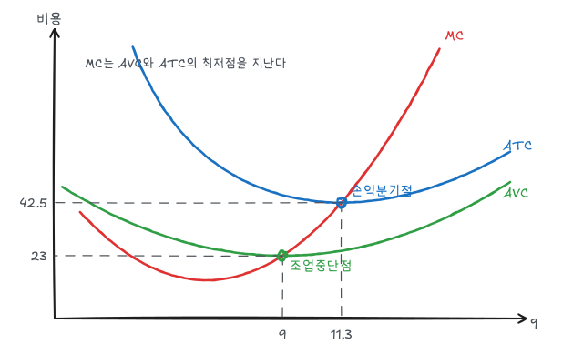
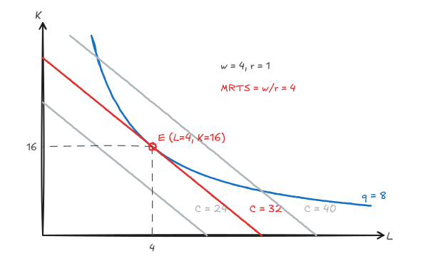
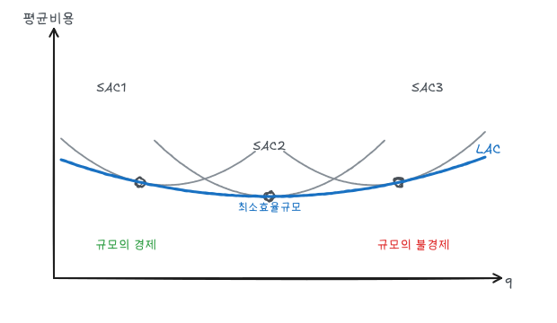

비용이론은 [생산](/posts/micro-production)에 요소가격을 결합한 것이다. 같은 산출량을 만드는 여러 요소 조합 중 가장 싼 조합을 찾고, 산출량에 따라 비용이 어떻게 변하는지 본다.

## 1. 비용의 개념

| 개념 | 내용 |
|---|---|
| 회계적 비용 | 실제 지출과 감가상각 |
| 경제적 비용 | 회계적 비용 + 기회비용 (자기 소유 건물의 임대료, 사장 본인의 포기한 임금 등) |
| 매몰비용 | 이미 지출되어 회수할 수 없는 비용. 앞으로의 의사결정에서 무시한다 |
| 고정비용(FC) | 산출량과 무관, 생산을 멈춰도 발생 (단, 사업을 접으면 피할 수 있음) |
| 가변비용(VC) | 산출량에 따라 변함 |

고정비용과 매몰비용은 다르다. 공장 임대료는 고정비용이지만 계약을 끝내면 피할 수 있다. 특수 장비 구입비는 다른 용도로 팔 수 없으면 매몰비용이다.

## 2. 단기 비용곡선

$$
TC = FC + VC(q)
$$

$$
AFC = \frac{FC}{q},\quad AVC = \frac{VC}{q},\quad ATC = AFC + AVC,\quad MC = \frac{dTC}{dq} = \frac{dVC}{dq}
$$

고정비용은 미분하면 사라지므로 MC는 FC와 무관하다.

### 예제

$$
VC = \tfrac13 q^3 - 6q^2 + 50q, \qquad FC = 200
$$

$$
MC = q^2 - 12q + 50, \quad AVC = \tfrac13 q^2 - 6q + 50, \quad ATC = AVC + \frac{200}{q}
$$

| 지점 | 계산 | 결과 |
|---|---|---|
| MC 최저 | $2q - 12 = 0$ | $q = 6$, $MC = 14$ |
| AVC 최저 | $\frac23 q - 6 = 0$ | $q = 9$, $AVC = 23 = MC(9)$ |
| ATC 최저 | $MC = ATC$ 수치해 | $q \approx 11.3$, $ATC \approx 42.5$ |

### 평균과 한계의 관계

- $MC < AVC$이면 AVC가 감소하고, $MC > AVC$이면 AVC가 증가한다. 따라서 **MC는 AVC와 ATC의 최저점을 통과한다**.
- AVC 최저점 위에서 $MC = AVC$이고, ATC 최저점은 그보다 오른쪽(q ≈ 11.3)에 있다. AFC가 계속 줄어들기 때문에 ATC는 AVC보다 늦게 최저점에 도달한다.
- 산출이 늘수록 ATC와 AVC의 간격(=AFC)은 좁아진다.

### 생산과 비용의 대응

노동만 가변요소이고 임금이 $w$이면 $VC = wL$이므로

$$
MC = \frac{w\,\Delta L}{\Delta q} = \frac{w}{MP_L}, \qquad AVC = \frac{wL}{q} = \frac{w}{AP_L}
$$

MP가 증가하는 구간에서 MC가 감소하고, 수확체감이 시작되면 MC가 증가한다. AP 최대점이 AVC 최저점에 대응한다. 비용곡선의 U자 모양은 생산함수의 수확체감에서 나온다.

## 3. 장기: 비용최소화

### 등비용선

$$
C = wL + rK \quad\Leftrightarrow\quad K = \frac{C}{r} - \frac{w}{r}L
$$

기울기는 $-w/r$이다. 자본의 사용자비용 $r$에는 이자의 기회비용과 감가상각이 포함된다. 자본을 직접 소유해도 대여료만큼의 기회비용이 있다.

### 최소비용 조건

주어진 산출량 $\bar q$를 가장 싸게 생산하는 점은 등량곡선과 가장 낮은 등비용선의 접점이다.

$$
MRTS = \frac{MP_L}{MP_K} = \frac{w}{r}
\quad\Leftrightarrow\quad
\frac{MP_L}{w} = \frac{MP_K}{r}
$$

1원당 한계생산이 모든 요소에서 같아야 한다.

### 예제

$q = \sqrt{KL}$, $w = 4$, $r = 1$, 목표 산출량 $q = 8$.

$$
MRTS = \frac{K}{L} = \frac{4}{1} \Rightarrow K = 4L, \qquad \sqrt{4L^2} = 8 \Rightarrow L = 4,\ K = 16
$$

$$
C^* = 4(4) + 1(16) = 32
$$

비용 24의 등비용선은 q = 8 등량곡선에 닿지 않고, 비용 40의 등비용선은 등량곡선을 두 번 자르므로 비용을 더 줄일 수 있다.

임금이 4에서 1로 내리면 $K/L = 1$이 되어 $L = K = 8$, 비용은 16이다. 상대적으로 싸진 노동을 더 쓰는 방향으로 요소 대체가 일어난다.

### 라그랑지 풀이와 승수의 의미

$$
\mathcal L = wL + rK - \mu\,(\sqrt{KL} - \bar q)
$$

에서 $\mu$는 산출량 한 단위를 더 생산하는 데 드는 비용, 즉 **장기 한계비용**이다. 예제에서 $q = \sqrt{KL}$, $w = 4$, $r = 1$이면 장기 총비용은 $C(q) = 4q$이므로 $\mu = LMC = 4$이다.

### 확장경로

요소가격을 고정하고 산출량을 바꿀 때 비용최소점들을 이은 선이다. 예제에서는 항상 $K = 4L$이므로 원점에서 뻗는 직선이다. 확장경로에서 각 산출량의 최소비용을 읽으면 장기 총비용곡선 $LTC(q)$가 된다.

## 4. 장기 평균비용과 규모의 경제

| 구분 | 의미 | LAC |
|---|---|---|
| 규모의 경제 | 산출을 2배로 늘릴 때 비용이 2배 미만 | 감소 |
| 규모의 불경제 | 산출을 2배로 늘릴 때 비용이 2배 초과 | 증가 |

규모의 경제는 규모수익보다 넓은 개념이다. 요소 비율이 바뀌거나 대량 구매로 요소가격이 내려가는 효과도 포함한다. 비용-산출 탄력성으로 측정한다.

$$
E_C = \frac{\Delta C / C}{\Delta q / q} = \frac{MC}{AC}
$$

$E_C < 1$이면 규모의 경제, $E_C > 1$이면 규모의 불경제다.

### 장기 평균비용은 단기 평균비용의 포락선

장기에는 산출량마다 최적 공장 규모를 선택할 수 있다. 각 공장 규모의 SAC 중 가장 낮은 부분을 이으면 LAC가 된다.

아래 그림은 $LAC = 14 + 0.03(q - 15)^2$와 $q = 6, 15, 24$에서 LAC에 접하는 세 SAC를 그린 것이다.

- LAC가 감소하는 구간(규모의 경제)에서는 SAC1이 **자신의 최저점보다 왼쪽**에서 LAC와 접한다. 작은 산출량을 만들 때도 약간 큰 공장을 덜 가동하는 것이 유리하다.
- LAC 최저점(최소효율규모, $q = 15$)에서만 SAC2의 최저점과 LAC가 접한다.
- LAC가 증가하는 구간에서는 SAC3의 최저점보다 오른쪽에서 접한다.
- 단기에는 공장 규모를 바꿀 수 없으므로 $SAC \ge LAC$이다.

## 5. 범위의 경제와 학습곡선

**범위의 경제**는 두 제품을 한 기업이 함께 생산하는 비용이 따로 생산하는 비용의 합보다 작은 경우다.

$$
SC = \frac{C(q_1) + C(q_2) - C(q_1, q_2)}{C(q_1, q_2)}
$$

$SC > 0$이면 범위의 경제다. 자동차와 트럭처럼 설비와 인력을 공유할 수 있으면 나타난다.

**학습곡선**은 누적 생산량이 늘수록 단위당 투입이 줄어드는 현상이다. 노동자의 숙련, 공정 개선이 원인이다. 규모의 경제(한 시점의 생산량에 따른 비용)와 달리 누적 경험에 따른 비용 하락이다. 신규 진입 초기의 비용 하락을 규모의 경제로 착각하면 무리한 증설을 하게 된다.

## 정리

| 개념 | 식 / 조건 | 예제 |
|---|---|---|
| MC와 AVC | MC가 AVC 최저점 통과 | $q = 9$, 23 |
| MC와 ATC | MC가 ATC 최저점 통과 | $q \approx 11.3$, 42.5 |
| 생산과 비용 | $MC = w/MP_L$, $AVC = w/AP_L$ | |
| 비용최소화 | $MRTS = w/r$ | $L = 4$, $K = 16$, $C = 32$ |
| 장기 비용 | LAC는 SAC의 포락선 | 최소효율규모 $q = 15$ |
| 규모의 경제 | $E_C = MC/AC < 1$ | |
