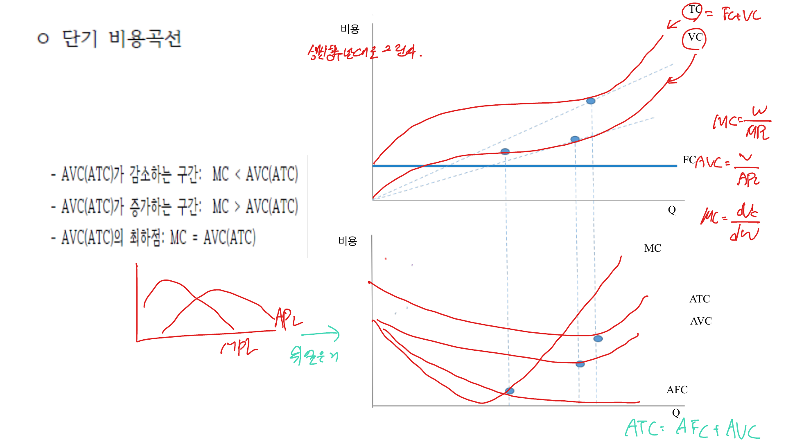
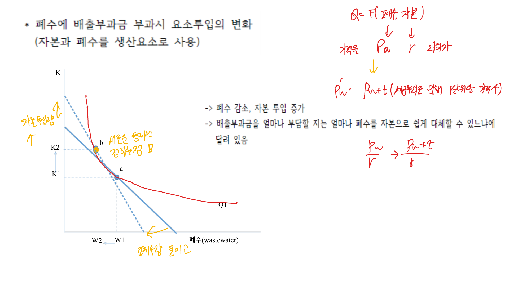

비용이론은 생산기술과 요소가격이 주어졌을 때 기업이 산출량을 생산하는 데 드는 최소비용을 설명한다. 생산이론이 물리적 투입-산출 관계를 다룬다면, 비용이론은 그 관계에 가격을 붙인다.

## 1. 비용의 종류

총비용은 고정비용과 가변비용의 합이다.

$$
TC(Q) = FC + VC(Q)
$$

고정비용은 산출량과 무관하게 드는 비용이고, 가변비용은 산출량에 따라 변하는 비용이다. 단기에는 일부 생산요소가 고정되어 있으므로 고정비용이 존재한다. 장기에는 모든 요소를 조정할 수 있으므로 고정비용과 가변비용의 구분이 약해진다.

평균비용과 한계비용은 다음과 같다.

$$
AC = \frac{TC}{Q}
$$

$$
AVC = \frac{VC}{Q}
$$

$$
AFC = \frac{FC}{Q}
$$

$$
MC = \frac{dTC}{dQ} = \frac{dVC}{dQ}
$$

 

 

## 2. 평균비용과 한계비용의 관계

한계비용이 평균비용보다 낮으면 평균비용은 하락하고, 한계비용이 평균비용보다 높으면 평균비용은 상승한다. 따라서 한계비용곡선은 평균비용곡선의 최저점을 지난다.

$$
MC < AC \Rightarrow AC \downarrow
$$

$$
MC > AC \Rightarrow AC \uparrow
$$

$$
MC = AC \Rightarrow AC \text{ 최소}
$$

같은 논리로 한계비용곡선은 평균가변비용곡선의 최저점도 지난다.

## 3. 비용과 생산성

단기에서 자본이 고정되고 노동만 변한다고 하자. 임금이 $w$이면 가변비용은 $VC = wL$이다. 노동의 한계생산물이 높을수록 산출량 한 단위를 추가로 만들기 위해 필요한 노동이 적으므로 한계비용은 낮아진다.

$$
MC = \frac{w}{MP_L}
$$

평균가변비용도 평균생산물과 반대 관계를 가진다.

$$
AVC = \frac{w}{AP_L}
$$

즉 생산성 곡선의 모양은 비용곡선의 모양과 연결된다.

## 4. 등비용선

노동 가격이 $w$, 자본 가격이 $r$, 총비용이 $C$이면 등비용선은 다음과 같다.

$$
wL + rK = C
$$

기울기는 요소가격비율이다.

$$
\frac{dK}{dL} = -\frac{w}{r}
$$

등비용선은 같은 비용으로 구입할 수 있는 노동과 자본 조합을 나타낸다.

## 5. 비용최소화

주어진 산출량 $\bar Q$를 최소비용으로 생산하려면 등량곡선과 등비용선이 접해야 한다.

$$
MRTS_{LK} = \frac{w}{r}
$$

생산물의 한계생산물로 쓰면

$$
\frac{MP_L}{MP_K} = \frac{w}{r}
$$

정리하면 각 생산요소에 지출한 1원당 한계생산물이 같아야 한다.

$$
\frac{MP_L}{w} = \frac{MP_K}{r}
$$

한쪽 요소의 원당 한계생산물이 더 크면 그 요소를 더 쓰고 다른 요소를 줄여 비용을 낮출 수 있다.

 

 

## 6. 장기비용과 규모의 경제

장기평균비용은 각 산출량을 생산하는 최소비용을 산출량으로 나눈 것이다. 장기에는 설비 규모를 선택할 수 있으므로 단기평균비용곡선들의 포락선으로 이해할 수 있다.

장기평균비용이 하락하는 구간은 규모의 경제, 상승하는 구간은 규모의 불경제다.

- 규모의 경제: 산출량 증가 시 평균비용 하락
- 규모수익 불변에 가까운 구간: 평균비용이 거의 일정
- 규모의 불경제: 산출량 증가 시 평균비용 상승

규모의 경제는 전문화, 대량생산, 고정비용 분산 등에서 발생한다. 규모의 불경제는 관리비용 증가, 조직 복잡성, 조정비용 증가 때문에 나타날 수 있다.

## 정리

비용곡선은 생산기술과 요소가격이 결합된 결과다. 단기에는 고정요소 때문에 비용곡선이 제약을 받지만, 장기에는 모든 요소를 조정해 비용최소화가 가능하다. 비용최소화 조건은 $MRTS = w/r$이며, 이는 이후 기업의 공급결정과 시장균형 분석의 기초가 된다.
