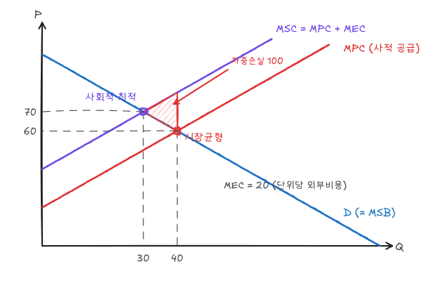
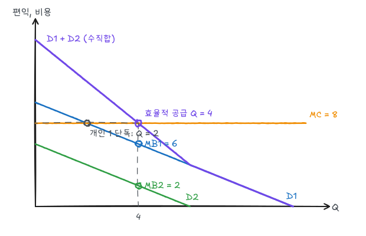

[일반균형](/posts/micro-general-equilibrium-efficiency)의 효율 조건은 시장가격이 모든 비용과 편익을 반영할 때 성립한다. 가격에 반영되지 않는 비용·편익이 있으면 경쟁시장도 비효율적이다.

## 1. 외부효과

한 경제주체의 행동이 다른 주체에게 영향을 주는데 그 영향이 시장가격에 반영되지 않는 것이다.

| 유형 | 예 | 결과 |
|---|---|---|
| 부정적 생산 외부효과 | 공장 폐수, 매연 | 과잉생산 |
| 부정적 소비 외부효과 | 흡연, 소음 | 과잉소비 |
| 긍정적 생산 외부효과 | 양봉업자와 과수원 | 과소생산 |
| 긍정적 소비 외부효과 | 백신 접종, 주택 정원 가꾸기 | 과소소비 |

### 부정적 외부효과의 예제

$$
\text{수요(한계사회편익)}: P = 100 - Q, \qquad \text{한계사적비용 } MPC = 20 + Q
$$

생산 1단위가 주변에 20의 피해(한계외부비용 $MEC = 20$)를 준다.

$$
MSC = MPC + MEC = 40 + Q
$$

| | 조건 | 수량 | 가격 |
|---|---|---|---|
| 시장균형 | $D = MPC$ | 40 | 60 |
| 사회적 최적 | $D = MSC$ | 30 | 70 |

시장은 사회적 최적보다 10단위 많이 생산한다. 30번째에서 40번째 단위까지는 사회적 비용이 편익보다 크다. 자중손실은 $Q = 30$~$40$ 구간에서 MSC와 수요곡선 사이의 삼각형이다.

$$
DWL = \tfrac12 \times (40 - 30) \times (80 - 60) = 100
$$

긍정적 외부효과는 반대다. 한계외부편익(MEB)만큼 사회적 편익이 수요곡선보다 위에 있으므로 시장이 과소 생산한다. 보조금이 대응 수단이다.

## 2. 외부효과의 교정

### 피구세

단위당 세금을 MEC와 같게(20) 부과하면 기업의 비용이 MSC와 같아져 시장이 스스로 $Q = 30$을 선택한다. 세금이 외부비용을 **내부화**한다.

### 배출기준과 배출부과금

공해 배출량 감축으로 보면, 사회적 최적 배출량은 **한계감축비용(MCA) = 한계사회피해(MSC)**가 되는 점이다.

| 수단 | 방식 | 특징 |
|---|---|---|
| 배출기준 | 배출량 상한을 법으로 정함 | 배출량이 확실함, 감축비용이 불확실 |
| 배출부과금 | 배출 단위당 요금 | 감축비용이 확실함, 배출량이 불확실 |

한계감축비용곡선이 가파르고 한계사회피해곡선이 평평하면 부과금이, 피해곡선이 가파르면(적은 초과 배출도 큰 피해) 기준이 낫다.

부과금의 또 다른 장점은 **감축비용이 기업마다 다를 때** 같은 총감축을 더 싸게 달성한다는 것이다. 모든 기업이 같은 요금을 마주하므로 한계감축비용이 같아질 때까지 감축하기 때문이다.

### 배출권 거래제

두 기업이 총 30단위를 감축해야 한다. 감축비용은

$$
C_1 = a_1^2 \;(MCA_1 = 2a_1), \qquad C_2 = \tfrac12 a_2^2 \;(MCA_2 = a_2)
$$

| 방식 | 감축 $(a_1, a_2)$ | 총비용 |
|---|---|---|
| 동일 기준 (각 15) | 15, 15 | $225 + 112.5 = 337.5$ |
| 비용최소 ($MCA_1 = MCA_2$) | 10, 20 | $100 + 200 = 300$ |

비용최소 조건 $2a_1 = a_2$, $a_1 + a_2 = 30$에서 $a_1 = 10$, $a_2 = 20$, 공통 한계감축비용은 20이다.

배출권을 발행해 거래를 허용하면 감축비용이 높은 기업 1이 기업 2에게서 배출권을 산다. 배출권 가격은 20이 되고, 각 기업은 $MCA = 20$이 되도록 감축한다. 정부가 기업별 비용을 몰라도 시장이 비용최소 배분을 찾아낸다. 배출부과금 20을 매겨도 같은 결과다.

### 재활용

쓰레기 처리의 한계사회비용이 사적 비용보다 크면 가계는 과다 배출한다. 종량제 봉투나 용기 보증금(빈병 보증금)은 배출 단위에 가격을 매겨 재활용을 늘린다.

## 3. 재산권과 코즈 정리

**재산권**이 명확히 정의되고 **거래비용이 작으면**, 재산권을 누구에게 주든 당사자 간 협상으로 효율적 결과에 도달한다.

### 예제

강 상류 공장과 하류 어민. 공장이 필터를 설치하면 비용 100이 들고, 오염되면 어민 이윤이 200 줄어든다.

| | 공장 이윤 | 어민 이윤 | 합계 |
|---|---|---|---|
| 필터 없음 | 500 | 100 | 600 |
| 필터 설치 | 400 | 300 | **700** |

필터 설치가 효율적이다.

- **어민이 깨끗한 물에 대한 권리를 가짐**: 공장은 필터(100)를 설치하든 피해(200)를 배상하든 해야 하므로 필터를 설치한다.
- **공장이 오염할 권리를 가짐**: 어민이 공장에 100~200 사이 금액을 지불하고 필터 설치를 요청한다. 어민은 200의 피해를 피하고 공장은 100의 비용을 보전받으므로 둘 다 이득이다.

어느 경우든 필터가 설치된다. 재산권 배분은 **효율이 아니라 분배**만 바꾼다.

코즈 정리가 성립하기 어려운 경우:
- 당사자가 많아 협상 비용이 큼 (대기오염의 피해자 수백만 명)
- 상대의 비용·편익을 모르는 전략적 행동
- 불완전한 소송 제도

## 4. 공유자원

누구나 자유롭게 이용할 수 있는 자원(어장, 공유 목초지, 지하수)이다. 각 이용자는 자신의 사적 비용만 고려하고 다른 이용자에게 주는 비용(자원 고갈)은 무시하므로 **과다 이용**된다. 이를 **공유자원의 비극**이라 한다.

공유자원의 한계사회비용은 사적 비용 + 다른 사람의 이용 감소분이다. 효율적 이용량은 이 사회적 비용과 한계편익이 같아지는 점으로, 자유 이용량보다 적다. 대응은 단일 소유자에게 소유권 부여, 어획 쿼터, 이용료 부과다.

## 5. 공공재

| | 배제 가능 | 배제 불가능 |
|---|---|---|
| **경합적** | 사적재 (음식, 옷) | 공유자원 (어장) |
| **비경합적** | 클럽재 (케이블 TV, 유료 도로) | **공공재** (국방, 등대, 가로등) |

- **비경합성**: 한 사람이 추가로 소비해도 다른 사람의 소비가 줄지 않는다. 추가 소비자의 한계비용이 0이다.
- **비배제성**: 대가를 내지 않은 사람을 소비에서 배제할 수 없다.

### 효율적 공급: 수직합

사적재의 시장수요는 같은 가격에서 수량을 더하는 수평합이다. 공공재는 모든 사람이 **같은 수량**을 소비하므로, 한 단위 추가의 사회적 편익은 각자의 한계편익을 더한 **수직합**이다.

$$
\sum_i MB_i(Q) = MC
$$

예제: 두 사람의 한계편익이 $MB_1 = 10 - Q$, $MB_2 = 6 - Q$이고 공공재의 한계비용이 8이다.

$$
MB_1 + MB_2 = 16 - 2Q \;(Q \le 6), \qquad 16 - 2Q = 8 \;\Rightarrow\; Q^* = 4
$$

$Q = 4$에서 개인 1의 한계편익은 6, 개인 2는 2로 합이 MC와 같다. 각자가 자기 한계편익만큼 부담하면(**린달 가격**) 효율적 공급을 비용분담으로 달성할 수 있다.

### 무임승차

시장에 맡기면 각자 자기 편익만 보고 구매한다. 개인 1은 $10 - Q = 8$인 $Q = 2$까지만 사고, 개인 2는 한계편익이 처음부터 8보다 작아 사지 않는다. 오히려 개인 1이 산 2단위를 공짜로 즐긴다. 공급량은 2로 효율적 수준 4에 못 미친다.

비배제성 때문에 각자 남의 기여에 **무임승차**하려 하고 선호를 감추므로, 공공재는 시장에서 과소 공급된다. 정부가 세금으로 공급하는 이유다. 다만 정부도 각자의 한계편익을 알기 어렵다.

## 6. 공공재 공급과 투표

다수결 투표로 공공재 지출을 결정하면 결과는 **중위투표자**가 원하는 수준이 된다. 중위투표자의 선호보다 많은 지출안이나 적은 지출안은 과반수를 얻지 못하기 때문이다.

중위투표자의 선호는 평균 선호와 다를 수 있으므로 다수결의 결과가 효율적 수준(수직합 = MC)과 일치한다는 보장이 없다. 소득과 선호의 분포가 비대칭이면 과다 또는 과소 공급이 일어난다.

## 정리

| 개념 | 조건 / 내용 | 예제 |
|---|---|---|
| 부정적 외부효과 | 시장 $D = MPC$, 최적 $D = MSC$ | $Q$: 40 → 30, $DWL = 100$ |
| 피구세 | $t = MEC$ | 20 |
| 배출권 거래 | $MCA_1 = MCA_2 = $ 배출권 가격 | (10, 20), 비용 300 |
| 코즈 정리 | 재산권 + 낮은 거래비용 → 효율적 협상 | 필터 설치 |
| 공유자원 | 사적 비용만 고려 → 과다 이용 | |
| 공공재 효율 | $\sum MB_i = MC$ | $Q^* = 4$ |
| 무임승차 | 시장 공급 < 효율 수준 | 2 < 4 |
| 중위투표자 | 다수결은 중위 선호를 따름 | |
