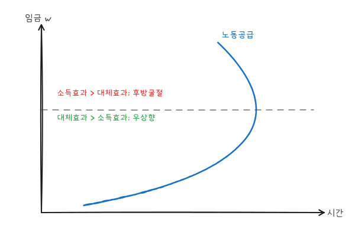
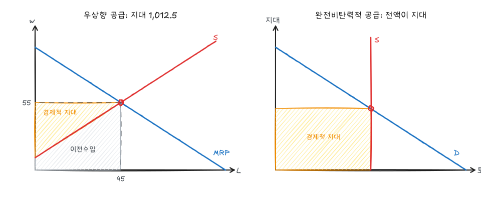
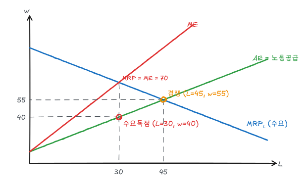
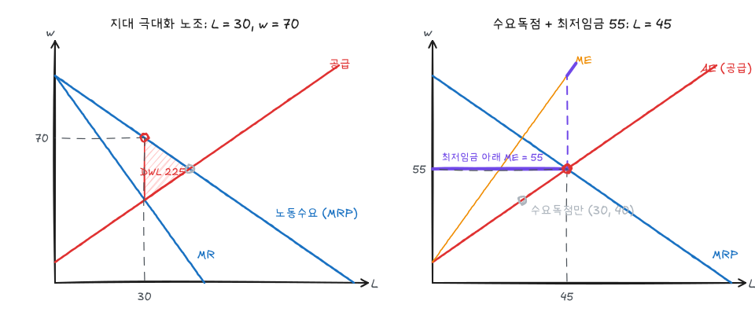

노동·자본·원자재 같은 생산요소의 가격과 고용량이 어떻게 결정되는지 다룬다. 요소에 대한 수요는 그 요소로 만드는 상품 수요에서 파생되는 **파생수요**다.

## 1. 요소수요: 한계수입생산

노동 한 단위를 더 고용해서 얻는 추가 수입이 **한계수입생산**(MRP)이다.

$$
MRP_L = MR \times MP_L
$$

| 상품시장 | MRP |
|---|---|
| 완전경쟁 ($MR = P$) | $P \times MP_L$ (한계생산가치, $VMP_L$) |
| 독점 ($MR < P$) | $MR \times MP_L < P \times MP_L$ |

요소시장이 경쟁적이면 기업은 임금 $w$를 주어진 것으로 보고

$$
MRP_L = w
$$

에서 고용한다. 이는 [완전경쟁기업](/posts/micro-perfect-competition)의 $P = MC$와 같은 조건이다. $MC = w/MP_L$이므로 $P = w/MP_L \Leftrightarrow P \times MP_L = w$이다.

수확체감 때문에 MRP는 우하향하고, 단기 노동수요곡선이 된다.

### 가변요소가 여럿일 때

임금이 내리면 노동을 더 쓰고, 그에 따라 자본의 한계생산이 올라 자본도 늘어난다. 자본 증가가 다시 노동의 MP를 올리므로, 장기 노동수요는 단기 MRP 곡선보다 **더 탄력적**이다.

### 산업의 요소수요

임금이 내려 모든 기업이 고용과 생산을 늘리면 시장 공급이 늘어 상품가격이 하락한다. 가격 하락으로 각 기업의 MRP가 왼쪽으로 이동하므로, 산업의 노동수요는 개별 기업 수요의 단순 합보다 **덜 탄력적**이다.

## 2. 경쟁적 요소시장의 균형

예제 노동시장:

$$
MRP_L = 100 - L \;(\text{수요}), \qquad w = 10 + L \;(\text{공급})
$$

경쟁균형은 $100 - L = 10 + L$에서

$$
L_c = 45, \qquad w_c = 55
$$

이다. 이때 마지막 노동자가 만들어내는 가치(MRP = 55)가 그가 받는 임금과 같다.

## 3. 노동공급

노동자는 하루 24시간을 여가와 노동으로 나눈다. 여가 1시간의 기회비용이 시간당 임금 $w$이다. 임금이 오를 때

- **대체효과**: 여가가 비싸지므로 여가를 줄이고 더 일한다.
- **소득효과**: 소득이 늘어 정상재인 여가를 더 원한다 → 덜 일한다.

낮은 임금 구간에서는 대체효과가 커서 노동공급이 우상향하지만, 임금이 충분히 높아지면 소득효과가 커져 노동공급이 감소할 수 있다. 이것이 **후방굴절 노동공급곡선**이다.

점선 아래의 임금에서는 임금이 오를수록 노동시간이 늘고, 점선 위에서는 오히려 줄어든다. 꺾이는 점은 임금 상승의 대체효과와 소득효과가 정확히 상쇄되는 임금이다. 개인의 노동공급이 꺾여도 시장 노동공급은 새로운 사람의 진입 때문에 대개 우상향한다.

## 4. 경제적 지대

요소 소유자가 받는 금액 중 그 요소를 그 용도에 공급하게 만드는 데 필요한 최소금액(이전수입)을 초과하는 부분이다. 공급곡선 위, 가격 아래 면적이다.

예제 경쟁균형에서

$$
\text{경제적 지대} = \tfrac12 \times 45 \times (55 - 10) = 1{,}012.5
$$

공급이 완전비탄력적인 요소(토지, 특별한 재능)는 받는 금액 전체가 경제적 지대다. 비옥한 땅에 있는 농장의 회계적 이윤은 장기에 토지 지대로 흡수되어 경제적 이윤이 0이 된다.

왼쪽에서 노동자가 받는 임금총액 $55 \times 45$ 중 공급곡선 아래(회색)는 각 노동자를 일하게 하는 데 필요한 최소 금액, 즉 이전수입이고, 그 위의 노란 삼각형이 경제적 지대다. 오른쪽처럼 공급이 완전비탄력적이면 가격이 아무리 낮아도 공급량이 같으므로 이전수입이 0이고 받는 금액 전체가 지대다. 이 경우 지대에 세금을 매겨도 공급량이 줄지 않으므로 효율 손실이 없다.

## 5. 수요독점 노동시장

한 지역의 유일한 고용주처럼 구매자가 시장지배력을 가지면 공급곡선 $w = 10 + L$이 **평균지출**(AE)이 된다. 한 명 더 고용하려면 임금을 올려야 하고, 그 인상은 기존 노동자 모두에게 적용된다.

$$
E = wL = (10 + L)L, \qquad ME = \frac{dE}{dL} = 10 + 2L
$$

수요독점자는 $MRP = ME$에서 고용하고, 공급곡선이 허용하는 최저 임금을 지급한다.

$$
100 - L = 10 + 2L \;\Rightarrow\; L_m = 30, \qquad w_m = 10 + 30 = 40
$$

| | 경쟁 | 수요독점 |
|---|---|---|
| 고용 | 45 | 30 |
| 임금 | 55 | 40 |
| 마지막 노동자의 MRP | 55 | 70 |

수요독점에서는 마지막 노동자의 MRP(70)가 임금(40)보다 크다. 노동자는 자기 생산 가치보다 적게 받는다.

### 잉여 비교

| | 경쟁 | 수요독점 | 변화 |
|---|---|---|---|
| 노동자 잉여 (공급곡선 위, 임금 아래) | $\frac12(45)(45) = 1{,}012.5$ | $\frac12(30)(30) = 450$ | −562.5 |
| 고용주 잉여 (MRP 아래, 임금 위) | $\frac12(45)(45) = 1{,}012.5$ | $\frac{(100 + 70)}{2}(30) - 40(30) = 1{,}350$ | +337.5 |
| 총잉여 | 2,025 | 1,800 | **−225** |

자중손실은 $L = 30$에서 45 사이, MRP와 공급곡선 사이 삼각형으로 $\frac12 \times 15 \times (70 - 40) = 225$이다.

### 최저임금의 역할

수요독점 시장에서는 적절한 최저임금이 고용을 **늘릴** 수 있다. 최저임금을 55로 정하면 고용주는 55 미만으로 임금을 줄 수 없으므로 $L = 45$까지 ME가 55인 수평선이 된다. 고용주는 $MRP = 55$인 45명을 고용한다. 경쟁 결과가 회복된다. 최저임금이 40에서 55 사이이면 고용과 임금이 모두 수요독점보다 높다.

## 6. 공급독점: 노동조합

노동조합은 노동 공급의 독점자처럼 행동한다. 노동수요곡선 $w = 100 - L$을 시장수요로 보면 목표에 따라 결과가 달라진다.

| 목표 | 조건 | 예제 결과 |
|---|---|---|
| 고용 극대화 | 경쟁 결과 | $L = 45$, $w = 55$ |
| 임금총액 극대화 | 노동수요의 $MR = 0$ ($100 - 2L = 0$) | 제약 없으면 $L = 50$, $w = 50$이지만 임금 50에서는 40명만 일하려 하므로 공급 제약 안의 최대인 $L = 45$, $w = 55$ |
| 지대 극대화 | 노동수요의 MR = 공급곡선 ($100 - 2L = 10 + L$) | $L = 30$, $w = 70$ |

지대 극대화 노조는 독점기업처럼 고용을 줄이고 임금을 70으로 올린다. 고용된 30명은 이득을 보지만 15명은 일자리를 잃고 비노조 부문으로 이동해 그곳 임금을 낮춘다.

**쌍방독점**(수요독점 고용주 + 노조): 고용주는 임금 40, 노조는 임금 70을 원한다. 결과는 교섭력에 따라 40과 70 사이에서 정해지며 고용은 30~45 사이가 된다(양 끝점 $w=40, 70$에서 $L=30$, 중간 $w=55$에서 $L=45$). 상대의 시장지배력이 서로를 상쇄해 경쟁 결과에 가까워질 수도 있다.

왼쪽에서 노조는 노동수요에 대한 MR이 공급곡선과 만나는 30명을 정하고, 노동수요곡선 위의 임금 70을 요구한다. 빨간 삼각형이 줄어든 고용 15명분의 자중손실 225다. 오른쪽에서 최저임금 55를 두면 45명까지는 한 명 더 고용해도 기존 임금이 오르지 않으므로 한계지출이 55인 수평선이 되고, 그 뒤로 원래 ME로 뛰어오른다. MRP가 이 꺾인 ME와 만나는 45명이 고용되어 경쟁 결과가 회복된다.

## 7. 요소시장 구조의 비교

같은 노동수요 $MRP_L = 100 - L$과 노동공급 $w = 10 + L$에서 시장구조별 결과를 비교한다. 노동자 잉여는 임금 아래·공급곡선 위의 면적, 고용주 잉여는 MRP 아래·임금 위의 면적이다.

| 구조 | 결정 조건 | 고용 | 임금 | 노동자 잉여 | 고용주 잉여 | 총잉여 | 자중손실 |
|---|---|---|---|---|---|---|---|
| 경쟁 | $MRP = $ 공급 | 45 | 55 | 1,012.5 | 1,012.5 | 2,025 | 0 |
| 수요독점 | $MRP = ME$ | 30 | 40 | 450 | 1,350 | 1,800 | 225 |
| 지대 극대화 노조 | 노동수요의 $MR = $ 공급 | 30 | 70 | 1,350 | 450 | 1,800 | 225 |
| 수요독점 + 최저임금 55 | $MRP = 55$ | 45 | 55 | 1,012.5 | 1,012.5 | 2,025 | 0 |
| 쌍방독점 | 교섭 | 30~45 | 40~70 | | | 1,800~2,025 | 0~225 |

수요독점과 지대 극대화 노조는 고용을 똑같이 30으로 줄여 자중손실 225를 낳지만, 잉여를 가져가는 쪽이 반대다. 수요독점은 임금을 공급곡선까지 낮추고, 노조는 수요곡선까지 올린다. 수요독점 시장의 최저임금은 한계지출곡선을 수평으로 만들어 고용을 경쟁 수준으로 되돌린다. 경쟁시장의 최저임금이 고용을 줄이는 것과 반대다.

## 정리

| 개념 | 식 | 예제 |
|---|---|---|
| 요소수요 | $MRP_L = MR \times MP_L$ | $100 - L$ |
| 경쟁 고용 | $MRP = w$ | $L = 45$, $w = 55$ |
| 경제적 지대 | 공급곡선 위, 가격 아래 | 1,012.5 |
| 수요독점 | $MRP = ME$, 임금은 공급곡선에서 | $L = 30$, $w = 40$ |
| 수요독점 자중손실 | | 225 |
| 지대 극대화 노조 | $MR_{\text{수요}} = $ 공급 | $L = 30$, $w = 70$ |
