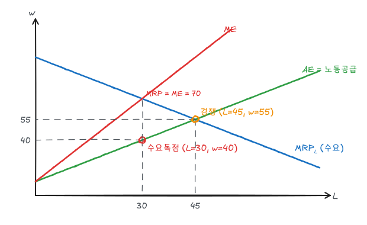

노동·자본·원자재 같은 생산요소의 가격과 고용량이 어떻게 결정되는지 다룬다. 요소에 대한 수요는 그 요소로 만드는 상품 수요에서 파생되는 **파생수요**다.

## 1. 요소수요: 한계수입생산

노동 한 단위를 더 고용해서 얻는 추가 수입이 **한계수입생산**(MRP)이다.

$$
MRP_L = MR \times MP_L
$$

| 상품시장 | MRP |
|---|---|
| 완전경쟁 ($MR = P$) | $P \times MP_L$ (한계생산가치, $VMP_L$) |
| 독점 ($MR < P$) | $MR \times MP_L < P \times MP_L$ |

요소시장이 경쟁적이면 기업은 임금 $w$를 주어진 것으로 보고

$$
MRP_L = w
$$

에서 고용한다. 이는 [완전경쟁기업](/posts/micro-perfect-competition)의 $P = MC$와 같은 조건이다. $MC = w/MP_L$이므로 $P = w/MP_L \Leftrightarrow P \times MP_L = w$이다.

수확체감 때문에 MRP는 우하향하고, 단기 노동수요곡선이 된다.

### 가변요소가 여럿일 때

임금이 내리면 노동을 더 쓰고, 그에 따라 자본의 한계생산이 올라 자본도 늘어난다. 자본 증가가 다시 노동의 MP를 올리므로, 장기 노동수요는 단기 MRP 곡선보다 **더 탄력적**이다.

### 산업의 요소수요

임금이 내려 모든 기업이 고용과 생산을 늘리면 시장 공급이 늘어 상품가격이 하락한다. 가격 하락으로 각 기업의 MRP가 왼쪽으로 이동하므로, 산업의 노동수요는 개별 기업 수요의 단순 합보다 **덜 탄력적**이다.

## 2. 경쟁적 요소시장의 균형

예제 노동시장:

$$
MRP_L = 100 - L \;(\text{수요}), \qquad w = 10 + L \;(\text{공급})
$$

경쟁균형은 $100 - L = 10 + L$에서

$$
L_c = 45, \qquad w_c = 55
$$

이다. 이때 마지막 노동자가 만들어내는 가치(MRP = 55)가 그가 받는 임금과 같다.

## 3. 노동공급

노동자는 하루 24시간을 여가와 노동으로 나눈다. 여가 1시간의 기회비용이 시간당 임금 $w$이다. 임금이 오를 때

- **대체효과**: 여가가 비싸지므로 여가를 줄이고 더 일한다.
- **소득효과**: 소득이 늘어 정상재인 여가를 더 원한다 → 덜 일한다.

낮은 임금 구간에서는 대체효과가 커서 노동공급이 우상향하지만, 임금이 충분히 높아지면 소득효과가 커져 노동공급이 감소할 수 있다. 이것이 **후방굴절 노동공급곡선**이다.

## 4. 경제적 지대

요소 소유자가 받는 금액 중 그 요소를 그 용도에 공급하게 만드는 데 필요한 최소금액(이전수입)을 초과하는 부분이다. 공급곡선 위, 가격 아래 면적이다.

예제 경쟁균형에서

$$
\text{경제적 지대} = \tfrac12 \times 45 \times (55 - 10) = 1{,}012.5
$$

공급이 완전비탄력적인 요소(토지, 특별한 재능)는 받는 금액 전체가 경제적 지대다. 비옥한 땅에 있는 농장의 회계적 이윤은 장기에 토지 지대로 흡수되어 경제적 이윤이 0이 된다.

## 5. 수요독점 노동시장

한 지역의 유일한 고용주처럼 구매자가 시장지배력을 가지면 공급곡선 $w = 10 + L$이 **평균지출**(AE)이 된다. 한 명 더 고용하려면 임금을 올려야 하고, 그 인상은 기존 노동자 모두에게 적용된다.

$$
E = wL = (10 + L)L, \qquad ME = \frac{dE}{dL} = 10 + 2L
$$

수요독점자는 $MRP = ME$에서 고용하고, 공급곡선이 허용하는 최저 임금을 지급한다.

$$
100 - L = 10 + 2L \;\Rightarrow\; L_m = 30, \qquad w_m = 10 + 30 = 40
$$

| | 경쟁 | 수요독점 |
|---|---|---|
| 고용 | 45 | 30 |
| 임금 | 55 | 40 |
| 마지막 노동자의 MRP | 55 | 70 |

수요독점에서는 마지막 노동자의 MRP(70)가 임금(40)보다 크다. 노동자는 자기 생산 가치보다 적게 받는다.

### 잉여 비교

| | 경쟁 | 수요독점 | 변화 |
|---|---|---|---|
| 노동자 잉여 (공급곡선 위, 임금 아래) | $\frac12(45)(45) = 1{,}012.5$ | $\frac12(30)(30) = 450$ | −562.5 |
| 고용주 잉여 (MRP 아래, 임금 위) | $\frac12(45)(45) = 1{,}012.5$ | $\frac{(100 + 70)}{2}(30) - 40(30) = 1{,}350$ | +337.5 |
| 총잉여 | 2,025 | 1,800 | **−225** |

자중손실은 $L = 30$에서 45 사이, MRP와 공급곡선 사이 삼각형으로 $\frac12 \times 15 \times (70 - 40) = 225$이다.

### 최저임금의 역할

수요독점 시장에서는 적절한 최저임금이 고용을 **늘릴** 수 있다. 최저임금을 55로 정하면 고용주는 55 이하로 임금을 줄 수 없으므로 $L = 45$까지 ME가 55인 수평선이 된다. 고용주는 $MRP = 55$인 45명을 고용한다. 경쟁 결과가 회복된다. 최저임금이 40에서 55 사이이면 고용과 임금이 모두 수요독점보다 높다.

## 6. 공급독점: 노동조합

노동조합은 노동 공급의 독점자처럼 행동한다. 노동수요곡선 $w = 100 - L$을 시장수요로 보면 목표에 따라 결과가 달라진다.

| 목표 | 조건 | 예제 결과 |
|---|---|---|
| 고용 극대화 | 경쟁 결과 | $L = 45$, $w = 55$ |
| 임금총액 극대화 | 노동수요의 $MR = 0$ ($100 - 2L = 0$) | 제약 없으면 $L = 50$, $w = 50$이지만 임금 50에서는 40명만 일하려 하므로 공급 제약 안의 최대인 $L = 45$, $w = 55$ |
| 지대 극대화 | 노동수요의 MR = 공급곡선 ($100 - 2L = 10 + L$) | $L = 30$, $w = 70$ |

지대 극대화 노조는 독점기업처럼 고용을 줄이고 임금을 70으로 올린다. 고용된 30명은 이득을 보지만 15명은 일자리를 잃고 비노조 부문으로 이동해 그곳 임금을 낮춘다.

**쌍방독점**(수요독점 고용주 + 노조): 고용주는 임금 40, 노조는 임금 70을 원한다. 결과는 교섭력에 따라 40과 70 사이에서 정해지며 고용은 30 근처다. 상대의 시장지배력이 서로를 상쇄해 경쟁 결과에 가까워질 수도 있다.

## 정리

| 개념 | 식 | 예제 |
|---|---|---|
| 요소수요 | $MRP_L = MR \times MP_L$ | $100 - L$ |
| 경쟁 고용 | $MRP = w$ | $L = 45$, $w = 55$ |
| 경제적 지대 | 공급곡선 위, 가격 아래 | 1,012.5 |
| 수요독점 | $MRP = ME$, 임금은 공급곡선에서 | $L = 30$, $w = 40$ |
| 수요독점 자중손실 | | 225 |
| 지대 극대화 노조 | $MR_{수요} = $ 공급 | $L = 30$, $w = 70$ |
