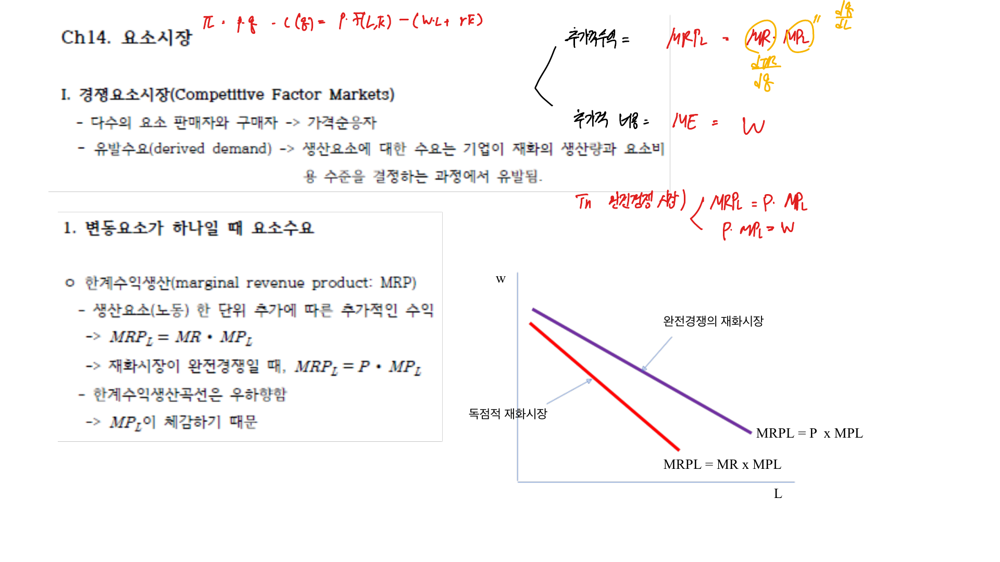
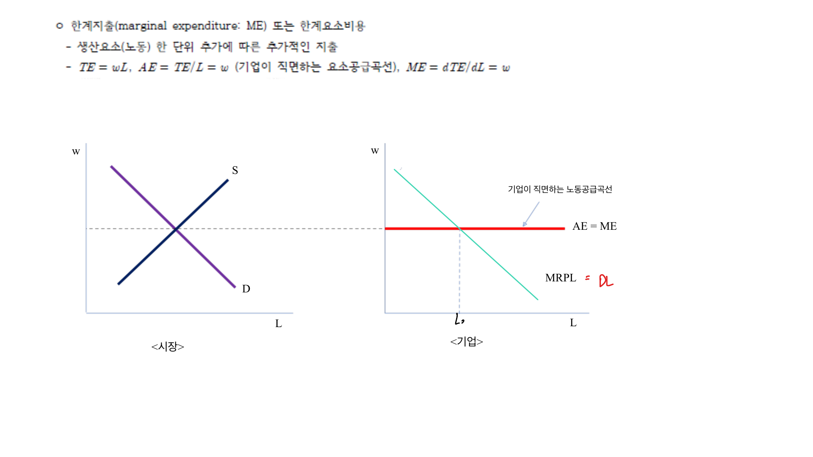

요소시장은 노동, 자본, 토지 같은 생산요소가 거래되는 시장이다. 재화시장에서 소비자가 상품을 수요하듯, 요소시장에서는 기업이 생산요소를 수요한다. 요소수요는 최종재 생산에서 파생되므로 파생수요라고 한다.

## 1. 생산요소 수요

기업은 생산요소를 추가로 고용할 때 얻는 추가수입과 추가비용을 비교한다. 노동 한 단위를 더 고용할 때 추가로 얻는 수입은 한계수입생산(MRP)이다.

$$
MRP_L = MR \times MP_L
$$

완전경쟁 재화시장에서는 $MR = P$이므로

$$
MRP_L = P \times MP_L
$$

독점적 재화시장에서는 $MR < P$이므로 같은 한계생산물이라도 노동수요가 더 작다.

 

 

## 2. 경쟁적 요소시장

노동시장이 완전경쟁이면 개별 기업은 임금 $w$를 주어진 것으로 받아들인다. 노동 한 단위를 추가로 고용하는 비용은 임금이다.

이윤극대화 조건은 다음과 같다.

$$
MRP_L = w
$$

즉 노동의 한계수입생산이 임금보다 크면 노동을 더 고용하고, 임금보다 작으면 고용을 줄인다.

## 3. 노동시장 균형

시장 전체의 노동수요는 기업들의 노동수요를 수평합한 것이다. 노동공급은 가계가 임금에 따라 노동을 얼마나 제공하려 하는지를 나타낸다.

균형임금과 균형고용량은 노동수요와 노동공급이 만나는 곳에서 결정된다.

$$
L^D(w^*) = L^S(w^*)
$$

## 4. 수요독점

수요독점은 요소를 구매하는 쪽이 하나인 시장이다. 노동시장에서는 한 기업이 지역 노동수요의 대부분을 차지하는 경우를 생각할 수 있다.

수요독점 기업은 더 많은 노동을 고용하려면 더 높은 임금을 제시해야 한다. 이때 한계요소비용(ME)은 임금보다 크다.

$$
ME_L > w
$$

수요독점의 고용조건은 다음과 같다.

$$
MRP_L = ME_L
$$

그 결과 경쟁노동시장보다 고용량이 적고 임금도 낮아질 수 있다.

 

 

## 5. 최저임금과 수요독점

완전경쟁 노동시장에서 최저임금이 균형임금보다 높으면 고용이 감소하고 실업이 발생한다.

하지만 수요독점 노동시장에서는 적절한 최저임금이 오히려 고용과 임금을 모두 높일 수 있다. 최저임금이 한계요소비용을 낮추는 효과를 만들기 때문이다.

따라서 최저임금의 효과는 노동시장의 구조에 따라 달라진다.

## 6. 경제적 지대

경제적 지대는 생산요소가 실제로 받는 보수 중 그 요소를 공급하도록 유인하는 데 필요한 최소금액을 초과하는 부분이다.

공급이 완전히 비탄력적인 요소는 보수 대부분이 경제적 지대가 된다. 토지처럼 공급량이 고정된 요소가 대표적이다.

요소공급이 탄력적일수록 지대의 비중은 작아지고, 이전수입의 비중은 커진다.

## 정리

요소수요는 최종재 수요에서 파생된다. 기업은 요소의 한계수입생산과 요소비용을 비교해 고용량을 정한다. 경쟁적 요소시장에서는 $MRP = w$가 성립하지만, 수요독점에서는 $MRP = ME$가 성립하고 고용량과 임금이 경쟁시장보다 낮아질 수 있다.
