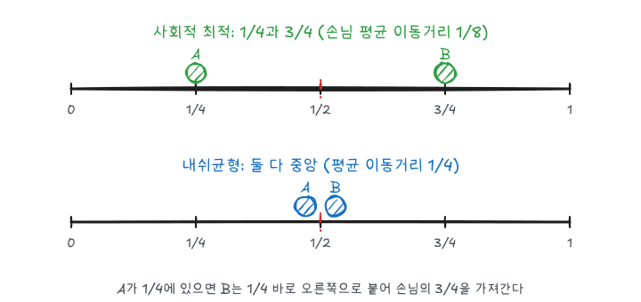
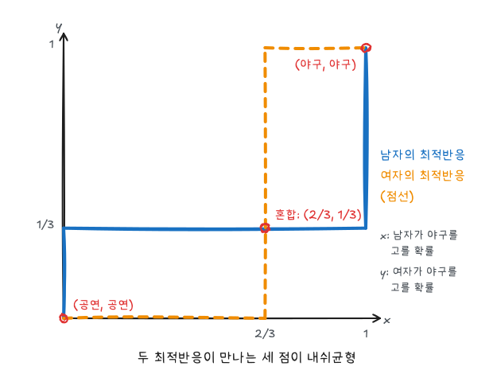
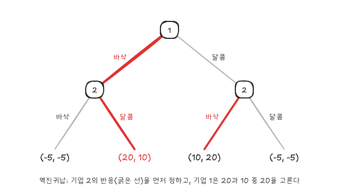
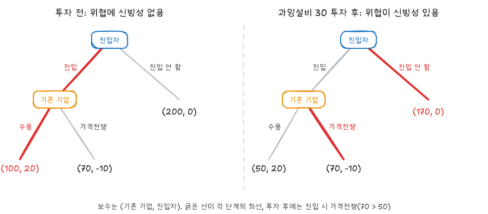

[과점](/posts/micro-monopolistic-competition-oligopoly)에서 본 상호의존적 의사결정을 일반화한 것이 게임이론이다. 게임은 **경기자, 전략, 보수**로 구성된다. 보수표에서 각 칸은 (경기자 1 보수, 경기자 2 보수)다.

## 1. 협조게임과 비협조게임

| 구분 | 특징 |
|---|---|
| 협조게임 | 구속력 있는 계약을 맺을 수 있음 (공동 투자 협상) |
| 비협조게임 | 구속력 있는 계약이 불가능 (경쟁 기업의 가격 결정) |

차이는 경기자가 협조하는지가 아니라 **계약이 가능한지**에 있다. 이 글은 비협조게임을 다룬다.

## 2. 우월전략

상대의 전략과 관계없이 항상 최선인 전략이다.

| | 기업 B: 광고 | 기업 B: 광고 안 함 |
|---|---|---|
| **기업 A: 광고** | 10, 5 | 15, 0 |
| **기업 A: 광고 안 함** | 6, 8 | 10, 2 |

A는 B가 광고하면 10 > 6, 안 하면 15 > 10이므로 광고가 우월전략이다. B도 5 > 0, 8 > 2로 광고가 우월전략이다. **우월전략균형**은 (광고, 광고)다.

## 3. 내쉬균형

모든 경기자에게 우월전략이 있는 것은 아니다. 위 표에서 B의 보수만 바꿔 보자.

| | 기업 B: 광고 | 기업 B: 광고 안 함 |
|---|---|---|
| **기업 A: 광고** | 10, 5 | 15, 0 |
| **기업 A: 광고 안 함** | 6, 8 | 20, 2 |

이제 A는 B가 광고하면 광고(10 > 6), 안 하면 광고 안 함(20 > 15)이 최선으로 우월전략이 없다. B는 여전히 광고가 우월전략이다. A는 B가 광고할 것을 예상하므로 광고를 선택한다. (광고, 광고)는 각자 상대 전략을 주어진 것으로 볼 때 최선이므로 **내쉬균형**이다.

우월전략균형은 "상대가 무엇을 하든 최선", 내쉬균형은 "상대가 하는 것에 대해 최선"이다. 모든 우월전략균형은 내쉬균형이지만 역은 아니다.

### 내쉬균형이 여러 개인 경우

두 기업이 바삭한 과자와 달콤한 과자 중 하나를 고른다. 같은 시장을 고르면 둘 다 손해다.

| | 기업 2: 바삭 | 기업 2: 달콤 |
|---|---|---|
| **기업 1: 바삭** | −5, −5 | 10, 10 |
| **기업 1: 달콤** | 10, 10 | −5, −5 |

(바삭, 달콤)과 (달콤, 바삭) 두 개가 내쉬균형이다. 어느 균형이 실현될지는 게임 밖의 요인(먼저 발표, 관행)에 달려 있다.

**입지 게임**: 해변에서 두 아이스크림 판매자가 위치를 고른다. 손님은 가까운 판매자에게 간다. 한쪽이 중앙에서 벗어나면 상대가 그쪽으로 붙어 손님을 더 가져가므로, 둘 다 해변 **중앙**에 자리 잡는 것이 내쉬균형이다. 손님 입장에서는 양 끝의 1/4 지점에 하나씩 있는 편이 이동거리가 짧지만 균형이 아니다. 정당의 공약이 중도로 수렴하는 현상도 같은 구조다.

두 판매자가 1/4과 3/4에 있으면 손님의 평균 이동거리가 1/8로 가장 짧다. 그러나 이 배치에서 B가 A 바로 오른쪽으로 옮기면 A의 오른쪽 손님을 모두 가져가 점유율이 1/2에서 3/4로 늘어난다. 서로 이런 유인이 있으므로 둘 다 중앙에 모일 때까지 움직이고, 그때 평균 이동거리는 1/4로 두 배가 된다. 내쉬균형이 사회적으로 최선은 아니라는 또 하나의 예다.

## 4. 맥시민 전략

상대가 합리적이지 않을 가능성이 걱정되면 **최악의 경우의 보수를 최대화**하는 전략을 택할 수 있다.

| | 기업 2: 투자 안 함 | 기업 2: 투자 |
|---|---|---|
| **기업 1: 투자 안 함** | 0, 0 | −10, 10 |
| **기업 1: 투자** | −100, 0 | 20, 10 |

기업 2는 투자가 우월전략이다. 이를 예상하면 기업 1은 투자해 20을 얻는다(내쉬균형). 그러나 기업 2가 실수로 투자하지 않으면 −100이다. 기업 1의 최악 보수는 투자 안 함이 −10, 투자가 −100이므로 맥시민 전략은 **투자 안 함**이다. 보수적이지만 큰 손실을 피한다.

## 5. 혼합전략

순수전략 내쉬균형이 없는 게임도 있다. 동전 맞추기:

| | 경기자 B: 앞 | 경기자 B: 뒤 |
|---|---|---|
| **경기자 A: 앞** | 1, −1 | −1, 1 |
| **경기자 A: 뒤** | −1, 1 | 1, −1 |

어느 칸에서도 한 쪽은 바꿀 유인이 있다. 각 전략을 확률적으로 선택하는 **혼합전략**에서는 균형이 존재한다.

B가 앞을 확률 $q$로 낼 때 A의 기대보수는

$$
\text{앞: } q - (1 - q) = 2q - 1, \qquad \text{뒤: } -q + (1 - q) = 1 - 2q
$$

A가 두 전략에 무차별하려면 $q = 0.5$이다. 같은 논리로 A도 0.5로 섞는다. 혼합전략 내쉬균형은 둘 다 (0.5, 0.5)이고 기대보수는 0이다. **상대를 무차별하게 만드는 확률**로 섞는다는 것이 핵심이다.

앞의 과자 게임에도 혼합전략 균형이 있다. 상대가 바삭을 $p$로 고를 때 바삭의 기대보수 $-5p + 10(1 - p)$와 달콤의 기대보수 $10p - 5(1 - p)$가 같아지는 $p = 0.5$다.

### 성 대결 게임

| | 여자: 야구 | 여자: 공연 |
|---|---|---|
| **남자: 야구** | 2, 1 | 0, 0 |
| **남자: 공연** | 0, 0 | 1, 2 |

순수전략 내쉬균형은 (야구, 야구)와 (공연, 공연) 두 개다. 혼합전략 균형도 있다. 남자가 야구를 $x$, 여자가 야구를 $y$의 확률로 고른다고 하자.

- 여자가 무차별: 야구 $1 \cdot x$ = 공연 $2(1 - x)$ → $x = 2/3$
- 남자가 무차별: 야구 $2y$ = 공연 $1 \cdot (1 - y)$ → $y = 1/3$

혼합전략 균형은 (남자 야구 2/3, 여자 야구 1/3)이다. 이때 남자의 기대보수는 $2 \times \tfrac13 = \tfrac23$로, 어느 순수전략 균형보다 낮다. 서로 엇갈릴 확률이 $\tfrac23 \cdot \tfrac23 + \tfrac13 \cdot \tfrac13 = \tfrac59$나 되기 때문이다.

세 균형은 두 사람의 **최적반응**을 한 그림에 그리면 한꺼번에 보인다. 가로축은 남자가 야구를 고를 확률 $x$, 세로축은 여자가 야구를 고를 확률 $y$다.

남자는 $y > 1/3$이면 야구($x = 1$), $y < 1/3$이면 공연($x = 0$)이 최선이고, $y = 1/3$이면 무엇이든 최선이다. 여자는 $x = 2/3$을 기준으로 같은 모양이다. 내쉬균형은 서로가 서로에게 최적반응인 점이므로 두 계단 모양의 그래프가 만나는 점이고, 양 끝의 두 순수전략 균형과 가운데의 혼합전략 균형 $(2/3, 1/3)$ 세 개가 있다.

## 6. 반복게임

죄수의 딜레마를 한 번만 하면 둘 다 배신한다. [과점 글](/posts/micro-monopolistic-competition-oligopoly)의 가격 게임을 다시 쓰면

| | 기업 2: 저가(4) | 기업 2: 고가(6) |
|---|---|---|
| **기업 1: 저가(4)** | 12, 12 | 20, 4 |
| **기업 1: 고가(6)** | 4, 20 | 16, 16 |

이다. 이 게임을 **무한히(또는 끝을 모르게) 반복**하면 협조가 가능하다.

**맞대응(tit-for-tat) 전략**: 처음에는 고가, 이후에는 상대가 직전에 한 대로 따라 한다. 

- 계속 협조: 매기 16
- 한 번 배신: 이번에 20(+4), 다음 기부터 상대가 저가로 보복해 매기 12(−4씩)

배신의 일시적 이득 4가 이후 영원히 이어지는 손실보다 작으므로 협조가 유지된다. 할인율이 $r$이면 협조 조건은 대략

$$
4 \le \frac{4}{r}\quad\Leftrightarrow\quad r \le 1
$$

로 미래를 충분히 중시하면 성립한다. 

반복 횟수가 **유한하고 알려져 있으면** 마지막 기에는 배신하고, 이를 아는 경기자는 그 전 기에도 배신한다. 역으로 풀면 첫 기부터 배신이 균형이 된다. 현실에서는 상대의 합리성에 대한 불확실성, 제한된 합리성 때문에 유한 반복에서도 협조가 관찰된다.

협조가 쉬운 조건: 기업 수가 적음, 수요·비용이 안정적, 가격이 공개됨, 상호작용이 잦음.

### 쿠르노·담합·슈타켈베르크를 보수표로

[과점](/posts/micro-monopolistic-competition-oligopoly)의 수요 $P = 30 - Q$, $MC = 0$에서 각 기업이 7.5, 10, 15 중 하나를 고르는 게임이다. 칸은 (기업 1 이윤, 기업 2 이윤)이다.

| | 기업 2: 7.5 | 기업 2: 10 | 기업 2: 15 |
|---|---|---|---|
| **기업 1: 7.5** | 112.5, 112.5 | 93.75, 125 | 56.25, 112.5 |
| **기업 1: 10** | 125, 93.75 | **100, 100** | 50, 75 |
| **기업 1: 15** | 112.5, 56.25 | 75, 50 | 0, 0 |

- 동시에 고르면 (10, 10)이 내쉬균형이다(쿠르노). 상대가 10일 때 10이 최선이다.
- (7.5, 7.5)의 담합은 각자 112.5로 더 좋지만, 상대가 7.5일 때 내가 10으로 늘리면 125를 얻으므로 유지되지 않는다(죄수의 딜레마).
- 기업 1이 먼저 정하면 15를 고른다. 기업 2는 7.5로 반응하고(56.25 > 50 > 0) 기업 1은 112.5를 얻는다(슈타켈베르크).

## 7. 순차게임과 역진귀납

한 경기자가 먼저 움직이고 상대가 이를 보고 반응한다. **게임나무**를 그리고 마지막 결정부터 거꾸로 풀어 나간다(**역진귀납**).

앞의 과자 게임에서 기업 1이 먼저 선택한다고 하자.

1. 기업 1이 바삭을 고르면 기업 2는 달콤(10 > −5) → (10, 10)
2. 기업 1이 달콤을 고르면 기업 2는 바삭 → (10, 10)

보수를 비대칭으로 바꿔 (바삭, 달콤) = (20, 10), (달콤, 바삭) = (10, 20)이라면 기업 1은 바삭을 먼저 선택해 20을 확보한다. 먼저 움직이는 쪽이 유리한 균형을 고른다. [슈타켈베르크 모형](/posts/micro-monopolistic-competition-oligopoly)도 같은 구조다.

게임나무의 끝에서부터 푼다. 기업 1이 바삭을 고른 가지에서 기업 2는 −5와 10 중 10(달콤)을, 달콤을 고른 가지에서는 20(바삭)을 고른다. 이 반응을 아는 기업 1은 두 가지의 결과 20과 10을 비교해 바삭을 고른다. 동시게임에서는 두 균형 중 어느 것이 실현될지 정해지지 않았지만, 순서가 생기면 역진귀납으로 균형이 하나로 정해진다.

## 8. 위협, 확약, 신빙성

위협은 실행할 유인이 있어야 **신빙성**이 있다. 신빙성 없는 위협은 상대가 무시한다.

먼저 움직이는 이점을 얻으려면 행동을 되돌릴 수 없게 **확약**해야 한다. 대규모 설비 투자, 장기 계약, 평판 쌓기가 확약 수단이다. 선택지를 스스로 줄이는 것이 오히려 유리할 수 있다.

## 9. 진입저지

기존 기업(독점)과 잠재적 진입기업의 게임이다.

| | 진입자: 진입 | 진입자: 진입 안 함 |
|---|---|---|
| **기존 기업: 고가(수용)** | 100, 20 | 200, 0 |
| **기존 기업: 저가(가격전쟁)** | 70, −10 | 130, 0 |

진입이 일어나면 기존 기업은 수용(100 > 70)을 택하므로 "진입하면 가격전쟁을 하겠다"는 위협은 신빙성이 없다. 진입자는 진입한다(20 > 0).

기존 기업이 미리 30을 들여 설비를 확장한다고 하자. 진입자를 수용하면 늘린 설비가 놀아 투자비와 유휴 설비 유지비 때문에 보수가 100에서 50으로 줄고, 가격전쟁을 하면 늘린 설비를 다 활용하므로 70이 그대로 유지된다. 이제 진입 시 가격전쟁(70 > 50)이 유리하므로 위협에 신빙성이 생긴다. 진입자는 −10을 예상하고 진입하지 않는다. 기존 기업은 고가로 $200 - 30 = 170$을 얻는다. 투자하지 않았을 때(100)보다 이익이다. **과잉설비가 진입저지 수단**이 된다.

투자 전에는 진입이 일어난 뒤 기존 기업에게 수용(100)이 가격전쟁(70)보다 낫다. 진입자는 이를 예상하고 진입해 20을 얻는다. 투자 후에는 같은 마디에서 가격전쟁(70)이 수용(50)보다 나아진다. 진입자는 진입하면 −10을 얻게 되므로 진입하지 않는다. 투자가 바꾼 것은 진입 후 기존 기업 자신의 보수뿐이지만, 그 결과 위협이 실행될 것이라는 사실을 진입자가 믿게 된다. 부분게임 완전균형은 이처럼 각 마디에서 실제로 실행할 행동만으로 균형을 찾는다.

### 전략적 무역정책

보잉과 에어버스가 신형 항공기 생산 여부를 정한다. 시장은 한 기업만 이익을 낼 수 있는 크기다.

| | 에어버스: 생산 | 에어버스: 생산 안 함 |
|---|---|---|
| **보잉: 생산** | −10, −10 | 100, 0 |
| **보잉: 생산 안 함** | 0, 100 | 0, 0 |

먼저 개발을 시작한 보잉이 생산하면 (100, 0)이 된다. 유럽 정부가 에어버스에 20의 보조금을 약속하면 에어버스의 생산 보수가 −10 → 10, 100 → 120이 되어 에어버스에게 생산이 우월전략이 된다. 이를 아는 보잉은 생산하지 않고 결과는 (0, 120)이다. 보조금 20으로 100의 이윤을 자국 기업으로 옮긴 셈이다. 다만 상대국도 보조금으로 맞서면 이 효과가 사라진다.

## 10. 경매

| 방식 | 내용 | 최적 전략 |
|---|---|---|
| 영국식(오름) | 가격을 올려가며 마지막 입찰자가 낙찰 | 자기 가치까지 입찰 |
| 네덜란드식(내림) | 높은 가격에서 내려가며 처음 수락자가 낙찰 | 가치보다 낮게 수락 |
| 최고가 밀봉 | 가장 높은 입찰가로 낙찰, 그 가격 지불 | 가치보다 낮게 입찰 |
| 차가 밀봉(비크리) | 가장 높은 입찰자가 두 번째 가격 지불 | 자기 가치를 그대로 입찰 |

사적 가치 경매에서 영국식과 차가 밀봉 경매는 낙찰가가 두 번째로 높은 가치로 같다. **공통 가치** 경매(유전 채굴권처럼 가치는 같지만 추정이 다른 경우)에서는 가장 낙관적으로 추정한 사람이 낙찰되므로 실제 가치보다 많이 지불하는 **승자의 저주**가 생긴다. 이를 피하려면 추정치보다 낮게 입찰해야 한다.

## 11. 균형 개념의 비교

| 개념 | 요구하는 조건 | 존재 | 유일성 | 다른 개념과의 관계 |
|---|---|---|---|---|
| 우월전략균형 | 상대의 모든 전략에 대해 최선 | 없는 경우가 많음 | 존재하면 유일 | 우월전략균형은 항상 내쉬균형 |
| 내쉬균형 (순수전략) | 상대의 균형 전략에 대해 최선 | 없을 수 있음 | 여럿일 수 있음 | 가장 기본적인 해 개념 |
| 내쉬균형 (혼합전략) | 상대를 무차별하게 만드는 확률 | 유한 게임에서 항상 존재 | 여럿일 수 있음 | 순수전략 균형을 특수한 경우로 포함 |
| 맥시민 | 최악의 보수를 최대화 | 항상 존재 | | 상대의 합리성을 가정하지 않음. 내쉬균형과 다를 수 있음 |
| 부분게임 완전균형 | 모든 부분게임에서 내쉬균형 (역진귀납) | 유한 순차게임에서 존재 | | 내쉬균형의 부분집합. 신빙성 없는 위협을 배제 |

조건이 강할수록 예측은 날카롭지만 균형이 없을 가능성이 커진다. 혼합전략까지 허용한 내쉬균형은 항상 존재하지만 여럿일 수 있다. 순차게임에서는 부분게임 완전균형이 신빙성 없는 위협에 기댄 내쉬균형을 걸러낸다.

## 정리

| 개념 | 핵심 |
|---|---|
| 우월전략 | 상대와 무관하게 최선 |
| 내쉬균형 | 상대 전략에 대해 최선, 혼자 바꿀 유인 없음 |
| 맥시민 | 최악의 보수를 최대화 |
| 혼합전략 | 상대를 무차별하게 만드는 확률로 섞음 |
| 반복게임 | 무한 반복이면 맞대응으로 협조 가능 |
| 순차게임 | 역진귀납, 선발자 이점 |
| 신빙성 | 실행할 유인이 있어야 위협이 통함 |
| 진입저지 | 확약(과잉설비)으로 위협에 신빙성 부여 |
| 승자의 저주 | 공통 가치 경매에서 과다 지불 |
