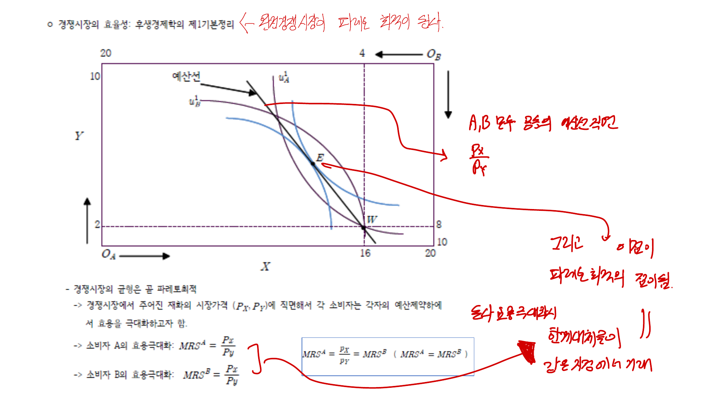

일반균형분석은 여러 시장이 동시에 연결되어 움직이는 상황을 다룬다. 한 시장의 가격 변화는 다른 시장의 수요와 공급을 바꾸고, 그 변화가 다시 처음 시장에 영향을 줄 수 있다.

## 1. 부분균형과 일반균형

부분균형분석은 한 시장만 따로 떼어 수요와 공급을 분석한다. 다른 시장의 가격과 소득은 고정되어 있다고 본다.

일반균형분석은 모든 시장의 상호작용을 함께 본다. 예를 들어 한 재화의 가격이 오르면 대체재 수요가 변하고, 생산요소 수요도 변하며, 소비자의 소득과 후생도 함께 바뀐다.

## 2. 교환경제와 에지워스 상자

두 소비자와 두 재화가 있는 순수교환경제를 생각하자. 에지워스 상자는 두 소비자가 가진 재화의 총량을 하나의 상자 안에 표현한다.

상자 안의 한 점은 두 소비자 사이의 자원배분을 나타낸다. 한 소비자의 원점에서 본 좌표는 그 소비자의 소비량이고, 반대쪽 원점에서 본 좌표는 다른 소비자의 소비량이다.

## 3. 파레토 효율

어떤 배분에서 한 사람의 후생을 낮추지 않고 다른 사람의 후생을 높일 수 없다면 그 배분은 파레토 효율적이다.

교환경제에서 파레토 효율 조건은 두 소비자의 한계대체율이 같아지는 것이다.

$$
MRS_A = MRS_B
$$

두 소비자의 한계대체율이 다르면 서로 교환을 통해 둘 중 적어도 한 명의 후생을 높일 수 있다.

 

 

## 4. 계약곡선

에지워스 상자에서 두 소비자의 무차별곡선이 서로 접하는 점들의 집합을 계약곡선이라고 한다. 계약곡선 위의 점들은 교환에서 파레토 효율적이다.

초기부존점에서 출발하면, 두 소비자가 자발적으로 거래해 서로 더 나아질 수 있는 영역이 있다. 이 영역 안에서 교환이 이루어지다가 더 이상 상호이익 거래가 불가능한 계약곡선 위의 점에 도달한다.

## 5. 경쟁균형과 효율성

완전경쟁시장에서 소비자는 주어진 가격 아래 효용을 극대화하고, 기업은 이윤을 극대화한다. 교환경제에서 모든 소비자가 같은 가격비율을 직면하므로 각자의 최적점에서

$$
MRS_A = \frac{P_X}{P_Y}
$$

$$
MRS_B = \frac{P_X}{P_Y}
$$

따라서

$$
MRS_A = MRS_B
$$

즉 완전경쟁균형은 교환에서 파레토 효율적이다.

## 6. 생산효율

생산경제에서는 두 재화를 생산하기 위해 노동과 자본 같은 생산요소를 배분한다. 생산효율은 한 재화의 생산량을 줄이지 않고 다른 재화의 생산량을 늘릴 수 없는 상태다.

생산효율 조건은 두 산업의 기술적 한계대체율이 같아지는 것이다.

$$
MRTS_X = MRTS_Y
$$

요소가격이 모든 산업에 동일하게 주어지면 각 기업의 비용최소화 조건 때문에 이 조건이 성립한다.

## 7. 산출물 구성의 효율성

생산가능곡선에서 한 재화를 더 생산하기 위해 포기해야 하는 다른 재화의 양은 한계변환율(MRT)이다.

소비자가 느끼는 한계대체율과 생산에서의 한계변환율이 같아야 산출물 구성이 효율적이다.

$$
MRS = MRT
$$

이는 소비자가 원하는 교환비율과 경제가 실제로 생산에서 맞닥뜨리는 교환비율이 같아야 한다는 뜻이다.

## 8. 후생경제학의 기본정리

제1후생정리는 일정 조건 아래 완전경쟁균형이 파레토 효율적이라는 명제다. 시장실패가 없고 모든 시장이 완전경쟁적이면 시장가격은 효율적인 자원배분을 유도한다.

제2후생정리는 적절한 초기부존의 재분배가 가능하다면 원하는 파레토 효율 배분을 경쟁균형으로 달성할 수 있다는 명제다.

다만 외부성, 공공재, 정보비대칭, 시장지배력 같은 시장실패가 있으면 경쟁균형이 효율적이지 않을 수 있다.

## 정리

일반균형분석은 여러 시장을 동시에 고려한다. 효율성 조건은 교환에서 $MRS_A = MRS_B$, 생산에서 $MRTS_X = MRTS_Y$, 산출물 구성에서 $MRS = MRT$로 정리된다. 완전경쟁균형은 이상적인 조건에서 파레토 효율적이지만, 시장실패가 있으면 정책 개입의 근거가 생긴다.
