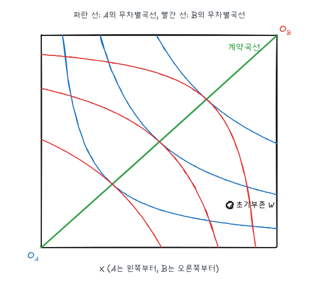
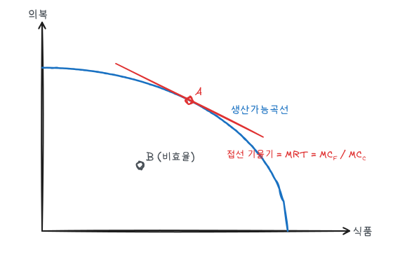

지금까지는 한 시장만 따로 보는 **부분균형** 분석이었다. 이 글은 여러 시장이 서로 영향을 주고받는 **일반균형**과, 경쟁시장이 자원을 효율적으로 배분하는 조건을 다룬다.

## 1. 일반균형 분석

두 시장이 연결되어 있으면 한 시장의 변화가 다른 시장으로 퍼지고 다시 돌아온다(**피드백 효과**).

예: 영화관 표에 세금을 부과하면 영화 가격이 오르고, 대체재인 영화 스트리밍 수요가 증가해 스트리밍 가격이 오른다. 스트리밍 가격 상승은 다시 영화관 수요를 늘린다. 부분균형 분석은 첫 효과만 보므로 세금의 효과를 과대 또는 과소평가할 수 있다.

## 2. 교환의 효율: 에지워스 상자

두 소비자 A, B가 두 재화 X, Y를 나누어 가진다. 총량이 각각 10이면 가로·세로 10인 상자의 모든 점이 하나의 배분이다. A의 원점은 왼쪽 아래, B의 원점은 오른쪽 위다.

예제: 두 사람 모두 $U = XY$이고, 초기부존 W에서 A는 $(8, 2)$, B는 $(2, 8)$을 가진다.

### 파레토 효율

다른 사람을 나쁘게 하지 않고는 누구도 더 좋게 만들 수 없는 배분이다. 

초기부존 W에서 A의 MRS는 $Y/X = 2/8 = 0.25$, B의 MRS는 $8/2 = 4$이다. A는 X 1단위를 Y 0.25와, B는 X 1단위를 Y 4와 바꿀 의향이 있다. 그 사이 비율(예: 1 대 1)로 A가 X를 주고 Y를 받으면 둘 다 좋아진다. W는 비효율적이다.

**교환의 효율 조건**은

$$
MRS^A_{XY} = MRS^B_{XY}
$$

즉 두 사람의 무차별곡선이 접하는 점이다. 이런 점들을 이은 것이 **계약곡선**이다. 예제에서 $Y_A/X_A = (10 - Y_A)/(10 - X_A)$를 정리하면 $Y_A = X_A$, 즉 상자의 대각선이다.

W를 지나는 두 무차별곡선 사이의 렌즈 모양 영역이 두 사람 모두 개선되는 배분이고, 그 영역 안의 계약곡선 구간이 교환으로 도달할 수 있는 효율적 결과다.

### 경쟁균형

가격 $P_X$, $P_Y$가 주어지면 두 사람은 각자 $MRS = P_X/P_Y$가 되도록 선택한다. 둘이 같은 가격비를 보므로 자동으로 $MRS^A = MRS^B$가 되어 계약곡선 위의 점에 도달한다.

예제에서 $P_Y = 1$로 두고 균형가격을 구하자. A의 소득은 $8P_X + 2$, B의 소득은 $2P_X + 8$이다. $U = XY$이므로 각자 소득의 절반을 X에 쓴다.

$$
X_A + X_B = \frac{8P_X + 2}{2P_X} + \frac{2P_X + 8}{2P_X} = \frac{10P_X + 10}{2P_X} = 10 \;\Rightarrow\; P_X = 1
$$

균형에서 A와 B는 모두 $(5, 5)$를 소비한다. A의 효용은 $8 \times 2 = 16$에서 25로, B도 16에서 25로 증가한다. 가격비 1은 W를 지나는 예산선의 기울기이고, 그 예산선이 계약곡선과 만나는 점이 균형이다.

## 3. 후생경제학의 기본정리

| 정리 | 내용 |
|---|---|
| 제1정리 | 모든 사람이 경쟁시장에서 거래하면 경쟁균형은 파레토 효율적이다 |
| 제2정리 | 선호가 볼록하면, 모든 파레토 효율적 배분은 적절한 초기부존 재분배 후 경쟁균형으로 달성할 수 있다 |

제1정리는 시장의 효율성, 제2정리는 **효율과 공평을 분리**할 수 있다는 뜻이다. 공평한 분배를 원하면 가격을 통제하지 말고 초기부존(소득)을 재분배한 뒤 시장에 맡기면 된다. 다만 현실의 재분배 수단(소득세)은 노동 유인을 바꿔 효율 손실을 낳는다.

## 4. 효용가능곡선과 공평

계약곡선 위의 각 점에서 두 사람의 효용 조합 $(U_A, U_B)$를 그린 것이 **효용가능곡선**이다. 곡선 위의 모든 점이 효율적이고, 곡선 안쪽은 비효율적이다.

효율적인 점은 무수히 많으므로 효율만으로는 어느 배분이 좋은지 정할 수 없다. 이를 고르려면 공평에 대한 가치판단이 필요하다.

| 관점 | 기준 |
|---|---|
| 평등주의 | 모든 사람이 같은 양의 재화를 가짐 |
| 롤스주의 | 가장 못사는 사람의 효용을 극대화 |
| 공리주의 | 효용의 합을 극대화 |
| 시장 지향 | 경쟁시장의 결과가 공평 |

비효율적인 점이 어떤 효율적인 점보다 더 공평할 수도 있다. 효율과 공평은 다른 축이다.

## 5. 생산의 효율

### 투입의 효율

두 산업(식품 F, 의복 C)이 노동과 자본을 나누어 쓴다. 생산의 에지워스 상자에서 효율 조건은 두 산업의 MRTS가 같은 것이다.

$$
MRTS^F_{LK} = MRTS^C_{LK}
$$

경쟁적 요소시장에서는 두 산업 모두 $MRTS = w/r$로 맞추므로 이 조건이 자동으로 성립한다.

### 생산가능곡선

투입이 효율적인 생산 조합을 산출 평면에 그린 것이 **생산가능곡선**(PPF)이다. 예제로 $F^2 + C^2 = 100$인 4분원을 쓴다.

PPF의 기울기(절댓값)가 **한계변환율**(MRT)이다. 식품 1단위를 더 만들기 위해 포기해야 하는 의복의 양이다.

$$
MRT = -\frac{dC}{dF} = \frac{MC_F}{MC_C}
$$

예제에서 $MRT = F/C$이다. A$(6, 8)$에서 $MRT = 0.75$이고, 식품을 더 많이 만들수록 MRT가 커진다. PPF가 원점에 대해 오목한 이유는 특정 생산에 더 적합한 요소를 먼저 쓰고, 덜 적합한 요소를 나중에 옮기기 때문이다(한계비용 체증). 

B$(4, 4)$는 PPF 안쪽이므로 투입이 비효율적이거나 자원이 놀고 있다. 같은 자원으로 두 재화를 모두 더 만들 수 있다.

## 6. 산출의 효율

생산된 재화의 구성이 소비자의 선호에 맞아야 한다.

$$
MRS = MRT
$$

$MRS = 1$, $MRT = 2$라면 소비자는 식품 1단위를 의복 1단위와 같게 평가하는데 식품 1단위를 만들려면 의복 2단위를 포기해야 한다. 식품 생산을 줄이고 의복을 늘리면 후생이 커진다.

경쟁시장에서는

- 소비자: $MRS = P_F/P_C$
- 생산자: $P = MC$이므로 $MRT = MC_F/MC_C = P_F/P_C$

따라서 $MRS = MRT$가 성립한다. 예제 PPF의 점 A에서 가격비가 0.75이면 소비자도 $MRS = 0.75$인 점을 고르게 된다.

### 세 가지 효율 조건 요약

| 효율 | 조건 | 경쟁시장에서 성립하는 이유 |
|---|---|---|
| 교환 | $MRS^A = MRS^B$ | 모두 같은 $P_X/P_Y$를 봄 |
| 투입 | $MRTS^F = MRTS^C$ | 모두 같은 $w/r$을 봄 |
| 산출 | $MRS = MRT$ | $MRS = P_F/P_C = MC_F/MC_C$ |

## 7. 국제무역의 이득

나라마다 MRT가 다르면 **비교우위**가 생긴다. 상대적으로 MRT가 작은(기회비용이 낮은) 재화에 특화하고 교역하면 두 나라 모두 자국 PPF 바깥의 소비가 가능해진다. 무역은 전체 후생을 높이지만 수입 경쟁 산업의 노동자처럼 손해를 보는 집단도 생긴다.

## 8. 시장실패

후생경제학 제1정리는 가정이 성립할 때만 유효하다. 다음 경우 경쟁시장이 비효율적이 된다.

| 원인 | 내용 |
|---|---|
| 시장지배력 | 독점은 $P > MC$이므로 $MRS \neq MRT$ |
| 불완전한 정보 | 소비자가 품질·가격을 모르면 효율 조건이 깨짐 (역선택, 도덕적 해이) |
| 외부효과 | 공해처럼 시장가격에 반영되지 않는 비용·편익 |
| 공공재 | 비배제성·비경합성 때문에 시장이 과소 공급 |

## 정리

| 개념 | 조건 | 예제 |
|---|---|---|
| 교환의 효율 | $MRS^A = MRS^B$ | 계약곡선 $Y_A = X_A$ |
| 경쟁균형 | $MRS = P_X/P_Y$ | $P_X/P_Y = 1$, 둘 다 $(5, 5)$ |
| 투입의 효율 | $MRTS^F = MRTS^C$ | |
| 한계변환율 | $MC_F/MC_C$ | A$(6, 8)$에서 0.75 |
| 산출의 효율 | $MRS = MRT$ | |
| 후생 제1정리 | 경쟁균형은 파레토 효율 | |
| 후생 제2정리 | 재분배 + 시장으로 원하는 효율점 달성 | |
