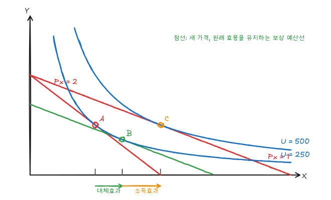

[소비자 행동](/posts/micro-consumer-behavior)에서 구한 최적 선택을 가격과 소득을 바꿔가며 다시 풀면 수요곡선이 나온다. 예제는 계속 $U = XY$, $P_Y = 5$, $I = 100$을 쓴다.

## 1. 가격 변화와 개별수요곡선

$P_X$를 바꾸면 예산선이 회전하고 최적점이 이동한다. 이 최적점들을 이은 선이 **가격소비곡선**(PCC)이다. 각 가격과 그때의 $X^*$를 가격-수량 평면에 옮기면 **개별수요곡선**이 된다.

콥-더글러스 예제에서 $X^* = I/(2P_X) = 50/P_X$이다.

| $P_X$ | $X^*$ | $Y^*$ | 효용 |
|---|---|---|---|
| 4 | 12.5 | 10 | 125 |
| 2 | 25 | 10 | 250 |
| 1 | 50 | 10 | 500 |

개별수요곡선 $X = 50/P_X$는 직각쌍곡선이다. X에 대한 지출 $P_X X = 50$이 항상 일정하므로 가격탄력성은 모든 점에서 $-1$이다. $Y^*$가 $P_X$와 무관하므로 PCC는 수평선이다.

수요곡선 위에서는 각 점에서 $MRS = P_X/P_Y$가 성립하므로 가격이 낮을수록 MRS도 작다. 즉 수요곡선 높이는 그 재화의 한계적 가치를 나타낸다.

## 2. 소득 변화와 엥겔곡선

가격을 고정하고 소득을 바꾸면 예산선이 평행이동한다. 최적점을 이은 선이 **소득소비곡선**(ICC), 소득과 수요량의 관계가 **엥겔곡선**이다.

예제에서 $X^* = I/(2 \times 2) = I/4$이므로 엥겔곡선은 원점을 지나는 직선이고 소득탄력성은 1이다.

| 재화 | 소득 증가 시 | 엥겔곡선 |
|---|---|---|
| 정상재 | 수요 증가 | 우상향 |
| 열등재 | 수요 감소 | 우하향(꺾임) |

같은 재화라도 소득 구간에 따라 정상재였다가 열등재가 될 수 있다(저가 햄버거 등).

## 3. 대체효과와 소득효과

가격 변화의 효과는 두 부분으로 나뉜다.

- **대체효과**: 효용을 그대로 두고 상대가격만 바뀌었을 때의 수요 변화. 항상 가격과 반대 방향이다.
- **소득효과**: 실질소득(구매력) 변화에 따른 수요 변화. 정상재면 대체효과와 같은 방향, 열등재면 반대 방향이다.

### 예제: $P_X$가 2에서 1로 하락

1. **원래 선택 A**: $(25, 10)$, $U = 250$.
2. **새 선택 C**: $P_X = 1$이면 $X = 50,\ Y = 10$, $U = 500$.
3. **보상 예산선과 B**: 새 가격비 $1/5$로 원래 효용 250을 유지하는 최소 지출점. $MRS = Y/X = 1/5$에서 $X = 5Y$, $XY = 5Y^2 = 250$이므로

$$
Y_B = \sqrt{50} \approx 7.07, \qquad X_B = \sqrt{1250} \approx 35.36
$$

이때 필요한 지출은 $35.36 + 5(7.07) \approx 70.7$이다. 즉 가격 하락은 소득이 약 29.3 오른 것과 같은 효과를 준다.

| 효과 | 이동 | X 변화 |
|---|---|---|
| 대체효과 | A → B | $25 \to 35.36$ (+10.36) |
| 소득효과 | B → C | $35.36 \to 50$ (+14.64) |
| 총효과 | A → C | $25 \to 50$ (+25) |

이 분해는 원래 효용을 유지하는 힉스(Hicks) 방식이다. 원래 묶음을 살 수 있게 소득을 보상하는 슬러츠키(Slutsky) 방식에서는 보상 소득이 $25 \times 1 + 10 \times 5 = 75$이고 그때의 수요는 $X = 75/2 = 37.5$이므로 대체효과가 +12.5로 계산된다.

### 기펜재

열등재이면서 소득효과가 대체효과보다 크면 가격이 떨어질 때 수요가 오히려 감소한다. 이런 재화가 **기펜재**이고 수요곡선이 우상향한다. 소득의 큰 부분을 차지하는 열등재에서만 이론적으로 가능하며 실제 사례는 드물다.

| 재화 | 대체효과 | 소득효과 | 총효과 |
|---|---|---|---|
| 정상재 | − | − | − (수요법칙) |
| 열등재 | − | + (작음) | − |
| 기펜재 | − | + (큼) | + |

부호는 가격 변화에 대한 수요량 변화의 방향이다.

## 4. 시장수요

시장수요는 같은 가격에서 개별 수요량을 **수평으로 합한** 것이다.

$$
Q^D(P) = \sum_{i} q_i(P)
$$

예를 들어 소비자 1의 수요가 $q_1 = 100 - P$ ($P \le 100$), 소비자 2의 수요가 $q_2 = 60 - P$ ($P \le 60$)이면

$$
Q^D = \begin{cases} 100 - P, & 60 < P \le 100 \\ 160 - 2P, & 0 \le P \le 60 \end{cases}
$$

로 $P = 60$에서 꺾인다. 개별 수요가 꺾이지 않아도 시장수요는 꺾일 수 있다.

시장수요의 탄력성은 소비자 수, 소득분포, 대체재 존재 여부에 따라 달라진다. 개별 브랜드 수요는 시장 전체 수요보다 훨씬 탄력적이다.

## 5. 소비자잉여

소비자잉여는 소비자가 지불할 용의가 있는 금액과 실제 지불액의 차이다. 수요곡선 아래, 가격선 위의 면적이다.

$$
CS = \int_0^{Q^*} P^D(Q)\,dQ - P^*Q^*
$$

[수요와 공급](/posts/micro-supply-demand)의 예제(수요 $P = 50 - Q/2$, 균형 $P^* = 30$, $Q^* = 40$)에서

$$
CS = \tfrac12 \times 40 \times (50 - 30) = 400
$$

이다. 가격이 35로 오르면 수요량이 30이 되고 $CS = \tfrac12 \times 30 \times 15 = 225$로 175 감소한다.

## 6. 네트워크 외부효과

다른 사람의 구매가 내 수요에 영향을 주면 시장수요는 단순한 수평합이 아니다.

- **밴드왜건 효과**(양의 외부효과): 다른 사람이 많이 살수록 내 수요가 증가한다. 메신저, SNS 등. 시장수요가 개별수요보다 더 탄력적이 된다.
- **스놉 효과**(음의 외부효과): 다른 사람이 많이 살수록 내 수요가 감소한다. 한정판 명품 등. 시장수요가 덜 탄력적이 된다.

가격이 내려가 판매량이 늘면 밴드왜건 효과로 수요곡선 자체가 오른쪽으로 이동하므로, 관찰되는 수요 반응은 순수 가격효과보다 크다.

## 정리

| 개념 | 핵심 | 예제 |
|---|---|---|
| 개별수요곡선 | PCC를 가격-수량 평면에 옮김 | $X = 50/P_X$, 탄력성 −1 |
| 엥겔곡선 | 소득과 수요량 | $X = I/4$ |
| 대체효과 | 효용 고정, 상대가격 변화 | +10.36 |
| 소득효과 | 구매력 변화 | +14.64 |
| 시장수요 | 수평합 | $P = 60$에서 꺾임 |
| 소비자잉여 | 수요곡선 아래, 가격 위 | 400 |
