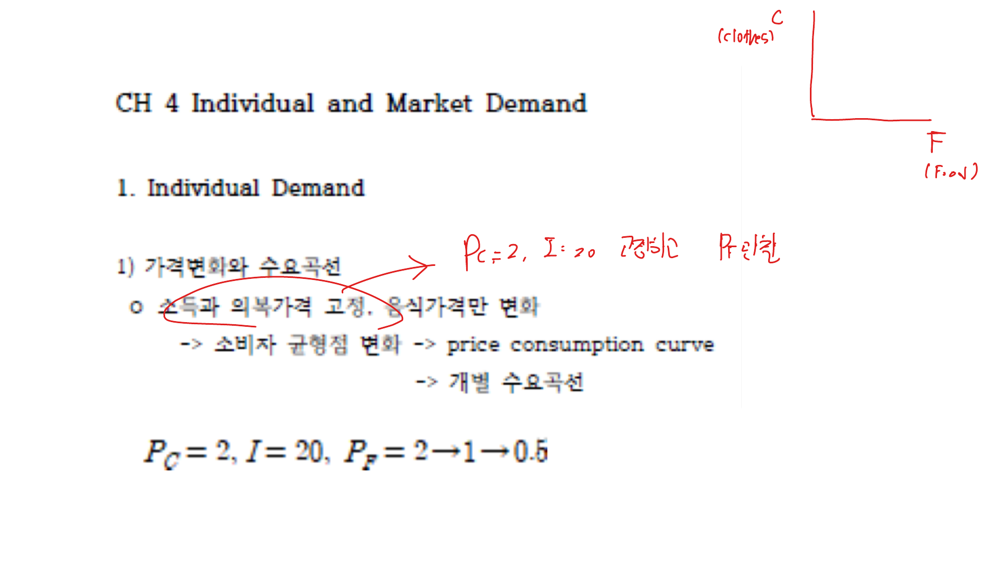
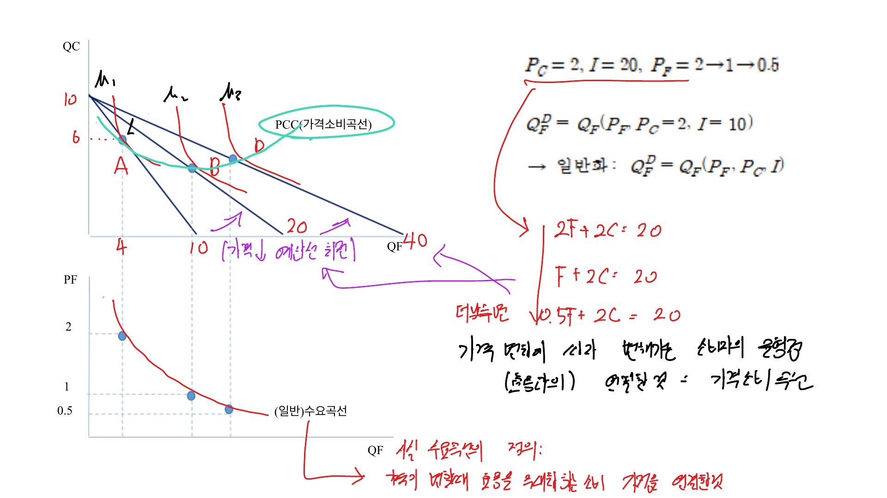

개별수요는 한 소비자의 최적 선택에서 도출되고, 시장수요는 개별수요를 수평으로 더해 얻는다. 이 장에서는 가격과 소득 변화가 소비자 선택을 어떻게 움직이는지 보고, 그 결과 수요곡선과 소비자잉여를 정리한다.

## 1. 가격소비곡선과 개별수요

한 재화의 가격만 변하고 다른 가격과 소득이 고정되어 있다고 하자. 가격 변화에 따라 소비자균형점이 이동하는 궤적을 가격소비곡선(PCC, Price Consumption Curve)이라고 한다.

가격소비곡선에서 각 가격에 대응하는 최적 소비량을 아래쪽 가격-수량 평면으로 옮기면 개별수요곡선이 된다.

 

 

수요곡선은 단순히 선호에서 바로 나오는 것이 아니라, 예산제약 아래에서 효용극대화 문제를 풀어 얻는 결과다.

## 2. 소득소비곡선과 엥겔곡선

가격은 고정하고 소득만 변화시키면 소비자균형도 이동한다. 이 균형점들의 궤적을 소득소비곡선(ICC, Income Consumption Curve)이라고 한다.

소득과 한 재화의 소비량 사이의 관계를 따로 그리면 엥겔곡선이 된다.

 

 

정상재는 소득이 증가할 때 수요량이 증가한다.

$$
\frac{\partial Q}{\partial I} > 0
$$

열등재는 소득이 증가할 때 수요량이 감소한다.

$$
\frac{\partial Q}{\partial I} < 0
$$

필수재는 소득이 증가해도 소비량 증가가 제한적이고, 사치재는 소득 증가에 더 민감하게 반응한다.

## 3. 대체효과와 소득효과

가격 변화가 수요량에 미치는 효과는 두 부분으로 나눌 수 있다.

- 대체효과: 상대가격 변화 때문에 소비 조합이 바뀌는 효과
- 소득효과: 가격 변화로 실질소득이 변해 소비가 바뀌는 효과

슬러츠키 관점에서는 가격 변화 후에도 기존 상품묶음을 살 수 있도록 소득을 보상해 상대가격 효과만 분리한다. 힉스 관점에서는 기존 효용수준을 유지하도록 보상한다.

정상재의 가격이 상승하면 대체효과와 소득효과가 모두 수요량을 줄인다. 열등재는 소득효과가 반대 방향으로 작용하지만, 보통 대체효과가 더 커서 수요곡선은 여전히 우하향한다.

## 4. 시장수요

시장수요는 각 가격에서 모든 소비자의 수요량을 더한 것이다.

$$
Q^M(P) = \sum_{i=1}^{n} Q_i(P)
$$

따라서 시장수요곡선은 개별수요곡선의 수평합이다. 가격 $P$가 주어졌을 때 각 소비자가 원하는 수량을 모두 더해 시장 전체 수요량을 구한다.

개별수요가 선형이어도 소비자가 시장에 참여하기 시작하는 가격이 다르면 시장수요는 구간별로 기울기가 달라질 수 있다.

## 5. 소비자잉여

소비자잉여는 소비자가 지불할 의사액과 실제 지불액의 차이다. 수요곡선은 각 수량에 대한 한계지불의사를 나타내므로, 가격 위와 수요곡선 아래의 면적이 소비자잉여가 된다.

$$
CS = \int_0^{Q^*} P_D(Q)\,dQ - P^*Q^*
$$

선형 수요곡선에서는 삼각형 면적으로 계산할 수 있다.

$$
CS = \frac{1}{2}(P_{\max} - P^*)Q^*
$$

소비자잉여는 가격정책, 세금, 보조금, 독점가격의 후생효과를 분석할 때 기본 도구가 된다.

## 6. 네트워크 외부성

어떤 재화는 다른 사람이 많이 사용할수록 가치가 커지거나 작아진다. 전자를 양의 네트워크 외부성, 후자를 음의 네트워크 외부성이라고 한다.

밴드왜건 효과는 많은 사람이 소비할수록 더 소비하고 싶어지는 현상이다. 반대로 스놉 효과는 많은 사람이 소비할수록 희소성이 낮아져 수요가 줄어드는 현상이다.

네트워크 외부성이 있으면 개별 수요를 단순히 더한 시장수요만으로는 시장 반응을 충분히 설명하기 어렵다.

## 정리

개별수요곡선은 소비자의 효용극대화 문제에서 도출되고, 시장수요곡선은 개별수요의 수평합이다. 가격 변화는 대체효과와 소득효과로 나누어 해석할 수 있으며, 소비자잉여는 수요곡선 아래 면적으로 측정된다.
