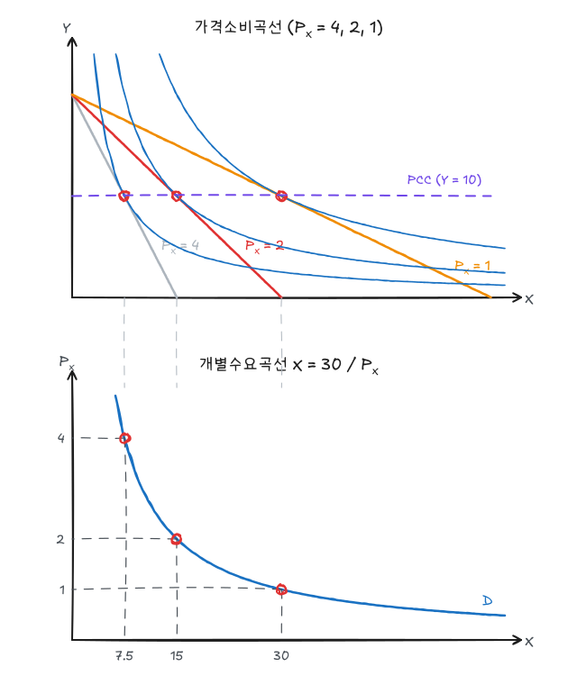
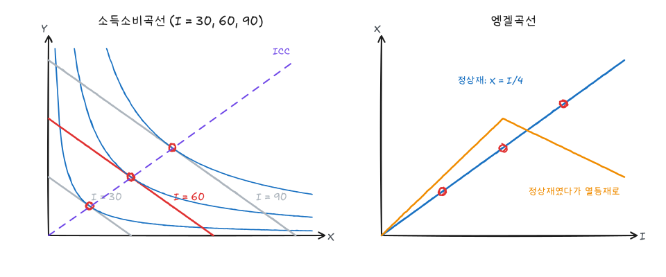
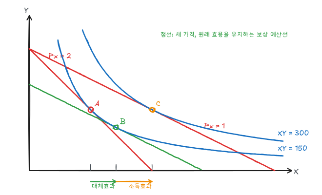
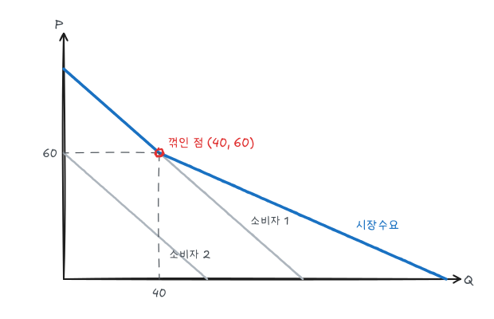
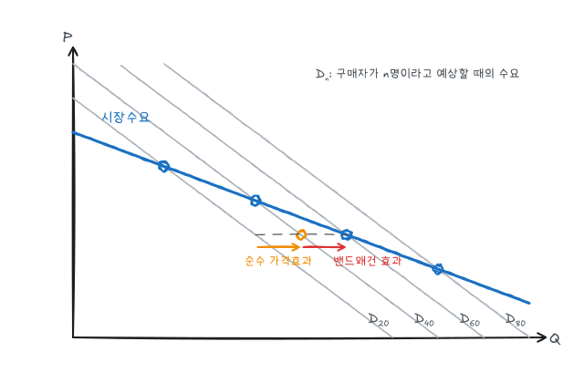

[소비자 행동](/posts/micro-consumer-behavior)에서 구한 최적 선택을 가격과 소득을 바꿔가며 다시 풀면 수요곡선이 나온다. 예제는 계속 $U = X^{0.5}Y^{0.5}$, $P_Y = 3$, $I = 60$을 쓴다.

## 1. 가격 변화와 개별수요곡선

$P_X$를 바꾸면 예산선이 회전하고 최적점이 이동한다. 이 최적점들을 이은 선이 **가격소비곡선**(PCC)이다. 각 가격과 그때의 $X^*$를 가격-수량 평면에 옮기면 **개별수요곡선**이 된다.

콥-더글러스 예제에서 $X^* = I/(2P_X) = 30/P_X$이다.

| $P_X$ | $X^*$ | $Y^*$ | 효용 |
|---|---|---|---|
| 4 | 7.5 | 10 | 8.66 |
| 2 | 15 | 10 | 12.25 |
| 1 | 30 | 10 | 17.32 |

개별수요곡선 $X = 30/P_X$는 직각쌍곡선이다. X에 대한 지출 $P_X X = 30$이 항상 일정하므로 가격탄력성은 모든 점에서 $-1$이다. $Y^*$가 $P_X$와 무관하므로 PCC는 수평선이다.

수요곡선 위에서는 각 점에서 $MRS = P_X/P_Y$가 성립하므로 가격이 낮을수록 MRS도 작다. 즉 수요곡선 높이는 그 재화의 한계적 가치를 나타낸다.

위 그림에서 $P_X$가 4, 2, 1로 내릴 때 예산선이 Y절편을 축으로 회전하고, 접점은 $(7.5, 10)$, $(15, 10)$, $(30, 10)$으로 옮겨 간다. 접점들을 이은 PCC가 수평선이다. 각 접점의 X 수량과 그때의 가격을 아래 그림으로 옮기면 개별수요곡선 $X = 30/P_X$의 세 점이 된다.

## 2. 소득 변화와 엥겔곡선

가격을 고정하고 소득을 바꾸면 예산선이 평행이동한다. 최적점을 이은 선이 **소득소비곡선**(ICC), 소득과 수요량의 관계가 **엥겔곡선**이다.

예제에서 $X^* = I/(2 \times 2) = I/4$이므로 엥겔곡선은 원점을 지나는 직선이고 소득탄력성은 1이다.

| 재화 | 소득 증가 시 | 엥겔곡선 |
|---|---|---|
| 정상재 | 수요 증가 | 우상향 |
| 열등재 | 수요 감소 | 우하향(꺾임) |

같은 재화라도 소득 구간에 따라 정상재였다가 열등재가 될 수 있다(저가 햄버거 등).

$P_X = 2$, $P_Y = 3$에서 소득이 30, 60, 90으로 늘면 접점은 $(7.5, 5)$, $(15, 10)$, $(22.5, 15)$로 원점을 지나는 직선(ICC) 위에서 움직인다. 이 X 수량을 소득에 대해 그린 것이 엥겔곡선 $X = I/4$다. 주황 점선은 소득이 일정 수준을 넘으면 수요가 줄어드는 재화의 엥겔곡선으로, 꺾인 점 이후 구간에서 그 재화는 열등재다.

## 3. 대체효과와 소득효과

가격 변화의 효과는 두 부분으로 나뉜다.

- **대체효과**: 효용을 그대로 두고 상대가격만 바뀌었을 때의 수요 변화. 항상 가격과 반대 방향이다.
- **소득효과**: 실질소득(구매력) 변화에 따른 수요 변화. 정상재면 대체효과와 같은 방향, 열등재면 반대 방향이다.

### 예제: $P_X$가 2에서 1로 하락

1. **원래 선택 A**: $(15, 10)$, $U = \sqrt{150} \approx 12.25$.
2. **새 선택 C**: $P_X = 1$이면 $X = 30,\ Y = 10$, $U = \sqrt{300} \approx 17.32$.
3. **보상 예산선과 B**: 새 가격비 $1/3$로 원래 효용을 유지하는 최소 지출점. $MRS = Y/X = 1/3$에서 $X = 3Y$, $XY = 3Y^2 = 150$이므로

$$
Y_B = \sqrt{50} \approx 7.07, \qquad X_B = \sqrt{450} \approx 21.21
$$

이때 필요한 지출은 $21.21 + 3(7.07) \approx 42.43$이다. 원래 소득 60보다 17.57 적다. 즉 가격 하락은 소득이 17.57 오른 것과 같은 효과를 준다.

| 효과 | 이동 | X 변화 |
|---|---|---|
| 대체효과 | A → B | $15 \to 21.21$ (+6.21) |
| 소득효과 | B → C | $21.21 \to 30$ (+8.79) |
| 총효과 | A → C | $15 \to 30$ (+15) |

이 분해는 원래 효용을 유지하는 힉스(Hicks) 방식이다. 원래 묶음을 살 수 있게 소득을 보상하는 슬러츠키(Slutsky) 방식으로도 나눌 수 있고, 두 방식은 보상 소득을 정하는 기준이 다르다.

| | 힉스 | 슬러츠키 |
|---|---|---|
| 보상 기준 | 원래 **효용**을 유지 | 원래 **묶음**을 살 수 있게 함 |
| 보상 소득 | $e(1, 3, 12.25) = 42.43$ | $15 \times 1 + 10 \times 3 = 45$ |
| 보상 후 선택 | $(21.21,\ 7.07)$, $U = 12.25$ | $(22.5,\ 7.5)$, $U = \sqrt{168.75} = 12.99$ |
| 대체효과 | $15 \to 21.21$ (+6.21) | $15 \to 22.5$ (+7.5) |
| 소득효과 | $21.21 \to 30$ (+8.79) | $22.5 \to 30$ (+7.5) |

슬러츠키 방식은 보상 후에도 원래 묶음을 살 수 있으므로 효용이 원래보다 높아지고, 대체효과가 힉스보다 크게 나온다. 총효과 +15는 같다. 힉스는 효용을 고정해 보상수요곡선과 대응하고, 슬러츠키는 관찰 가능한 가격과 소득만으로 계산된다.

### 지출극소화와 보상수요

효용극대화를 뒤집어, 목표 효용 $\bar U$를 가장 싸게 달성하는 문제를 풀 수도 있다.

$$
\min_{X, Y}\ P_X X + P_Y Y \quad \text{s.t.}\quad U(X, Y) = \bar U
$$

해를 **보상수요**(힉스 수요) $X^h(P_X, P_Y, \bar U)$, 최소 지출을 **지출함수** $e(P_X, P_Y, \bar U)$라 한다. 일반 수요 $X(P_X, P_Y, I)$는 마셜 수요라 부른다. 콥-더글러스 예제에서는

$$
X = \frac{I}{2P_X},\qquad V(P, I) = \frac{I}{2\sqrt{P_X P_Y}},\qquad
X^h = \bar U\sqrt{\frac{P_Y}{P_X}},\qquad e(P, \bar U) = 2\bar U\sqrt{P_X P_Y}
$$

이다. 두 수요를 비교하면 다음과 같다.

| | 마셜(보통) 수요 | 힉스(보상) 수요 |
|---|---|---|
| 문제 | 효용극대화: 소득 $I$ 고정 | 지출극소화: 효용 $\bar U$ 고정 |
| 변수 | $P_X,\ P_Y,\ I$ | $P_X,\ P_Y,\ \bar U$ |
| 가격 변화 시 | 대체효과와 소득효과 모두 반영 | 대체효과만 반영 (소득효과 제거) |
| 기울기 | 기펜재면 우상향 가능 | 항상 우하향 |
| 관측 | 가능 | 직접 관측 불가 |

$V$는 간접효용함수다. 두 문제는 **쌍대** 관계로, $e(P, V(P, I)) = I$가 성립한다. 지출함수를 가격으로 미분하면 보상수요가 나온다($\partial e/\partial P_X = X^h$, 셰퍼드 보조정리).

두 수요의 관계가 **슬러츠키 방정식**이다.

$$
\frac{\partial X}{\partial P_X} = \frac{\partial X^h}{\partial P_X} - X\frac{\partial X}{\partial I}
$$

첫 항이 대체효과, 둘째 항이 소득효과다. 예제의 $P_X = 2$에서 $\partial X/\partial P_X = -I/(2P_X^2) = -7.5$, $\partial X^h/\partial P_X = -\tfrac12 \bar U\sqrt{P_Y}P_X^{-1.5} = -3.75$, $X\,\partial X/\partial I = 15 \times \tfrac14 = 3.75$이므로 $-7.5 = -3.75 - 3.75$로 맞는다.

### 보상변화와 동등변화

가격 변화로 인한 후생 변화를 화폐로 측정하는 방법이다.

| 척도 | 정의 | $P_X$: 2 → 1 |
|---|---|---|
| 보상변화(CV) | 새 가격에서 **원래 효용**으로 돌아가게 하는 소득 조정 | $60 - e(1, 3, 12.25) = 60 - 42.43 = 17.57$ |
| 동등변화(EV) | 원래 가격에서 **새 효용**을 얻게 하는 소득 조정 | $e(2, 3, 17.32) - 60 = 84.85 - 60 = 24.85$ |
| 소비자잉여 변화 | 마셜 수요곡선 아래 면적 | $\int_1^2 \frac{30}{P}\,dP = 30\ln 2 = 20.79$ |

정상재의 가격 하락에서는 $CV < \Delta CS < EV$이다. 소득효과가 작으면 세 값이 가까워지므로, 실제 분석에서는 관찰 가능한 마셜 수요의 소비자잉여를 근사치로 쓴다.

### 기펜재

열등재이면서 소득효과가 대체효과보다 크면 가격이 떨어질 때 수요가 오히려 감소한다. 이런 재화가 **기펜재**이고 수요곡선이 우상향한다. 소득의 큰 부분을 차지하는 열등재에서만 이론적으로 가능하며 실제 사례는 드물다.

| 재화 | 대체효과 | 소득효과 | 총효과 |
|---|---|---|---|
| 정상재 | − | − | − (수요법칙) |
| 열등재 | − | + (작음) | − |
| 기펜재 | − | + (큼) | + |

부호는 가격 변화에 대한 수요량 변화의 방향이다.

## 4. 시장수요

시장수요는 같은 가격에서 개별 수요량을 **수평으로 합한** 것이다.

$$
Q^D(P) = \sum_{i} q_i(P)
$$

예를 들어 소비자 1의 수요가 $q_1 = 100 - P$ ($P \le 100$), 소비자 2의 수요가 $q_2 = 60 - P$ ($P \le 60$)이면

$$
Q^D = \begin{cases} 100 - P, & 60 < P \le 100 \\ 160 - 2P, & 0 \le P \le 60 \end{cases}
$$

로 $P = 60$에서 꺾인다. 개별 수요가 꺾이지 않아도 시장수요는 꺾일 수 있다.

가격이 60보다 높으면 소비자 2는 사지 않으므로 시장수요는 소비자 1의 수요와 같다. 가격이 60 아래로 내려오면 두 사람이 모두 사므로, 같은 가격에서 수량을 더한 직선 $Q = 160 - 2P$가 되고 기울기가 완만해진다. 꺾인 점 $(40, 60)$은 새로운 소비자가 시장에 들어오는 가격이다.

시장수요의 탄력성은 소비자 수, 소득분포, 대체재 존재 여부에 따라 달라진다. 개별 브랜드 수요는 시장 전체 수요보다 훨씬 탄력적이다.

## 5. 소비자잉여

소비자잉여는 소비자가 지불할 용의가 있는 금액과 실제 지불액의 차이다. 수요곡선 아래, 가격선 위의 면적이다.

$$
CS = \int_0^{Q^*} P^D(Q)\,dQ - P^*Q^*
$$

[수요와 공급](/posts/micro-supply-demand)의 예제(수요 $P = 50 - Q/2$, 균형 $P^* = 30$, $Q^* = 40$)에서

$$
CS = \tfrac12 \times 40 \times (50 - 30) = 400
$$

이다. 가격이 35로 오르면 수요량이 30이 되고 $CS = \tfrac12 \times 30 \times 15 = 225$로 175 감소한다.

## 6. 네트워크 외부효과

다른 사람의 구매가 내 수요에 영향을 주면 시장수요는 단순한 수평합이 아니다.

- **밴드왜건 효과**(양의 외부효과): 다른 사람이 많이 살수록 내 수요가 증가한다. 메신저, SNS 등. 시장수요가 개별수요보다 더 탄력적이 된다.
- **스놉 효과**(음의 외부효과): 다른 사람이 많이 살수록 내 수요가 감소한다. 한정판 명품 등. 시장수요가 덜 탄력적이 된다.

- **과시효과**(베블런 효과): 가격이 높다는 사실이 위신을 주어 가격이 오를수록 수요가 늘기도 한다. 명품, 고가 장신구 등. 다른 사람의 구매량이 아니라 가격 자체가 효용에 들어간다는 점이 스놉 효과와 다르다.

| | 밴드왜건(편승) | 스놉(속물) | 과시(베블런) |
|---|---|---|---|
| 수요에 영향을 주는 것 | 다른 사람의 구매량 ↑ | 다른 사람의 구매량 ↑ | 가격 ↑ |
| 내 수요 | 증가 | 감소 | 증가 |
| 시장수요의 가격탄력성 | 커진다 | 작아진다 | 우상향 구간이 생길 수 있다 |

가격이 내려가 판매량이 늘면 밴드왜건 효과로 수요곡선 자체가 오른쪽으로 이동하므로, 관찰되는 수요 반응은 순수 가격효과보다 크다.

$D_n$은 구매자가 $n$명이라고 예상할 때의 수요곡선이다. 예상 구매자가 많을수록 곡선이 오른쪽에 있다. 실제 시장수요는 예상과 실제 구매자 수가 일치하는 점들을 이은 선으로, 각 $D_n$보다 완만하다. 그림에는 축 눈금을 생략했지만 강의 예제의 수치로 보면, 가격이 20에서 15로 내릴 때 예상 구매자 수가 40으로 그대로라면 수요량은 40에서 50으로 는다(순수 가격효과). 그런데 구매자가 늘었다는 사실 자체가 수요를 끌어올려 60까지 늘어난다(밴드왜건 효과). 스놉 효과는 그 반대로, 구매자가 늘수록 수요곡선이 왼쪽으로 이동해 시장수요가 각 $D_n$보다 가파르다.

## 정리

| 개념 | 핵심 | 예제 |
|---|---|---|
| 개별수요곡선 | PCC를 가격-수량 평면에 옮김 | $X = 30/P_X$, 탄력성 −1 |
| 엥겔곡선 | 소득과 수요량 | $X = I/4$ |
| 대체효과 | 효용 고정, 상대가격 변화 | +6.21 |
| 소득효과 | 구매력 변화 | +8.79 |
| 보상변화 / 동등변화 | 후생 변화의 화폐 측정 | 17.57 / 24.85 |
| 시장수요 | 수평합 | $P = 60$에서 꺾임 |
| 소비자잉여 | 수요곡선 아래, 가격 위 | 400 |
