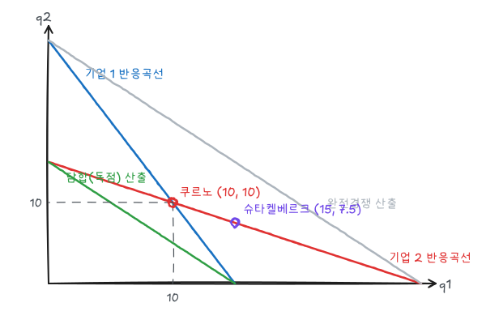

완전경쟁과 독점 사이의 시장구조를 다룬다. 과점 예제는 모두 시장수요 $P = 30 - Q$, $MC = 0$인 두 기업 모형으로 계산한다.

## 1. 독점적 경쟁

| 특징 | 내용 |
|---|---|
| 다수의 기업 | 각 기업의 영향력은 작음 |
| 차별화된 상품 | 각 기업은 우하향하는 수요곡선 (약간의 시장지배력) |
| 자유로운 진입·퇴출 | 장기 경제적 이윤 0 |

치약, 커피전문점, 미용실이 예다.

**단기**: 각 기업은 독점처럼 $MR = MC$에서 생산하고 $P > AC$이면 이윤을 낸다.

**장기**: 이윤이 있으면 비슷한 상품을 가진 기업이 진입해 각 기업의 수요가 왼쪽으로 이동하고 더 탄력적이 된다. 수요곡선이 AC 곡선에 **접할** 때까지 계속된다.

$$
MR = MC, \qquad P = AC \;(\text{접점})
$$

### 비효율성

- $P > MC$: 가격이 한계비용보다 높아 자중손실이 있다.
- **초과설비**: 수요곡선이 AC의 우하향 구간에서 접하므로 AC 최저점보다 적게 생산한다.

다만 이 비효율은 상품 다양성의 대가다. 차별화가 클수록 시장지배력과 비효율이 크지만 소비자는 다양한 선택지를 얻는다.

## 2. 과점과 내쉬균형

소수의 기업이 상호의존적으로 행동한다. 진입장벽(규모의 경제, 특허, 기존 기업의 전략적 행동)이 있다. 각 기업은 경쟁자의 반응을 고려해 결정해야 한다.

**내쉬균형**: 각 기업이 경쟁자의 행동을 주어진 것으로 보고 자신이 할 수 있는 최선을 하는 상태. 어느 기업도 혼자 전략을 바꿀 유인이 없다.

## 3. 쿠르노 모형: 동시 수량 경쟁

두 기업이 동시에 산출량을 결정한다. 기업 1의 이윤은

$$
\pi_1 = (30 - q_1 - q_2)\,q_1
$$

$q_2$를 주어진 것으로 보고 극대화하면

$$
\frac{\partial \pi_1}{\partial q_1} = 30 - 2q_1 - q_2 = 0 \;\Rightarrow\; q_1 = 15 - \tfrac12 q_2
$$

이 **반응곡선**은 경쟁자 산출이 늘수록 내 최적 산출이 준다는 뜻이다. 대칭이므로 $q_2 = 15 - \frac12 q_1$이다. 두 식을 연립하면

$$
q_1 = q_2 = 10,\quad Q = 20,\quad P = 10,\quad \pi_1 = \pi_2 = 100
$$

### 비교

| 결과 | 산출 $(q_1, q_2)$ | 시장 $Q$ | 가격 | 이윤 $(\pi_1, \pi_2)$ |
|---|---|---|---|---|
| 완전경쟁 ($P = MC$) | $q_1 + q_2 = 30$ | 30 | 0 | 0, 0 |
| 쿠르노 | 10, 10 | 20 | 10 | 100, 100 |
| 슈타켈베르크 (기업 1 선도) | 15, 7.5 | 22.5 | 7.5 | 112.5, 56.25 |
| 담합 (공동 독점) | 7.5, 7.5 | 15 | 15 | 112.5, 112.5 |

그림에서 담합 산출은 $q_1 + q_2 = 15$인 직선, 경쟁 산출은 $q_1 + q_2 = 30$인 직선이다. 쿠르노 균형은 두 직선 사이에 있다.

기업 수가 $n$개로 늘면 쿠르노 산출은 각 $q = 30/(n + 1)$, 시장 산출 $30n/(n + 1)$이다. $n \to \infty$이면 경쟁 산출 30으로 수렴한다.

## 4. 슈타켈베르크 모형: 선도자의 이점

기업 1이 먼저 산출을 정하고, 기업 2가 그것을 보고 반응한다. 기업 1은 기업 2의 반응곡선을 자신의 이윤함수에 대입한다.

$$
\pi_1 = \left(30 - q_1 - (15 - \tfrac12 q_1)\right)q_1 = \left(15 - \tfrac12 q_1\right)q_1
$$

$$
\frac{d\pi_1}{dq_1} = 15 - q_1 = 0 \;\Rightarrow\; q_1 = 15,\quad q_2 = 7.5,\quad P = 7.5
$$

먼저 많이 생산하겠다고 **확약**하면 경쟁자가 생산을 줄일 수밖에 없다. 선도자 이윤 112.5가 추종자 56.25의 두 배다. 수량경쟁에서는 먼저 움직이는 쪽이 유리하다.

## 5. 베르트랑 모형: 가격경쟁

### 동질적 상품

두 기업이 동질적 상품의 가격을 동시에 정하면 소비자는 모두 싼 쪽에서 산다. 상대보다 조금만 싸게 매기면 시장 전체를 가져오므로 가격 인하가 이어져

$$
P_1 = P_2 = MC = 0, \qquad \pi_1 = \pi_2 = 0
$$

이 된다. 기업이 둘뿐인데도 완전경쟁 결과가 나온다(베르트랑 역설). 같은 시장에서 수량을 선택하면 쿠르노 결과가 나오므로 **전략변수의 선택**이 결과를 크게 바꾼다.

### 차별화된 상품

상품이 차별화되어 있으면 가격을 올려도 고객을 모두 잃지 않는다. 예를 들어 수요가

$$
Q_1 = 12 - 2P_1 + P_2, \qquad Q_2 = 12 - 2P_2 + P_1
$$

이고 고정비용 20, 가변비용 0이면 기업 1의 반응곡선은 $\partial\pi_1/\partial P_1 = 12 - 4P_1 + P_2 = 0$에서 $P_1 = 3 + \frac14 P_2$이다. 대칭 내쉬균형은

$$
P = 4,\quad Q = 8,\quad \pi = 4 \times 8 - 20 = 12
$$

이다. 담합해 두 가격을 함께 정하면 $\pi = (12 - P)P - 20$을 극대화하는 $P = 6$, $Q = 6$, $\pi = 16$이다. 가격경쟁에서 반응곡선은 우상향한다(상대가 올리면 나도 올림).

## 6. 담합과 죄수의 딜레마

담합하면 둘 다 이윤이 커지는데 왜 쿠르노 결과가 나오는가? 위 차별화 상품 예제의 보수표로 보자.

| | 기업 2: $P = 4$ | 기업 2: $P = 6$ |
|---|---|---|
| **기업 1: $P = 4$** | 12, 12 | 20, 4 |
| **기업 1: $P = 6$** | 4, 20 | 16, 16 |

상대가 6일 때 내가 4로 내리면 $Q_1 = 12 - 8 + 6 = 10$, $\pi_1 = 40 - 20 = 20$이다. 이때 상대는 $Q_2 = 12 - 12 + 4 = 4$, $\pi_2 = 24 - 20 = 4$다.

상대가 무엇을 하든 $P = 4$가 유리하다(우월전략). 그래서 둘 다 4를 선택하고 12씩 얻는다. 둘 다 6이면 16씩 얻을 수 있는데도 그렇게 되지 않는다. 이것이 **죄수의 딜레마**다. 자세한 분석은 [게임이론](/posts/micro-game-theory)에서 다룬다.

## 7. 가격경직성과 굴절수요곡선

과점시장 가격은 비용이나 수요가 변해도 잘 바뀌지 않는다. **굴절수요곡선 모형**은 이를 다음과 같이 설명한다.

- 내가 가격을 올리면 경쟁자는 따라 올리지 않는다 → 고객을 많이 잃음, 현재 가격 위쪽 수요가 탄력적
- 내가 가격을 내리면 경쟁자도 따라 내린다 → 판매가 별로 늘지 않음, 아래쪽 수요가 비탄력적

수요곡선이 현재 가격에서 꺾이므로 MR 곡선이 그 수량에서 **불연속**이 된다. MC가 그 불연속 구간 안에서 움직이면 최적 가격과 수량이 바뀌지 않는다. 다만 이 모형은 처음 가격이 어떻게 정해졌는지는 설명하지 못한다.

## 8. 가격신호와 가격선도

명시적 담합이 불법이므로 기업들은 암묵적 협조를 시도한다.

- **가격신호**: 가격 인상을 발표해 경쟁자가 따라오기를 기대한다.
- **가격선도**: 한 기업(보통 지배적 기업)이 가격을 정하고 나머지가 따른다.
- **지배적 기업 모형**: 지배적 기업은 시장수요에서 군소 기업(경쟁 주변부)의 공급을 뺀 **잔여수요**를 보고 $MR = MC$로 가격을 정한다. 군소 기업은 그 가격을 받아들이고 $P = MC$에서 생산한다.

## 9. 카르텔

명시적으로 가격과 산출을 합의하는 집단이다. OPEC이 대표적이다. 카르텔이 성공하려면

1. 안정적인 조직(합의 유지, 이탈 감시)이 가능해야 하고
2. 잠재적 시장지배력, 즉 카르텔 밖 공급과 시장수요가 비탄력적이어야 한다.

각 회원은 합의 가격에서 더 많이 팔고 싶은 유인(앞의 보수표에서 가격을 내리는 유인)이 있으므로 카르텔은 본질적으로 불안정하다. 원유처럼 단기 수요와 비회원 공급이 비탄력적이면 카르텔이 큰 시장지배력을 가질 수 있지만, 장기에는 탄력성이 커져 지배력이 약해진다.

## 정리

| 모형 | 전략변수 | 결과 (예제) |
|---|---|---|
| 독점적 경쟁 장기 | 가격 | $P = AC$ 접점, 초과설비 |
| 쿠르노 | 수량, 동시 | $q = 10$씩, $P = 10$ |
| 슈타켈베르크 | 수량, 순차 | 15 / 7.5, 선도자 이점 |
| 베르트랑 (동질) | 가격, 동시 | $P = MC = 0$ |
| 베르트랑 (차별화) | 가격, 동시 | $P = 4$, 담합 시 6 |
| 굴절수요 | | MR 불연속 → 가격경직성 |
| 카르텔 | 합의 | 이탈 유인으로 불안정 |
