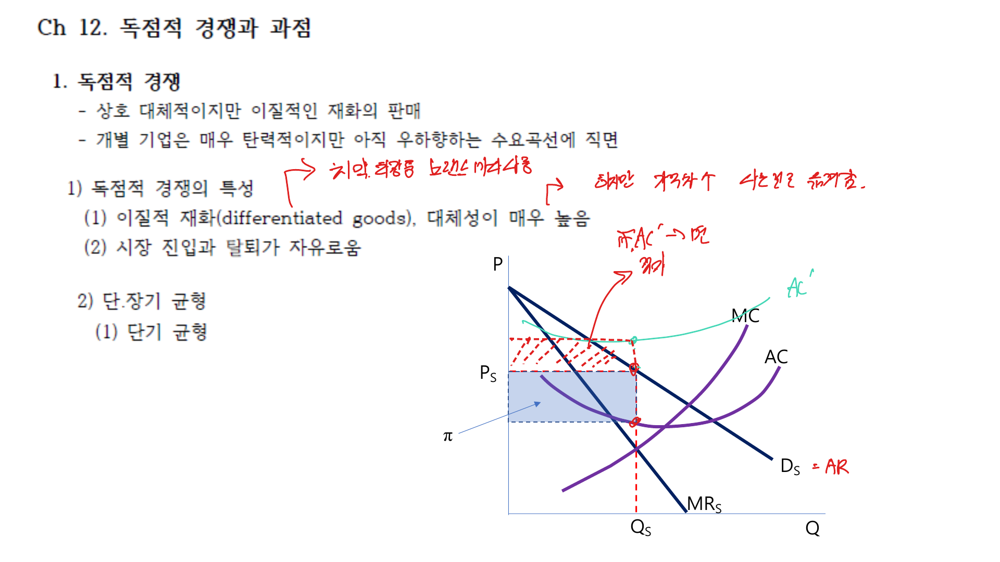

독점적 경쟁과 과점은 완전경쟁과 독점 사이에 있는 시장구조다. 독점적 경쟁에서는 많은 기업이 차별화된 상품을 팔고, 과점에서는 소수 기업의 전략적 상호작용이 중요하다.

## 1. 독점적 경쟁

독점적 경쟁시장의 특징은 다음과 같다.

- 많은 기업이 존재한다.
- 상품은 완전히 같지 않고 차별화되어 있다.
- 진입과 퇴출이 비교적 자유롭다.
- 각 기업은 우하향하는 수요곡선을 직면한다.

단기에는 독점기업처럼 $MR = MC$에서 생산량을 정하고, 수요곡선에서 가격을 결정한다.

 

 

## 2. 장기균형

단기에 경제적 이윤이 발생하면 새로운 기업이 진입한다. 진입은 기존 기업의 수요를 왼쪽으로 이동시키고 더 탄력적으로 만든다.

장기균형에서는 경제적 이윤이 0이 된다.

$$
P = AC
$$

하지만 완전경쟁과 달리 가격은 한계비용보다 높다.

$$
P > MC
$$

또한 기업은 평균비용 최저점보다 적은 양을 생산하므로 초과설비가 존재한다.

## 3. 제품차별화와 광고

독점적 경쟁에서 기업은 가격뿐 아니라 품질, 디자인, 위치, 브랜드, 광고로 경쟁한다. 제품차별화는 기업이 어느 정도 가격결정력을 갖게 만든다.

광고는 소비자에게 정보를 제공할 수도 있고, 브랜드 이미지를 형성해 수요를 덜 탄력적으로 만들 수도 있다. 광고비가 비용을 높이지만 수요를 충분히 늘리면 기업에 유리할 수 있다.

## 4. 과점과 전략적 상호작용

과점은 소수 기업이 시장의 대부분을 차지하는 구조다. 한 기업의 선택이 다른 기업의 이윤에 영향을 주므로 전략적 상호작용이 중요하다.

과점 분석에서는 각 기업이 경쟁자의 반응을 어떻게 예상하는지가 핵심이다.

## 5. 쿠르노 모형

쿠르노 모형에서는 기업들이 생산량을 동시에 선택한다. 각 기업은 경쟁자의 생산량을 주어진 것으로 보고 자신의 이윤을 극대화한다.

기업 $i$의 최적 생산량은 경쟁자의 생산량에 대한 반응함수로 표현된다.

$$
q_i = R_i(q_j)
$$

쿠르노 균형은 두 기업의 반응함수가 만나는 점이다. 이 점에서는 어느 기업도 혼자 생산량을 바꿔 이윤을 높일 수 없다.

## 6. 스타켈버그 모형

스타켈버그 모형에서는 선도기업이 먼저 생산량을 선택하고, 추종기업이 이를 관찰한 뒤 생산량을 선택한다.

선도기업은 추종기업의 반응함수를 예상하고 생산량을 정한다. 이 때문에 선도기업은 먼저 움직이는 이점을 가질 수 있다.

## 7. 베르트랑 모형

베르트랑 모형에서는 기업들이 가격을 동시에 선택한다. 상품이 동질적이고 한계비용이 같다면, 두 기업만 있어도 가격이 한계비용까지 내려갈 수 있다.

$$
P = MC
$$

이는 생산량 경쟁과 가격 경쟁의 결과가 크게 다를 수 있음을 보여준다.

## 8. 담합과 카르텔

과점기업들이 서로 협력해 독점기업처럼 행동하면 이윤을 높일 수 있다. 이를 담합 또는 카르텔이라고 한다.

그러나 각 기업은 약속한 생산량보다 더 많이 생산해 단기 이익을 얻을 유인이 있다. 따라서 담합은 유지가 어렵고, 반복게임과 처벌전략이 중요해진다.

## 정리

독점적 경쟁은 제품차별화 때문에 가격결정력을 갖지만 진입과 퇴출 때문에 장기 경제적 이윤은 0이 된다. 과점에서는 기업 수가 적어 전략적 상호작용이 핵심이며, 생산량 경쟁, 가격 경쟁, 선도기업의 존재, 담합 가능성에 따라 균형이 달라진다.
