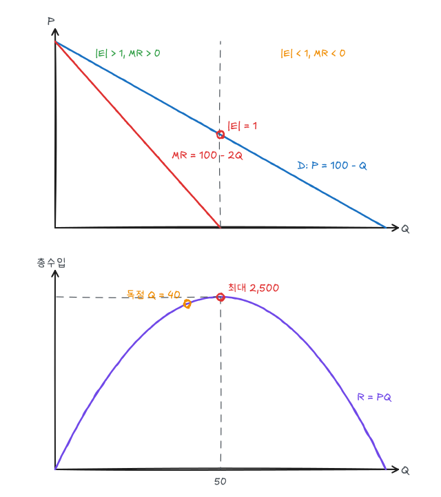
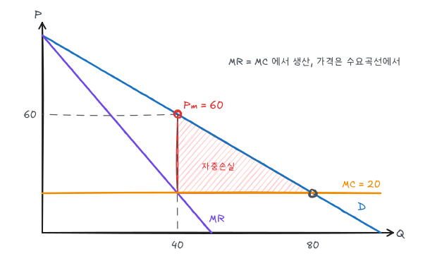
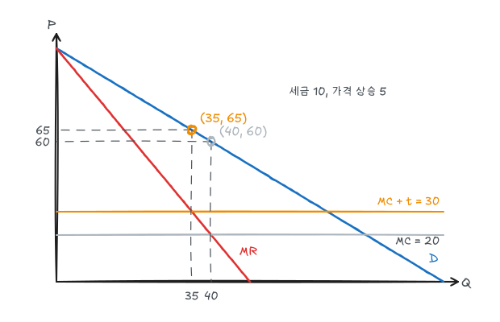
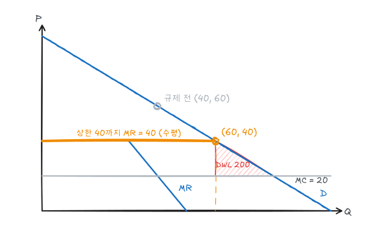
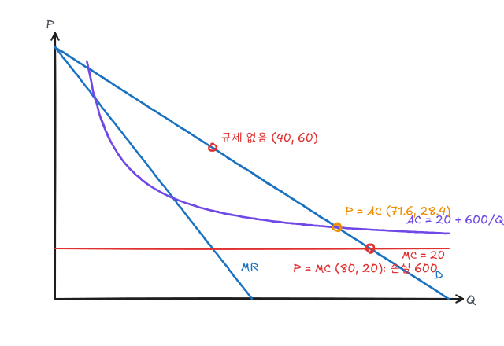
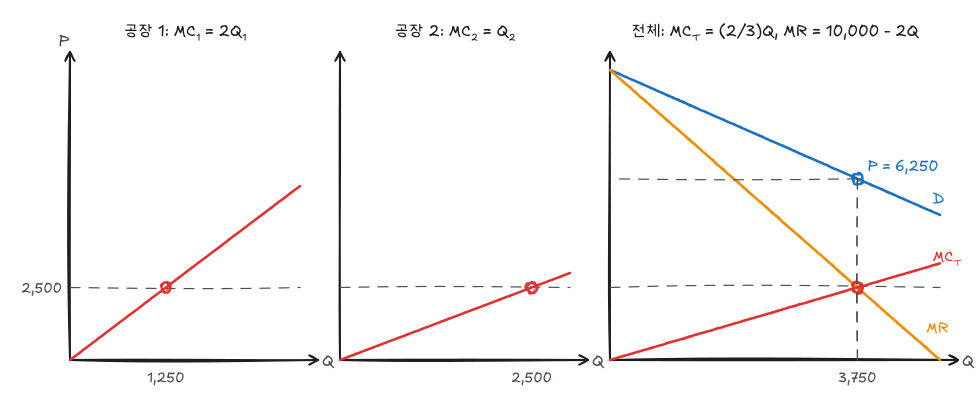
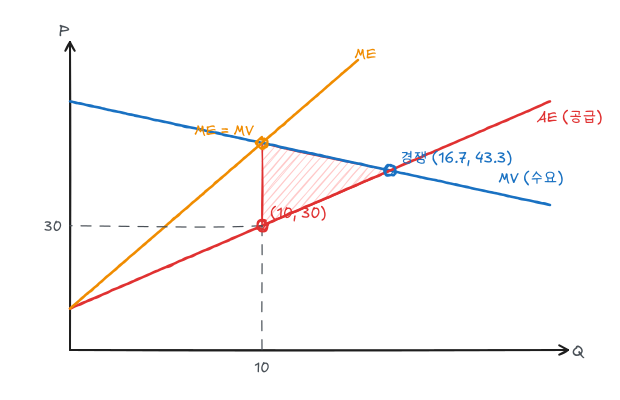

독점기업은 시장수요곡선 전체를 직면하므로 가격을 정할 수 있다. 예제는 다음과 같다.

$$
P = 100 - Q, \qquad MC = AC = 20
$$

## 1. 한계수입

$$
R = P(Q)\,Q, \qquad MR = \frac{dR}{dQ} = P + Q\frac{dP}{dQ}
$$

수요곡선이 우하향하면 더 팔기 위해 가격을 내려야 하고, 그 인하는 기존 판매분 전체에 적용된다. 따라서 $MR < P$이다.

선형 수요 $P = a - bQ$에서 $MR = a - 2bQ$로, **절편은 같고 기울기가 2배**다. 예제에서 $MR = 100 - 2Q$이다.

### 한계수입과 탄력성

$$
MR = P\left(1 + \frac{Q}{P}\frac{dP}{dQ}\right) = P\left(1 + \frac{1}{E_d}\right)
$$

| 탄력성 | MR |
|---|---|
| $\lvert E_d\rvert > 1$ | $MR > 0$ |
| $\lvert E_d\rvert = 1$ | $MR = 0$, 총수입 최대 |
| $\lvert E_d\rvert < 1$ | $MR < 0$ |

$MC > 0$이면 이윤극대화점에서 $MR > 0$이어야 하므로 **독점기업은 수요의 탄력적 구간에서 생산한다**.

수요곡선의 중점 $Q = 50$에서 $\lvert E \rvert = 1$이고 MR이 0이며, 총수입이 최대 2,500이다. 그 왼쪽(탄력적 구간)에서는 더 팔수록 총수입이 늘고, 오른쪽(비탄력적 구간)에서는 줄어든다. 독점 산출량 $Q = 40$은 탄력적 구간에 있다. 한계비용이 양수인 한 총수입이 줄어드는 구간까지 생산하는 것은 손해이기 때문이다.

## 2. 이윤극대화

$$
MR = MC: \quad 100 - 2Q = 20 \;\Rightarrow\; Q_m = 40, \quad P_m = 100 - 40 = 60
$$

$$
\pi = (60 - 20)(40) = 1{,}600
$$

비교를 위해 경쟁시장이라면 $P = MC = 20$에서 $Q_c = 80$이다.

| | 경쟁 | 독점 |
|---|---|---|
| 가격 | 20 | 60 |
| 수량 | 80 | 40 |
| 소비자잉여 | $\frac12(80)(80) = 3{,}200$ | $\frac12(40)(40) = 800$ |
| 생산자잉여(이윤) | 0 | 1,600 |
| 총잉여 | 3,200 | 2,400 |
| 자중손실 | 0 | **800** |

자중손실은 꼭짓점 $(40, 60), (40, 20), (80, 20)$인 삼각형으로 $\frac12 \times 40 \times 40 = 800$이다. 소비자잉여 감소분 2,400 중 1,600은 독점이윤으로 이전되고 800은 사라진다.

여기에 독점 지위를 얻거나 유지하려고 쓰는 로비·광고·과잉설비 비용(**지대추구**)이 추가 손실로 더해질 수 있다.

## 3. 가격설정의 경험법칙

$MR = MC$에 $MR = P(1 + 1/E_d)$를 대입하면

$$
\frac{P - MC}{P} = -\frac{1}{E_d}
\qquad\Leftrightarrow\qquad
P = \frac{MC}{1 + 1/E_d}
$$

예제 균형점의 탄력성은 $E_d = (dQ/dP)(P/Q) = -1 \times 60/40 = -1.5$이다.

$$
\frac{60 - 20}{60} = 0.667 = \frac{1}{1.5}, \qquad P = \frac{20}{1 - 1/1.5} = 60
$$

수요가 탄력적일수록 가격이 MC에 가까워진다. $E_d = -4$이면 $P = 20/(1 - 0.25) = 26.7$, $E_d = -2$이면 $P = 40$이다. 슈퍼마켓처럼 개별 점포 수요가 탄력적이면 마크업이 작고, 편의점처럼 덜 탄력적이면 마크업이 크다.

## 4. 독점에는 공급곡선이 없다

경쟁시장에서는 가격과 공급량이 일대일로 대응한다. 독점에서는 산출량이 MC뿐 아니라 **수요곡선의 모양**에 따라 결정되므로, 수요 이동에 따라 같은 가격에서 다른 수량을, 또는 같은 수량에서 다른 가격을 선택할 수 있다. 따라서 가격과 공급량의 고정된 관계(공급곡선)가 정의되지 않는다.

## 5. 세금의 효과

단위당 세금 $t$를 부과하면 MC가 $20 + t$가 된다. $t = 10$이면

$$
100 - 2Q = 30 \;\Rightarrow\; Q = 35,\quad P = 65
$$

가격이 세금의 절반(5)만큼 올랐다. 선형 수요, 일정한 MC에서 독점가격은 세금의 절반만큼 오른다. 수요가 일정 탄력성 형태이면 가격이 세금보다 더 많이 오를 수도 있다. $E_d = -2$이면 $P = 2\,MC$이므로 MC가 20에서 30으로 오를 때 가격은 40에서 60으로, 세금의 두 배인 20이 오른다.

세금은 MC를 20에서 30으로 올린다. 새 MC가 MR과 만나는 점에서 수량이 35로 줄고, 그 수량에서 수요곡선의 높이인 65가 새 가격이다. MR의 기울기가 수요곡선의 두 배이므로, MC가 10 오를 때 수량은 5 줄고 가격은 그 절반인 5만 오른다.

## 6. 다공장 독점

공장 1과 2의 비용이 다르면 각 공장의 MC가 같아지도록 생산을 나누고, 그 공통 MC를 MR과 같게 한다.

$$
MR(Q_T) = MC_1(Q_1) = MC_2(Q_2), \qquad Q_T = Q_1 + Q_2
$$

$MC_1 > MC_2$라면 공장 1의 생산을 줄이고 공장 2를 늘려 같은 총산출을 더 싸게 만들 수 있으므로, 균형에서는 두 MC가 같아야 한다. 전체 MC 곡선은 각 공장 MC의 수평합이다.

## 7. 시장지배력의 측정과 원천

**러너지수**

$$
L = \frac{P - MC}{P} = -\frac{1}{E_d}, \qquad 0 \le L \le 1
$$

예제의 독점 러너지수는 0.667이다. 완전경쟁이면 0이다. 높은 러너지수가 반드시 높은 이윤을 뜻하지는 않는다. 평균비용이 높으면 마크업이 커도 이윤이 작을 수 있다.

개별 기업의 수요 탄력성을 결정하는 요인:

1. **시장수요의 탄력성**: 대체재가 많을수록 탄력적
2. **시장 내 기업 수**: 많을수록 개별 기업 수요가 탄력적. 진입장벽(특허, 저작권, 규모의 경제, 정부 면허, 핵심 자원 독점)이 기업 수를 제한한다
3. **기업 간 상호작용**: 공격적으로 경쟁하면 시장지배력이 작아진다

## 8. 가격규제와 자연독점

### 가격상한 규제

예제에 가격상한 $\bar P$를 두면 $\bar P$ 아래에서는 MR이 $\bar P$인 수평선이 된다.

| 상한 | 결과 |
|---|---|
| $\bar P = 60$ 이상 | 효과 없음 |
| $20 < \bar P < 60$ | 수량이 $100 - \bar P$로 증가, 자중손실 감소 |
| $\bar P = 20$ ($= MC$) | $Q = 80$, 경쟁 결과, 자중손실 0 |
| $\bar P < 20$ | MC 아래이므로 공급이 0이 됨(조업중단), 초과수요 |

상한 40을 두면 수요곡선의 높이가 40 이상인 $Q \le 60$ 구간에서 기업은 추가 판매로 기존 판매가격을 낮출 필요가 없으므로 MR이 40인 수평선이 된다. 이 구간에서 $MR = 40 > MC = 20$이므로 기업은 60까지 생산한다. 자중손실은 800에서 200으로 줄어든다. 상한이 MC와 같은 20이면 자중손실이 0이 된다.

### 자연독점

규모의 경제가 매우 커서 한 기업이 시장 전체를 공급할 때 비용이 가장 낮은 경우다(전력, 수도, 철도). 평균비용이 계속 감소하므로 $MC < AC$이다.

- $P = MC$로 규제하면 $P < AC$이므로 손실이 나서 기업이 유지되지 않는다(보조금 필요).
- 현실에서는 $P = AC$로 규제해 경제적 이윤 0을 허용한다(수익률 규제).
- 수익률 규제는 허용 수익률 $s$, 자본 $K$, 감가상각 $D$, 세금 $T$로 가격을 $P = AVC + \dfrac{D + T + sK}{Q}$로 정한다. 비용 정보 문제, 규제 지연, 과잉 자본투자 유인의 문제가 있다.
- 그 밖에 요금을 평균비용에 맞추는 방법(평균비용 가격설정), 사용량 구간마다 다른 가격을 매기는 방법(구간 가격)도 쓴다.

그림은 본문의 수요 $P = 100 - Q$, $MC = 20$에 고정비용 600을 더한 예시다. 평균비용 $AC = 20 + 600/Q$는 어디서나 MC보다 높고 계속 감소한다. 규제가 없으면 독점 결과 $(40, 60)$에서 이윤 1,000을 얻는다. $P = MC$로 규제하면 수량 80으로 효율적이지만 가격 20이 AC 27.5보다 낮아 고정비용 600만큼 손실이 난다. $P = AC$로 규제하면 수요곡선과 AC가 만나는 $(71.6, 28.4)$에서 이윤 0이 되고, 자중손실은 남지만 크게 줄어든다. 자중손실은 규제가 없으면 $\frac12(60 - 20)(80 - 40) = 800$, $P = AC$이면 $\frac12(28.4 - 20)(80 - 71.6) \approx 35$, $P = MC$이면 0이다(대신 보조금 600이 필요하다).

## 9. 수요독점

구매자가 하나인 시장에서는 구매자가 시장지배력을 갖는다. 구매를 늘리면 모든 단위의 가격이 오르므로 **한계지출(ME)**이 평균지출(공급곡선)보다 높다.

$$
ME = MV \quad(\text{한계가치 = 수요곡선})
$$

수요독점자는 경쟁보다 적게 사고 낮은 가격을 지불한다. 노동시장의 예는 [요소시장](/posts/micro-factor-market)에서 수치로 다룬다. 수요독점력의 원천은 시장 공급의 탄력성, 구매자 수, 구매자 간 상호작용이다.

독점의 러너지수에 대응하는 **수요독점력 지수**는 공급 탄력성 $E_S$로 정해진다. $ME = P(1 + 1/E_S) = MV$이므로

$$
\frac{MV - P}{P} = \frac{1}{E_S}
$$

공급이 탄력적일수록 구매자가 가격을 낮출 여지(마크다운)가 작다. 한 판매자와 한 구매자만 있는 **쌍방독점**에서는 양쪽 모두 가격을 정할 수 없어 결과가 협상력에 달려 있고 이론이 하나의 해를 주지 않는다.

## 10. 강의 예제

### 독점과 자중손실

$P = 60 - 2Q$, $MC = 2Q$이면 $MR = 60 - 4Q = 2Q$에서 $Q_m = 10$, $P_m = 40$이다. 사회적 최적은 $P = MC$인 $60 - 2Q = 2Q$에서 $Q_c = 15$, $P_c = 30$이다.

$$
DWL = \tfrac12(40 - 20)(15 - 10) = 50, \qquad L = \frac{P - MC}{P} = \frac{40 - 20}{40} = 0.5
$$

### 다공장 독점

$P = 10{,}000 - Q$, 두 공장의 비용이 $TC_1 = Q_1^2$, $TC_2 = \tfrac12 Q_2^2$이다. $MC_1 = 2Q_1$, $MC_2 = Q_2$를 수평으로 더하면 $Q_T = \tfrac12 MC + MC = \tfrac32 MC$, 즉 $MC_T = \tfrac23 Q_T$이다.

$$
MR = 10{,}000 - 2Q = \tfrac23 Q \;\Rightarrow\; Q^* = 3{,}750,\quad MC = 2{,}500,\quad P = 6{,}250
$$

$$
Q_1 = \tfrac12(2{,}500) = 1{,}250, \qquad Q_2 = 2{,}500
$$

비용이 싼 공장 2가 두 배를 생산한다.

오른쪽 그림에서 두 공장의 MC를 수평으로 더한 $MC_T$가 MR과 만나는 $Q = 3{,}750$, $MC = 2{,}500$이 전체 산출과 공통 한계비용이다. 같은 높이 2,500의 수평선이 왼쪽 두 그림에서 각 공장의 MC와 만나는 점이 공장별 생산량 1,250과 2,500이다. 가격은 전체 산출에서 수요곡선의 높이 6,250이다.

### 독점과 수입규제

국내 독점기업: 수요 $P = 50 - Q$, $MC = 5 + Q$, 국제가격 10.

| 상황 | 결정 | 국내 생산 | 소비 | 수입 | 가격 |
|---|---|---|---|---|---|
| 수입 금지 | $MR = 50 - 2Q = 5 + Q$ | 15 | 15 | 0 | 35 |
| 자유무역 | 국제가격 10을 받아들임, $10 = 5 + Q$ | 5 | 40 | 35 | 10 |
| 관세 7 | 국내가격 17, $17 = 5 + Q$ | 12 | 33 | 21 | 17 |

자유무역에서는 독점기업도 가격수용자가 되어 $P = MC$로 생산한다. 수입 금지는 독점력을 그대로 남긴다.

### 수요독점

공급곡선 $P = 10 + 2Q$(평균지출), 한계가치 $MV = 60 - Q$이다. $E = (10 + 2Q)Q$이므로 $ME = 10 + 4Q$.

$$
ME = MV: \quad 10 + 4Q = 60 - Q \;\Rightarrow\; Q = 10, \quad P = 10 + 2(10) = 30
$$

경쟁이라면 $10 + 2Q = 60 - Q$에서 $Q = 16.7$, $P = 43.3$이다. 수요독점자는 더 적게 사고 더 낮은 가격을 지불한다. 균형점에서 $E_S = \frac12 \times \frac{30}{10} = 1.5$이고 $\frac{MV - P}{P} = \frac{50 - 30}{30} = 0.667 = \frac{1}{1.5}$로 지수 식과 맞는다.

수요독점자는 ME와 MV가 만나는 $Q = 10$에서 구매량을 정하고, 공급곡선이 허용하는 최저 가격 30을 지불한다. 경쟁이라면 공급곡선과 MV가 만나는 $(16.7, 43.3)$에서 거래된다. 빨간 삼각형(약 66.7)이 수요독점의 자중손실이다. 독점이 수요곡선 위에서 높은 가격을 고르듯, 수요독점은 공급곡선 위에서 낮은 가격을 고른다.

## 11. 비교

완전경쟁, 독점, 수요독점은 같은 구조를 판매 쪽과 구매 쪽에서 본 것이다.

| 구분 | 완전경쟁 | 독점(판매자 1) | 수요독점(구매자 1) |
|---|---|---|---|
| 직면하는 곡선 | 수평 | 시장수요 | 시장공급 |
| 결정 조건 | $P = MC$ | $MR = MC$ | $ME = MV$ |
| 한계와 평균의 관계 | $MR = P$ | $MR < P$ | $ME > P$ |
| 거래량 | 효율적 | 경쟁보다 적음 | 경쟁보다 적음 |
| 가격 | 경쟁가격 | 경쟁보다 높음 | 경쟁보다 낮음 |
| 시장지배력 지표 | 0 | $(P - MC)/P = -1/E_d$ | $(MV - P)/P = 1/E_S$ |
| 예제 | $P = 20$, $Q = 80$ | $P = 60$, $Q = 40$ | $P = 30$, $Q = 10$ (경쟁 43.3, 16.7) |

가격규제는 두 경우 모두 가격을 경쟁수준으로 묶으면 거래량이 효율적이 된다는 점에서 같다. 독점은 상한이 MC까지 낮아지면 되고(8절), 수요독점은 하한이 경쟁가격까지 높아지면 된다. 독점에 대한 대응이 가격규제 외에 **독점금지법**(합병 심사, 담합 금지)으로도 이루어진다는 점도 함께 기억해 둔다.

## 정리

- $MR = P(1 + 1/E_d) < P$이므로 독점은 탄력적 구간에서 생산하고, $MR = MC$에서 경쟁보다 적게 높은 가격으로 판다.
- 마크업은 $(P - MC)/P = -1/E_d$로 탄력성이 정한다. 높은 러너지수가 높은 이윤은 아니다.
- 독점은 공급곡선이 없고, 세금은 가격을 세금의 절반(선형 수요)에서 그 이상까지 올린다.
- 자연독점은 $P = MC$면 손실, $P = AC$면 이윤 0과 작은 자중손실이다.
- 수요독점은 구매자 쪽 거울상이다. 한계지출이 공급곡선보다 높아 경쟁보다 적게, 낮은 가격에 산다.
