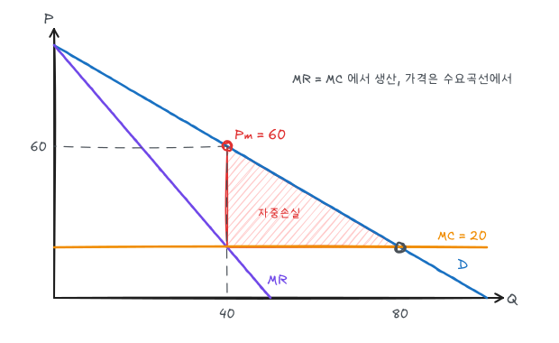

독점기업은 시장수요곡선 전체를 직면하므로 가격을 정할 수 있다. 예제는 다음과 같다.

$$
P = 100 - Q, \qquad MC = AC = 20
$$

## 1. 한계수입

$$
R = P(Q)\,Q, \qquad MR = \frac{dR}{dQ} = P + Q\frac{dP}{dQ}
$$

수요곡선이 우하향하면 더 팔기 위해 가격을 내려야 하고, 그 인하는 기존 판매분 전체에 적용된다. 따라서 $MR < P$이다.

선형 수요 $P = a - bQ$에서 $MR = a - 2bQ$로, **절편은 같고 기울기가 2배**다. 예제에서 $MR = 100 - 2Q$이다.

### 한계수입과 탄력성

$$
MR = P\left(1 + \frac{Q}{P}\frac{dP}{dQ}\right) = P\left(1 + \frac{1}{E_d}\right)
$$

| 탄력성 | MR |
|---|---|
| $\lvert E_d\rvert > 1$ | $MR > 0$ |
| $\lvert E_d\rvert = 1$ | $MR = 0$, 총수입 최대 |
| $\lvert E_d\rvert < 1$ | $MR < 0$ |

$MC > 0$이면 이윤극대화점에서 $MR > 0$이어야 하므로 **독점기업은 수요의 탄력적 구간에서 생산한다**.

## 2. 이윤극대화

$$
MR = MC: \quad 100 - 2Q = 20 \;\Rightarrow\; Q_m = 40, \quad P_m = 100 - 40 = 60
$$

$$
\pi = (60 - 20)(40) = 1{,}600
$$

비교를 위해 경쟁시장이라면 $P = MC = 20$에서 $Q_c = 80$이다.

| | 경쟁 | 독점 |
|---|---|---|
| 가격 | 20 | 60 |
| 수량 | 80 | 40 |
| 소비자잉여 | $\frac12(80)(80) = 3{,}200$ | $\frac12(40)(40) = 800$ |
| 생산자잉여(이윤) | 0 | 1,600 |
| 총잉여 | 3,200 | 2,400 |
| 자중손실 | 0 | **800** |

자중손실은 꼭짓점 $(40, 60), (40, 20), (80, 20)$인 삼각형으로 $\frac12 \times 40 \times 40 = 800$이다. 소비자잉여 감소분 2,400 중 1,600은 독점이윤으로 이전되고 800은 사라진다.

여기에 독점 지위를 얻거나 유지하려고 쓰는 로비·광고·과잉설비 비용(**지대추구**)이 추가 손실로 더해질 수 있다.

## 3. 가격설정의 경험법칙

$MR = MC$에 $MR = P(1 + 1/E_d)$를 대입하면

$$
\frac{P - MC}{P} = -\frac{1}{E_d}
\qquad\Leftrightarrow\qquad
P = \frac{MC}{1 + 1/E_d}
$$

예제 균형점의 탄력성은 $E_d = (dQ/dP)(P/Q) = -1 \times 60/40 = -1.5$이다.

$$
\frac{60 - 20}{60} = 0.667 = \frac{1}{1.5}, \qquad P = \frac{20}{1 - 1/1.5} = 60
$$

수요가 탄력적일수록 가격이 MC에 가까워진다. $E_d = -4$이면 $P = 20/(1 - 0.25) = 26.7$, $E_d = -2$이면 $P = 40$이다. 슈퍼마켓처럼 개별 점포 수요가 탄력적이면 마크업이 작고, 편의점처럼 덜 탄력적이면 마크업이 크다.

## 4. 독점에는 공급곡선이 없다

경쟁시장에서는 가격과 공급량이 일대일로 대응한다. 독점에서는 산출량이 MC뿐 아니라 **수요곡선의 모양**에 따라 결정되므로, 수요 이동에 따라 같은 가격에서 다른 수량을, 또는 같은 수량에서 다른 가격을 선택할 수 있다. 따라서 가격과 공급량의 고정된 관계(공급곡선)가 정의되지 않는다.

## 5. 세금의 효과

단위당 세금 $t$를 부과하면 MC가 $20 + t$가 된다. $t = 10$이면

$$
100 - 2Q = 30 \;\Rightarrow\; Q = 35,\quad P = 65
$$

가격이 세금의 절반(5)만큼 올랐다. 선형 수요, 일정한 MC에서 독점가격은 세금의 절반만큼 오른다. 수요가 일정 탄력성 형태이면 가격이 세금보다 더 많이 오를 수도 있다.

## 6. 다공장 독점

공장 1과 2의 비용이 다르면 각 공장의 MC가 같아지도록 생산을 나누고, 그 공통 MC를 MR과 같게 한다.

$$
MR(Q_T) = MC_1(Q_1) = MC_2(Q_2), \qquad Q_T = Q_1 + Q_2
$$

$MC_1 > MC_2$라면 공장 1의 생산을 줄이고 공장 2를 늘려 같은 총산출을 더 싸게 만들 수 있으므로, 균형에서는 두 MC가 같아야 한다. 전체 MC 곡선은 각 공장 MC의 수평합이다.

## 7. 시장지배력의 측정과 원천

**러너지수**

$$
L = \frac{P - MC}{P} = -\frac{1}{E_d}, \qquad 0 \le L \le 1
$$

예제의 독점 러너지수는 0.667이다. 완전경쟁이면 0이다. 높은 러너지수가 반드시 높은 이윤을 뜻하지는 않는다. 평균비용이 높으면 마크업이 커도 이윤이 작을 수 있다.

개별 기업의 수요 탄력성을 결정하는 요인:

1. **시장수요의 탄력성**: 대체재가 많을수록 탄력적
2. **시장 내 기업 수**: 많을수록 개별 기업 수요가 탄력적. 진입장벽(특허, 저작권, 규모의 경제, 정부 면허, 핵심 자원 독점)이 기업 수를 제한한다
3. **기업 간 상호작용**: 공격적으로 경쟁하면 시장지배력이 작아진다

## 8. 가격규제와 자연독점

### 가격상한 규제

예제에 가격상한 $\bar P$를 두면 $\bar P$ 아래에서는 MR이 $\bar P$인 수평선이 된다.

| 상한 | 결과 |
|---|---|
| $\bar P = 60$ 이상 | 효과 없음 |
| $20 < \bar P < 60$ | 수량이 $100 - \bar P$로 증가, 자중손실 감소 |
| $\bar P = 20$ ($= MC$) | $Q = 80$, 경쟁 결과, 자중손실 0 |
| $\bar P < 20$ | MC 아래이므로 공급 감소, 초과수요 |

### 자연독점

규모의 경제가 매우 커서 한 기업이 시장 전체를 공급할 때 비용이 가장 낮은 경우다(전력, 수도, 철도). 평균비용이 계속 감소하므로 $MC < AC$이다.

- $P = MC$로 규제하면 $P < AC$이므로 손실이 나서 기업이 유지되지 않는다(보조금 필요).
- 현실에서는 $P = AC$로 규제해 경제적 이윤 0을 허용한다(수익률 규제).
- 수익률 규제는 비용 정보 문제, 규제 지연, 과잉 자본투자 유인의 문제가 있다.

## 9. 수요독점

구매자가 하나인 시장에서는 구매자가 시장지배력을 갖는다. 구매를 늘리면 모든 단위의 가격이 오르므로 **한계지출(ME)**이 평균지출(공급곡선)보다 높다.

$$
ME = MV \quad(\text{한계가치 = 수요곡선})
$$

수요독점자는 경쟁보다 적게 사고 낮은 가격을 지불한다. 노동시장의 예는 [요소시장](/posts/micro-factor-market)에서 수치로 다룬다. 수요독점력의 원천은 시장 공급의 탄력성, 구매자 수, 구매자 간 상호작용이다.

## 정리

| 개념 | 식 | 예제 |
|---|---|---|
| 한계수입 | $P(1 + 1/E_d)$ | $100 - 2Q$ |
| 이윤극대화 | $MR = MC$ | $Q = 40$, $P = 60$, $\pi = 1{,}600$ |
| 마크업 규칙 | $(P - MC)/P = -1/E_d$ | 0.667 |
| 자중손실 | 경쟁 대비 사라진 잉여 | 800 |
| 세금 $t = 10$ | | $P$: 60 → 65 |
| 자연독점 규제 | $P = AC$ | |
