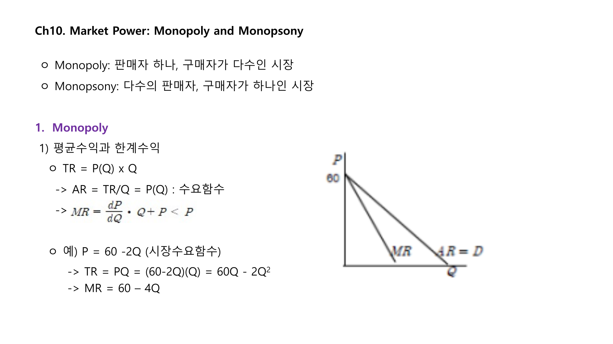
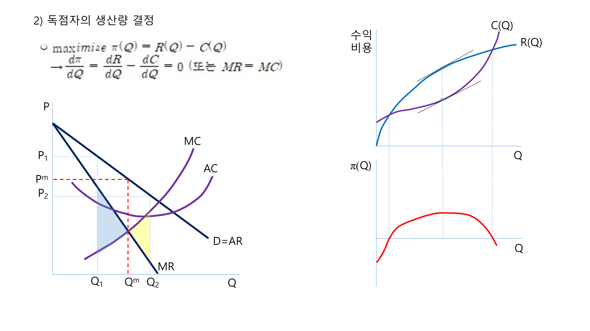

독점은 판매자가 하나이고 구매자가 다수인 시장이다. 독점기업은 시장수요곡선 전체를 직면하므로 가격을 주어진 것으로 받아들이지 않고, 가격과 생산량을 함께 고려해 이윤을 극대화한다.

## 1. 평균수입과 한계수입

독점기업의 총수입은 가격과 판매량의 곱이다.

$$
TR = P(Q)Q
$$

평균수입은 총수입을 판매량으로 나눈 것이므로 수요가격과 같다.

$$
AR = \frac{TR}{Q} = P(Q)
$$

한계수입은 판매량을 한 단위 늘릴 때 총수입이 얼마나 변하는지를 나타낸다.

$$
MR = \frac{dTR}{dQ}
$$

예를 들어 시장수요가 $P = 60 - 2Q$라면

$$
TR = (60 - 2Q)Q = 60Q - 2Q^2
$$

$$
MR = 60 - 4Q
$$

선형 수요에서 한계수입곡선은 수요곡선보다 두 배 가파르게 내려간다.

 

 

## 2. 독점자의 생산량 결정

독점기업도 이윤극대화 조건은 한계수입과 한계비용이 같다는 것이다.

$$
MR = MC
$$

다만 완전경쟁과 달리 독점에서는 $P > MR$이다. 따라서 독점가격은 한계비용보다 높다.

생산량은 $MR = MC$에서 정하고, 가격은 그 생산량에서 수요곡선이 지불할 수 있는 가격으로 결정된다.

 

 

## 3. 독점력과 러너지수

독점력은 가격을 한계비용보다 높게 설정할 수 있는 능력이다. 이를 러너지수로 측정한다.

$$
L = \frac{P - MC}{P}
$$

독점기업의 이윤극대화 조건을 탄력성으로 쓰면

$$
\frac{P - MC}{P} = -\frac{1}{E_d}
$$

수요가 덜 탄력적일수록 독점기업은 가격을 한계비용보다 더 높게 설정할 수 있다.

## 4. 독점의 사회적 비용

완전경쟁에서는 $P = MC$가 되지만 독점에서는 $P > MC$이고 생산량은 경쟁균형보다 적다. 그 결과 일부 거래가 사라지고 사중손실이 발생한다.

독점은 소비자잉여 일부를 생산자잉여로 이전시키고, 나머지는 사회 전체의 손실로 사라지게 만든다.

## 5. 가격규제와 자연독점

자연독점은 규모의 경제가 커서 한 기업이 시장 전체를 공급하는 것이 비용 측면에서 유리한 경우다. 전력, 수도, 철도 같은 산업이 전형적인 예다.

한계비용 가격규제는 효율적이지만, 평균비용이 한계비용보다 높으면 기업이 손실을 볼 수 있다.

$$
P = MC
$$

평균비용 가격규제는 기업의 손실을 막지만 완전한 효율성은 달성하지 못한다.

$$
P = AC
$$

## 6. 독점수요

독점수요는 구매자가 하나이고 판매자가 다수인 시장이다. 독점수요자는 구매량을 늘리려면 더 높은 가격을 지불해야 하므로 한계지출이 공급가격보다 크다.

독점수요자의 최적 구매량은 한계가치와 한계지출이 같은 곳에서 결정된다.

$$
MV = ME
$$

그 결과 경쟁시장보다 낮은 가격과 적은 거래량이 나타날 수 있다.

## 정리

독점의 핵심은 $MR = MC$로 생산량을 정하지만 가격은 수요곡선에서 결정한다는 점이다. 독점가격은 한계비용보다 높고 생산량은 경쟁시장보다 적다. 수요가 비탄력적일수록 독점력은 커지며, 그 결과 소비자잉여 감소와 사중손실이 발생한다.
