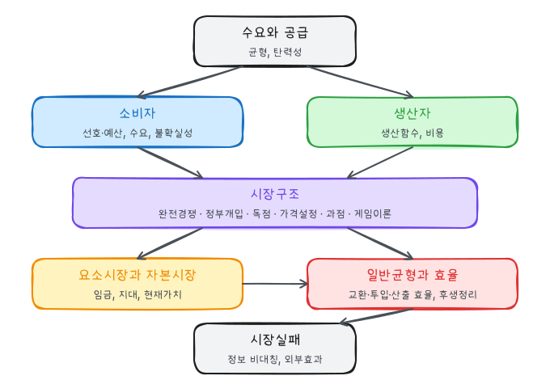

Pindyck·Rubinfeld 『미시경제학』을 기반으로 한 강의 자료를 바탕으로 정리한 시리즈다. 이 글은 교재 1장의 기초 개념과 시리즈 전체의 흐름을 정리한다. 각 장의 세부 내용과 계산 예제는 개별 글에서 다룬다.

## 1. 미시경제학의 대상

미시경제학은 소비자, 기업, 노동자 같은 **개별 경제주체**가 어떻게 선택하고, 그 선택이 시장에서 어떻게 상호작용해 가격과 수량을 결정하는지 분석한다. 거시경제학은 국민소득, 물가, 실업, 이자율 같은 **집계 변수**를 다룬다. 거시 현상도 결국 개별 시장의 합이므로 현대 거시경제학은 미시적 기초 위에 서 있다.

미시경제학의 세 가지 축:

| 축 | 질문 | 해당 글 |
|---|---|---|
| 상충관계(trade-off) | 제한된 소득·자원으로 무엇을 선택하는가 | 소비자, 생산, 비용 |
| 가격 | 가격은 선택에 어떤 신호를 주는가 | 수요와 공급, 경쟁시장 |
| 시장 | 시장구조에 따라 결과가 어떻게 달라지는가 | 독점, 과점, 게임이론 |

## 2. 이론과 모형

경제이론은 현실을 단순화한 **모형**이다. 소비자가 효용을 극대화하고 기업이 이윤을 극대화한다는 가정에서 출발해 예측을 도출하고, 그 예측을 자료로 검증한다. 모형의 가정이 비현실적이라는 것만으로는 모형을 버리지 않는다. 관심 있는 현상을 얼마나 잘 예측하고 설명하는지로 평가한다.

| 분석 | 질문 형태 | 예 |
|---|---|---|
| 실증적 분석 | "~하면 어떻게 되는가" (원인과 결과) | 수입 자동차에 관세를 부과하면 국내 자동차 가격은 얼마나 오르는가 |
| 규범적 분석 | "무엇을 해야 하는가" (가치판단 포함) | 관세를 부과해야 하는가 |

규범적 분석도 실증적 분석 결과(누가 얼마나 얻고 잃는가)를 바탕으로 한다. 이 시리즈의 잉여 분석과 자중손실 계산은 실증적 분석이고, 그 결과로 정책을 평가하는 부분이 규범적 분석이다.

## 3. 시장의 정의

**시장**은 상호작용을 통해 가격을 결정하는 구매자와 판매자의 집합이다. **산업**은 같은 재화를 판매하는 기업들의 집합이다.

시장의 범위는 두 차원에서 정한다.

| 차원 | 내용 | 예 |
|---|---|---|
| 지리적 범위 | 어느 지역까지 같은 가격으로 움직이는가 | 주택은 지역 시장, 금은 세계 시장 |
| 상품 범위 | 어떤 상품들이 서로 대체되는가 | 콜라 시장에 다른 탄산음료를 포함하는가 |

시장을 넓게 잡을수록 각 기업의 점유율이 작아져 시장지배력이 작게 평가된다. 그래서 기업결합 심사에서 시장 획정이 중요한 쟁점이 된다.

**차익거래**: 한 곳에서 싸게 사서 다른 곳에서 비싸게 파는 행위다. 같은 시장 안에서는 차익거래가 가격 차이를 운송비 이내로 줄인다. 가격 차이가 운송비보다 크게 지속되면 두 지역은 별개의 시장이다.

## 4. 명목가격과 실질가격

**명목가격**은 그 시점의 화폐로 표시한 가격이다. 물가가 오르면 명목가격도 오르므로 시점이 다른 가격을 비교하려면 물가 변화를 제거한 **실질가격**을 써야 한다.

$$
\text{실질가격}_t = \text{명목가격}_t \times \frac{CPI_{\text{기준연도}}}{CPI_t}
$$

가상 예: 어떤 재화의 가격이 1990년 300원, 2020년 800원이고 소비자물가지수(2020 = 100)가 1990년 30이라 하자.

$$
\text{1990년 가격의 2020년 원화 환산} = 300 \times \frac{100}{30} = 1{,}000\text{원}
$$

명목가격은 2.7배 올랐지만 실질가격은 1,000원에서 800원으로 20% **하락**했다. 물가 전체보다 덜 올랐으므로 다른 재화에 비해 상대적으로 싸졌다.

기준연도를 1990년으로 잡아도 결론은 같다: 2020년 가격 800원은 1990년 원화로 $800 \times 30/100 = 240$원이다.

CPI는 소비자가 사는 바구니, 생산자물가지수(PPI)는 기업 간 거래되는 중간재·원자재 가격을 측정한다. 라스파이레스형 물가지수의 한계는 [소비자 행동](/posts/micro-consumer-behavior)에서 다룬다.

## 5. 시리즈 지도

| 파트 | 글 | 핵심 조건 |
|---|---|---|
| 시장 기초 | [수요와 공급의 기초](/posts/micro-supply-demand) | $Q_D = Q_S$, 탄력성 |
| 소비자 | [소비자 행동](/posts/micro-consumer-behavior) | $MRS = P_X/P_Y$ |
| | [개별수요와 시장수요](/posts/micro-individual-market-demand) | 대체효과 + 소득효과 |
| | [불확실성하의 소비자 행동](/posts/micro-uncertainty-consumer-behavior) | 기대효용, 위험프리미엄 |
| 생산자 | [생산](/posts/micro-production) | $MRTS = MP_L/MP_K$ |
| | [비용](/posts/micro-cost) | $MRTS = w/r$, LAC는 SAC의 포락선 |
| 시장구조 | [완전경쟁시장](/posts/micro-perfect-competition) | $P = MC$, 장기 $P = \min AC$ |
| | [경쟁시장 분석](/posts/micro-competitive-market-analysis) | 잉여와 자중손실 |
| | [독점과 시장지배력](/posts/micro-monopoly-market-power) | $MR = MC$, $(P - MC)/P = -1/E_d$ |
| | [시장지배력과 가격설정](/posts/micro-pricing-market-power) | $MR_1 = MR_2 = MC$ |
| | [독점적 경쟁과 과점](/posts/micro-monopolistic-competition-oligopoly) | 반응곡선, 내쉬균형 |
| | [게임이론](/posts/micro-game-theory) | 우월전략, 역진귀납 |
| 요소·자본 | [요소시장](/posts/micro-factor-market) | $MRP_L = w$, 수요독점 $MRP = ME$ |
| | [자본시장](/posts/micro-capital-market) | $NPV > 0$ |
| 일반균형 | [일반균형과 경제적 효율](/posts/micro-general-equilibrium-efficiency) | $MRS^A = MRS^B$, $MRS = MRT$ |
| 시장실패 | [정보의 비대칭](/posts/micro-asymmetric-information) | 역선택, 도덕적 해이 |
| | [외부효과와 공공재](/posts/micro-externalities-public-goods) | $MSB = MSC$, 수직합 = MC |

### 흐름 요약

1. **수요와 공급**으로 가격이 정해지는 기본 구조를 본다.
2. 수요곡선 뒤에는 **소비자의 효용극대화**가, 공급곡선 뒤에는 **기업의 비용최소화와 이윤극대화**가 있다.
3. 두 행동이 만나는 방식이 **시장구조**에 따라 달라진다. 완전경쟁은 $P = MC$로 총잉여를 극대화하고, 시장지배력이 있으면 $P > MC$가 되어 자중손실이 생긴다.
4. 같은 논리를 상품 대신 **생산요소**에 적용하면 임금과 이자율이 결정된다.
5. 모든 시장을 함께 보면 경쟁균형이 **파레토 효율**적이라는 후생경제학 제1정리에 도달한다.
6. 그 정리의 가정이 깨지는 경우, 즉 **시장지배력, 정보 비대칭, 외부효과, 공공재**가 정부 개입의 근거가 된다.

### 반복해서 나오는 원리

| 원리 | 등장하는 곳 |
|---|---|
| 한계 = 가격 (한계편익 = 한계비용) | $MRS = P_X/P_Y$, $P = MC$, $MRP = w$, $MSB = MSC$ |
| 1원당 한계값 균등 | 한계효용 균등, $MP_L/w = MP_K/r$, $MR_1 = MR_2$ |
| 평균과 한계의 관계 | AP와 MP, AC와 MC, AE와 ME, AR과 MR |
| 대체효과와 소득효과 | 가격 변화에 대한 수요, 임금 변화에 대한 노동공급 |
| 잉여와 자중손실 | 정부 개입, 독점, 수요독점, 외부효과 |
