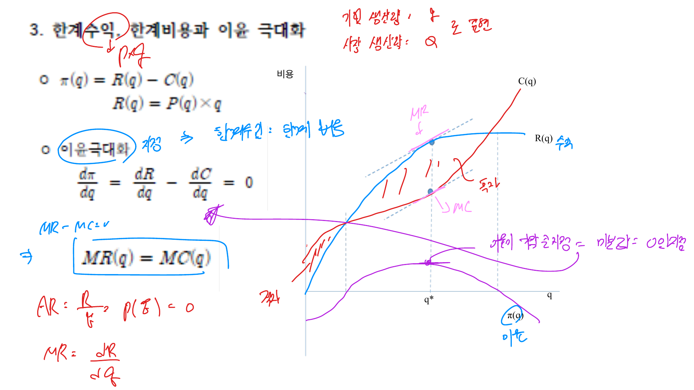
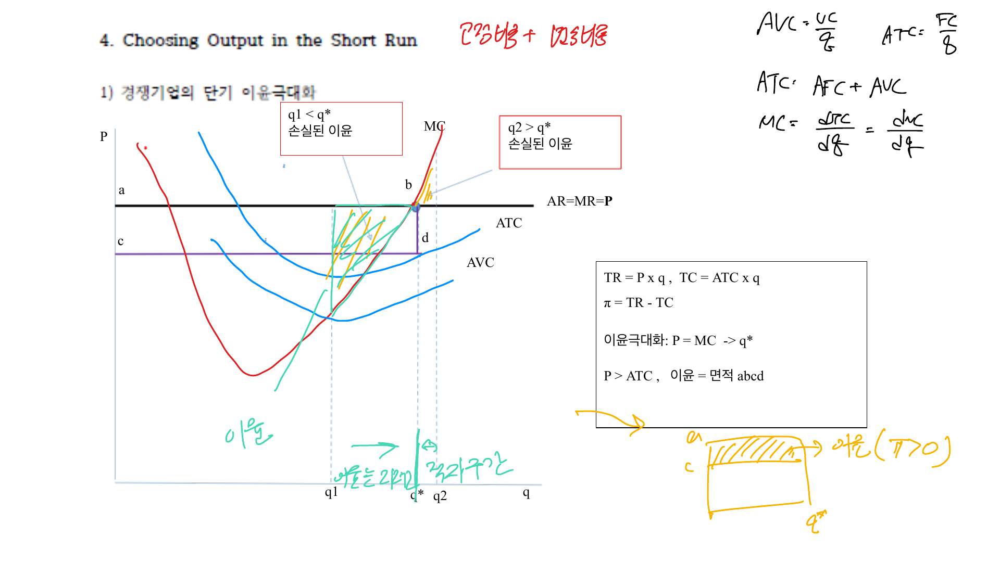

완전경쟁시장은 개별 기업이 시장가격에 영향을 줄 수 없는 시장이다. 기업은 가격을 주어진 것으로 받아들이고, 이윤을 극대화하는 생산량만 선택한다.

## 1. 완전경쟁시장의 조건

완전경쟁시장은 보통 다음 조건을 가진다.

- 많은 판매자와 구매자가 존재한다.
- 개별 기업은 가격수용자다.
- 상품은 동질적이다.
- 진입과 퇴출이 자유롭다.
- 정보가 충분하다.

이 조건에서 개별 기업이 직면하는 수요곡선은 시장가격에서 수평이다.

$$
P = AR = MR
$$

## 2. 이윤극대화

기업의 이윤은 총수입에서 총비용을 뺀 것이다.

$$
\pi(q) = R(q) - C(q)
$$

완전경쟁기업의 총수입은 가격과 산출량의 곱이다.

$$
R(q) = Pq
$$

이윤극대화의 1계 조건은 한계수입과 한계비용이 같다는 것이다.

$$
MR = MC
$$

완전경쟁에서는 $MR = P$이므로

$$
P = MC
$$

 

 

## 3. 이윤과 손실

생산량은 $P = MC$에서 결정되지만, 이윤이 양수인지 음수인지는 가격과 평균총비용의 관계가 결정한다.

$$
\pi = TR - TC = Pq - ATC \cdot q = (P - ATC)q
$$

따라서

- $P > ATC$: 경제적 이윤
- $P = ATC$: 정상이윤
- $P < ATC$: 손실

 

 

## 4. 조업중단점

단기에는 고정비용이 이미 발생했으므로, 기업은 가격이 평균가변비용보다 높으면 손실이 나더라도 생산을 계속할 수 있다.

조업을 계속할 조건은 다음과 같다.

$$
TR \ge VC
$$

$$
Pq \ge AVC \cdot q
$$

$$
P \ge AVC
$$

따라서 가격이 평균가변비용의 최저점보다 낮으면 조업을 중단한다. 단기 공급곡선은 평균가변비용 최저점 위의 한계비용곡선이다.

## 5. 시장공급

단기 시장공급곡선은 각 기업의 단기 공급곡선을 수평으로 더한 것이다.

$$
Q^S(P) = \sum_i q_i(P)
$$

시장가격이 오르면 각 기업은 $P = MC$ 조건에 따라 생산량을 늘리고, 시장 전체 공급량도 증가한다.

## 6. 장기균형

장기에는 기업의 진입과 퇴출이 가능하다. 시장가격이 평균비용보다 높아 경제적 이윤이 발생하면 새로운 기업이 진입한다. 공급이 증가하면서 가격은 하락한다.

반대로 손실이 발생하면 기업이 퇴출하고 공급이 감소하면서 가격이 상승한다. 장기균형에서는 경제적 이윤이 0이 된다.

$$
P = MC = \min AC
$$

이는 완전경쟁 장기균형에서 가격이 최소평균비용과 같아진다는 뜻이다.

## 7. 효율성

완전경쟁균형은 생산효율성과 배분효율성을 가진다.

생산효율성은 장기균형에서 기업이 최소평균비용으로 생산한다는 뜻이다.

$$
P = \min AC
$$

배분효율성은 소비자의 한계편익이 생산의 한계비용과 같다는 뜻이다.

$$
P = MB = MC
$$

## 정리

완전경쟁기업은 가격을 통제하지 못하므로 생산량만 선택한다. 단기 생산량은 $P = MC$에서 결정되고, 조업 여부는 $P \ge AVC$로 판단한다. 장기에는 진입과 퇴출 때문에 경제적 이윤이 0이 되고 $P = MC = \min AC$가 성립한다.
