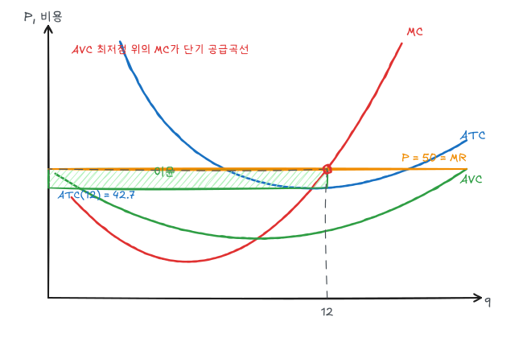

[비용](/posts/micro-cost)에서 구한 비용곡선을 그대로 써서 완전경쟁기업의 산출 결정을 분석한다. 예제 비용함수는 다음과 같다.

$$
MC = q^2 - 12q + 50,\quad AVC = \tfrac13 q^2 - 6q + 50,\quad FC = 200
$$

## 1. 완전경쟁의 가정

| 가정 | 결과 |
|---|---|
| 다수의 판매자와 구매자 | 개별 기업은 가격수용자 |
| 동질적 상품 | 모든 기업이 같은 가격을 받음 |
| 자유로운 진입과 퇴출 | 장기 경제적 이윤 0 |
| 완전한 정보 | 일물일가 |

개별 기업이 직면하는 수요곡선은 시장가격 수준의 **수평선**이다. 따라서 $P = AR = MR$이다.

## 2. 이윤극대화

$$
\pi(q) = R(q) - C(q), \qquad \frac{d\pi}{dq} = MR - MC = 0
$$

모든 기업의 이윤극대화 조건은 $MR = MC$이고, 완전경쟁에서는 $MR = P$이므로

$$
P = MC(q)
$$

2계 조건은 MC가 증가하는 구간이어야 한다는 것이다. MC가 감소하는 구간의 교차점은 이윤 최소점이다.

### 예제: $P = 50$

$$
q^2 - 12q + 50 = 50 \;\Rightarrow\; q(q - 12) = 0 \;\Rightarrow\; q^* = 12
$$

$q = 0$은 MC 감소 구간의 교차점이므로 제외한다.

$$
ATC(12) = \tfrac13(144) - 72 + 50 + \tfrac{200}{12} = 42.67
$$

$$
\pi = (P - ATC)\,q = (50 - 42.67)(12) = 88
$$

## 3. 단기 손실과 조업중단

가격이 ATC 최저점(≈ 42.5)보다 낮으면 손실이 난다. 이때도 생산할지는 가변비용을 회수하는지로 판단한다.

| 가격 구간 | 결과 |
|---|---|
| $P > \min ATC$ (42.5) | 양의 이윤 |
| $P = \min ATC$ | 이윤 0, **손익분기점** |
| $\min AVC < P < \min ATC$ | 손실이지만 생산. 손실이 FC보다 작음 |
| $P < \min AVC$ (23) | **조업중단**. 생산하지 않으면 손실 = FC |

가격이 30이면 $q^2 - 12q + 20 = 0$에서 $q = 6 + \sqrt{16} = 10$이다. 

$$
AVC(10) = 33.3 - 60 + 50 = 23.33,\quad ATC(10) = 43.33
$$

$$
\pi = (30 - 43.33)(10) = -133.3
$$

생산을 멈추면 손실이 FC = 200이므로 생산하는 편이 66.7 덜 손해다. 판매수입 300이 가변비용 233.3을 덮고 남는 66.7을 고정비용에 보탠다.

## 4. 단기 공급곡선

### 기업

단기 공급곡선은 **AVC 최저점(q = 9, P = 23) 위쪽의 MC 곡선**이다. 그 아래 가격에서는 공급량이 0이다.

$$
q^s(P) = \begin{cases} 6 + \sqrt{P - 14}, & P \ge 23 \\ 0, & P < 23 \end{cases}
$$

$MC = P$를 $q$에 대해 풀면 $q = 6 + \sqrt{P - 14}$이다. $P = 23$이면 $q = 9$, $P = 50$이면 $q = 12$로 앞의 결과와 일치한다.

요소가격이 오르면 MC가 위로 이동하므로 같은 가격에서 공급량이 준다.

### 산업

같은 기업이 100개 있으면 산업 단기 공급은 수평합이다.

$$
Q^s(P) = 100\,(6 + \sqrt{P - 14}), \quad P \ge 23
$$

실제로는 산업 전체 생산이 늘면 요소가격이 오를 수 있으므로 산업 공급곡선은 개별 공급의 단순 합보다 가파를 수 있다.

## 5. 생산자잉여

생산자잉여는 시장가격과 MC 사이의 면적, 즉 **수입 − 가변비용**이다.

$$
PS = R - VC = \pi + FC
$$

$P = 50$, $q = 12$에서 $VC(12) = 576 - 864 + 600 = 312$이므로

$$
PS = 600 - 312 = 288 = 88 + 200
$$

단기에는 고정비용이 이미 지출된 것이므로 생산자잉여가 이윤보다 크다.

## 6. 장기 균형

장기에는 기업이 공장 규모를 바꾸고, 진입과 퇴출이 자유롭다.

- 경제적 이윤이 양(+)이면 새 기업이 진입해 공급이 늘고 가격이 내린다.
- 손실이면 기업이 퇴출해 가격이 오른다.
- 결국 **$P = LMC = \min LAC$**에서 경제적 이윤이 0이 된다.

경제적 이윤 0은 회계적 이윤 0이 아니다. 자본과 경영자가 다른 곳에서 벌 수 있는 수익(정상이윤)은 이미 비용에 포함되어 있다.

희소한 자원(좋은 입지, 특별한 재능)을 가진 기업은 장기에도 회계적 이윤을 낼 수 있지만, 그 자원의 기회비용(**경제적 지대**)을 비용에 포함하면 경제적 이윤은 여전히 0이다.

예제 기업의 비용이 장기에도 같다면 장기 균형가격은 ATC 최저점인 약 42.5, 각 기업 산출량은 11.3이다.

## 7. 장기 공급곡선

수요가 늘었을 때 진입이 일어나며 요소가격이 어떻게 반응하느냐에 따라 장기 공급곡선 모양이 결정된다.

| 산업 | 진입 시 요소가격 | 장기 공급곡선 |
|---|---|---|
| 비용 불변 산업 | 불변 | 수평 ($P = \min LAC$) |
| 비용 증가 산업 | 상승 | 우상향 |
| 비용 감소 산업 | 하락 (요소 공급의 규모의 경제) | 우하향 |

장기 공급은 단기 공급보다 탄력적이다. 세금이나 수요 변화의 효과는 단기와 장기에서 다르게 나타난다. 비용 불변 산업에서 단위당 세금을 부과하면 장기에는 세금 전액이 가격에 전가된다.

## 정리

| 개념 | 조건 | 예제 |
|---|---|---|
| 이윤극대화 | $P = MC$, MC 증가 구간 | $P = 50 \Rightarrow q = 12$, $\pi = 88$ |
| 손익분기점 | $P = \min ATC$ | 42.5 |
| 조업중단점 | $P = \min AVC$ | 23 |
| 단기 공급곡선 | AVC 위의 MC | $q = 6 + \sqrt{P - 14}$ |
| 생산자잉여 | $R - VC = \pi + FC$ | 288 |
| 장기 균형 | $P = \min LAC$, $\pi = 0$ | |
