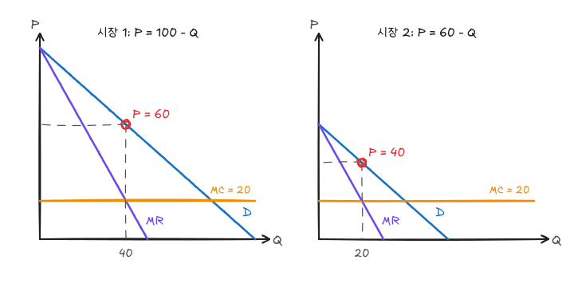

[독점](/posts/micro-monopoly-market-power)의 단일가격 전략($P = 100 - Q$, $MC = 20$)은 이윤 1,600을 남기고 소비자잉여 800과 자중손실 800을 남긴다. 이 글은 시장지배력을 가진 기업이 남은 잉여를 이윤으로 가져오는 방법을 다룬다.

## 1. 1급 가격차별 (완전 가격차별)

각 소비자에게 그의 **유보가격**(최대 지불의사)을 받는다. 추가 판매가 기존 판매가격을 낮추지 않으므로 $MR$ 곡선이 수요곡선과 같아진다.

- 생산량: $P = MC$인 $Q = 80$ (경쟁과 같음)
- 이윤: 수요곡선과 MC 사이 전체 면적 $= \frac12 \times 80 \times 80 = 3{,}200$
- 소비자잉여 0, 자중손실 0

효율적이지만 잉여가 모두 기업에 간다. 실제로는 유보가격을 정확히 알 수 없어 불완전한 1급 가격차별(의사·변호사의 소득별 요금, 자동차 딜러의 흥정, 대학의 장학금)이 나타난다.

## 2. 2급 가격차별

같은 재화의 **구매량**에 따라 다른 가격을 받는다. 수량할인, 구간별 요금(전기 요금 누진제의 역방향)이 대표적이다.

예제 수요에서 첫 40단위를 60에, 다음 20단위를 40에 판다고 하면

$$
\pi = (60 - 20)\times 40 + (40 - 20)\times 20 = 1{,}600 + 400 = 2{,}000
$$

단일가격보다 이윤이 크고 거래량도 60으로 늘어 자중손실이 줄어든다. 구간을 더 잘게 나눌수록 1급 가격차별에 가까워진다.

## 3. 3급 가격차별

소비자를 관찰 가능한 특성(학생, 노인, 지역)으로 집단으로 나누고 집단별로 다른 가격을 받는다. 이윤극대화 조건은

$$
MR_1 = MR_2 = MC
$$

$MR_1 > MR_2$이면 시장 2에서 시장 1로 판매를 옮겨 수입을 늘릴 수 있기 때문이다. $MR_i = P_i(1 + 1/E_i)$를 대입하면

$$
\frac{P_1}{P_2} = \frac{1 + 1/E_2}{1 + 1/E_1}
$$

로, **덜 탄력적인 집단에 높은 가격**을 매긴다.

### 예제

| | 시장 1 | 시장 2 |
|---|---|---|
| 수요 | $P_1 = 100 - Q_1$ | $P_2 = 60 - Q_2$ |
| 한계수입 | $100 - 2Q_1$ | $60 - 2Q_2$ |
| $MR = 20$ | $Q_1 = 40$ | $Q_2 = 20$ |
| 가격 | $P_1 = 60$ | $P_2 = 40$ |
| 탄력성 | $-60/40 = -1.5$ | $-40/20 = -2$ |
| 이윤 | $40 \times 40 = 1{,}600$ | $20 \times 20 = 400$ |

검산: $P_1/P_2 = 60/40 = 1.5$, $(1 - 1/2)/(1 - 1/1.5) = 0.5/0.333 = 1.5$.

**단일가격과 비교**: 두 시장을 합친 수요는 $P \le 60$ 구간에서 $Q = 160 - 2P$, 즉 $P = 80 - Q/2$이다. $MR = 80 - Q = 20$에서 $Q = 60$, $P = 50$이며 이윤은 $(50 - 20) \times 60 = 1{,}800$이다. 가격차별 이윤 2,000이 더 크다.

이 예제처럼 수요가 선형이고 두 시장 모두 판매가 이루어지면 총판매량은 같다(60). 이 경우 가격차별은 총잉여를 줄인다. 반대로 단일가격에서는 아예 팔지 않던 시장이 가격차별로 열리면 총잉여가 늘 수 있다.

가격차별이 가능하려면 (1) 시장지배력, (2) 집단 구분 가능, (3) **재판매 차단**이 필요하다.

## 4. 시점 간 가격차별과 최대부하 가격설정

**시점 간 가격차별**: 수요가 비탄력적인 고객(먼저 사고 싶은 사람)에게 출시 초기 높은 가격을 받고, 시간이 지나 탄력적인 고객에게 낮은 가격을 받는다. 신작 하드커버와 문고판, 영화 개봉과 이후 스트리밍이 예다.

**최대부하 가격설정**: 수요가 몰리는 시간대에 높은 가격을 받는다. 전기요금 시간대별 요금, 성수기 항공권이 예다. 시간대별 수요가 서로 독립이고 성수기 MC가 높으므로 각 시간대에서 $MR = MC$를 따로 맞춘다. 가격차별과 달리 이는 효율성을 높인다(가격이 MC에 가까워짐).

## 5. 이부가격제

입장료(가입비) $T$와 사용료 $P$를 함께 받는다. 놀이공원, 통신 기본료, 회원제 창고형 할인점이 예다.

**동일한 소비자**만 있다면 사용료를 $P = MC$로 두고 입장료로 소비자잉여 전체를 받는 것이 최적이다. 예제에서 각 소비자 수요가 $P = 100 - Q$라면

$$
P = 20,\quad Q = 80,\quad T = \tfrac12 \times 80 \times 80 = 3{,}200
$$

로 1급 가격차별과 같은 이윤을 얻는다.

**수요가 다른 두 소비자**(수요 $P = 100 - Q$, $P = 60 - Q$)라면 입장료는 작은 소비자의 잉여를 넘을 수 없다. 사용료를 MC보다 약간 높이면 큰 소비자에게서 더 많은 이윤을 얻는다. 

| 사용료 $P$ | 입장료 $T$ (소비자 2 잉여) | 사용 이윤 $(P - 20)(Q_1 + Q_2)$ | 총이윤 |
|---|---|---|---|
| 20 | $\frac12(40)^2 = 800$ | 0 | 1,600 |
| 30 | $\frac12(30)^2 = 450$ | $10 \times 100 = 1{,}000$ | 1,900 |
| 40 | $\frac12(20)^2 = 200$ | $20 \times 80 = 1{,}600$ | 2,000 |
| 50 | $\frac12(10)^2 = 50$ | $30 \times 60 = 1{,}800$ | 1,900 |

입장료는 두 소비자 모두에게 받으므로 총이윤 $= 2T + (P - 20)(Q_1 + Q_2)$다. 이 예제에서는 사용료 40이 최적이며 $MC$보다 높다. 소비자가 다양할수록 최적 사용료는 MC보다 높아지고 입장료는 작아진다.

## 6. 묶어팔기

두 재화를 묶어 하나의 가격에 판다. **유보가격의 음의 상관**이 있을 때 이익이다.

| 소비자 | 재화 A 유보가격 | 재화 B 유보가격 | 합계 |
|---|---|---|---|
| 1 | 12,000 | 3,000 | 15,000 |
| 2 | 10,000 | 4,000 | 14,000 |

MC = 0이라 하자.

- 따로 판매: A를 10,000에, B를 3,000에 팔면 수입 $2 \times 10{,}000 + 2 \times 3{,}000 = 26{,}000$
- 묶어 판매: 14,000에 팔면 $2 \times 14{,}000 = 28{,}000$

A를 더 원하는 사람이 B를 덜 원하므로 합계의 차이가 작아져(15,000 vs 14,000) 묶음 가격으로 더 많은 잉여를 가져올 수 있다. 유보가격이 양의 상관이면 묶어팔기 이득이 없다.

**혼합 묶어팔기**는 묶음과 개별 상품을 함께 판다. 어떤 소비자의 한 재화 유보가격이 MC보다 낮을 때 순수 묶어팔기보다 유리하다. **끼워팔기**는 한 상품 구매에 다른 상품 구매를 조건으로 거는 방식이다(프린터와 전용 잉크).

## 7. 광고

광고 지출 $A$가 수요를 늘리면 이윤 $\pi = P\,Q(P, A) - C(Q) - A$를 극대화하는 조건은

$$
\frac{A}{PQ} = -\frac{E_A}{E_P}
$$

이다. $E_A$는 수요의 광고탄력성이다. **매출 대비 광고비 비율은 광고탄력성/가격탄력성(절댓값)**이다. 예를 들어 $E_A = 0.1$, $E_P = -4$이면 매출의 2.5%를 광고에 쓴다. 가격탄력성이 작은(차별화된) 상품, 광고탄력성이 큰 상품일수록 광고비 비중이 높다.

## 정리

| 전략 | 조건 | 예제 이윤 |
|---|---|---|
| 단일가격 | $MR = MC$ | 1,600 |
| 1급 가격차별 | $P = MC$까지, 유보가격 징수 | 3,200 |
| 2급 가격차별 (2구간) | 60 / 40 | 2,000 |
| 3급 가격차별 | $MR_1 = MR_2 = MC$ | 2,000 (단일가격 1,800) |
| 이부가격제 (동질적) | $P = MC$, $T = CS$ | 3,200 |
| 이부가격제 (이질적) | $P > MC$ | 2,000 |
| 광고 | $A/PQ = -E_A/E_P$ | |
