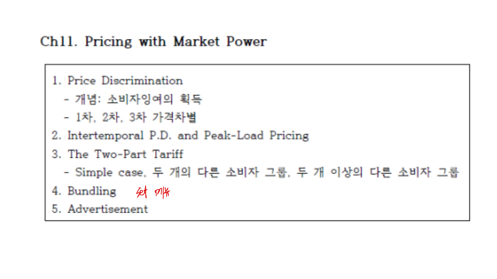
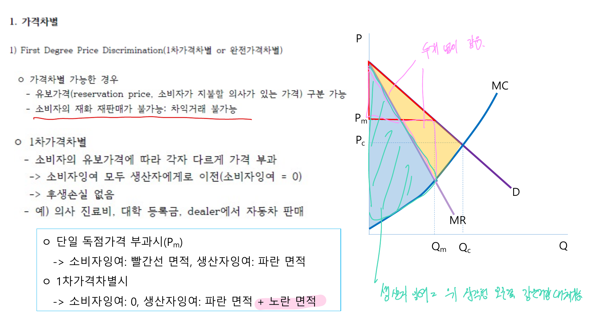

시장지배력을 가진 기업은 단일가격만 선택하지 않는다. 소비자별 지불의사, 구매량, 시간대, 상품 조합에 따라 가격을 다르게 설정해 더 많은 잉여를 흡수할 수 있다.

## 1. 가격차별의 기본 아이디어

단일 독점가격에서는 가격보다 지불의사가 높은 소비자에게서만 판매하고, 가격보다 낮은 지불의사를 가진 소비자는 배제된다. 그러나 어떤 소비자는 더 높은 가격도 낼 의사가 있고, 어떤 소비자는 조금 낮은 가격이면 구매할 수 있다.

가격차별은 이런 차이를 이용해 소비자잉여 일부를 생산자잉여로 전환하는 전략이다.

 

 

가격차별이 가능하려면 세 조건이 필요하다.

- 기업이 시장지배력을 가져야 한다.
- 소비자 또는 시장을 구분할 수 있어야 한다.
- 저가로 산 소비자가 고가 시장에 되파는 차익거래가 어려워야 한다.

## 2. 1급 가격차별

1급 가격차별은 각 소비자의 지불의사를 정확히 알고 각 단위마다 최대 지불의사를 가격으로 부과하는 경우다.

완전한 1급 가격차별이 가능하면 모든 소비자잉여가 생산자에게 이전된다. 또한 생산량은 경쟁균형 수준까지 늘어날 수 있어 사중손실이 사라진다.

현실에서는 소비자의 정확한 지불의사를 알기 어렵기 때문에 완전한 1급 가격차별은 드물다.

## 3. 2급 가격차별

2급 가격차별은 소비자 특성을 직접 알지 못하지만 구매량이나 상품 패키지에 따라 다른 단가를 적용하는 방식이다.

대표적인 예는 수량할인이다.

- 많이 구매할수록 단가를 낮춤
- 기본요금과 사용량 요금을 결합
- 품질이나 옵션을 나누어 자기선택을 유도

소비자가 스스로 자신의 유형에 맞는 상품을 선택하게 만드는 것이 핵심이다.

## 4. 3급 가격차별

3급 가격차별은 소비자 집단별로 다른 가격을 부과하는 방식이다. 학생 할인, 지역별 가격, 시간대별 가격이 예다.

각 시장에서 이윤극대화 조건은 다음과 같다.

$$
MR_1 = MR_2 = MC
$$

탄력성이 작은 시장에는 더 높은 가격을, 탄력성이 큰 시장에는 더 낮은 가격을 부과한다.

$$
\frac{P_i - MC}{P_i} = -\frac{1}{E_i}
$$

따라서 $|E_i|$가 작을수록 가격-한계비용 마진은 커진다.

 

 

## 5. 이부가격제

이부가격제는 고정요금과 사용량 요금을 결합한 가격방식이다.

$$
T(q) = A + pq
$$

$A$는 가입비 또는 기본요금이고, $p$는 단위 사용요금이다. 놀이공원 입장료와 놀이기구 이용료, 헬스장 회원권과 사용료, 통신 기본요금이 예다.

소비자 유형이 같다면 단위가격을 한계비용에 가깝게 설정하고, 소비자잉여를 고정요금으로 회수하는 방식이 가능하다.

## 6. 묶음판매

묶음판매는 여러 상품을 함께 팔아 소비자별 지불의사 차이를 활용하는 전략이다.

- 순수 묶음판매: 묶음으로만 판매
- 혼합 묶음판매: 개별판매와 묶음판매를 함께 제공

소비자들이 상품별로 서로 다른 지불의사를 가질 때 묶음판매는 수요를 평탄화해 더 많은 이윤을 만들 수 있다.

## 7. 피크로드 가격설정

수요가 시간대별로 크게 달라지는 산업에서는 혼잡한 시간대에 더 높은 가격을 부과할 수 있다. 전기, 교통, 숙박, 통신 서비스가 대표적이다.

피크 시간대에는 설비 용량이 부족하므로 높은 가격을 부과해 수요를 조절하고, 비피크 시간대에는 낮은 가격으로 유휴 설비를 활용한다.

## 정리

시장지배력을 가진 기업은 소비자의 지불의사 차이를 이용해 가격전략을 설계한다. 1급 가격차별은 개인별 지불의사, 2급 가격차별은 구매량과 자기선택, 3급 가격차별은 집단별 탄력성 차이에 기반한다. 핵심 원리는 탄력성이 낮은 쪽에 높은 가격을 부과하는 것이다.
